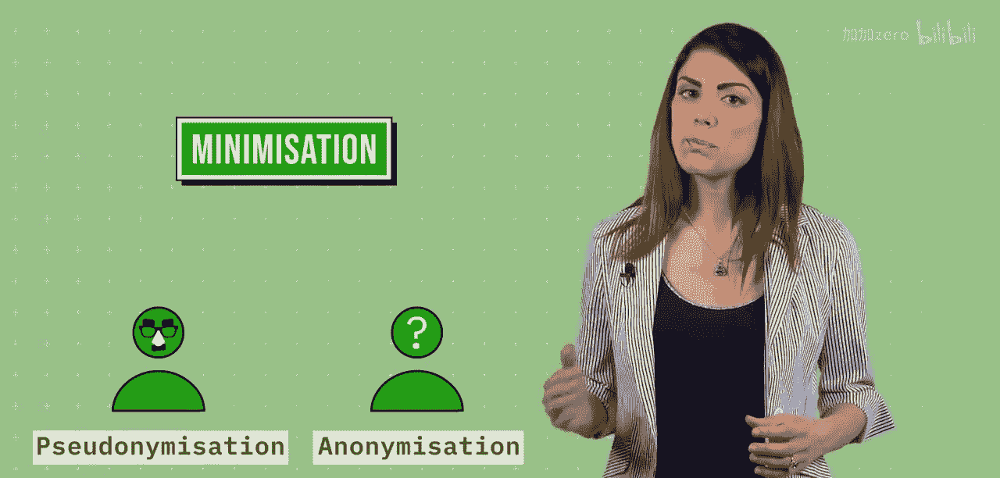
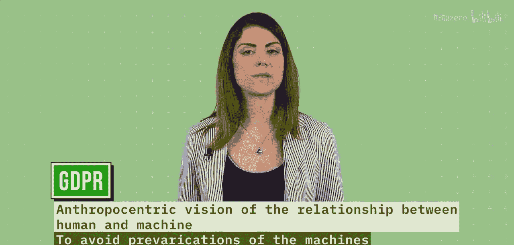

# 【人工智能：概述 专项课程】米兰理工大学—中英字幕 p50 p8_01_the-protection-of-privacy -BV1Er1PYhE9q_p50-

🎼。The use of AI today enables the collection and processing of data in volumes that would not have been imagined in the past。

There is a two way link between artificial intelligence on the one end and big data and the internet of things on the other。

 In fact， the huge amount of data generated by interconnected devices and systems requires the use of algorithms that are able to extract value from that to data。

Moreover， it is just this enormous availability of data that makes algorithms increasingly reliable and intelligent。

😊，Clearly， a relationship like this presents some risks in particular。

 there is the risk of such data， especially when they are qualified as personal data according to legislation being exploited in an illegal or indiscriminate manner For this reason。

 it is necessary to apply a legislation in order to regulate the processing of data carried out through such systems。

The legislation of reference in this area is the GDPR EU Reg 2016-679。

 whose provisions by deer two of the so called principle of technological neutrality must be applied regardless of the means and methods。

 by which the processing of personal data is carried out。

 therefore also with respect to processing are carried out through AI systems。

With particular reference to the latter， we should focus on the so called principles of privacy by design and privacy by the form。

Article 25 of the GDPR， in fact， establishes that the data controller， IE。

 the developers and operators of AI must ensure by design and by default fault in its systems。

 compliance with the provision of the processing of personal data。What does this exactly refers to？

In this area， the most important profiles are the purposes of the processing limitations to storage and the principle of data minimization。

With reference to ppos and storage， Article 5 of the GDPR expressly states that personal data shall be collected for specified。

 explicit and legitimate purposess and not further processed in a manner that is incompatible with dust purposess。

Moreover， they shall be kept for no longer than is necessary for the purposes for which the personal data are processed。

The principle of minimization， on the other end， requires that only data that are necessary in relation to the purposes for which they were collected should be processed。

It is therefore not too law for an AI system to collect and process data indiscriminately。However。

 the now widely available access to the IoT and its considerable capability to collect and process huge amounts of data could compromise compliance with these principles。

From the point of view of minimization， in fact， the main problem concerns the capability of AI systems to carry out a selection of the collected data in order to keep only those necessary for the performance of the service requested。

A good solution to make the processing less invasive is identified in the pseudonyymization and anonymization of the data。

In this way， not only must the data collected by the AI systems be only that which is necessary for that type of processing。

 but if possible， it must be collected in such a way as not to permit the identification of the data subject。

With regard to purpose and storage， on the other end。

 it is not only necessary for the user to be really aware that it is giving its data for specific purposes of using the system。

 but also for the IUT to be able to process the data collected。

 for the sole pursuit of data purposes。There is one last very important aspect we must underline。

The GDPR is based on an unpropocentric vision of the relationship between human and machine to avoid that there are prevaris of the machines on the humans and to guarantee that the last word always belongs to the latter。

For this reason， Article 22 of the GDPR prohibits so-called automated individual decision making processes。

 establishing that the data subject shall add the right not to be subject to a decision based solely on an automated processing which produces legal effects concerning I or error or similarly significantly affect I or error。

In other words， no artificial intelligence technology can be considered compliant with the GDPR without the data subject being guaranteed the right to obtain a human intervention to express their opinion and to contest the automated decision。

As it is evident， therefore with respect to the processing of data by AI systems。

 we are not without regulatory protection， we can consider that the GDPR may represent very adequate instrument to regulate the uncertainties in the processing of data by AI systems。

🎼However， due to the considerable complexity of the areas of life and IoT tools that may be involved。

 the correct pre of the principal sin will necessarily have to be carried out on a case by case basis。

 considering the peculiarities of each individual product that uses artificial intelligence techniques。

