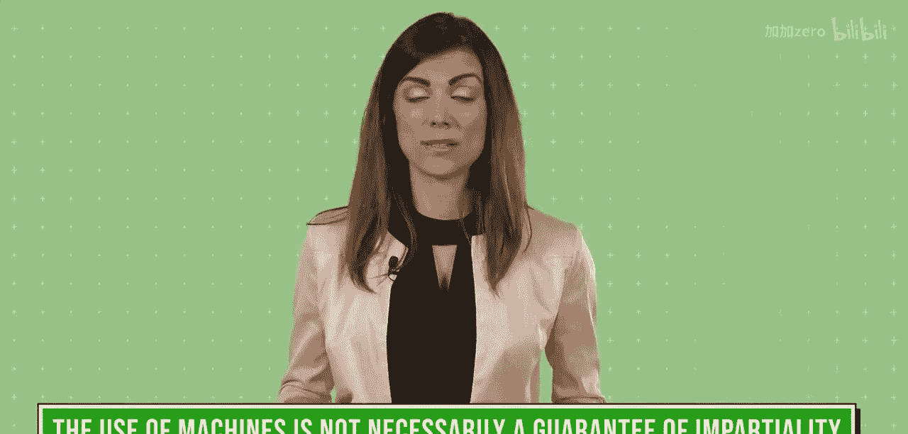
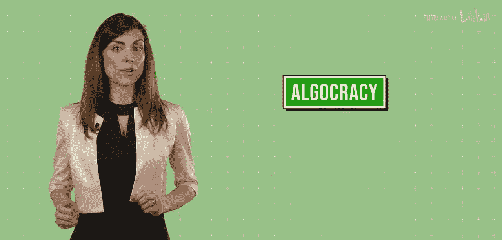
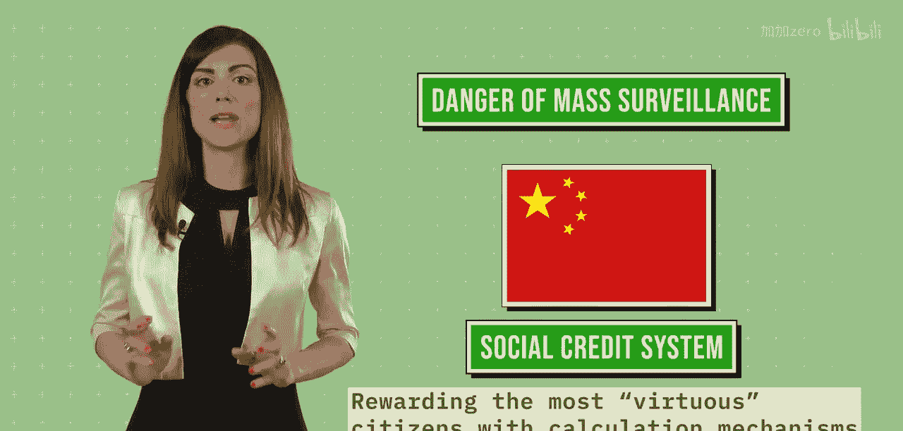
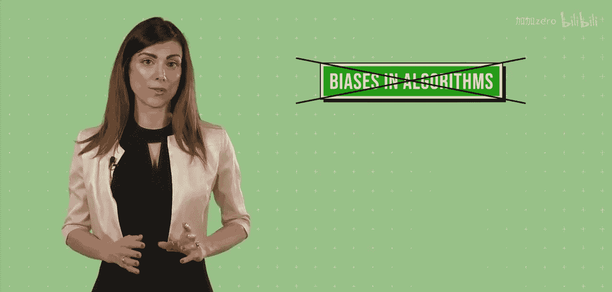

# 【人工智能：概述 专项课程】米兰理工大学—中英字幕 p51 p9_01_the-risks-of-algocracy-for-the-fundamental-freedoms-from-cambridge-analyti -BV1Er1PYhE9q_p51-

🎼。In the previous lesson， we saw the risks to confidentiality and privacy。

 which can arise from the pervasive SO AI technologies。In this lesson。

 we will see how the use of machines is not necessarily a guarantee of impartiality。In fact。

 we often add the perception that such systems are completely neutral with respect to the decisions we delegate to them。

 a machine seems to us completely free of prejudice when it makes its own decisions。

But is this really true， indeed AI systems are always developed on the basis of algorithms divided by men。

 and these algorithms also allow the machine to develop self learning mechanism based on information received from men。

In short， both in the creation and in the use of AI systems， human contribution is essential。

And it is in this context that what are known as algorithmic biases can occur。

 if not properly monitored， they can even lead to social discrimination。

Algorithmic biases and the influence of human cognitive biases。

 which are patterns of deviation of judgment， are some of the weaknesses of the use of intelligent systems。

 For example， in the field of facial recognition technologies。

 some studies have found an accuracy of about 99% in the case of light skinned men and only 35% in the case of dark skinned women。

This happens because worldwide， the AI algorithms underlyingline the recognition systems have been developed mainly with data from white or Asian men。

In this respect， the approach based on privacy by design。

 which we will also talk about in the next lesson in the development of intelligent technologies becomes fundamental to reduce as much as possible the risk that to the system called upon to provide the answer to certain questions。

 make use of potentially discriminatory parameters， as could be， for example， sex， race， religion。

 membership of political or trade union parties， state wealth and so on。But the algorithm。

 as well as being conditioned by men， can intercon in。

 it can affect the opinion of the individuals who are exposed to it thus causing a cognitive biases also for users in this sense。

 think of the case of Cambridge Analytica， which made a lot of headlines。

 a political consulting firm that exploited the personal data in its possession to influence the electoral choices of the data subject concerned。

These are situations of which the citizens are often not immediately aware。

 try to think of the so-called fake news in this sector if it's true that artificial intelligence can be a valid tool to prevent their diffusion。

 It is equally true that on the contrary， AI systems could be their vehicle。In fact。

 AI systems are designed in such a way as to profile their users selecting the information to be proposed to them and potentially influence their choices including political ones。

 and this selection could be independent of the truth of the news。

 but aimed only at associating the latter with the user's preferences。

This is the so called filter bubble the users receive only restricted the circle of news and information。

 those closest to their preferences。In this regard。

 someone talks about allgocracy to indicate a form of society based on the domination of algorithms and their decisions。

 stressing the risks deriving from the excessive personalization of the contents and informations。

 proposed to each user， to the point of limiting our full self-determination on our lives。

 on the use of our data， and in the final analysis on our choices。

 as well as on the anti-competitive risks， deriving from the concentration of economic power in the end of those were are able to implement and control。

 the most advanced algorithms。One of the most obvious dangers of ouroccray is what is referred to as mass surveillance。

 which can be expressed not only in the monitoring of the movement， but also of people's behavior。

 an emblematic case is that of China， which as instituted social credit system aimed at rewarding the most virtueuous citizens with calculation mechanisms。

 for example， because they have never had problems with the law， have no debts and so on。

In these cases， although a system may appear on the one end suitable to favor the virtuous behavior of citizens。

 on the other end， it can turn out to be a system capable of creating an unfair inequality of treatment between citizens。

 moreover， in such a context thequidpro quo in terms of privacy would be even more serious for citizens since the state risks becoming from the entity that protects them from abuses relating to the processing of their data。

 the entity that controls such data and determines its own policies on the basis of them。

From what we have said， it is clear that the biases inherent in algorithms can lead to the risk of erroneous or even discriminatory automated decisions。

In order to avoid this consequence， the solution to the biases is probably in their very cause。

 never renounce to intermediation of the human being。

This intermgtion， however， must take place at least two levels。At the legislative level。

 by lay down rules capable of really protecting individuals and providing a safeguard for their fundamental rights and freedoms。

😊，The law must value an anthropocentric vision in the relationship a human machine where technology is at the service of individuals and not vice versa。

At the operational level， imposing the constant supervision of the human being with respect to the decisions of AI systems in order to verify that they comply with shared ethical and legal principles。

🎼In this regard in the next lesson， we will talk about measures to design and develop intelligent systems compliant with the GDPR regulation。

