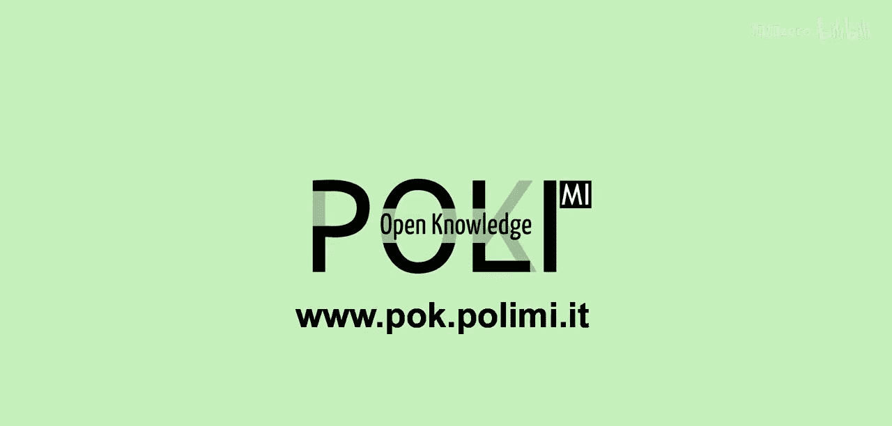

# 人工智能与法律合规：第10章：确保AI符合法律与隐私框架

在本节课中，我们将学习如何确保人工智能系统在处理个人数据时，符合以《通用数据保护条例》为核心的法律与隐私框架。我们将探讨GDPR的关键原则及其在欧盟最新AI法规提案中的体现，并了解实施合规的具体步骤。

---

上一节我们介绍了AI与大数据的关系。本节中，我们来看看GDPR为AI系统处理数据引入的核心合规措施。

GDPR首先强调的一项规定是 **“通过设计和默认方式保护隐私”** 的义务。具体而言，这意味着公司和组织在设计数据处理操作的最初阶段，就应实施技术和组织措施，从而从一开始就保障隐私和数据保护原则。默认情况下，应确保以最高隐私保护标准处理个人数据。

以下是“通过设计和默认方式保护隐私”的具体要求：
*   仅处理必要的数据。
*   设定较短的数据存储期限。
*   限制数据的可访问性，确保默认情况下个人数据不会被无限数量的人员访问。

这些原则同样体现在最新的AI法规提案中。该提案要求，对于高风险AI系统，应从设计阶段就采取措施，确保数据管理和处理是适当、安全且成比例的。

---

了解了设计阶段的隐私保护后，我们接下来探讨一个对AI系统运作方式有根本性影响的GDPR原则：**“免受自动化决策约束的权利”**。

该权利保护个人免受对其产生重大影响的、完全自动化的决策（包括用户画像）的约束。考虑到AI系统的决策过程通常是完全自动化且不涉及人工干预的，这一GDPR条款在实践中影响深远。遵守该条款意味着需要限制AI的自主决策能力，至少要为人工监督或干预保留空间。

---

除了限制自动化决策，GDPR还要求任何个人数据处理都必须辅以安全措施。这些措施必须基于风险评估来量身定制。

这意味着不存在普遍适用的标准或最低措施，安全措施必须根据技术发展水平不断更新。这一GDPR核心原则与上述“隐私设计”原则相辅相成，也被纳入了最新的AI法规提案。提案规定，必须为高风险AI系统建立、实施、记录和维护风险管理系统。

除了这种常规评估，GDPR还规定，当使用新技术的处理活动可能对个人权利和自由造成高风险时，必须进行一项特定的 **“数据保护影响评估”**。

DPIA的特殊性在于，如果评估结果显示处理活动存在高风险，则必须通知监管机构，并在该机构对评估的充分性及风险最小化措施提出意见之前，暂停处理活动。这对于经常与其他系统（包括第三方系统）交互、从而指数级增加数据意外泄露和丢失风险的AI系统而言尤为重要。

---

为了确保个人数据得到妥善保护，AI系统数据控制者采取的所有措施，也必须在整个供应链中得以实施。

为此，数据控制者应设定严格的合同条款和惩罚措施，以约束任何参与AI系统使用和数据处理的供应商，并确保对供应商实施的手段和安全措施进行控制，同时保留对供应商进行审计和检查的权利。

---

数据保护权还涉及GDPR规定的两个关键方面，AI法规提案中也提到了它们：**透明度和数据主体对其数据的控制权**。

这意味着必须以清晰易懂的方式让个人确切地知道谁、如何以及为何处理其个人数据。此外，在特定情况下（包括用户画像），如果未经数据主体事先同意，处理活动即不合法。数据主体必须被保证随时可以撤回同意。

透明度原则也意味着数据主体有权访问、更正并要求删除他人处理的自身数据。

---

最后，为尽可能保障数据主体的权利和自由，必须妥善管理 **数据泄露事件**。

根据GDPR，如果因控制者安全系统遭破坏或发生事故导致个人数据丢失、被篡改或被盗，应立即启动涉及所有数据处理供应商的内部调查，并采取任何措施以尽可能限制或消除相关损害。事实上，任何数据泄露都必须在知悉后的72小时内通知监管机构。

除非经评估认为数据泄露不太可能对个人的权利和自由造成风险。如果评估认为存在高风险，数据控制者还必须将数据泄露事件通知受影响的个人（数据主体）。

---

本节课中，我们一起学习了确保AI符合法律与隐私框架的关键步骤。我们探讨了“隐私设计”、限制自动化决策、实施安全措施与风险评估、进行数据保护影响评估、管理供应链合规、保障透明度与控制权，以及妥善应对数据泄露。理解并实施这些措施，对于开发和使用合法、合规且值得信赖的人工智能系统至关重要。