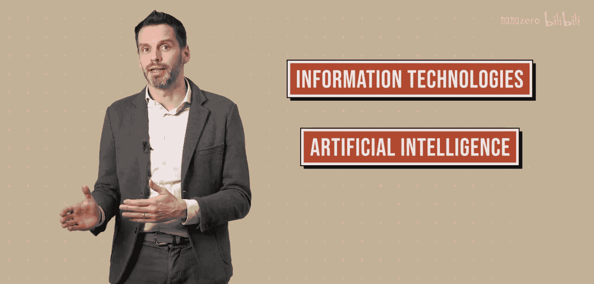
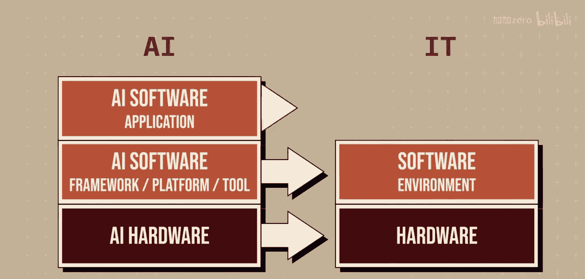
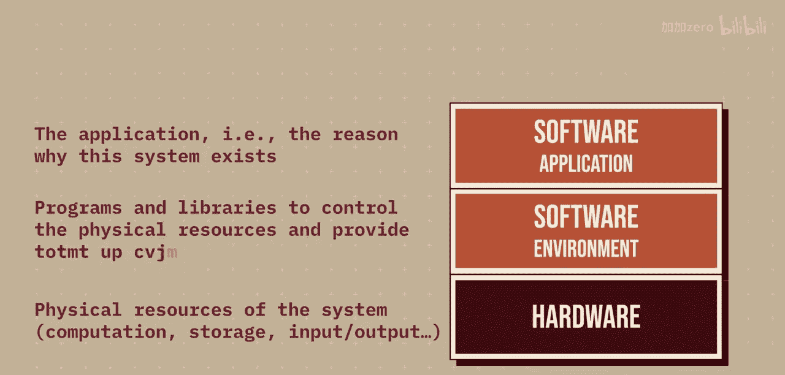
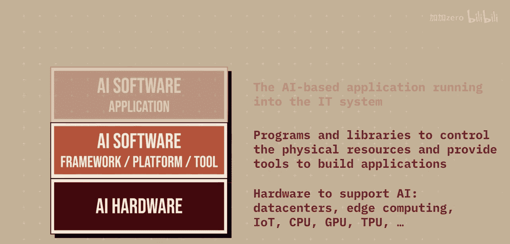

# 【人工智能：概述 专项课程】米兰理工大学—中英字幕 p53 p0_01_the-it-perspective-for-ai -BV1Er1PYhE9q_p53-

Welcome to the Moc on Techologies and platforms for artificial intelligence。

Information technologies and artificial intelligence， which is the relationship。

How can we use the IT perspective to describe and characterize the AI based systems？In this lecture。

 we will address these questions by exploring the strict and fruitful relationship that exists between information technologies and artificial intelligence。

But to achieve this goal， we need to take a step back and understand what artificial intelligence is。

 In 2018， the artificial intelligence observatory of the Potechnicco de Millano defined the artificial intelligence as the area of computer science that studies the development of hardware and software systems endowed with abilities typical of human beings。

Such systems are able to autonomously pursue a given purpose by making decision that until then were usually made by the human bankss。

Ardware and software systems endowed with abilities typical of human beings。 Hence。

 we have hardware and software。A based system comprise both levels。Being more precise。

 we could further distinguish software into software applications and software framework platform tool。

 From this perspective， we could say that an AI based system comprises the hardware。

 hence all the physical resources that are available。

 an AI application that is the reason why a system exist and an intermediate layer comprising frameworks。

 platforms and tools that lies between hardware and applications。

But what do these three levels remind us。These three levels remind us the typical IT architecture of a computing system comprising the hardware and the two layers of software environment。

 hence the operating system and the application。

In more detail， thanks to this IT perspective， we can define the hardware as all the physical resources that are available in a system。

 Exles of these resources are resources for competition。

 for the storage of data applications and for the networking。The softer application。

 that is the application that is running in the system and the softwareer environment that provides all the programs and libraries to control the physical resources。

 as well as the tools to build the applications。

Now， keeping in mind this perspective， we can go back to AI and understand how AI based systems are organized from the technological point of view。

In the lower layer， we have the AI hardware that comprises all the hardware resources meant to support the learning and inference of AI algorithms。

We will see that hardware resources range from large scale data centers to tiny I U T devices。

 hence differing sometimes of orders of magnitude in the computational ability。

 in the available memory and in the power consumption。

We will see that these other families that are characterized by very different technological constraints in terms of computation。

 memory and energy consumption will require specific AI techniques。In this layer。

 we can also find the hardware accelerator for AI， such as the GPU。

 TPU and FPGA being a groundbreaking revolution in the AI world。

We will see the importance ofard accelerators and how they operate in the upper layer。

 we have the AI application。 That is the reason why a system exists。 For example。

 we could have an AI based application running in a smart speaker to recognize a vocal command made by a user。

 or we could have an AI based application running in a smart car to detect the presence of a pedestrian。

Here， the limit of the possible AI applications is just the imagination of the AI developers。

In the middle， we can find the AI frameworks， platforms and tools。

 This layer comprises all the technological solutions。 For example。

 software libraries and tools that are meant to support an effective and efficient execution of the AI applications on the AI hardware。

The aim of this layer is twofold。 On one hand， this layer masks the complexity of the underlying hardware by providing an abstraction of hardware resources。

 On the other hand， it provides all the tools to help AI engineers and developers to easily design and develop AII B solutions。

😊，We will see that in this layer， we can find different ranges of technologies and solutions。

 For example， we can find here all the famous frameworks for machine and deep learning like Sha it。

 Tensorflow， Pyth and M Xnet。😊，But in this layer， we can also find all the software infrastructure that will support an effective and efficient development and running of AI applications。

 Like， for example， the cloud computing systems and the computing frameworks like Spark and Hadoop。😊。

What is the relationship between AI and cloud， the groundbreaking approach brought by machinery learning solutions in the cloud revealed to be the key factor to democratize AI。

 making it available to older the researchers and developers。

This is a particularly interesting point that will will be addressed in this MC by exploring the three computing levels supporting machine and deep learning in the cloud。

 infrastructure as a service， platforms as a service and solutions as a service。

Summing up in this mode， we will explore the hardware to support the learning and influence for machine ended deep learning。

 together with the AI frameworks， platforms and tools for an effective and efficient design and deployment of AI applications。

It is also important to define what is not the goal of this Moc。

 Our goal is not to set up a ranking of frameworks， platforms and tools。

 The reason why a ranking is out of scope of this MOoc is that day by day， new solutions。

 new technologies are available， each of which has its own features， pro and cons。In addition。

 advantages and disadvantages of a given solution strictly depend on the algorithm and the softer context in which the application is meant to operate。

 Like， for example， an AI application that is meant to be executed on the cloud on a smartphone or on a tiny I O T device。

That said， I'm very happy to welcome you to this MOOC on technologies and platforms for AI。😊。

Let's start。

