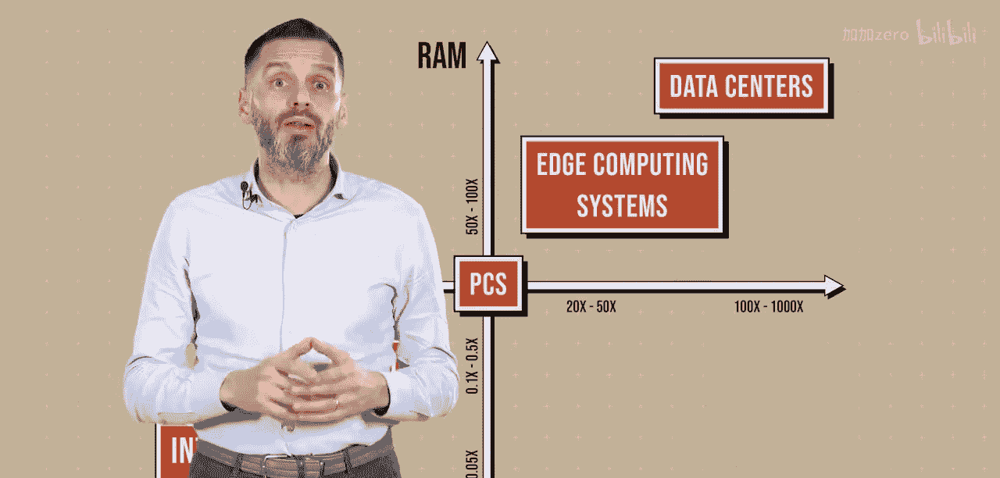

# 【人工智能：概述 专项课程】米兰理工大学—中英字幕 p54 p1_01_the-hardware-technologies-for-ai -BV1Er1PYhE9q_p54-

Hi， everyone。 In this lecture， we'll provide an overview of the hardware technologiesn for artificial intelligence and how they impact on AI applications。

😊，We saw that AI systems comprise the AIard layer， the intermediate AI software layer。

 including frameworks， platforms and tools for AI， and the layer running the AI application。

In this lecture we will detail the different families of hardware solutions for AI and we will see that these families will scale from the tiny IUT devices that are characterized by severe technological constraints on competition。

 memory and power consumption， up to the large scale data centers comprising multiple and high performance servers for competition。

 storage and networking。😊，So let's start now， which are the technological solutions where we can find AI applications in software。

 let's see some examples。In our homes， we have nowadays smart sensors that are able to measure the physical quantities and environmental quantities to control HB systems aiming at improving the comfort of people。

More and more often， we interact with online systems through virtual assistance that are able to recognize people's comments and execute actions on their behalf。

smart cars are nowadays moving from the labs to our roads。

Such novel generations of cars comprises several AI algorithms that are running in parallel directly on the car。

For example， to detect the presence of pedestrians or to recognize road signs。

Stock market predictions or personalized marketing suggestions are AI applications requiring a lot of computation and memory。

 and for three reasons， their execution is typically moved to the cloud or large scale data centers。

These are just examples of the wide range of hardware technologies for AI。

But they allow us to shed delight on the fact that AI could be executed everywhere。Hence。

 all the technological solutions that surround us might represent a viable technological asset for AI。

But in doing that， we must take into account the performance and technological constraints of each specific technological solution。

Indeed， tiny devices will be able to support the execution of simple AI algorithms。

 more powerful technological solutions will be able to support more complex and more effective AI algorithms。

😊，We will show that the most promising point of view is not to see this unit has a single or independent devices。

 but we will see that the technology is moving towards an ecosystem of units。

Each of which takes part in the AI competition。So let's make a step ahead and try to formalize the available hardware technologies for AI。

😊，We can summarize the available hardware technologies for AI into five main families。Data centers。

 edge computing systems， personal computers， embedded personal computers， internet to Things devices。

Let's start our analysis with the first family that the centers。

They represented the most powerful and most performing technological solutions since they comprise large scale high performing servers for competition。

 storage and networking。From this perspective， data center represented the reference technological solutions for the cloud computing party。

This is a crucial point because the interplay between data centers and cloud computing plays a crucial role in the socal called AI as a service approach by providing machine learning solutions as a service。

 machine learning platform as a service and machine learning infrastructure as a service。

 we will see these approaches in detail in the next lectures。😊。

The second family is edge computing systems。 They represent the novel player on the field。

Adure computinguting aims at moving the cloud to the ground by providing computation and storage to process data close to where data required。

This is， for example， the technological scenario of smart cars or smart manufacturing in industry 4。

0， where data are acquired at high frequency and where such data must be processed locally and quickly to provide effective and efficient reactions。

 like， for example， slowing down a car or the technical production problem。Going on。

 we find the third family， personal computers。This is the technological solution that is closer and more familiar to us。

In our personal computers， we have intelligent algorithms for detecting spam emails。

 as well as many more algorithms that aim at supporting users and business。

The recent heres show the importance of the fourth family of Ago technologiesn。

 embedded personal computers that are able to purposely operate in the environment such as mobile devices。

 Ozmar speakers。This family of technological solutions is becoming more and more important。

 since they often provide the interplay between users and cloud based computing systems。Hence。

 AI can run directly on the device， or the device is devoted to acquiring data through microphones。

 cameras or axelerometerters just to name a few， while the AA processing is carried out on the cloud。

Finally， internaln of Things devices are the last family of hardware technologies and represent the tiny pervasive devices operating pervasively in the environment。

Often， these devices are battery powered and the computation is carried out by means of microcontrollers。

In addition， severe constraints on the available memory and flash memory significantly affect the running AI applications。

Despite the constraints， IoT represents a very promising technological solutions for distributing intelligence and supporting this so called it intelligent everywhere computing。

In the next lectures， we will analyze these technological families in detail by describing characteristics and the referensic applications。

 advantages and disadvantages。😊，Furthermore， we will see that the technological evolution comprises not only these families of technologies。

 but also specific hardware devices meant to accelerated the execution of AI algorithms。

🎼That said， we have in front of us a very interesting journey embracing technologies and artificial intelligence。

😊。