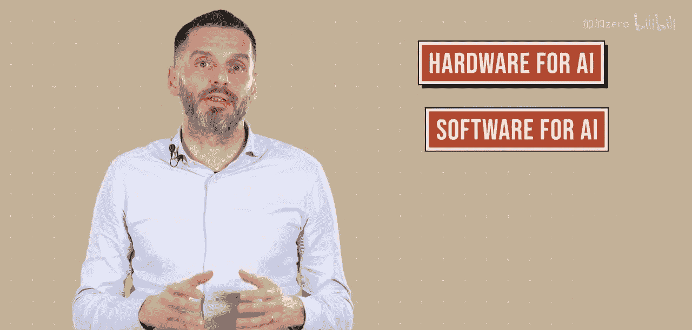
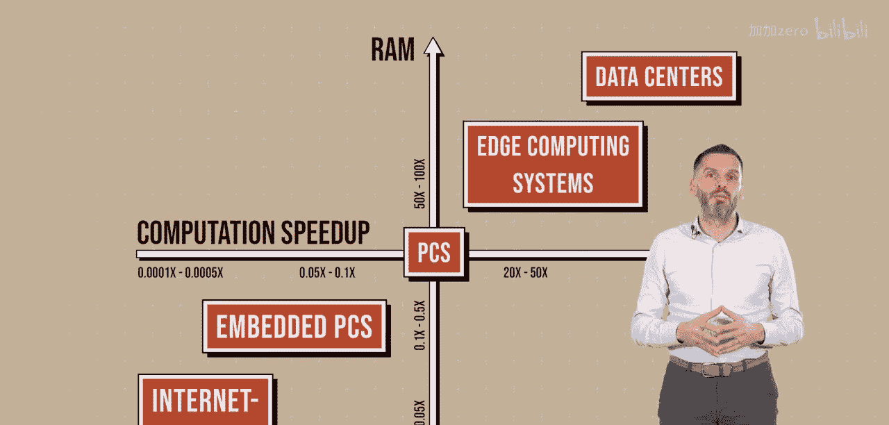
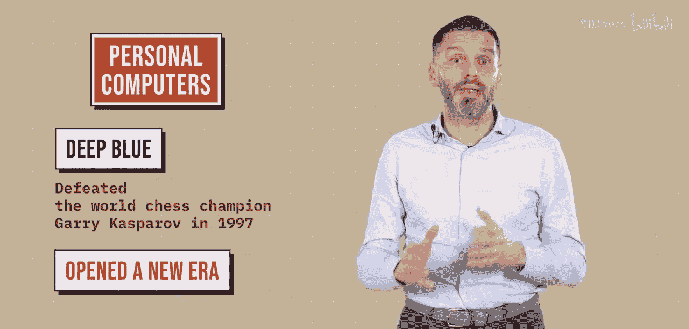
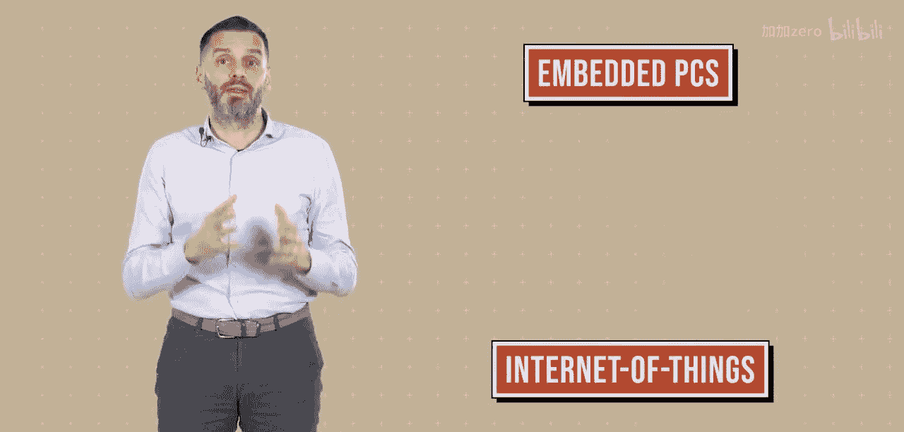
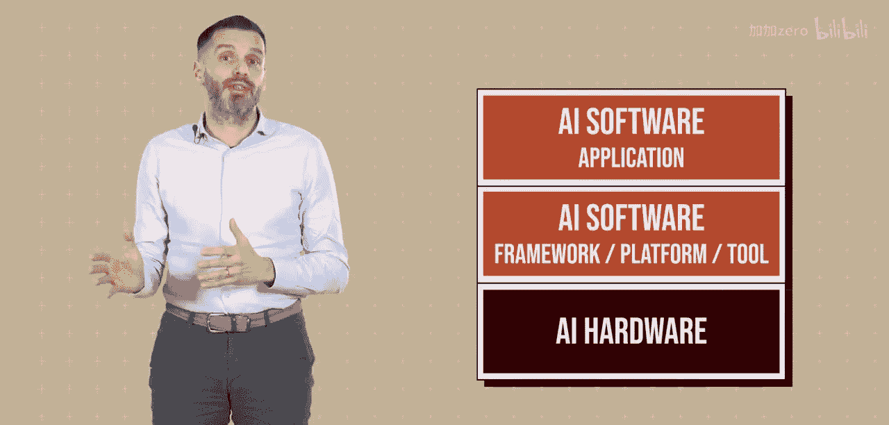
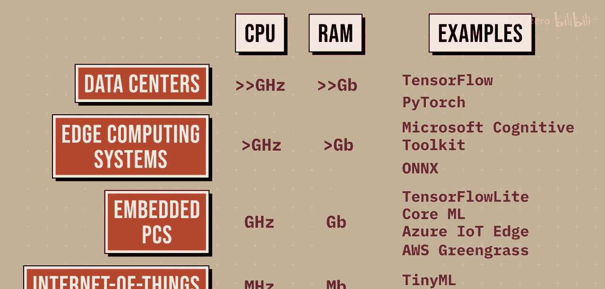
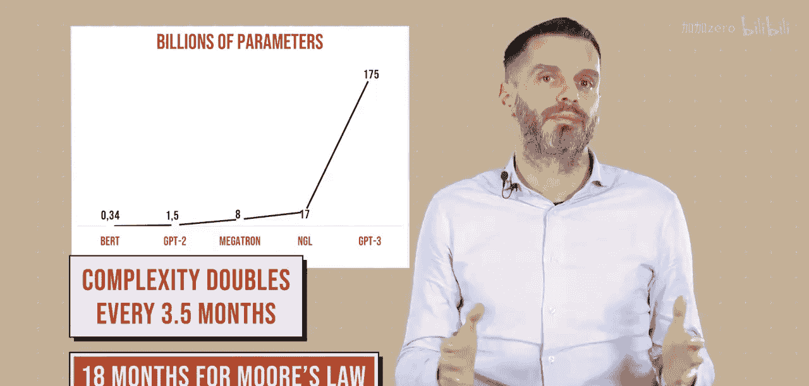
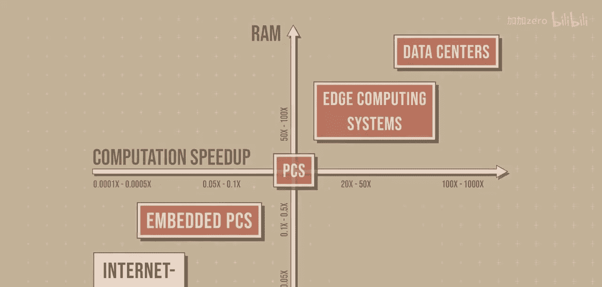

# 【人工智能：概述 专项课程】米兰理工大学—中英字幕 p55 p2_02_technological-evolution-and-ai-revolution -BV1Er1PYhE9q_p55-

Hi， and welcome back。In this lecture， we will highlight the importance of the interplay between hardware and software for effective and efficient AI applications。

From the AI perspective， hardware and software are two sides of the same coin。

We started analyzing this interplay by looking at the range of different technological solutions for AI。

 comprising intent of things， embedded PC， personal computer，ed systems， and data centers。

These technological solutions are nowadays part of our computing ecosystems and explicitly or implicitly they are always part of the game。

But what about AI。How crucial are these technologies in the AI revolution？Let's see some examples。

That the centers always played a crucial role in AI， and in particular。

 in the training and influence of very large neural networks。

 thanks to the very eye computing and memory abilities。For example。

 data centers allow it to train Watson， the IBN systems that won Geardy TV game show in 2011。

 or Alphago， the software that beat in 2016， the number one go player in the world， or U Libbratos。

 the I thats defeated in 2017 for TexL All them worldstop players。But let's move to 2020。

 where the largest and more complex neural network ever designed has been presented。

This neural network called GT3 is meant for natural language processing and comprises 175 billion parameters。

Here， data the centers played a crucial role in the training of GPT3。

 since its training on regular computers would have required several hundreds of years。

Edduate between systems represent the technological solutions for autonomous vehicles and autonomous robots。

 just to name a few， while there is one interesting anecote to tell about personal computers。

We all know about Deep Blue， the computer that defeated the world chess champion Gary Kasprorov in 1997。

This amazing news opened a new era in the relationship between AI and humans。

Interestingly， the computational and memory abilities of the blue are in line with what we have today in our personal computers。

😊，And last but not least， embedded personal computers and IoT systems being able to purposeversely operate in the environment provided technological infrastructure for a smart home and building。

 smart cities and Y just to name a few。😊。

Intelligent objects and smart speakers are relevant examples in the field。

We mentioned the interplay between hardware and software。

But how can we deal with such a large technological ettegeneity in the available hardware solutions？

We are moving from tiny battery powered objects to large scale data centers。

How can the intermediate AI software layer comprising frameworks。

 platforms and tools operate in such a wide range of hardware technologies？

The answer is a simple and complex at the same time。

The easy one is that we have different solutions depending on the target reference hardware。

The complex one is that the choice of the software to use strictly depends on the hardware。

 hence requiring a hardware software co designign of the AI system。Let's see some examples。

In data centers and edge computing systems， we have enough computational and memorability to consider all the most powerful versions of the shelf AI frameworks。

 platforms and tools。😊，Examples of these AI software solutions are the well known Tensorflow。

 Pythtorch， Microsoft Cognitic toolkit， and ONNX。Typically。

 these solutions provide both the inference and training functionality for machine and deploy learning solutions。

Embded PC being less powerful than data centers and edge computing systems rely on simplified version of AI software solutions。

Tensor light， Corml， Azura UT Edge， and AWS greengrass are examples of frameworks， platforms。

 and tools for embedded personal computers。Differently from what is available for data centers and edge computing。

 the AI solutions for embedded personal computers often provide only the inferenceability for machine and deploy learning models。

 while the training of such models is generally carried out on more powerful computing units。Finally。

 IUT units require specifically designed AI solutions because the AI severity constrained on computation。

 memory， and power consumption。For this purpose， approximated and quantized versions of AI frameworks。

 platforms， and tools must be considered such as TNML and STN32 cubeube。AI。

As we explored， the technological evolution of AI hardware made giant steps to support more and more complex neural networks and models。

Unfortunately， the algorithmic evolution is going faster。😊，For example， the recently introduced GPT3。

 as we already saw， is the largest network ever developed and trained with more than 175 billion parameters。

😊，As you can see， this trend is steadily growing and the complexity of such neural networks doubles every three months and a half。

The only reference we have for the hardware technological evolution is the Moore slow that estimates the doubling of hardware performance every 18 months。

😊，The gap between the algorithm and the technological evolution is huge。 How can we deal with this。

The answer resides in considering additional hardware specifically designed for AI。

And thanks to this specialized art we're able to parallelize the code and rely on hardware accelerated operations。

 we can boost the performance of machine and deep learning solutions by reducing the inference and training time。

Graphics processing units， the GPU， tensor processing units， the GPU。

 and the field programmal gateator array， the FPGA are examples of theseardor accelerators for AI。

It is worth mentioning that due to their complexity and power consumption。

 these hardware accelerators are typically present in data centers and edge computing systems。

Seldom we can find them in embedded PCs while IUT units are not considered a viable technological solutions for hardware accelerators。

That said， let's start exploring the technological families for AI。

