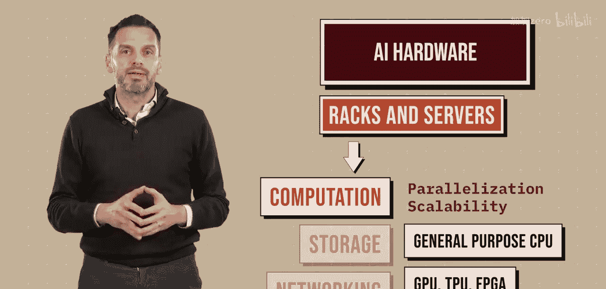
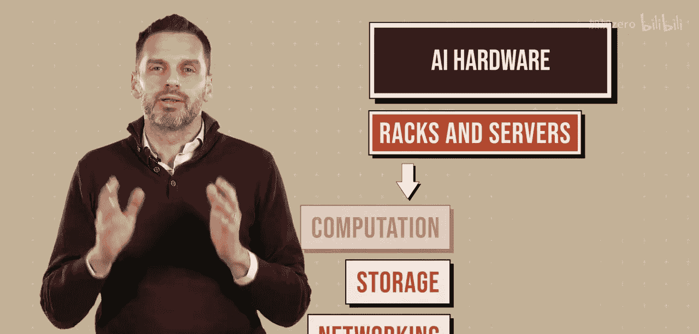
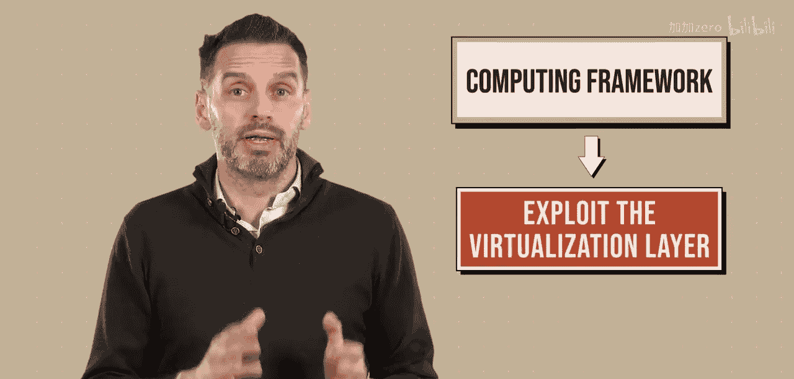
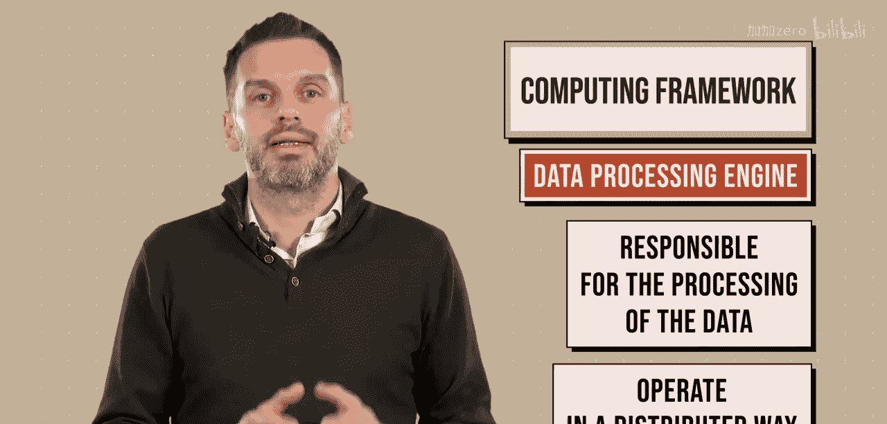
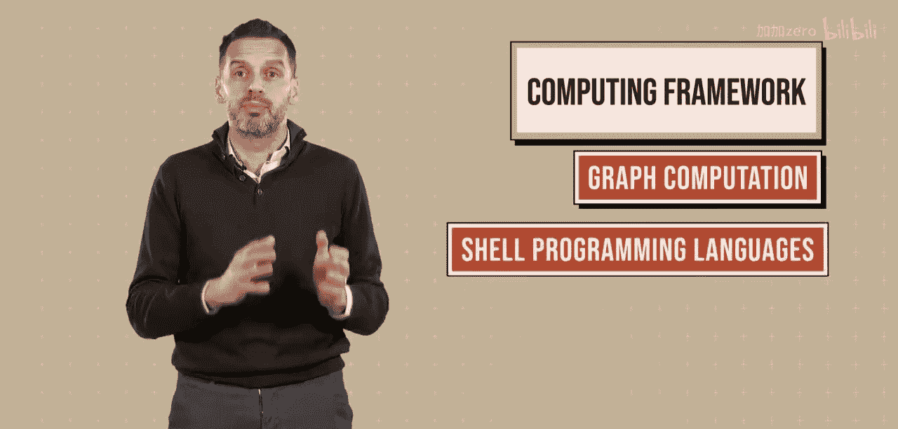
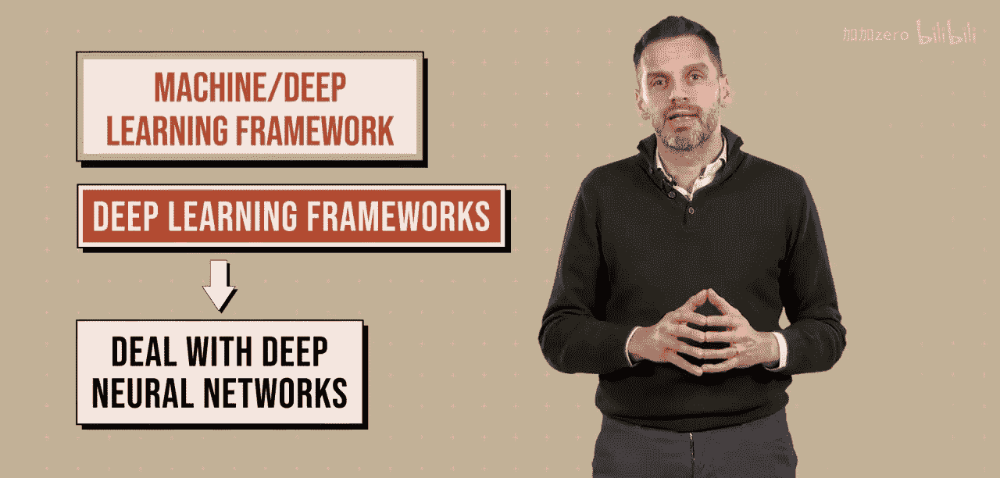
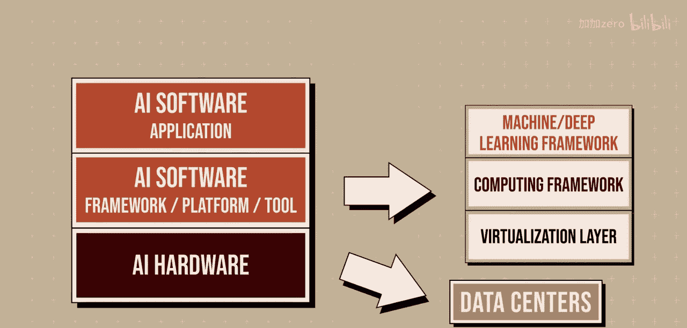

# 【人工智能：概述 专项课程】米兰理工大学—中英字幕 p56 p3_01_the-it-architecture-for-ai-on-cloud -BV1Er1PYhE9q_p56-

In this video we will address the following question。

 how can we design our intelligence system when the hardware layer is a data center， in other words。

 how can the presence and availability of such a large scale and high performing computing infrastructure affect the design and development of the software layer and theI application？

From the hardware point of view， data centers comprise Res and servers for competition。

 for storage and for networking。Pnelization and scalability are crucial abilities to support the learning and influence of machine and deep learning solutions here。

 high performing CPUs as well as hardware accelerators， for instance， GPU。

 GPU and FPGA are relevant technological assets。

In addition to computation， high performing storage and networking solutions such as networked attached St or St I network are crucial to overcome one of the main bottlenecks in the training of large neural networks。

 which is the need to move large quantities of training data。

In a data center， the middle software layer comprises three different models。

 the virtualization layer， the computing framework。

The machine and the learning framework。Let's start analyzing the first one， the virtualization layer。

Its aim is to virtualize the computing， storage， and networking resources present in the data center。

Disability is crucial to support the cloud computing party。

 where hardware resources are made available in an online and on demand manner to users。

Thisability is also crucial to support the as a service approach in machine and deep learning。

 where vehicle computing units are activated in an on demandmand manner to manage machine and deep learning requests made by users。

Virualization is provided by means of virtual machines or containers。

 and scalability is guaranteed by adding virtual resources for computation。

 storage and networking exactly when needed， and by removing them when they are no longer required。

In addition， thanks to these virtualization mechanisms。

 AI developers can design specific software environments endowed with AI toolbox and frameworks。

 as well as AI applications。Examples of tools for this virtualization layer are VMware， C， KVM， Ix。

 and Kubernetes。

Let's move on to the second model， the computing framework。

Computing framework is a softer layer able to exploit the virtualization layer to support effective and efficient computation in a large scale data center。

 Exles of computing frameworks are Hadoop， Spark and Flink。😊。

Interestingly， computing frameworks available of the shelf differ in the employed technologies and provided functionalities。

 but we could generalize data architectures into five main models， cluster manager。

 data processing engine， data storage， graph computation， and shells for programming languages。

The cluster manager is the lowest layer interacting directly with the virtualization layer to manage the allocation and coordination of the processing that is distributed on different computing units。

 either virtualized or physical， the cluster manager typically relies on a scheduler。

 which is a software management model close to what we have in our operating system to coordinate the processing。

 running in personal computers。Examples of this scheduler arepaashmezes and Haddu Pirne。

The data processing engine is the software model responsible for the processing of the data。

This engine is designed to operate in a distributed way by allocating， for example。

 the computation on a set of computing resources made available by the cluster manager and by integrating the results if needed。

For instance， when we need to compute the mean value of the large scale data set。

 we could parallelize the processing by allocating the computation on different workers。

 each of which operates on a subset of the data set。

 and the data processing engine finally aggregates the computing mean values to provide the overall mean value of the large scale data set。

Examples of the data processing engine are Spark and Mareduce。

An effective and efficient storage of data is crucial to speed up both the training and the inference of machine and in particular。

 deep learninging solutions。Examples of data storage solutions for computing frameworks are HDFS。

 HBase， Amazon S3， Cassandra， MongoDb， and Spark SQL。

These solutions are typically strictly integrated with the cluster manager and the data processing engine。

In addition， computing frameworks provide adoc tools for the processing of specific data structures such as graphraph。

 as well as support shells for high level programming languages such as Python， Java， Scala， or R。

After the analysis of the virtualization layer and the computing framework。

 let's finally see machine and learning frameworks。

 which aim at providing machine and deep learning solutions and algorithms for the AI application。

In particular， machine learning frameworks provide AI methods for classification， regression。

 clustering， anomaly detection， as well as solutions for data wrangling and data preparation。

These frameworks may or may not include neural network algorithms。Differently。

 deep learning frameworks are specifically designed to deal with deep neural networks that are specific types of neural networks characterized by a large number of hidden layers。

Machine and deep learning frameworks can operate either on top of computing frameworks or as a standalone solutions。

 Exles of machine learning frameworks operating on top of computing frameworks are Spark MLLlib。

 big DL and Mahot， While Tensorflows Sp deep learning for J and big DL are examples of deep learning frameworks operating on top of computing frameworks。

Differently， examples of standalone， machine learning and data processing frameworks are ShiicicL。

 Torch， panndas， Numpy， Maclibb， while deep learning frameworks meant to operate in a standalone manner are TensorFlow。

 Cafe MXnett， Kas， To， Microsoft C， NTK， and Pytorch。Interestingly。

 deep learning frameworks are typically able to exploit hardware accelerators such as GPUs。

 TUs and FPGs， while standalone solutions are typically organized into shelvess and libraries。

Summarizing when the AI hardware layer refers to data centers。

 the intermediateitent AI software layer comprises the virtualization layer， computing framework。

 and machine and deep learning framework。Finally， the upper AI application layer refers to machine and deploying as a service。

Such a no technological paradigming will be explored in the next video， stay tuned。

