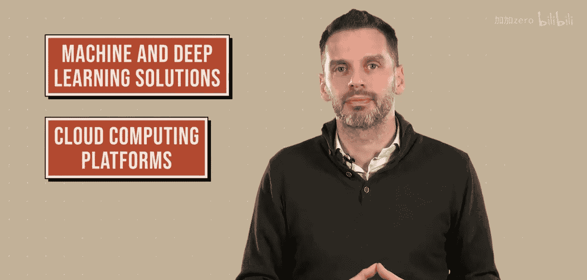
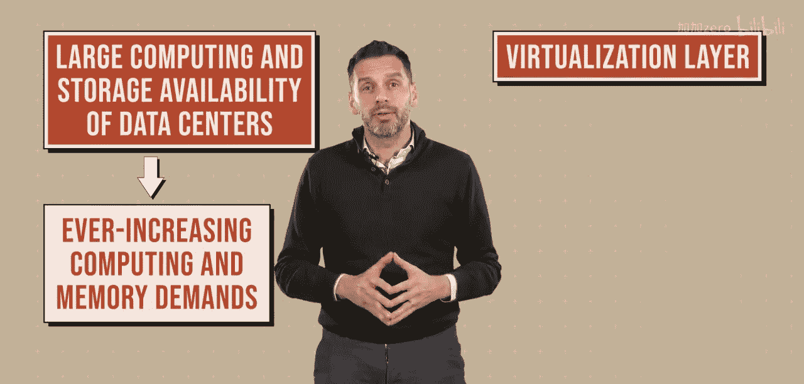
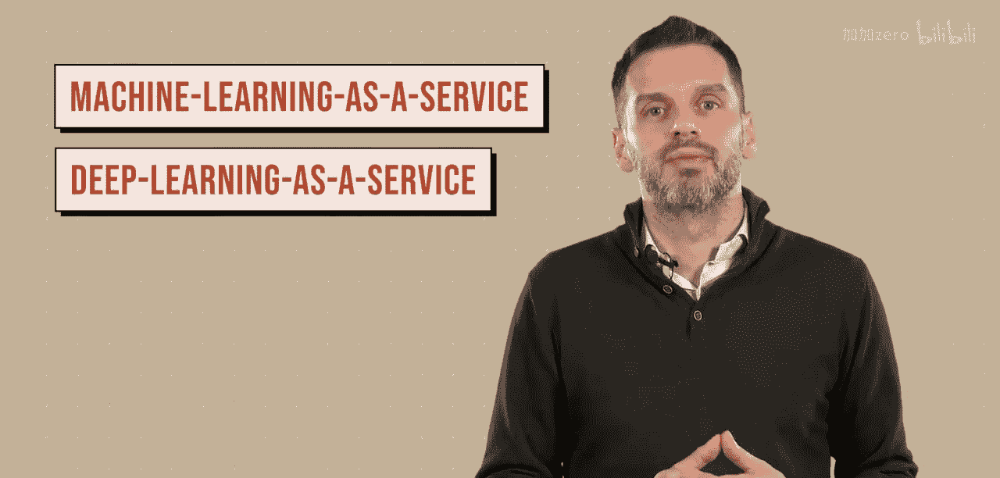
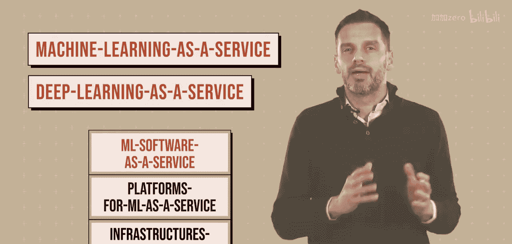

# 【人工智能：概述 专项课程】米兰理工大学—中英字幕 p57 p4_01_machine-and-deep-learning-as-a-service -BV1Er1PYhE9q_p57-

In this video， we will explore the steadily increasing integration between machine and deploymenting solutions and cloud computing platforms。

The reason for such a technological and scientific trend is twofold， On one hand。

 the large computing and storage availability of data centers can well intercept the ever increasing computing and memory demands of machine and in particular deep learning models。

On the other hand， the virtualization layer and the computing framework can provide the well known and widely used as a service Cloud computing paring。

 such a novel paring is integrated with machine and deep learning frameworks leading to the socalled machine learning as a service and deep learning as a service。

😊。

Interestingly， the basis of these machine and deploying algorithms made available in as service manner resides in the ability to provide users via web console or API with ready to use or remotely trainable machine and deploying models。

 leveraging the high performance computing and storage abilities of that centers。

But there is one interesting question we have to address。

What are the advantages of having machine and deploying in the cloud。

 This is a crucial point to address。

The cloud computing parting is able to simplify the access to machine and deep learning capabilities from two different perspectives。

Firstly， by means of as a service approach， users can exploit services based on machine and deep learning without requiring a deep expertise in the eye field。

And secondly， setting up a machine and deploying project within a virtual machine or a container can increase scalability and portability by exploiting the virtualization and the cloud computing part。

😊，For this reason， all the big players in the field of cloud computing also provide machine and deploying solutions as a service manner。

In such a technological scenario， thanks to virtualization mechanisms and cloud computing solutions。

 data centers are becoming the new frontier of machine learning as a service and deep learning as a service that can be developed at three different levels depending on the required flexibility and the available expertise in the AI field。

In the infrastructure for machine learning as a service。

 we start from a hardware infrastructure for AI that is provided as a service and both the software infrastructure and the A application are designed and developed by the software and the AI engineers。

Differently， the platform for machine learning as a service masks the complexity of the hardware by directly providing the software platform for the development of the AI application。

Finally， in the machine learning software as a service。

 the A application is already online and reachable via web console or API。

 and there is no hardware software or application to be designed or developed。

 Let's see these three different levels in detail。So we have infrastructures。

 platforms and solutions that can be accessed as a service manner in the infrastructure for machine learning as a service。

 the hardware for AI is made available by the cloud provider as a service while the AI and software designers collaborate to develop the AI software and the AI application。

This approach requires the largest effort in the design and development phases and the high expertise in the AI field。

 but it guarantees the highest flexibility and the ability to achieve fully cosmeticted solutions。😊。

Examples of these infrastructure for machine learning as a service are Amazon， E Square。

 Google Cloud， AzureD deploying VM， EBM， GPU， baremet serververs。

In the platform for machine learning as a service， ready to use toolboxes。

 libraries and frameworks for AI are made available to AI engineers。

This approach allows to mask the complexity of the AI hardware that is hidden within the platform。

Hence， the AI engineers must only focus on the development of the AI application。

The drawback of this approach is that preconfigud environments are used by AI engineers to train。

 tune and host models。Examples of this platform for machine learning as a service approach are Amazon SageMake。

 Azureura L service， Google Cloud， M L and G， EBM Watson。😊，Lastly。

 the machine Learn software as a service provides ready to use solutions based on machine and deep learning。

Examples of such solutions are Amazon AI services， Google Cloud AI， Microsoft Cognitive Services。

 and IBM Watson。Here， the user is not required to develop any code or study any algorithm。

For example， a user might rely on a machine learning software as a service for image recognition。

 where the user simply sends the image to an online service and receives back a J message storing the set of objects that are present in the image。

Here， the Ma and deep learning application is already there and the user just interacts with it by means of the web console or API。

The drawback of this approach is that only predified actions or activities can be carried out。

Suming up， machine and deep learning as a service can be addressed from three different perspectives。

Machine learning infrastructure as a service， machine learning platform as a service and machine learning solution as a service。

 We saw advantages and disadvantages of these three different perspectives。Moreover。

 the choice of the layer to consider in a machine and deep learning project depends on the required flexibility and the AI expertise that is available in the project team。

The lower layer provides the largest flexibility but requires the design and development of both AI software and the AI application。

The middle layer allows to hide the complexity of the AI hardware by providing the AI software layer。

 and designers have to focus only on the AI application。Finally。

 in the upper layer ready to use machine and deploying solutions are available。

 but only predeed actions and activities can be considered。

