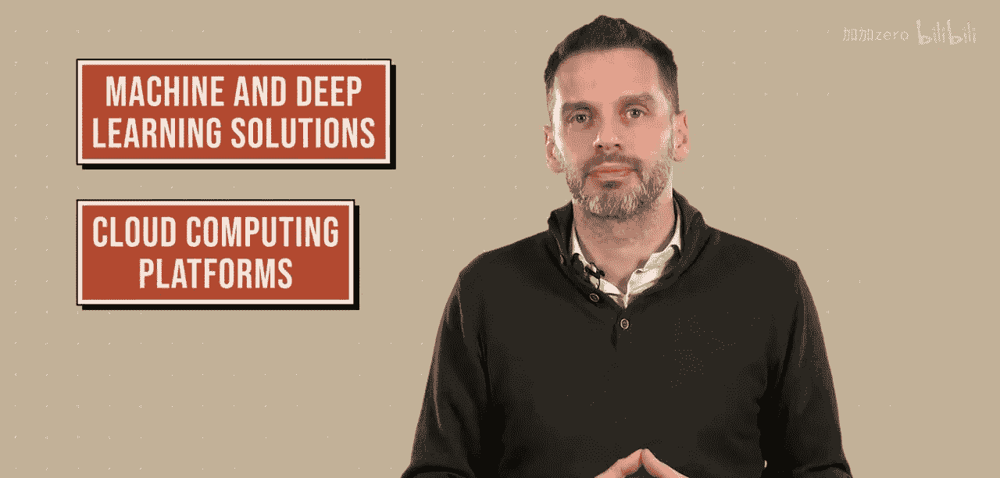
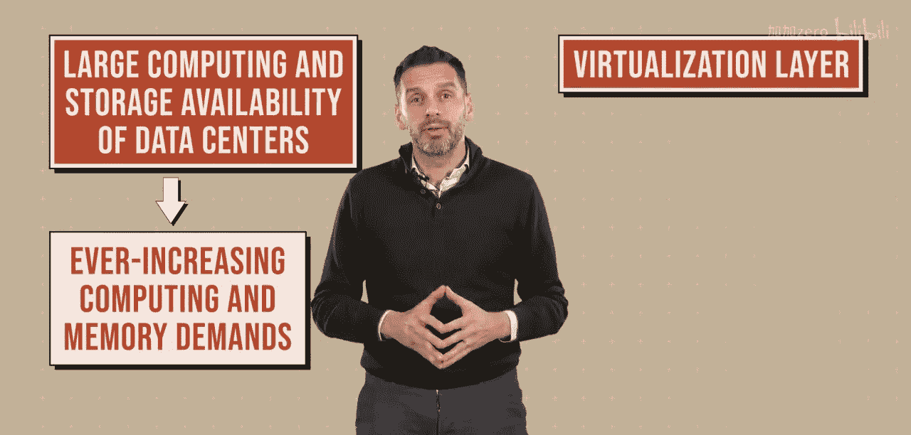
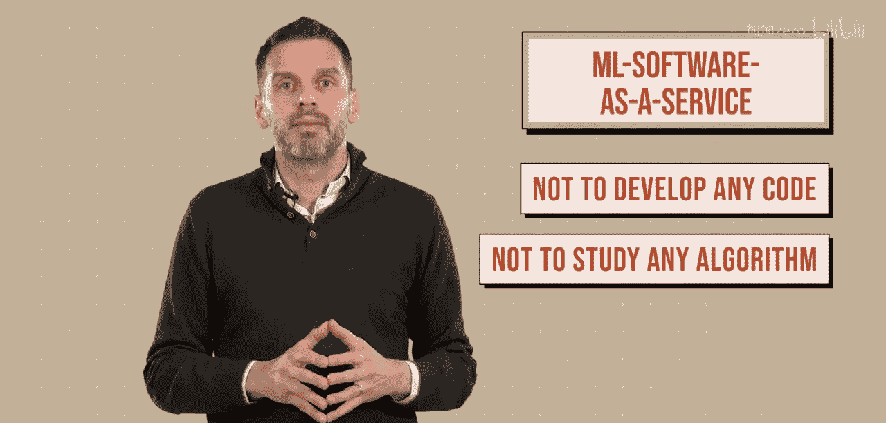
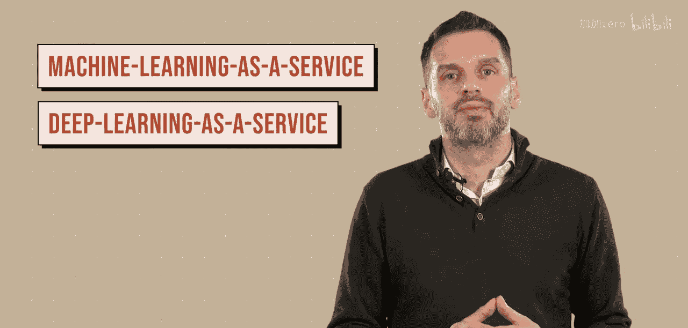
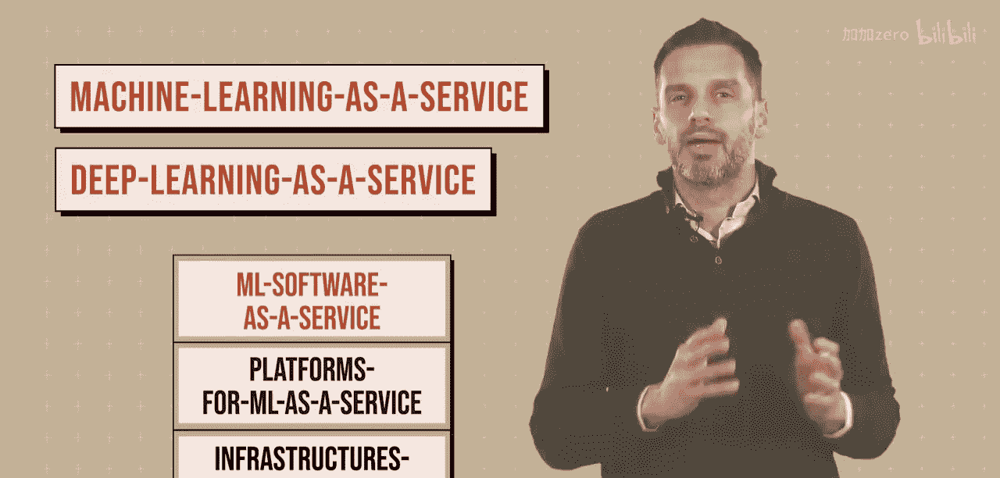
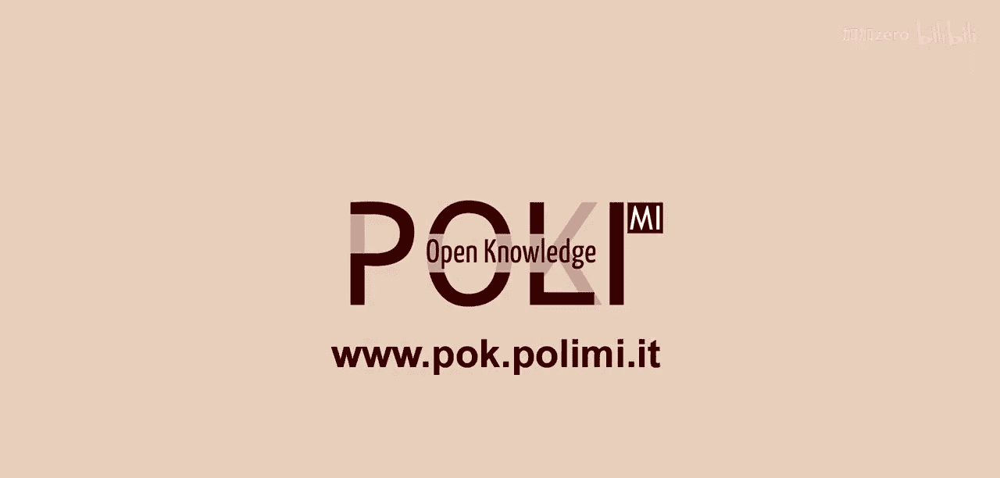

# 人工智能：概述 专项课程：4.1：机器学习与深度学习即服务 🚀




在本节课中，我们将探讨机器学习、深度学习解决方案与云计算平台之间日益紧密的集成趋势。

## 趋势背景

上一节我们介绍了人工智能的基本概念，本节中我们来看看它如何与云计算结合。这种技术与科学趋势的出现有两个主要原因。

一方面，数据中心强大的计算和存储能力，能够很好地满足机器学习，特别是深度学习模型日益增长的计算和内存需求。其需求可用以下公式表示：



**计算需求 ∝ 模型复杂度 × 数据规模**

另一方面，虚拟化层和计算框架提供了广为人知的“即服务”云计算模式。这种新模式与机器学习和深度学习框架相结合，催生了所谓的“机器学习即服务”和“深度学习即服务”。


## 服务化基础

有趣的是，这些以“即服务”形式提供的机器学习算法，其基础在于能够通过Web控制台或API，为用户提供开箱即用或可远程训练的模型，从而充分利用数据中心的高性能计算和存储能力。


## 云上机器学习的优势

但我们必须思考一个关键问题：将机器学习部署在云端有什么优势？

云计算模式能够从两个不同角度简化对机器学习能力的访问。

以下是其主要优势：


*   **降低专业门槛**：通过“即服务”方式，用户无需具备该领域的深厚专业知识，即可利用基于机器学习的服务。
*   **提升可扩展性与可移植性**：在虚拟机或容器中设置机器学习项目，可以利用虚拟化和云计算的优势，提高项目的可扩展性和可移植性。

因此，云计算领域的所有主要厂商也都以“即服务”的形式提供机器学习解决方案。

## 服务的三个层级

在这样的技术背景下，得益于虚拟化机制和云计算解决方案，数据中心正成为MLaaS和DLaaS的新前沿。根据所需的灵活性和团队在AI领域的专业知识，服务可以在三个不同层级上开发。

以下是三个不同的服务层级：

1.  **机器学习基础设施即服务**：在此层级，AI所需的硬件基础设施以服务形式提供，而软件基础设施和AI应用程序则由软件和AI工程师设计和开发。
2.  **机器学习平台即服务**：此层级通过直接提供用于开发AI应用的软件平台，屏蔽了硬件的复杂性。
3.  **机器学习软件即服务**：在此层级，AI应用程序已经在线，可通过Web控制台或API访问，无需设计或开发任何硬件、软件或应用程序。

让我们详细看看这三个层级。

### 1. 机器学习基础设施即服务

在IaaS for ML中，云服务提供商以服务形式提供AI硬件，而AI和软件设计师则协作开发AI软件和应用程序。

这种方法在设计和开发阶段需要最大的投入，并且要求团队具备较高的AI领域专业知识，但它能保证最高的灵活性，并能实现完全定制的解决方案。

此类服务的例子包括：**Amazon EC2、Google Cloud、Azure深度学习虚拟机、IBM GPU裸机服务器**。

### 2. 机器学习平台即服务

在PaaS for ML中，为AI工程师提供了开箱即用的工具箱、库和框架。

这种方法允许将AI硬件的复杂性隐藏在平台内部。因此，AI工程师只需专注于AI应用程序的开发。

这种方法的缺点是，AI工程师使用预配置的环境来训练、调优和托管模型。


此类平台的例子包括：**Amazon SageMaker、Azure ML服务、Google Cloud ML Engine、IBM Watson Studio**。

### 3. 机器学习软件即服务

ML软件即服务提供基于机器学习和深度学习的现成解决方案。

此类解决方案的例子包括：**Amazon AI服务、Google Cloud AI、Microsoft认知服务、IBM Watson**。



在这里，用户无需开发任何代码或研究任何算法。例如，用户可以依赖一个用于图像识别的ML软件即服务，用户只需将图像发送到在线服务，就会收到一个包含图像中所有物体信息的JSON消息。

```json
{
  "objects": ["dog", "cat", "tree"],
  "confidence": [0.98, 0.95, 0.87]
}
```



此时，机器学习应用已经存在，用户只需通过Web控制台或API与之交互。

这种方法的缺点是，只能执行预定义的操作或活动。

## 总结



本节课中我们一起学习了机器学习与深度学习即服务的概念。

总结来说，机器学习与深度学习即服务可以从三个不同的层面来理解：**机器学习基础设施即服务、机器学习平台即服务和机器学习软件即服务**。我们看到了这三个不同层面的优点和缺点。



此外，在机器学习项目中考虑使用哪个层级，取决于项目所需的灵活性以及项目团队可用的AI专业知识。较低的层级提供最大的灵活性，但需要设计和开发AI软件和应用程序。中间层级通过提供AI软件层来隐藏AI硬件的复杂性，设计者只需专注于AI应用程序。最后，在顶层，有现成的机器学习解决方案可用，但只能考虑预定义的操作和活动。