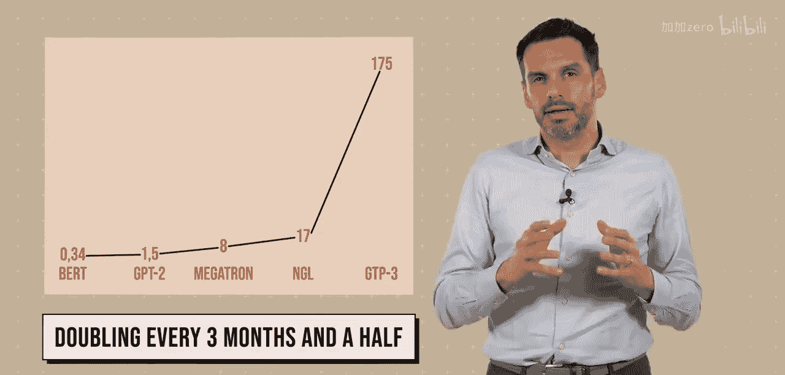
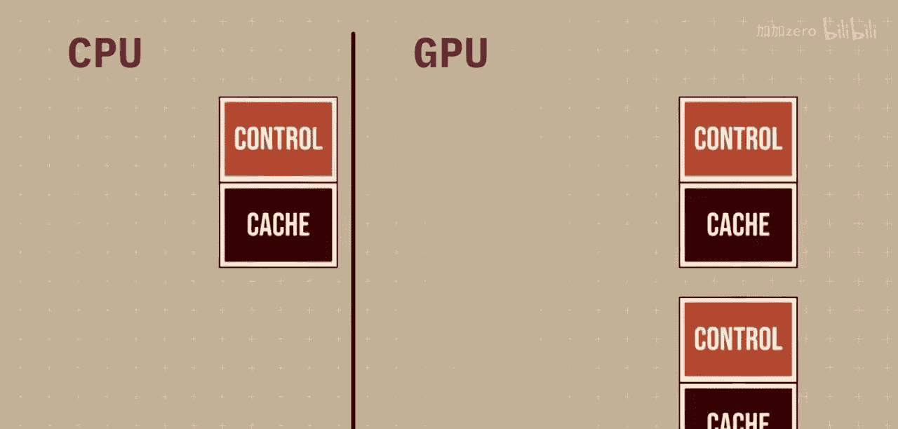
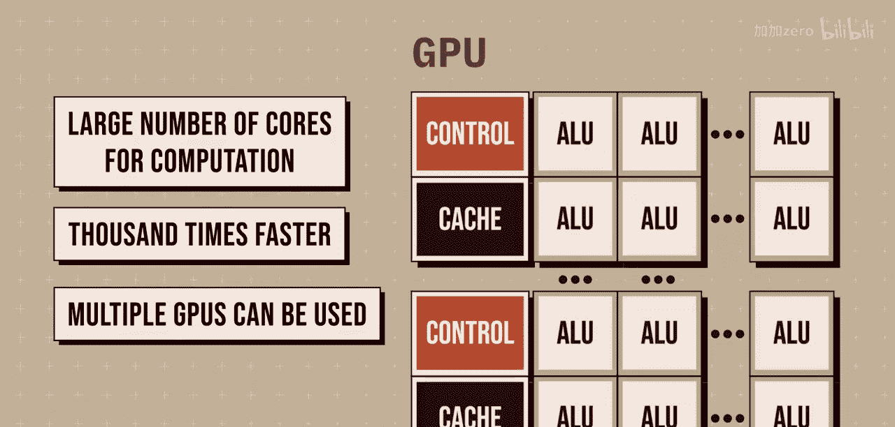
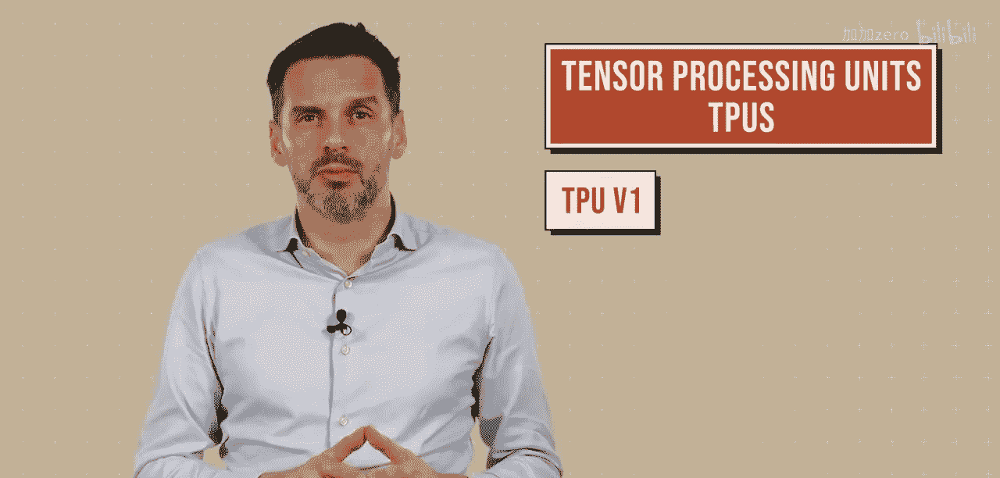
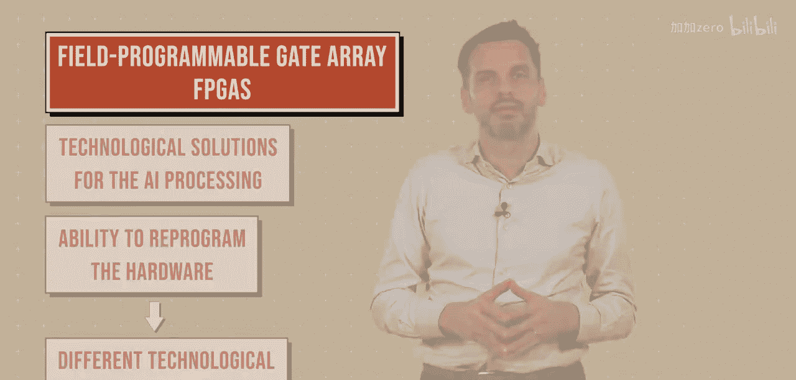
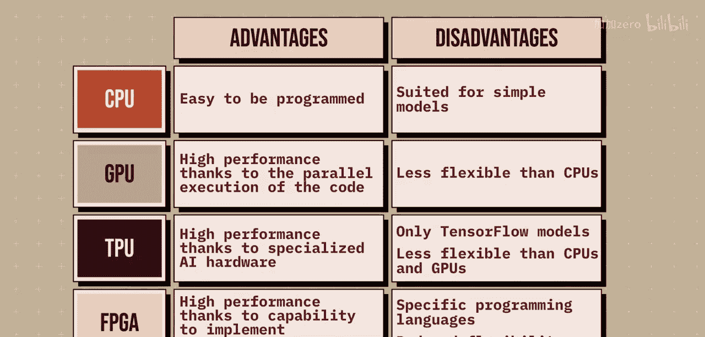
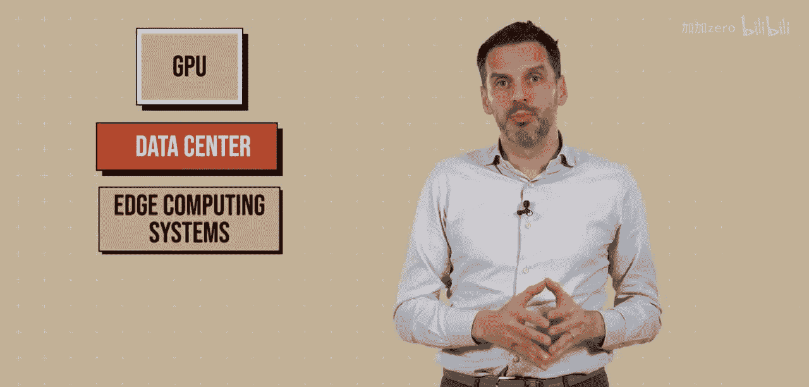
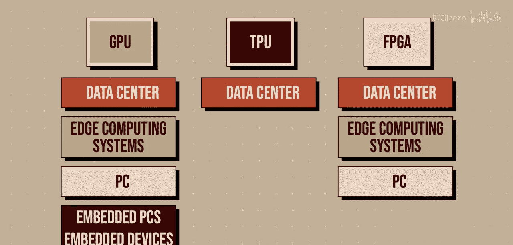

# 【人工智能：概述 专项课程】米兰理工大学—中英字幕 p58 p5_01_hardware-accelerators-fueling-ai -BV1Er1PYhE9q_p58-

Artificial intelligence is becoming the state of the art solution in many application domains。

To achieve this goal， AI solutions are becoming more and more complex over time。

We have already commented that the evolution of the complexity of deep neural networks is characterized by adoubling every three months and a half of the number of parameters。

 going up to the recently introduced GPT3 neural network for natural language processing that is characterized by more than 175 billion parameters。

But what about technological evolution， The only reference we have is Mooreslow that。

 despite being updated and discussed over time， might help us in understanding how technology evolves。

Morslow states that technology doubles its performance every 18， 24 months。

So we have a huge gap between the technological evolution and the algorithmic revolution。

 How can we deal with that？We need specific hardware devices to speed up training and inference of AI solutions。

 They are called AI hardware accelerators。From the technological point of view。

 three different families of hardware accelerators are available， graphical processing units。

 the GPUs， tensor processing units， the TUs， and field programmable gate arrays， FPGAs。

Let's have a look at these three different families of hardware accelerators in detail。

The GPUs are specialized hardware accelerator for AI meant to support data parallel computation。Here。

 the idea is that the same program， in our case， the learning or inference of large scale neural networks is executed on many course in parallel。

To achieve this goal， the instructions of the programs are transformed into matrix operations that are parallellyzed into specific course for computation。

The availability of a large number of courses for computation is the key technology in GPUs。

Thanks to this approach， GPUs can be up to it a thousand times faster than CPUs。In addition。

 in large scale data centers， multiple GPUs can be used to further speed up the training of very large neural networks。

Here， the activities of this set of GPUs are coordinated by CPU that distributes data to the GPUs and receive backs and aggregates the results of the different GPUs training phases。

In this particular scenario， the computation is not the only relevant point here。

 communication plays a crucial role and high performing communication networks are required to effectively reconcile the output of the GPUs。

While being well suited to artificial intelligence and in particular to machine and deep learning。

 the GPus can still be considered general purpose devices。In more detail。

 we could say that they have not been originally and specifically designed for machine and deep learning。

In fact， GPUs are used in many other application domains， such as scientific computing。

 image processing， and cryptocurrency mining。So the question is。

 can we rely on specific hardware for AI？Let me tell you a short story。Some years ago。

 Google Engines realized that if each of the Android users had used the Google assistant even for just three minutes a day。

 Google would have needed to double the number of its data centers in the world。As you can imagine。

 this is a critical path to take from both a technological and economic point of view。Hence。

 engineers decided to address the problem from a different perspective。

Instead of doubling the available hardware， what about specializing the hardware for machine learning operations？

This is where the tensor processing units come into play because they are custom built integrated circuits specifically designed to execute machine and deploying applications。

The T PUs are specifically tailored to Tensorflow。 the machine ended deep learning framework developed by Google。

We already mentioned this popular framework in a former video。😊。

TPUs have been powering the Google data centers since 2015， together with CPUs and GPUs since 2015。

 three different generations of TUs have been proposed。

The first version called TPU version 1 was the first TPU ever proposed and it was designed only to perform the inference of large scale neural networks。

After that， TPU version 2 and TPU version 3 have been proposed。

Both versions support both the inference and the training。

It is worth mentioning that TPU version 3 is the first liquid cooled hardware accelerator in Google data centers。

In addition to GPUs and TUs， the field programmable gate arrays。

 SPGs are viable technological solutions for the eye processing。

The technological core or FPGAs is the ability to reprogram the hardware for different technological scenarios。

Here， the array of logical gates can be programmed to implement AI applications。To achieve this goal。

 specific programming languages for the hardware must be consideredate。Summing up。

 CPUs are extremely flexible and can be programmed very easily。

 but they can be used only for simple AI models。GPUs provide high performance for both training and influence of large scale AI models and A networks。

 thanks to their highly paralleled architecture。But this happens at the expense of lower flexibility than CPUs。

TPUs can provide high performance for training and inference thanks to the ability to exploit specialized AI hardware。

The drawbacks of TUs refer to the need to use Tensorflow framework and to a limited flexibility with respect to CPUs and GPUs。

Finally， FPGAs are able to implement AI solutions into hardware。

But they require specific programming languages to design the array of logic gates as well as reduced flexibility with respect to the other hardware accelerators。

That said， let me conclude with a technological perspective。We saw that GPUs。

 TUs and FPGAs are available for AI。But where can we find this hardware accelerator into the femin of technological solutions。

 we already described it for AI comprising data centers，ed business systems， personal computers。

 and embedded personal computers。Thanks to their trade off between flexibility and power consumption。

 GPUs can be found in data centers， edge computing systems， personal computers。

 as well as in embedded personal computers。

On the other hand， TPUs are currently present only in the data centers due to their high technological requirements。

Finally， that the centers， edge computing systems and personal computers are viable technological solutions for FPGAs。

