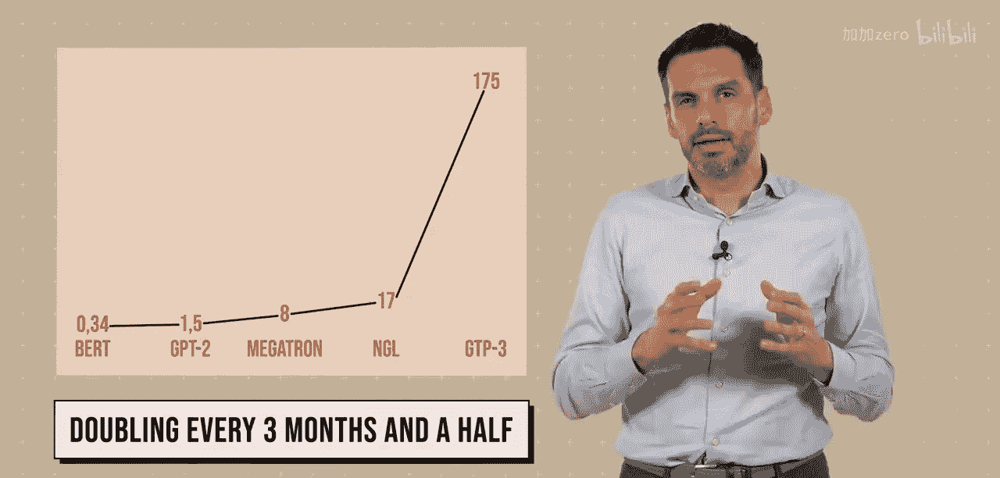
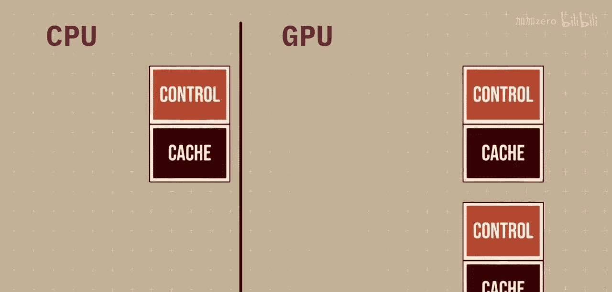
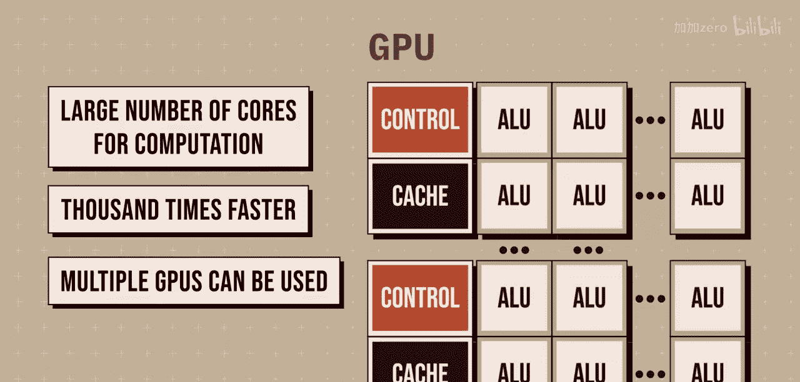
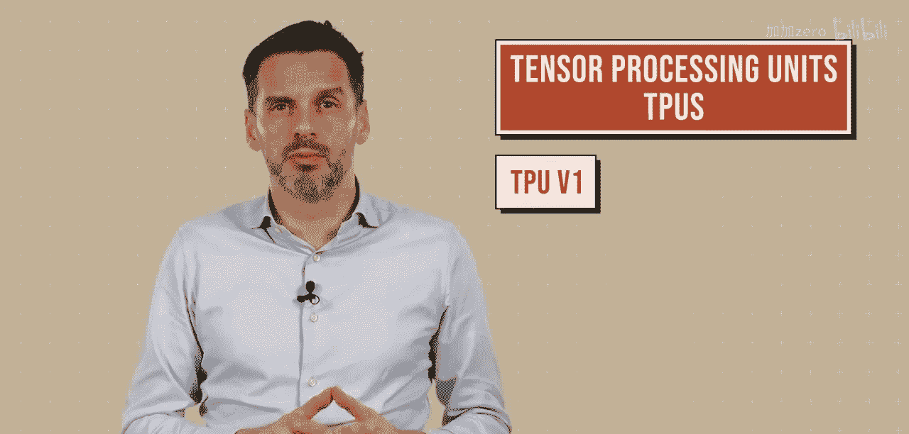
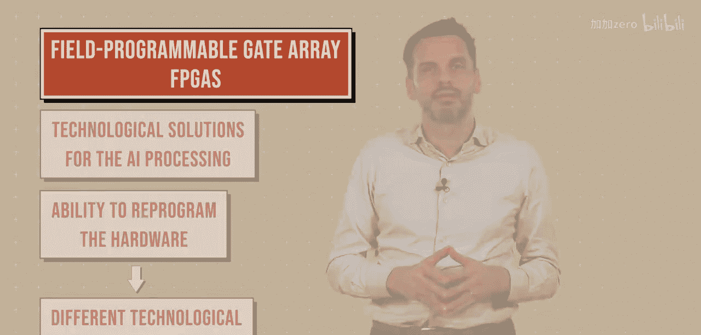
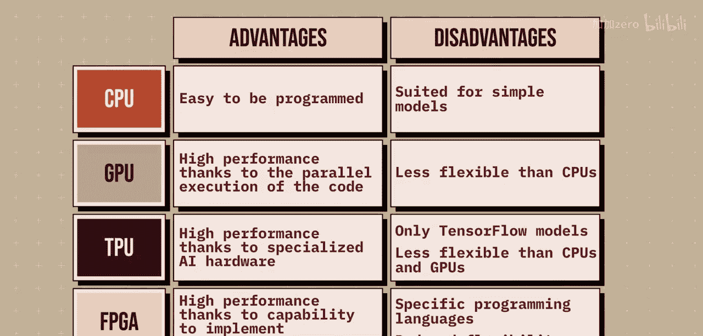
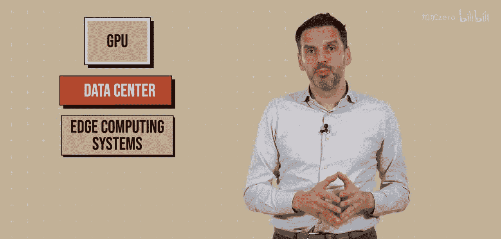
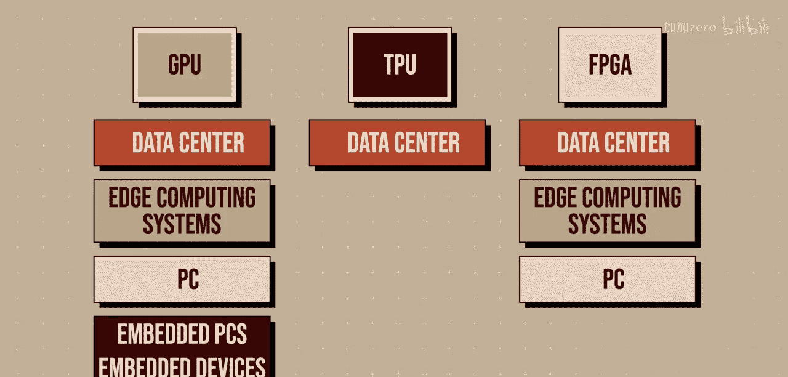

# 人工智能：概述 专项课程：5.1：硬件加速器驱动人工智能 🚀

在本节课中，我们将要学习人工智能硬件加速器。随着人工智能解决方案日益复杂，通用计算硬件已难以满足其巨大的计算需求。本节将详细介绍三种主流的专用硬件加速器：图形处理器、张量处理器和现场可编程门阵列，并分析它们各自的特点与应用场景。

## 人工智能的复杂性与硬件需求 🤖

人工智能已成为许多应用领域的先进解决方案。为了实现这一目标，人工智能解决方案正变得越来越复杂。

我们已经讨论过，深度神经网络复杂性的演变特点是其参数数量每三个半月翻一番。这一趋势已发展到最近推出的用于自然语言处理的GPT3神经网络，其参数超过1750亿个。

## 技术演进与算法革命的鸿沟 📈

那么技术演进的情况如何？我们唯一的参考是摩尔定律。尽管摩尔定律随时间推移被不断更新和讨论，但它可能有助于我们理解技术是如何演进的。摩尔定律指出，技术性能每18到24个月翻一番。

因此，在技术演进和算法革命之间存在巨大差距。我们该如何应对？我们需要特定的硬件设备来加速人工智能解决方案的训练和推理。这些设备被称为人工智能硬件加速器。

从技术角度来看，目前有三类不同的硬件加速器家族可用：图形处理器、张量处理器和现场可编程门阵列。

## 三类硬件加速器详解 💡

接下来，让我们详细看看这三类不同的硬件加速器。

### 图形处理器

图形处理器是专为人工智能设计的硬件加速器，旨在支持数据并行计算。其核心思想是，同一个程序（在我们这里指大规模神经网络的训练或推理）在多个核心上并行执行。

为了实现这一目标，程序指令被转换为矩阵运算，这些运算被并行化到特定的计算核心中执行。

**关键特性**：拥有大量用于计算的核心是图形处理器的关键技术。得益于这种方法，图形处理器的速度可比中央处理器快一千倍。

此外，在大型数据中心中，可以使用多个图形处理器来进一步加速超大规模神经网络的训练。

在这种特定场景下，计算并非唯一相关点，通信也起着至关重要的作用。需要高性能通信网络来有效协调各个图形处理器的输出结果。

虽然图形处理器非常适合人工智能，特别是机器学习和深度学习，但它们仍可被视为通用设备。更具体地说，它们最初并非专门为机器学习和深度学习而设计。

事实上，图形处理器还用于许多其他应用领域，例如科学计算、图像处理和加密货币挖矿。

### 张量处理器

那么，我们能否依赖专门的人工智能硬件呢？让我讲一个小故事。几年前，谷歌工程师意识到，如果每位安卓用户每天仅使用三分钟谷歌助手，谷歌就需要将其全球数据中心的规模扩大一倍。可以想象，从技术和经济角度来看，这都是一个关键问题。

因此，工程师们决定从不同角度解决这个问题。与其将可用硬件数量翻倍，不如将硬件专门用于机器学习操作？这就是张量处理器发挥作用的地方，因为它们是专门为执行机器学习和深度学习应用而定制的集成电路。

张量处理器是专门为谷歌开发的机器学习与深度学习框架TensorFlow量身定制的。我们在之前的视频中已经提到过这个流行框架。

自2015年以来，张量处理器与中央处理器和图形处理器一起为谷歌数据中心提供动力。自2015年起，已经推出了三代不同的张量处理器。

以下是各代张量处理器的特点：
*   **第一代**：被称为TPU v1，是首个提出的张量处理器，仅设计用于执行大规模神经网络的推理。
*   **第二代与第三代**：TPU v2和TPU v3随后被提出。这两个版本都同时支持推理和训练。值得一提的是，TPU v3是谷歌数据中心首个采用液冷技术的硬件加速器。

### 现场可编程门阵列

除了图形处理器和张量处理器，现场可编程门阵列也是用于人工智能处理的可行技术解决方案。

现场可编程门阵列的技术核心是能够针对不同的技术场景对硬件进行重新编程。

在这里，逻辑门阵列可以被编程以实现人工智能应用。为了实现这一目标，必须考虑使用特定的硬件编程语言。

## 硬件加速器对比与总结 ⚖️

上一节我们介绍了三类加速器，本节我们来总结和对比它们的特点。

中央处理器极其灵活且易于编程，但只能用于简单的人工智能模型。图形处理器凭借其高度并行的架构，为大规模人工智能模型和神经网络的训练和推理提供了高性能。但这是以比中央处理器更低的灵活性为代价的。

张量处理器得益于利用专用人工智能硬件的能力，可以为训练和推理提供高性能。张量处理器的缺点在于需要使用TensorFlow框架，并且相对于中央处理器和图形处理器灵活性有限。

最后，现场可编程门阵列能够将人工智能解决方案实现在硬件中。但它们需要特定的编程语言来设计逻辑门阵列，并且相对于其他硬件加速器灵活性较低。

## 技术视角下的部署场景 🗺️

综上所述，让我从技术角度进行总结。我们看到图形处理器、张量处理器和现场可编程门阵列都可用于人工智能。但这些硬件加速器可以在我们之前描述的人工智能技术解决方案层级中的哪些位置找到呢？该层级包括数据中心、边缘计算系统、个人计算机和嵌入式个人计算机。

以下是各类加速器的主要部署场景：
*   **图形处理器**：得益于其在灵活性和功耗之间的平衡，图形处理器可以在数据中心、边缘计算系统、个人计算机以及嵌入式个人计算机中找到。
*   **张量处理器**：由于其高技术要求，张量处理器目前仅存在于数据中心中。
*   **现场可编程门阵列**：对于现场可编程门阵列而言，数据中心、边缘计算系统和个人计算机都是可行的技术解决方案。

---

本节课中我们一起学习了驱动人工智能发展的三类核心硬件加速器：通用性强但能效比突出的**图形处理器**、为TensorFlow定制的专用高性能**张量处理器**，以及可通过编程灵活适配不同场景的**现场可编程门阵列**。理解它们各自的特点、优势、局限及适用场景，对于设计和部署高效的人工智能系统至关重要。