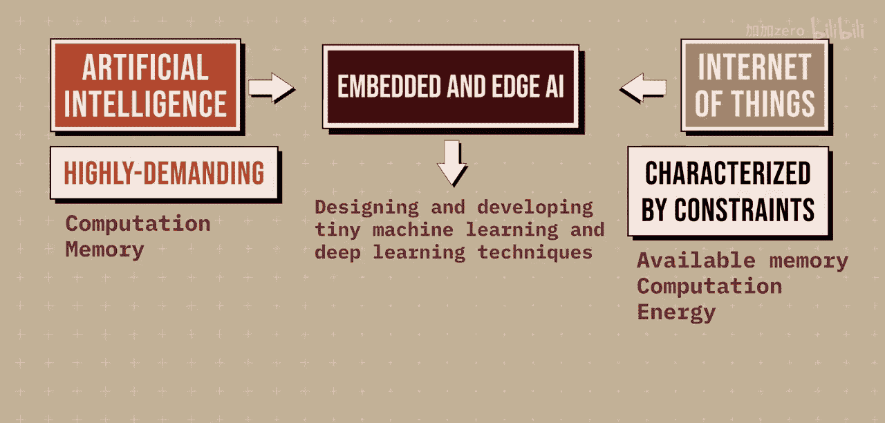
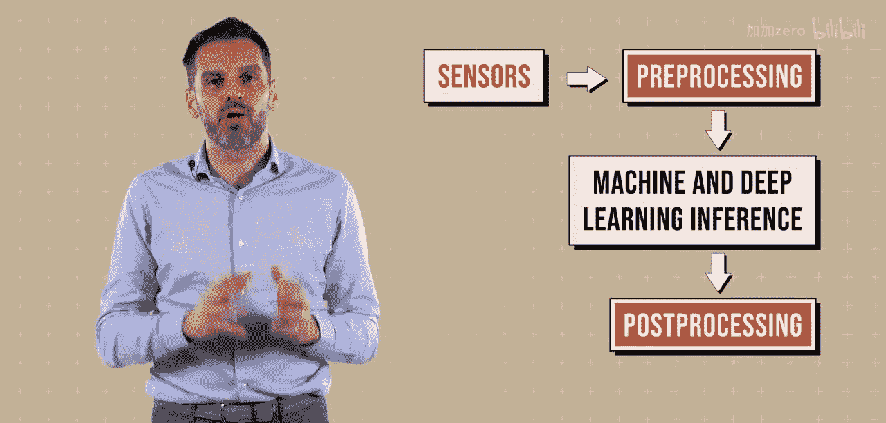

# 【人工智能：概述 专项课程】米兰理工大学—中英字幕 p60 p7_01_ai-for-iot -BV1Er1PYhE9q_p60-

Artificial intelligence and internal things might be considered at the extremes of the technological ecosystem。

AI solutions are typically highly demanding in terms of computation and memory。

 while Io T units are generally characterized by severe constraints on the available memory。

 computation and energy。Fillling this gap is the goal of the embedded NJI。

Which is a novelble impromising research area aiming at designing and developing tiny machine learning and deep learning techniques able to be executed on IU T units。

😊。

To achieve this goal， we will explore the development pipeline as well as approximation techniques comprising quantization and pruning to reduce the computational load and memory demand of machine learning and deep learning solutions so as to be executed on embedded systems and IoT units。

So how can we design AI applications for IoT？Designing an AI application for Io T relies on a development life cycle that is based on seven different steps。

The data collection phase aiming at creating a training set representing the specific application problem that needs to be addressed。

The model definition phase aims at identifying the best machine or deep learning model for the considered application training on the collected data。

The application development phase has the duty to set up the firmware for the I O T units。

 comprising the I T applications such as the acquisition and preprocessing steps of the data。

 as well as the machine and deep learning inference step。

The developed application is then compiled and built for a given hardware platform。

 such as a specific family of microcontrollers。After that。

 the app is flashed to the Io T device that is then ready to run its application。

 that is acquiring data， processing them through machine and deploy learning inference and providing an output。

😊，Finally， monitoring services could be activated and integrated within the Io T units to verify and evaluate their performance over time。

😊，It is worth noting that differently from a traditional personal computer or cloud based app development。

 the lifecycl for the AI application on Internet things is divided into two parts from the technological point of view。

😊，First， the identification and training of the model are typically carried out in the cloud where enough computation and memory are available。

Second， the I O T units being characterized by constraints on memory。

 computation and energy focus only on the inference phase of the machine and the learning models。😊。

But what is the hardware software architecture of such intelligent Io T units。Here。

 the hardware typically comprises a microcontroller with few kiloytes of RA as well as sensors and actuators。

Examples of sensors for Io T are environmental sensors， microphones。

 cameras and men's accelerometerters。The software architecture comprises three subsequent steps。

The prepros phase aims at acquiring and processing the data to make them understandable for the next inference step。

The machine and deep learning inference aims at applying the trained model on the acquired and processored data。

The output of this step， for example， a prediction。

 a classification or the detection of an anomaly in the data stream is then post processed to make a decision about how to react。

 such as opening a door， sending a message to the user or raising an alarm。

Examples of AI applications for Io are。The wakeward detection where a specific vocal command is recognized by the Io T device to activate further actions or processing。

 such as turn on the light。😊，Here， differently from smart speakers。

 I U T units are able to recognize only a limited， sometimes very limited set of commands。😊。

But here， the point is that this recognition phase is directly carried out on the device without requiring external processing steps or without moving the speech command to the cloud for the processing。

Another example is the person detection。Here， images are acquired by a camera and the detection phase is carried out directly on the device。

Finally， data coming from Mepsccmeter can be used to detect and recognize directly by the Io T units gestureests made by a person。

😊，But how can we design machine and deployment solutions able to fit the severe technological constraints of IUT units？

This is a challenging issue because we cannot just simply squeeze a complex neural networks。

 for example， requiring hundreds of megabytes to store its parameters into a tiny IUT unit。

To address this issue， we need three different steps。First。

 we need to redesign the architectures of our machine and deploy deploying solutions。

 and in particular of our neural networks。These new architectures will be able to consider by design。

 learning to reduce the memory and the computational requirements by considering simplified and tiny models。

In this field， recently， new methodologies have been proposed to guide the design of such tiny neural network architectures and their technological constraints on memory and computation。

In addition to tiny architectures for machine and deep learning。

 approximate computing mechanisms are typically considered to further reduce memory occupation and computational demand。

Examples of such mechanisms are quantization and pruning。

But this is not the last step in the design of AI solutions for IUT。

 since content and prune models can be further optimized for a given target hardware platform。

This step， which is typically hardware dependent， is typically carried out through an adultdo compilers integrated with the development tool chains。

But let's focus our attention on the approximate computing。 and in particular。

 on two specific mechanisms， quantization and pruning。

Quantization refers to reducing the memory occupation of the weights of a neural network by changing the number of bits used for the representation of the weights。

For example， 32 B floating point weights could be cast into a 8 bit integer representation。

This reduces the memory occupation of the neural network， and it could also speed up the processing。

 since integer operations could be faster than floating point1。😊。

Quantization could be carried out during the training or at the end of the training。 In both cases。

 the advantages in the reduction of the memory occupation can be relevant。

 but these advantages comes at the expenses of a possible reduction in the overall accuracy of the quantized model。

Pruning aims at reducing the computational load and the memory occupation of a neural network by e skiping the execution of some tasks associated with the processing chain。

😊，Here， the advantages are quite evident。Reducing the number of layers to be executed allows to decrease both the computational demand and the memory occupation。

 since parameters associated to those layers must not be stored。Even in this case。

 advantages might come at the expense of a possible reduction in the mod accuracy。

Quantization and pruning are typically jointly considered to further reduce memory occupation and computational demand。

But are there other ways to further optimize the learning and influence of AI solutions for an ecosystem of IoT units？

We'll see them in the next video。 Stay tuned。

🎼。

