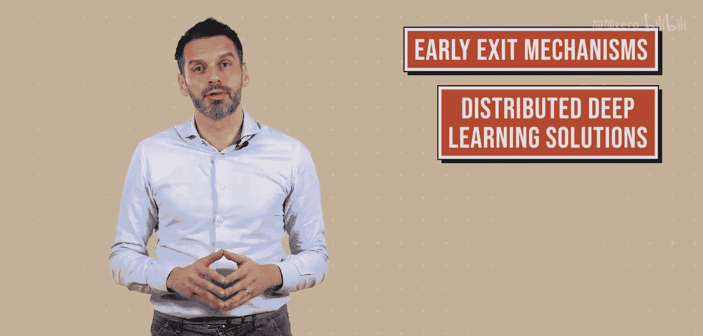
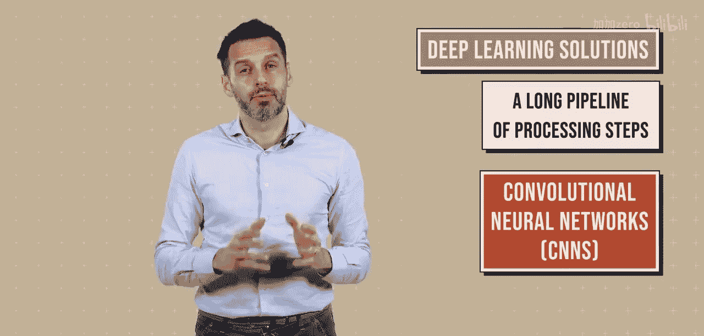
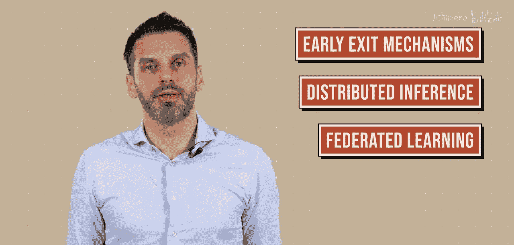

# 【人工智能：概述 专项课程】米兰理工大学—中英字幕 p61 p8_01_edge-ai -BV1Er1PYhE9q_p61-

Embded and AJI aims at bridging the gap between artificial intelligence and the internal of things。

In the formal video， we saw that quantization and pruning are crucial tools to design machine and deploying solutions able to match the severe technological constraints on computation。

 memory and energy of IUT units。But do we have other solutions to move AI to the ground。

 the answer is yes， in particular， in this video we will see three different approaches。First。

 early exit mechanisms allow to reduce the computational load and energy consumption of deep learning solutions by skipping at rough time the execution of some processing steps。

Second， distributed deep learning solutions allow the distribution of the processing steps in a heterogeneous ecosystem of pervasive devices。

Third， the federated learning mechanisms， aim at supporting the training of global machine or deep learning models from a set of pervasive devices without requiring to explicitly send the acquired data。

Let's see these three approaches in detail， and let's start with the early exit mechanisms。

The learning solutions are generally characterized by a long pipeline of processing steps。

In this field， convolutional Leo network called it CNNNs。

 represent the state of the art solution in many image and video recognition applications。

The deep architecture of these CNNs allows them to jointly learn the features and the classification task。

But to achieve this goal， CNNNs are generally organized into a hierarchy of fit for world layers aiming at processing the input image with a hierarchical representation of knowledge。

😊，This means that extracted features are characterized by an increasing complexity and meaning。

This is where early exit mechanisms also called gate classification come into play by inserting intermediate classification layers into the deep yeterarchical architecture。

The goal is to incrementally process the input image and classify it as soon as enough confidence is achieved。

 Here， the confidence is measured， for example， as the posterior probability of the classification。😊。

Thanks to these early exit mechanisms， we can skip the execution of some processing tasks when not needed。

 hence saving computation and energy in the IoT scenario。

We saw how we can optimize machine and deploymenting solutions for the intended of things by means of quantization。

 pruning or early exit mechanism。But we have always to keep in mind that an IoT unit typically operates within an ecosystem of pervasive units possibly characterized by heterogeneous hardware architectures。

Now let's see the second approach to move AI to the ground。

Here the point is that we are not only interested in reducing the complexity of the machine or deploying solutions to fit a technological constrained IoT unit。

In fact， we want to suitably place the processing layers of a CNN on the IoT units belonging to the ecosystem of pervasive units。

More precisely， the goal is to optimally place the CNN layers to the IoT units。

 minimizing the inference time from data gathering to the decision。

Such an approach can be applied both to traditional CNNNs where the processing Python is defined at design time such as the AlexNe。

 Resnet or urlog just to name a few。And to CNNN's implementing early exit mechanisms where the processing path is built at execution time according to the information content of the input。

In addition， we could consider multiple CNNNs characterized by different application purposes。

 running on the same IoT ecosystem， possibly sharing some processing layers。For example。

 in the same smartoma ecosystem， there might be an AI application for security surveillance as well as an AI application for fitness purposes these two AI applications might share some processing layers as well as some processing on some IoT units。

But what about the learning process in an ecosystem of IT units？

This is where federated learning comes into play。The aim of federated learning is to train in a federated way。

 a global machine or deep learning model in a scenario where data are distributed across different devices such as IUT units or mobile devices。

To achieve this goal， federated learning algorithmgonists rely on a server orchestrating the global learning phase and a set of pervasive devices supporting a local learning phase operating on possibly sensitive data here。

 the point is that the pervasive devices sent to the server only the locally trained model and not the apparent data。

In such a pervasive scenario， fedderated learning can provide several advantages。First。

 supporting privacy， each pervasive device keeps the raw data locally and these data are never shared with the server。

 second reduce latency， the communication between devices and server is only used to exchange the model updates。

 and not the data， hence reducing the required bandwidth in the energy consumption。Third。

 a large number of consideredate devices， in fact， federated learning algorithms are able to manage even a large number of devices possibly characterized by different hardware platforms and different amounts of acquire data。

Examples of fedderator learning can be found in smart cars， industry 34。0 and EF。

Summing up early exit mechanisms， distributed inference and federated learning are novel and promising learning paradigms aiming at moving AI to IUT。

In the next video we will see which are the challenges we have to face and the opportunities to be seized in the field of AI and technologies。

 stay tuned。

