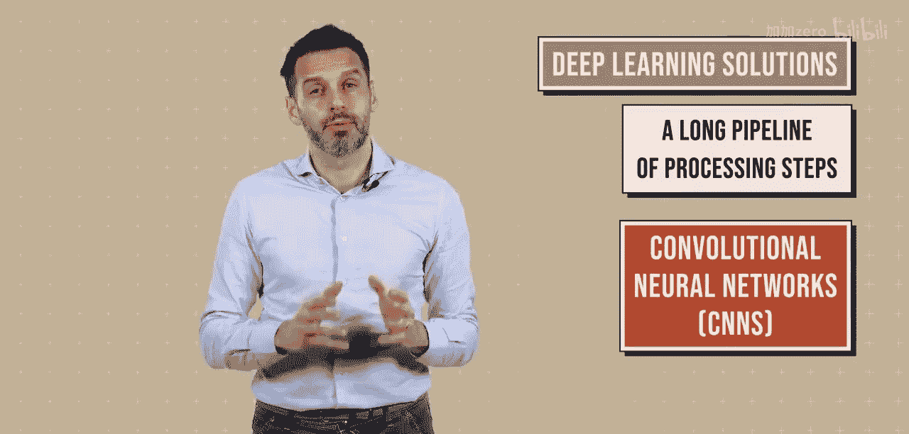
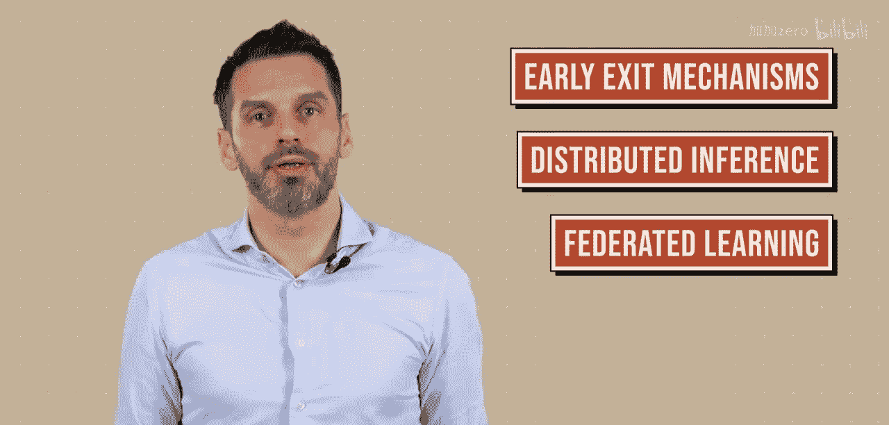

# 人工智能：专项课程：8.1：边缘人工智能 🚀

在本节课中，我们将要学习如何将人工智能（AI）技术部署到物联网（IoT）设备上，即“边缘人工智能”。我们将探讨三种核心方法，以克服物联网设备在计算、内存和能源方面的严格限制。

嵌入式与边缘人工智能旨在弥合人工智能与物联网内部世界之间的差距。在之前的视频中，我们看到**量化**和**剪枝**是设计机器学习解决方案并部署到物联网设备上的关键工具。但是，我们还有其他方法将AI推向边缘吗？答案是肯定的。具体来说，在本视频中，我们将看到三种不同的方法。

## 提前退出机制 🏃‍♂️

首先，我们来看看提前退出机制。深度学习解决方案通常由一系列冗长的处理步骤组成。在这个领域，卷积神经网络（CNNs）是许多图像和视频识别应用中的先进解决方案。

这些CNN的深度架构使它们能够联合学习特征和分类任务。但为了实现这一目标，CNN通常被组织成一系列特征提取层，旨在以知识的层次化表示来处理输入图像。这意味着提取的特征具有**递增的复杂性**和**含义**。

这正是提前退出机制（也称为门控分类）发挥作用的地方。其方法是在深度层次化架构中插入中间分类层。目标是增量式地处理输入图像，并在达到足够置信度时立即对其进行分类。这里的置信度可以通过分类的**后验概率**来衡量。

**公式示例：** 置信度 = P(类别 | 特征)

得益于这些提前退出机制，我们可以在不需要时跳过某些处理任务的执行，从而在物联网场景中节省计算和能源。

我们看到了如何通过量化、剪枝或提前退出机制来优化物联网的机器学习解决方案。但我们必须始终记住，一个物联网单元通常在由异构硬件架构组成的普适设备生态系统中运行。

## 分布式推理 🔄

现在，让我们看看将AI推向边缘的第二种方法。这里的重点在于，我们不仅对降低机器学习解决方案的复杂性以适应技术受限的物联网单元感兴趣。实际上，我们希望将CNN的处理层适当地放置在属于普适设备生态系统的物联网单元上。

更准确地说，目标是将CNN层最优地放置到物联网单元上，以最小化从数据收集到决策的**推理时间**。

这种方法既可以应用于处理路径在设计时确定的传统CNN（如AlexNet、ResNet或YOLO），也可以应用于实现了提前退出机制的CNN（其处理路径根据输入的信息内容在运行时动态构建）。

此外，我们还可以考虑在同一个物联网生态系统中运行具有不同应用目的的多个CNN，它们可能共享一些处理层。例如，在同一个智能家居生态系统中，可能同时存在用于安全监控的AI应用和用于健康目的的AI应用，这两个AI应用可能共享一些处理层，也可能在某些物联网单元上共享处理任务。

## 联邦学习 🤝

但是，在物联网单元的生态系统中，学习过程是怎样的呢？这就是联邦学习发挥作用的地方。联邦学习的目标是在数据分布在物联网单元或移动设备等不同设备上的场景中，以联邦的方式训练一个全局的机器学习或深度学习模型。

为了实现这一目标，联邦学习算法依赖于一个协调全局学习阶段的服务器，以及一组支持在可能敏感的数据上进行本地学习阶段的普适设备。这里的要点是，普适设备只向服务器发送本地训练的模型，而不是原始数据。

在这种普适场景中，联邦学习可以提供几个优势：
1.  **保护隐私**：每个普适设备在本地保存原始数据，这些数据永远不会与服务器共享。
2.  **降低延迟**：设备与服务器之间的通信仅用于交换模型更新，而不是数据，从而减少了所需的带宽和能源消耗。
3.  **支持大量异构设备**：联邦学习算法能够管理大量设备，这些设备可能具有不同的硬件平台和不同数量的采集数据。

联邦学习的例子可以在智能汽车、工业4.0和医疗保健领域找到。

## 总结 📝

本节课中，我们一起学习了将AI推向物联网边缘的三种新颖且有前景的学习范式：**提前退出机制**、**分布式推理**和**联邦学习**。提前退出机制通过动态跳过不必要的计算来优化单个设备的性能；分布式推理通过跨设备网络最优分配计算任务来提升系统效率；联邦学习则实现了在保护数据隐私的前提下，利用分布式设备的数据进行协同模型训练。

在下一个视频中，我们将看到在人工智能与物联网技术领域，我们必须面对哪些挑战以及可以抓住哪些机遇。敬请期待。