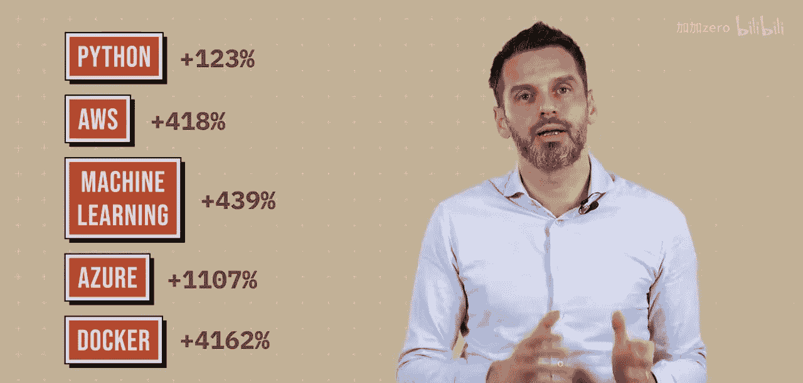
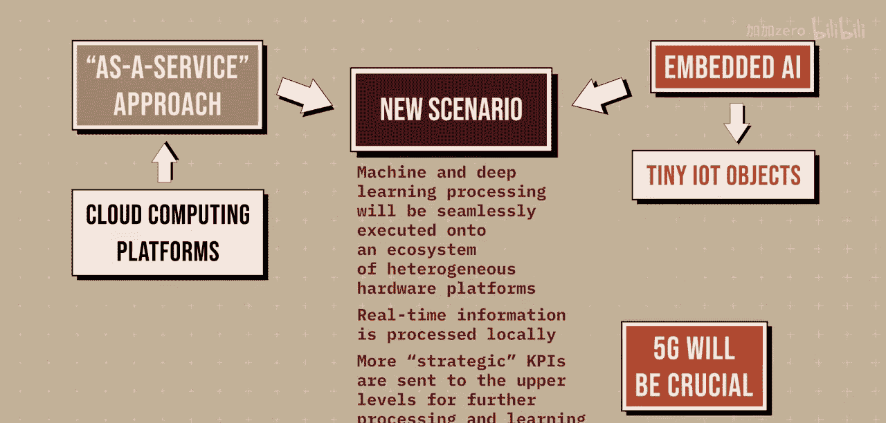
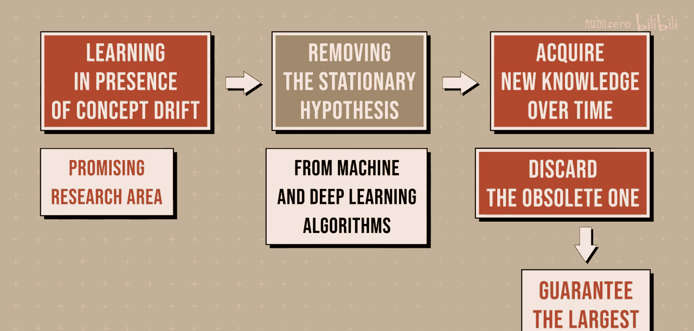

# 【人工智能：概述 专项课程】米兰理工大学—中英字幕 p62 p9_01_challenges-and-opportunities -BV1Er1PYhE9q_p62-

In our technological journey of artificial intelligence。

 we saw that machine and deploying solutions can scale from large data centers to tire energy devices。

 We commented the crucial role of hardware accelerators in the processing of AI solutions。

 and we introduced the machine and deploying solutions provided as a service manner。

The growing interest in these fields is also certified by the skills requested by the top  employers wish list。

Recently， IT Police Spectrum， the Magine of the Institute of Electrical and Electronics Engineers。

 published a very interesting ranking and comparison of the tech skills requested by the top US employers in 2014 and 2019s。

What is really interesting is that tech skills characterized by the largest increase are those associated with machine and deploying solutions and technologies。

😊，For example， Python， which is the programming language of most of the machine and the learning frameworks nowadays available。

 is at the third place of this ranking。The first two positions are occupied by SQL and Java respectively。

Python programming is nowadays requested in roughly 20% of the tech positions with the 123% increase over 2014。

In addition to Python from 2014 to 2019， the request for tech skills like AWS， Ma learning。

 Azure and Docker increased from 400% to 4，000%。Let me point out that AWS， machine learning。

 Azure and Docker are all technical points we addressed in the videos about machine and deep learning as a service。

These amazing numbers let us understand that machine and deployment solutions and technologies are nowadays viable opportunities to be sized。

But which are the challenges to face in order to move things to the ground？

Without trying to be exhaustive， I would like to mention three points。First。

 the convergeence between as a service and embedded AI， second。

 the ability to learn in real world environments that are possibly time varying， and third。

 the role of user privacy in the machine and deploying processing。

We saw that the as a service approach for machine and deep learning is supported by cloud computing platforms。

 why the embedded AI is meant for tiny IUT objects。

These two approaches that nowadays a scene at the external technology will naturally converge into a scenario where the machine and deep learning processing will be seamless executed onto an ecosystem of heterogeneous hardware platforms。

 where realtime information is processed locally， and where more strategic KPIs are sent to the upper levels for further processing and learning。

In this scenario， the upcoming 5G will play a crucial role by means of offloading and orchestration mechanisms。

But this is something we are already seeing in heterogeneous hardware devices， comprising。

 for example， a microcontroller and a GPU。In the global picture。

 the challenge is to scale the design of this heterogeneous hardware to the whole ecosystem of persive devices。

We are pretty sure that the integration between the as service approach and the MeAI will happen in the upcoming years。

 and we expect on one hand that the efficient and effective computing part of the cloud will be propagated to the edge to increase performance。

 scalability and reliability。

And on the other hand， that the IoT units will represent the first line of processing of cloud systems。

Moving machine and deep learning to the real world must encompass the fact that the real world changes or evolves over time。

This is due， for example， to seasonality or periodicity effect， changes in a user's behaviors。

 evolutions of the stock markets， faults or malfunctionings， in sensors orequwaators。

The effect of these variations also called concept drift is that previously learned models become obsolete。

 hence no more effective in processing the new data。From the technical point of view。

 most machine and deep learning algorithms assume that data are IID。

 hence independent and identically distributed。This assumption rarelyly holds in real world scenarios with potentially catastrophic effects on the envisage applications。

We had a relevant example with the occurrence of the COVd-19 pandemic in 2020。

What we knew about our world encoded in our machine and the learning models suddenly became obsolete。

 and we had to learn new models to predict， for example。

 economic trends on the behavior of the users。Learning in presence of concept drift is hence a promising research area。

 aiming at removing the stationary hypothesis from machine and deep learning algorithm。

So as to make them able to acquire new knowledge over time and discard the obsolete one in order to guarantee the largest accuracy even in ten varying scenarios。

Last， but not least privacy。We already commented that the technological evolution of cloud based computing infrastructures intercepted the ever growing demand of machine and deploying solutions through the machine and deploying as a service approach。

Unfortunately， to be effective， this approach requires the processing on the cloud of possibly sensitive user data。

 like for example， personal pictures of videos， medical diagnosis as well as data that might reveal ethnic origin。

 political opinions， but also genetic， biometric and health data。

The challenge we have to face here is to preserve the privacy of users in the machine and the learning as a service computing scenario or more generally in the scenario where acquired information is processed by remote technological actors。

This is a novelble impromising research and technological area of machine and deep learning based。

 for example， on homomorphic encryption and differential privacy。

There is still a lot of work to do in this area， and for sure we will see great advantages in this direction in the next few years。

We commented three out of the many challenges we have to face in the technological journey of AI。

In the next videos of this MC we will see the perspectives of two companies working in this field。

 ST Maceronics and Alcheelab， they will help us in understanding the next big steps in the field of embedded AI and cloud based machine and deep learning for social media stay tuned。

