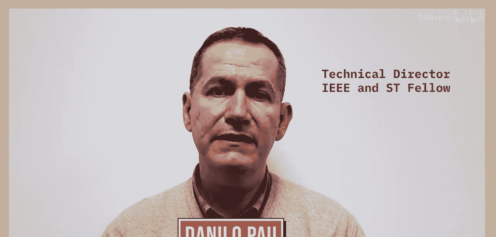
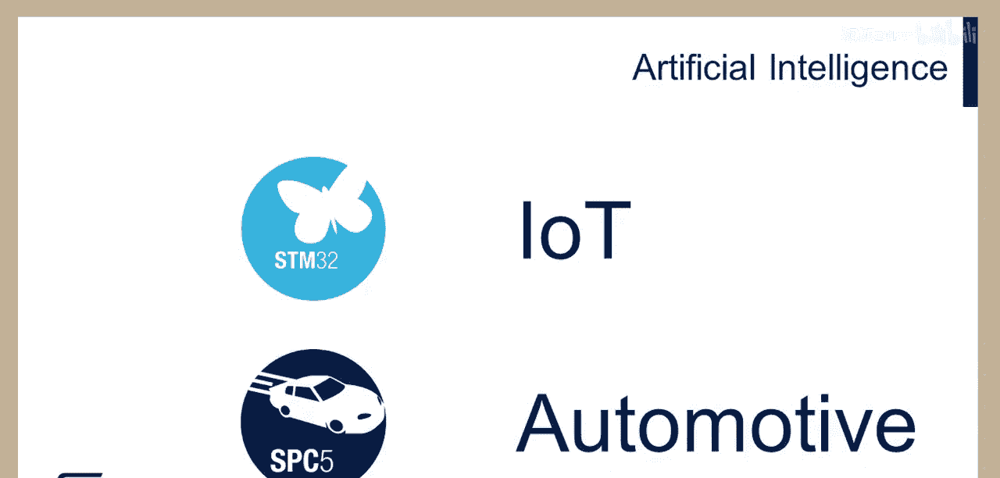
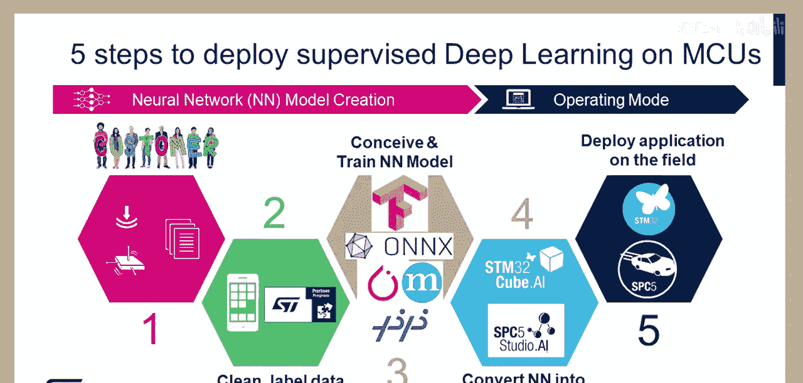
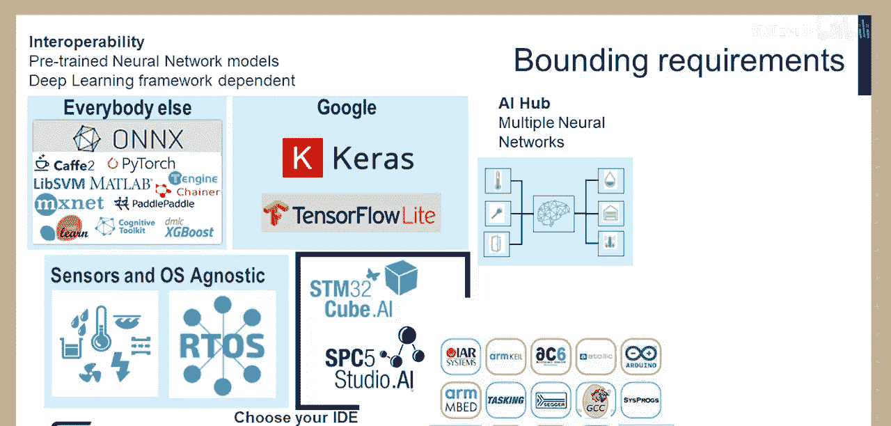
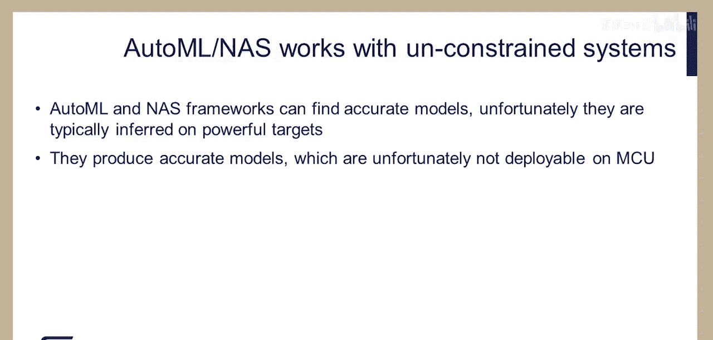
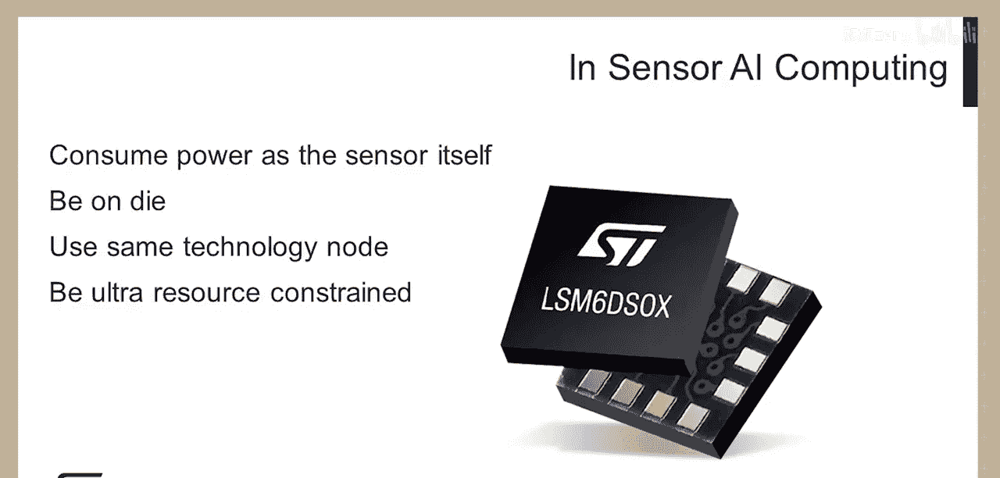

# 【人工智能：概述 专项课程】米兰理工大学—中英字幕 p63 p10_01_case-study-technology-provider -BV1Er1PYhE9q_p63-

Inter of things and computing everywhere are nowadays relevant technological scenarios for AI。

 and industries are playing a crucial role in this field。 Let's hear the point of view of an expert。

😊。

Hi， I am Danielo Pou， technicalical Director AttriP and SDt Fov。

 responsible for the development of artificial intelligence tool for microcontrollers and sensors in a system research and application in a ST microelectronics based in relatively anti。

What is STM microelectronics doing in AI？

To give you a bit of context， ST microelectronics produces and sells a lot of microcontrollers STM32 in the domain of internet of things and SC5 family in the context of automotive application。

 therefore when approaching to artificial intelligence one basic consideration and question was is that a trend subject or a technology singularity Well we came to a conclusion that was the latter and it changed also the way allows to shape application therefore we introduced a methodology composed by five steps in the domain of supervised the deep learning。

 the first step is to conceive an application therefore it means to select sensors that produced。

That feed the application the second step is to acquire enough data and clean them properly label them so that they are ready for the third step in the third step usually an AI application developer is used to design to create a neural network topology and to train it。

Therefore， it uses wellpular deep learning tools such as CAs Tensorflow Pytor。

 and typically they are exported in formats which are used to run neural network on various devices In the fourth step we introduced there is a need to deploy such pertraining neural network on microcontrollers。

 therefore to automatically deploy them and on company made microcontrollers， STM32 and Sfi。

 we introduced a unique technology which automatically translate them into efficient code and libraries that run with scarce resources on those microcontrollers the technology has been emed into tools that have been made public and made available to the developer。

And they are called SM32 cube。 AI and5tudio AI in the fifth step the library generated by those tools are deployed on the microcontroller and therefore field trials on the application can run in order to validate on the field on the field those are tools are being conceived in such a way they satisfy for basic requirements the first is to be interoperable with publicly available deep learning tool such as the one I mentioned care extensionten flow and the one that allows to create on an representation it's important because the interoperability topic because through a welldefined the standard format it is possible for those tool to export per neural network and for our technology to import and do the processing the second requirement is the。

to generate code that can feed any integrated development environment the method that the software community is willing to use there are many ideass around the community which is used to use them and therefore we need to interoperate once again with them how to generating andCC code the third requirement is to be agnostic on any application which means to be agnostic on the selection of the sensor and the realtime operating system in such a way we give the freedom to the developer to shape to define to conceive the application as they which the fourth requirement is to be capable to use the microcontroller as an artificial intelligence hub what does it mean it means the capability to instantiate multiple networks neural networks and to run them independently from any software or scheduler so that。

Microcontroller can run them serving different sensor。

 and the output is the output to be used on S PCC5 and STM 32 microcontrollers。

What do you think is limiting broad AI development？

AI developers typically uncraft neural network topologies in order to feed them on resourcelimted microcontrollers。

 one of the major challenges I see in the future is to allow them to use tools that automatically generate neural network topologies and optimize their hyperparmeter simultaneously in line with the constraints posed by the microcontrollers so what we need in the future are neural architecture searches s hyperparmeter optimization tools guided by resource constraints in order to simultaneously allow the design of the network accurate and deployable on microcontrollers。

After AI and microcontrollers， what do you think the next challenge will be？

After artificial intelligence on microcontrollers the next big trend will be in sensor artificial intelligence computing。

 which means to bring artificial intelligence in the sensor itself which implies a satisfied following requirement。

 B low complex as the sensor itself is therefore be inable on the same dye。

 sharing the same technological node， and be as low power as the sensor it is。

 which imply clearly to be in the micrott power consumption envelope。

🎼So the future of AI is bright and low power。 Thank you， Lalo。😊。

