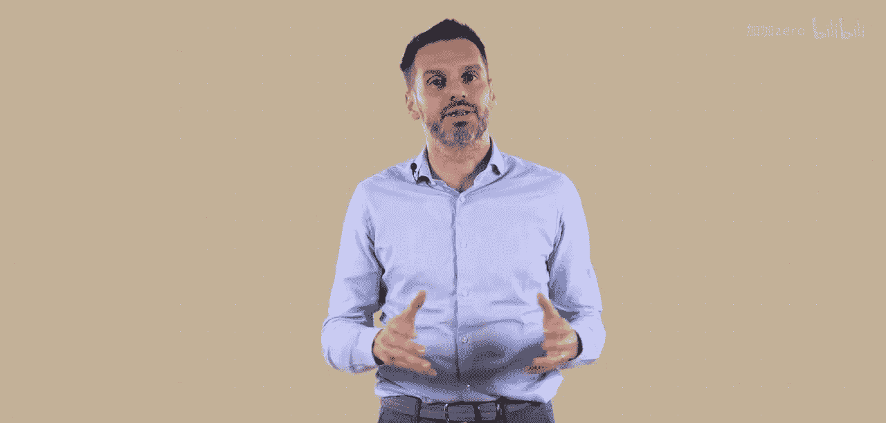
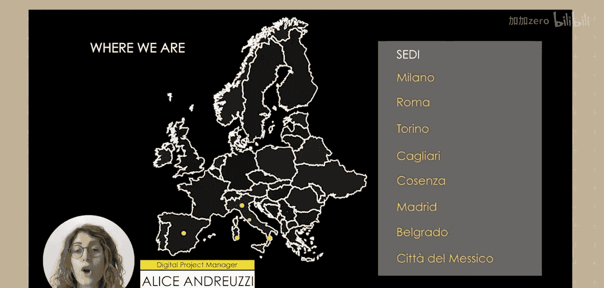
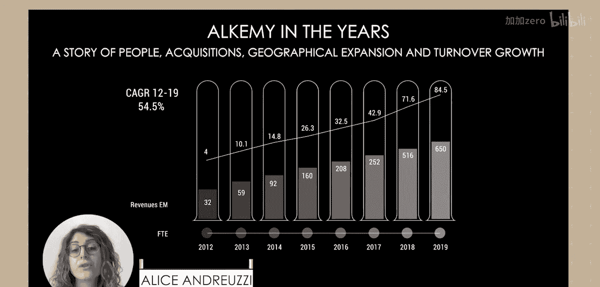
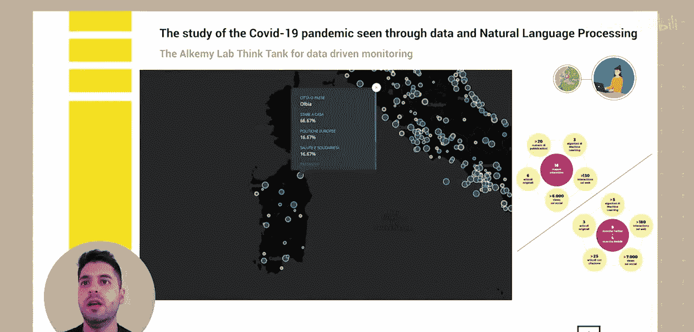

# 【人工智能：概述 专项课程】米兰理工大学—中英字幕 p64 p11_01_case-study-end-user -BV1Er1PYhE9q_p64-

Cloud computing and machine learning play a crucial role in the processing and knowledge extraction from large scale data sets。

😊，An application scenario in this field refers to social media analysis。

 Let's hear the opinion of Alchemy， an Italian company working in this field。

Al communitymuning Evol is an Italian company that operates in the digital transformation market。

 supporting the evolution of large and medium sized companies business models through digital transformation projects。

It helps enterprises to redesign strategies， products。

 and services through the use of technology data。The Camillabu is the innovation and research Str of Acumen。

We all know that in 2020， the CoviID pandemic completely changed our life。

 but how can we get value from the information present on social media in more detail。

 Is it possible to design a cloud based machine learning system to track and measure the discussions on social media related to Covid-19。

In February 2020， the Alcheer Riny La created a T tank to monitor data drivenven communication on the COveID-19 epidemic with the h to track the progress of discussion on Twitter and read it。

 natural language processing， topic modeling recognition algorithms made it possible to identify and track the most relevant discussions between conversation on Twitter in Italy。

 a club based platform for collecting data from Twitter。

 color perception data intelligence allowed collecting over 6 million tweets in Italian relating to discussions on the CoVID and Tt。

To identify the main three times inherent to the coona videos on Twitter and LP techniques have been involved。

 each extracted tweets text as being automatically transformed into numerical medical vectors and modeled with topic modeling algorithms。

 to identify the main topics inherent to the coona videos on Twitter。Every week。

 starting from March 20 to June 12， the Alms identified three main topics。

In the last week of March 2020， the analysis recorded a peak of over 50，000 tweets。

 well in May the volume of weekly conversation settled around a 20，000 tweet。

The recurring topics recognized are stayatom， European policies， health and immigration。

 The last one the immigration topic is the most enduring overtime while European policies term in central especially at the beginning of spring 2020。

And what about fake news。How can we design cloud based systems based on machine learning to detect fake news？

The recent global emergency caused by the spread of the coronavirus pandemic has generated discard feelings over the population。

 At the same time， they continue search of the latticeco as favor the dissemination first news service misinformation。

 especially within the instant messaging appss， blogs， microlos and social media。

 the fake news taken into consideration and the following the spread of the virus in Italy will be related to the presence of migrants。

 COviID19 is said to be a virus linked to weapons programme M5G and many others。 In these works。

 we extracted the data relating to each of these fake news we possess the text body of the data。

 and we modelly order to discover interesting features using innovative techniques in the further machine learning and other language processing。

The study also addresses the issue of the Chinese communication in Italy some tweets with was sharing of are attribute of fake news。

 the analysis identifiedifies some unpulated videos dis on Twitter in support of fake news。

 and these works have been published by numerous media like New York Times and Times Magaz。

 A further analysis carried out by Akimiab with A University aims to investigate communication on Twitter rather than Telegram related to Qon an international conspiracy theory。

 the complete network analysis showed that many accounts turn out to be automated with a widespread fake news。

Let's make a step ahead in the field of machine learning and cloud based processing of social data。

What is social data intelligence and how can it be related to electoral campaigns。

The analysis is a process of inspecting， cleaning， transforming and modeling data with the goal of discovering useful information。

 suggesting conclusion and supporting decision making Social data intelligence is a particular form of data analysis that is focused on social media data people use social media to write down their impressions。

 opinions and feelings about political events， social phenomenon of famous people Social data intelligence means collecting。

 analyzing and interpreting the public sphere from a political point of view it represents an opportunity to analyze political preferences。

 figure out how each party has addressed their electoral campaign。

 how they are communicating with people and what kind of feelings they generate on the public。

There are two main kinds of analyses that can be made on social media。Quantitative analysis。

 the analysis that consider every mention or a related to a candidate as an expression of the intention to vote。

 it can be geographical， we can define which area the majority of posts about candidate are place or temporal if you want to analyze how the conversations change day by day Qua analysis。

 the analysis that considers what people write down about candidates。

 and it can be based on text analysis， sentiment analysis。

 machine learning algorithms social media intelligence in politics cannot replace the opinion votes。

 however， it can represent an economic sustainable and faster way to collect information about what people really think about the election political parties and candidates。

Thank you for the very interesting insight。Cloud computing and machine learning are paving the way for new research areas。

 new technologies， and new perspectives in social media analysis。😊。

