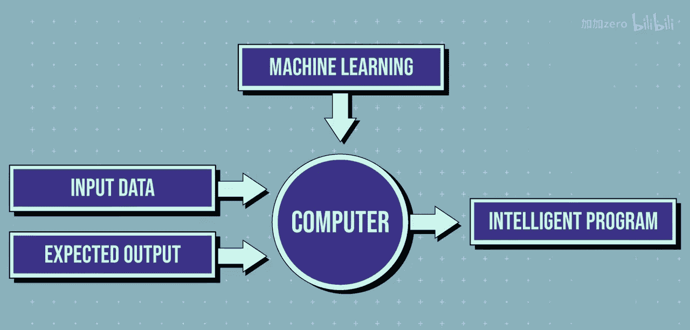
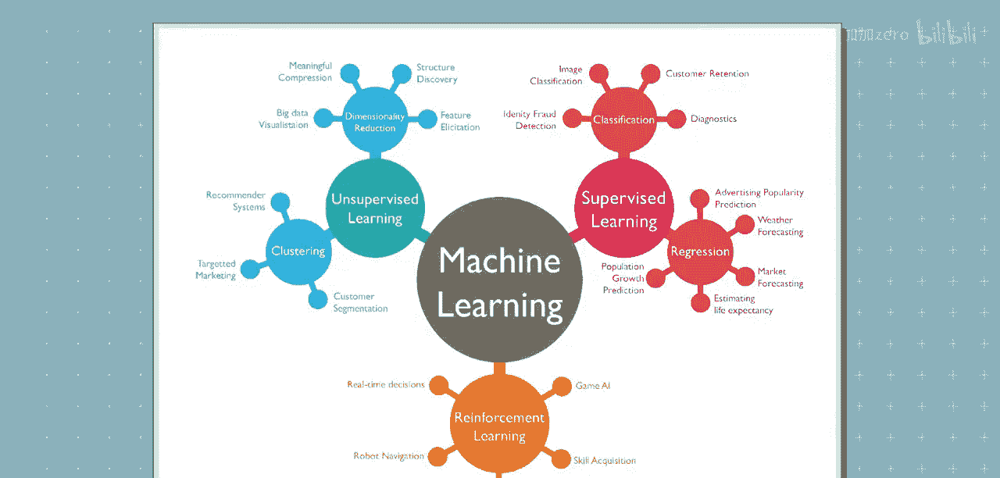
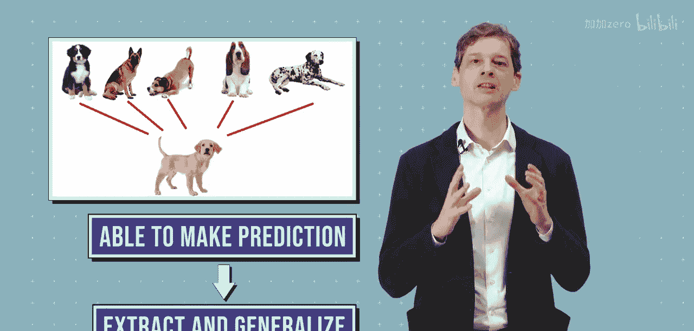
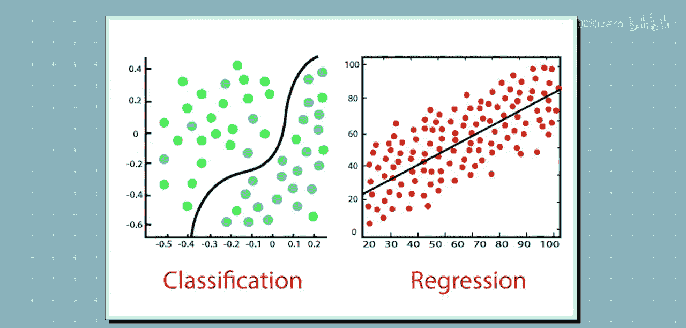
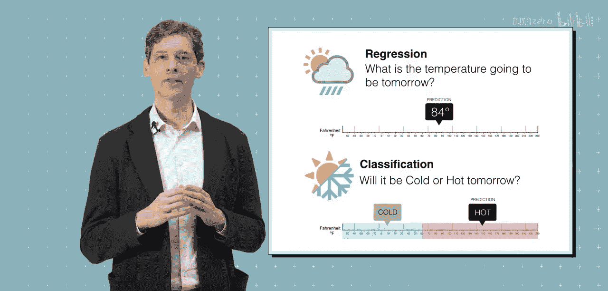
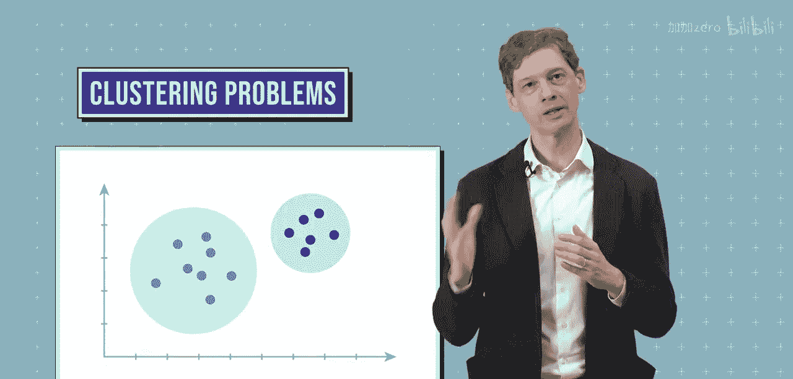
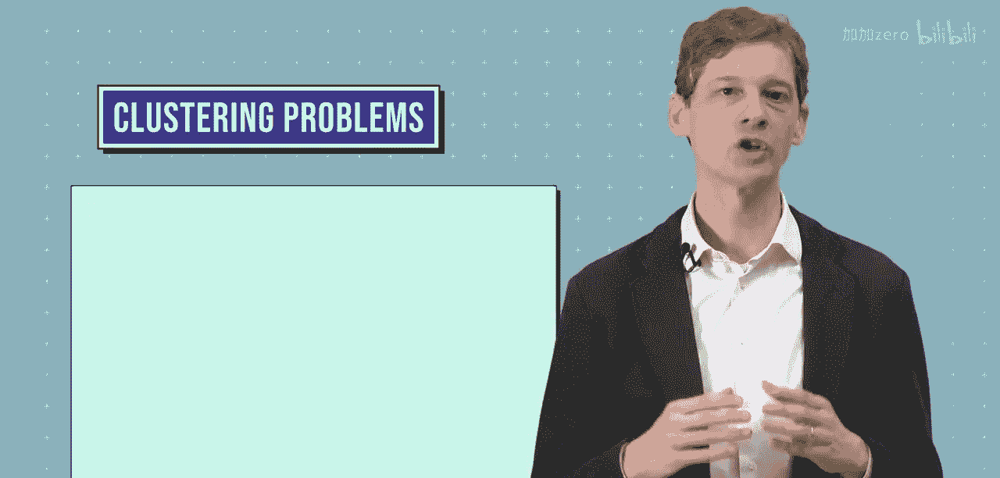
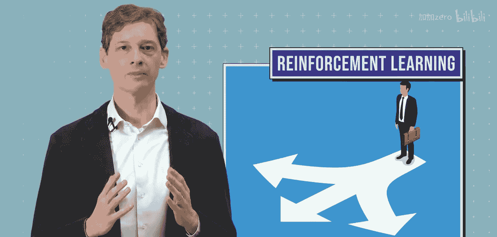
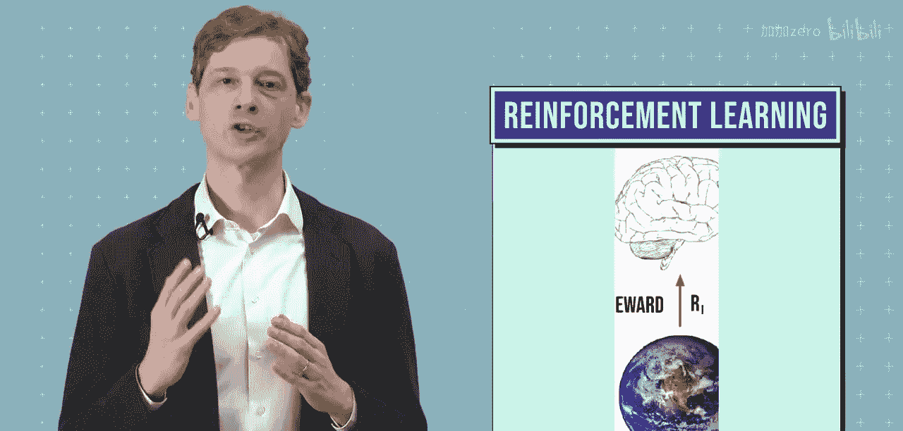

# 【人工智能：概述 专项课程】米兰理工大学—中英字幕 p65 p0_01_introduction-to-machine-learning -BV1Er1PYhE9q_p65-

Welcome to the machine learning course。This course provides a high level overview of technology that is changing our lives by transforming everything from the tech industry to agriculture。

 insurance， banking and marketing。

We use machine learning dozens of times a day， without even knowing it。

Each time we use a web search engine， our spam filter， detects and emails or the photos containing。

 Our friends are automatic grouped， we are exploiting machine learning algorithm。😊。

Bill Gates said a breakthrough in machine learning would be worth 10 Microsoft。The director of DARPA。

 the Research and Development Agency of the US Department of Defense。 Tony Theer said。

 machine learning is the next Internet。These are just some of the many claims made about machine learning that show the interest of both the most powerful nation and the most important companies for this technology。

Driven by the astonishing results obtained by machine learning algorithm in the last decade。

 billions of euros are invested every year in this field for public and private research。

But what is machine learning？In 1997， Tom Mitchell， professor at Kennedynegie Mellon University。

 provided this definition。A computer program is set to learn from experience E with respect to some class of task T and performance measure P。

 If its performance at a task T as measured by P， improves with the experience E。

One of the key elements of this definition is the experience。

Unlike classical artificial intelligence approaches。

 which uses a top down deductive approach based on models。

 machine learning algorithms exploit a bottom up inductive approach thats starting from experience data。

 the text patterns that are used to develop general conclusions。Since knowledge is induced from data。

 machine learning algorithms may fail， as I cannot learn something that I have not experienced。

Using the words of Arthur Samuel in 1959， machine learning is the field of study that gives computers the ability to learn without being explicitly programmed。

Traditional programming is a manual process in which a person， the programmer。

 develops a program that runs on the computer and uses input data to produce the output。

In machine learning， this par is overturned to get an automated process。

Starting from the input data and the corresponding desired output。

 machine learning algorithm automatically developed the program。

In this way， computers programmed themselves this。Machine learning is useful whenever we don't know。

 or it's very complex to explain to the machine how to solve a certain task。

While it is easier to show the machine examples of how to the problem is solved and let it learn to find the solution on its own。

For instance， suppose that we want to develop a program to recognize animals from their picture。

Using traditional programming， we would need to write many lines of code to specify how to process the image and what characterizes a certain animal species compared to others。

Using machine learning instead， we simply have to provide a set of examples where for each image。

 we need to indicate which animals is portrayed。Machine learning techniques can be roughly divided into three main categories。

Supervised learning， unsupervised learning and reinforcement learning。

Supervised learning aims at inferring a model， mapping an input space X to an output space Y。

 given a data set of examples。We refer to these techniques as a supervised because for each example in the data。

We have the association between the observation variables available as input and the output label value produced by a supervisor。

Going back to the previous example， the observation are the images of animals。

 and the labels are the names of the animals。Once we have trained a supervised learning technique over a data set of examples。

 we want the learn model to be able to make prediction about new uneen observation。 In other words。

 we want to learn models that can extract and generalize the knowledge contained in the training dataset。

Similar to what our brain does。In fact， we are able to recognize a dog。

 even if we have never seen that particular dog before。

Supervised learning techniques can be applied both into classification and regression problems。

In classification problems， the output variable to be predicted is categorical or discrete。

While in regression problems， the output variable is numerical or continuous。

For example， consider a weather forecasting problem where given a set of meteorological input variables。

 we have to predict the weather tomorrow。

If the expected output is a label like sunny， cloudy， rainy， we have a classification problem。

While if we have to predict the temperature during the day， it is a regression problem。

Let's move to the second category of machine learning techniques。

Unsupervised learning aims at finding a better representation for the data。In this case。

 we have a data set of observation without any output variable。

 and we want to discover hidden structure from unlabeled data。

Developing better data representation may be an essential step in solving the other machine learning problems。

 performing data analysis and data visualization。Unsupervised models can be further grouped into clustering association and dimensionality reduction problems。

In clustering problems， we want to unveil the inherentrant groupings in the data。A cluster is。

 therefore a collection of objects that are similar between them and are dissimilar to the obvious belonging to other clusters。

For example， in retail stores， clustering can be used to group the customers according to their purchasing habits in order to devise a separate business strategy for each group。

In association of real Learning， we want to identify new and interesting patterns in our dataset。

Which are usually represented in form of rules or frequent item sets。

They are commonly used for market basket analysis to know which items are bought together。

 for customer or clustering in retail， to know which store people tend to visit together。

 price bundling for assortment decisions， cross selling and others。Finally。

 the third andsupervised learning problem is dimensional cure reduction。

Dimenssal key reduction techniques aim at reducing the number of variables present in the data。

In most cases， these variables can have a large correlation。

 making their representation redundant and negatively affecting the training of machine learning models。

Reducing the number of variables without losing too much information is of paramount importance for increasing efficiency and the reliability of the learning process。

Dimmensality reduction can be achieved through feature selection。

 which is the selection of a subset of the original variables or through feature extraction。

 which consists of projecting the original variables into a new， usually smaller set of variables。

The third category of machine learning techniques is reinforcement learning。

Reinforcement learning aims at solving sequential the making problems。In this case。

 the agent that is the decision Chi maker learns by interacting with the environment。

At teacher iteration， the agent perceives the information from the environment。

Selected the chisson based on user information， and the receives a reward。

Which is a numerical value that the agent aims at maximizing over time。

Your enforcement learning agent learns by trial and error， just as animals。

 and you must do when they learn to walk， talk， drive， cook， etc。

Reinforcement learning finds application in many real world problems， such as digital advertising。

 resource management， medicine， autonomous driving， automatic trading and many others。

In the next lectures， we will cover these three categories of machine learning techniques in more detail。

 starting with supervised learning ones。🎼。