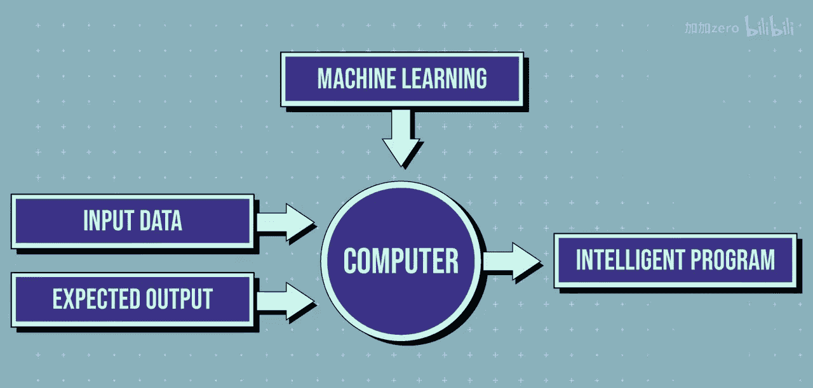
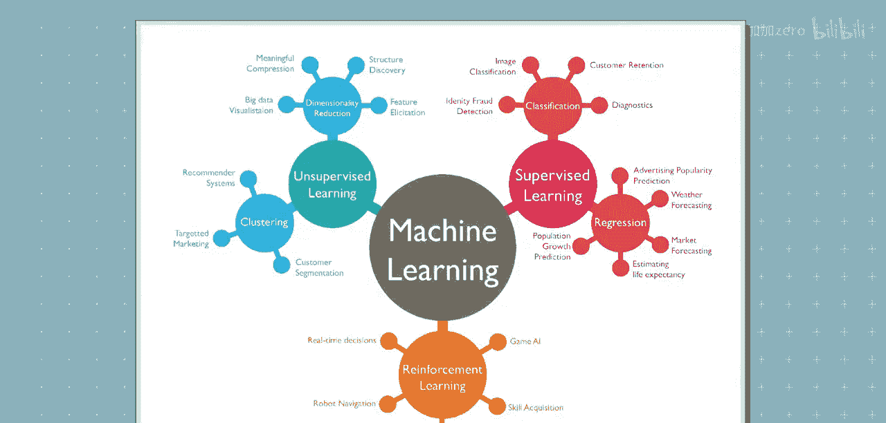
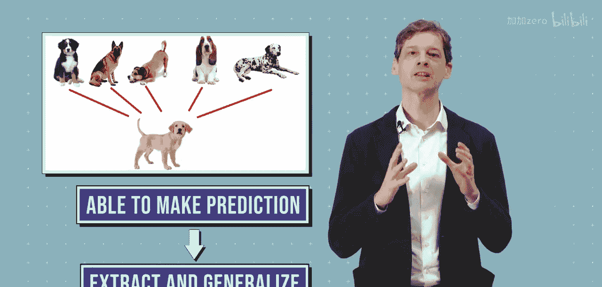
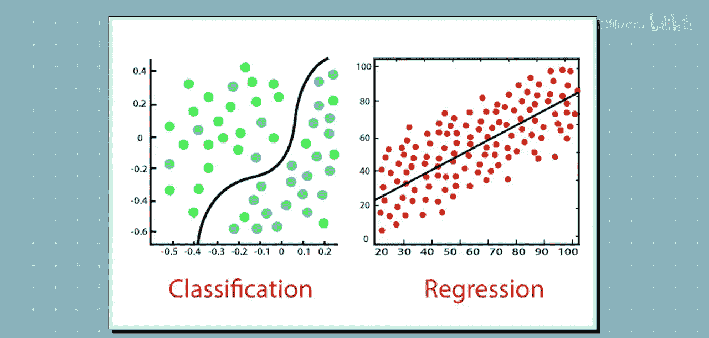
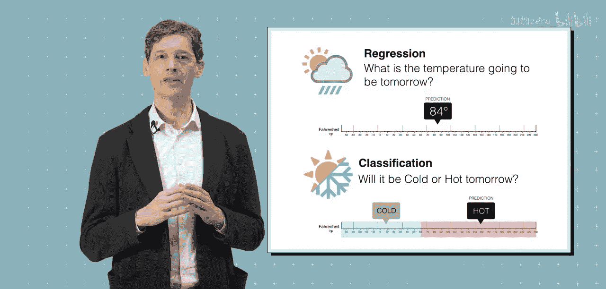
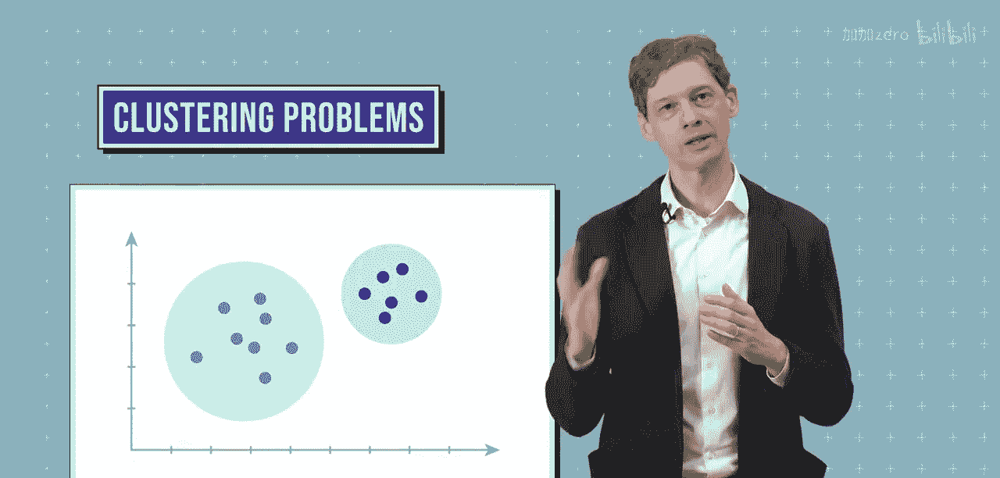
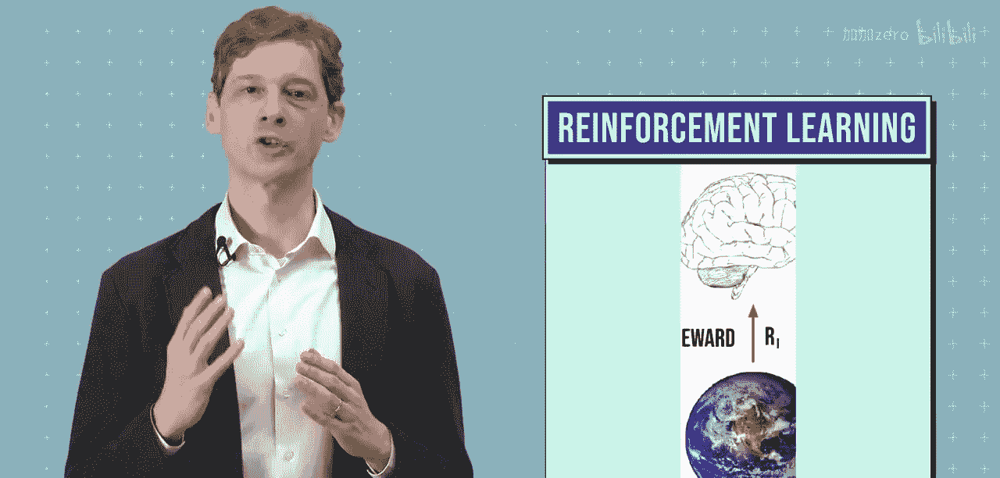

# 人工智能：概述 专项课程：0：机器学习导论 🧠

在本节课中，我们将要学习机器学习的基本概念。我们将了解什么是机器学习，它为何重要，以及它如何通过从数据中学习来改变我们解决问题的方式。课程将介绍机器学习的三种主要类型，并解释它们各自的应用场景。

---

欢迎来到机器学习课程。本课程将概述一项正在改变我们生活的技术，其影响遍及科技行业、农业、保险、银行业和市场营销。

我们每天会使用机器学习数十次，甚至没有意识到这一点。每次使用网络搜索引擎、垃圾邮件过滤器检测邮件，或自动分组包含朋友的照片时，我们都在利用机器学习算法。

比尔·盖茨曾说，机器学习领域的突破将抵得上十个微软。美国国防部高级研究计划局（DARPA）的主任托尼·蒂尔则表示，机器学习是下一个互联网。这些只是众多关于机器学习的论断中的一部分，它们显示了最强大的国家和最重要的公司对这一技术的浓厚兴趣。

在过去十年中，机器学习算法取得的惊人成果推动了该领域的飞速发展。每年都有数十亿欧元投入到该领域的公共和私人研究中。

那么，什么是机器学习？1997年，卡内基梅隆大学的汤姆·米切尔教授给出了这个定义：**一个计算机程序被认为能从经验E中学习，以解决任务T，并通过性能度量P来衡量，如果它在任务T上的性能（由P衡量）随着经验E的增加而提高**。

这个定义的关键要素之一是“经验”。与基于模型、采用自上而下演绎方法的经典人工智能方法不同，机器学习算法利用自下而上的归纳方法，从经验数据（即文本模式）出发，用于得出一般性结论。由于知识是从数据中归纳出来的，机器学习算法可能会失败，因为它无法学习从未经历过的东西。

用亚瑟·塞缪尔在1959年的话来说，机器学习是**赋予计算机无需明确编程就能学习的能力的研究领域**。传统编程是一个人工过程，程序员开发一个在计算机上运行的程序，使用输入数据来产生输出。在机器学习中，这个过程被颠覆以实现自动化。从输入数据和相应的期望输出出发，机器学习算法会自动开发出程序。

这样一来，计算机实现了自我编程。机器学习在我们不知道如何解决某个任务，或者向机器解释如何解决该任务非常复杂时特别有用。而向机器展示问题如何解决的例子，并让它自己学习找到解决方案则更为容易。

例如，假设我们想开发一个从图片中识别动物的程序。使用传统编程，我们需要编写许多行代码来指定如何处理图像，以及某个动物物种与其他物种相比的特征是什么。而使用机器学习，我们只需提供一组示例，其中每张图片都需要标明描绘的是哪种动物。

机器学习技术大致可分为三个主要类别：**监督学习**、**无监督学习**和**强化学习**。

---

上一节我们介绍了机器学习的定义和基本思想，本节中我们来看看第一种主要类型：监督学习。

## 监督学习 🎯

监督学习的目标是，在给定一个示例数据集的情况下，推断出一个将输入空间X映射到输出空间Y的模型。我们称这些技术为“监督”的，因为对于数据中的每个示例，我们都有观察变量（作为输入）与由监督者提供的输出标签值之间的关联。

回到之前的例子，观察变量是动物的图像，标签是动物的名称。一旦我们在示例数据集上训练了监督学习技术，我们希望学习到的模型能够对新的、未见过的观察进行预测。换句话说，我们希望学习能够提取并泛化训练数据集中包含的知识的模型。

这与我们大脑的工作方式类似。事实上，即使我们从未见过某只特定的狗，我们也能认出它是一只狗。

监督学习技术可以应用于分类和回归问题。

以下是这两种问题的区别：

*   **分类问题**：要预测的输出变量是**类别型**或**离散**的。
*   **回归问题**：要预测的输出变量是**数值型**或**连续**的。

例如，考虑一个天气预报问题，给定一组气象输入变量，我们必须预测明天的天气。如果期望输出是“晴天”、“多云”、“雨天”这样的标签，那么这是一个分类问题。而如果我们需要预测一天中的温度，则是一个回归问题。

---

了解了监督学习后，接下来我们探讨第二种类型：无监督学习。

## 无监督学习 🔍

无监督学习旨在为数据找到更好的表示。在这种情况下，我们有一个没有输出变量的观察数据集，我们希望从未标记的数据中发现隐藏的结构。

开发更好的数据表示可能是解决其他机器学习问题、进行数据分析和数据可视化的重要步骤。无监督模型可以进一步分为聚类、关联和降维问题。

以下是这三种无监督学习问题的介绍：

*   **聚类问题**：我们想要揭示数据中固有的分组。一个聚类就是一组彼此相似且与其他聚类中的对象不同的对象的集合。例如，在零售店中，聚类可用于根据客户的购买习惯对客户进行分组，以便为每个群体制定单独的商业策略。
*   **关联规则学习**：我们希望识别数据集中新的、有趣的模式，这些模式通常以规则或频繁项集的形式表示。它们通常用于市场篮子分析，以了解哪些商品被一起购买；用于零售业中的客户或商店聚类，以了解人们倾向于一起光顾哪些商店；以及用于捆绑定价、产品组合决策、交叉销售等。
*   **降维问题**：降维技术旨在减少数据中存在的变量数量。在大多数情况下，这些变量可能具有高度相关性，使得它们的表示冗余，并对机器学习模型的训练产生负面影响。在不丢失太多信息的情况下减少变量数量，对于提高学习过程的效率和可靠性至关重要。降维可以通过**特征选择**（选择原始变量的一个子集）或**特征提取**（将原始变量投影到一个新的、通常更小的变量集合中）来实现。

---

最后，我们来了解机器学习的第三种主要类型：强化学习。

## 强化学习 🎮

强化学习旨在解决顺序决策问题。在这种情况下，**智能体**（即决策者）通过与**环境**交互来学习。

在每次迭代中，智能体感知来自环境的信息，基于这些信息选择行动，然后获得一个**奖励**。奖励是一个数值，智能体的目标是随着时间的推移最大化这个累积奖励。

强化学习智能体通过试错来学习，就像动物（以及人类）在学习走路、说话、驾驶、烹饪等时所做的那样。强化学习在许多现实世界问题中都有应用，例如数字广告、资源管理、医学、自动驾驶、自动交易等。

---

在本节课中，我们一起学习了机器学习的基本概念。我们了解了机器学习的定义、其与传统编程的区别，并详细介绍了机器学习的三种主要类型：监督学习、无监督学习和强化学习。在接下来的课程中，我们将更深入地探讨这三类机器学习技术，从监督学习开始。