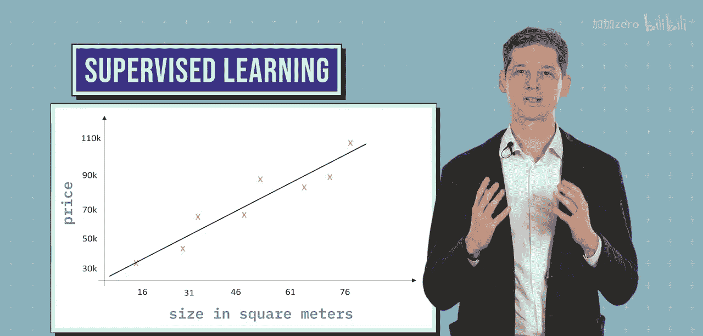
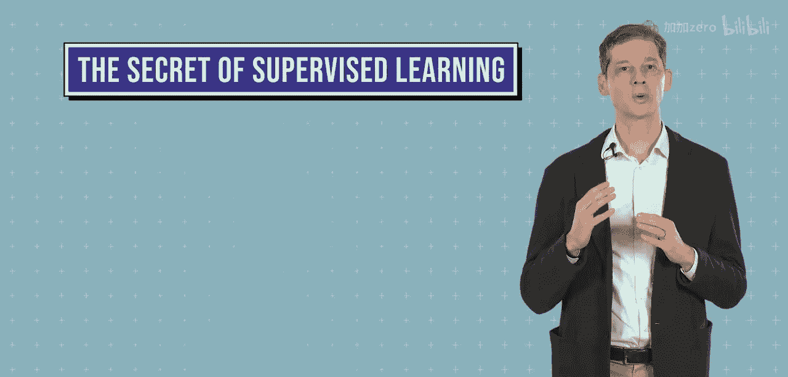
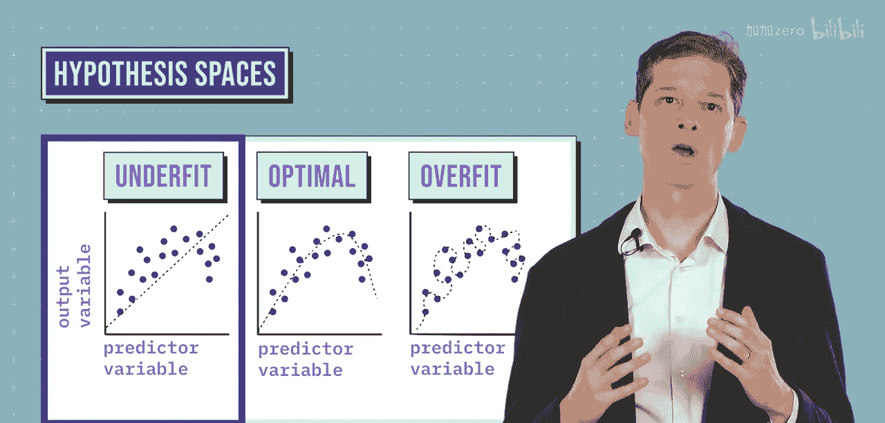
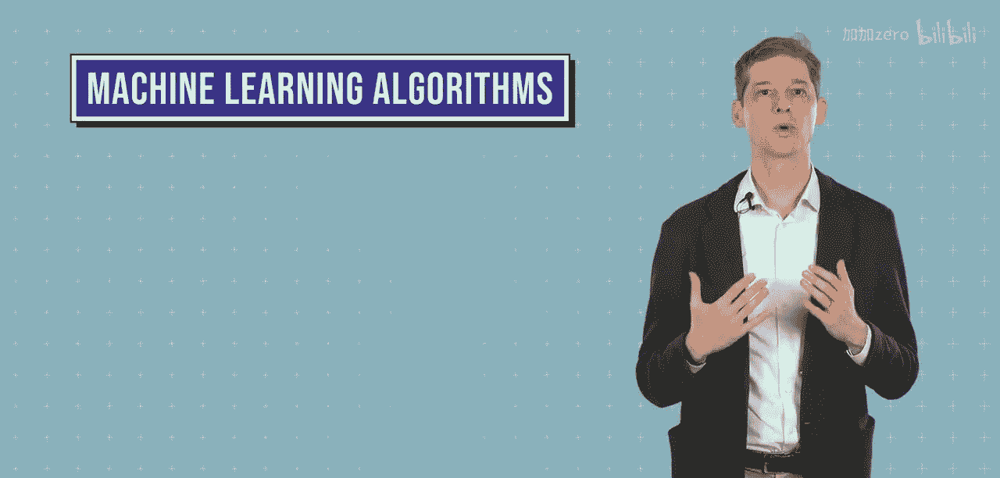
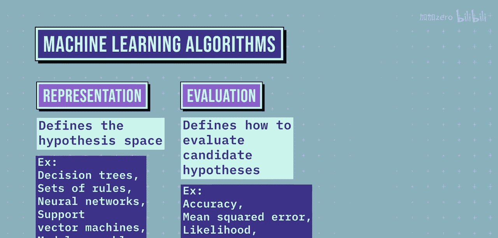
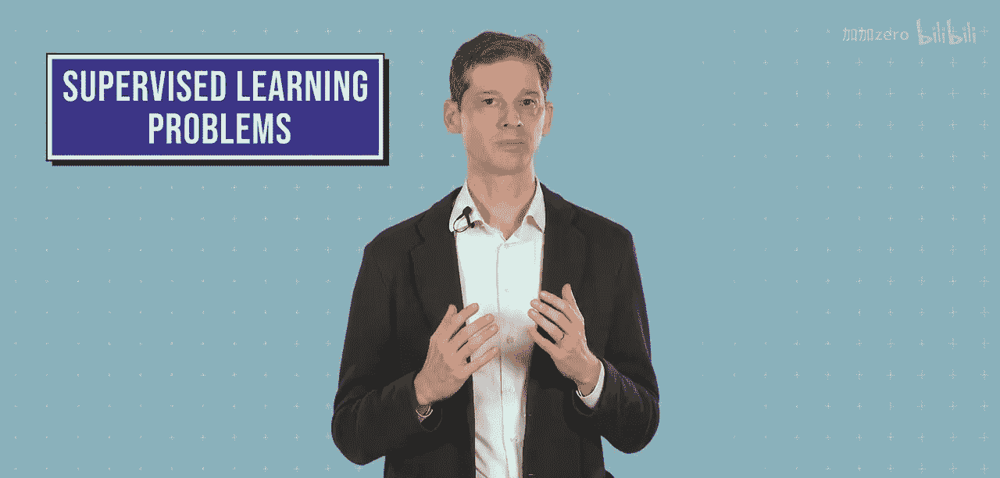

# 【人工智能：概述 专项课程】米兰理工大学—中英字幕 p66 p1_01_supervised-learning-problem -BV1Er1PYhE9q_p66-

Predicting the price of a house， identifying what objects are present in an image。

Predicting the weather condition in a particular location。

Understanding whether a customer review is positive or negative are just a few examples of problems that can be solved using supervised learning。

Supervised learning is the largest， most mature， most widely used up field of machine learning。

As the name indicates， supervised learning involves machine learning algorithms that learn under the presence of a supervisor。

The supervisor provides a set of examples， usually called training set。

To the machine learning algorithm。Each example is made up of a set of input variables， X。

 also called features， predictors or attributes。And one or more output variables。

 y also called the targets， responses or labels。The goal of a supervised learning algorithm is to learn a model that well approximates the functional relationship F between the input variables X and the output variables y。

Most importantly， we want to learn models that generalize well outside the example used during training。

For example。In a house prediction problem， the supervisor could provide a set of examples where the price of each house。

 which is the output variable， is related to its size。In the figure。

 the yellow cross also represented examples and the black line。

 a possible model to explain the relationship between size and price。

So when is a supervised learning useful？Supervised learning is not the right answer to all the problems。

But there are four cases where we can benefit from this technique。First。

Problems where there is no human expert。If people do not know the answer。

 they cannot write a program to solve it。This is the case of DNA analysis， or drug discovery。Second。

Problems where humans can perform the task。But no one can describe how to do it。

This is the case of object detection in images or text analysis。Third。

Problems where the desired function change frequently。

Even if humans are able to write a program to do it。As the problem changes too often。

 it is not cost effective。Examples include stock price predictions。Fourth。

 problems where each user needs a custom function。It is not cost effective to write a custom program for each user。

Examples are the recommendation of movies on a streaming platform or the development of spam filters。

Then。How can we solve a supervised learning problem。As previously mentioned。

 our goal is to approximate the unknown function F that relates input x to output y。

 given a data set D。To solve a supervised learning problem， we need to define three main components。

Evaluation by defining a loss function L。Representation。By defining a hypothesis space， H。

Optimization by defining an algorithm O， which minimizes the loss function L over the hypothesisthe space H。

In order to visualize these concepts， let's look at this graph。

With capital H， we denoted the space of all the possible function that met x into y。In this space。

 the function we want to learn is represented by a point。

Lowercase F is the unknown function that we want to approximate。

The loss function L is used to measure the dissimarity between any function and function F。

In the graph， the loss value for each function is represented with different intensities。

 The lighter the color， the lower the loss。Ideally， the loss function in f is 0。

 and its value increases， as we consider function that are very different from F。

The search for a function that approximates f is performed over a subspace of all the possible function。

 which is called hypothesissitive space。In the graph， denoted by capital H1。

Each hypothesis in the hypothesis space is a candidate solution to our problem。As shown in the graph。

 the hypothesis space may not contain the derived function have。Finally， to find the best hypothesis。

 lower case H1 inside our hypothesis space， we need an optimization algorithm that minimizes the chosen loss function。

😊，What we have described so far is not supervised learning， but function approximation。

If we want to improve our solution in functional approximation， we can enlarge the space。

Rather adding more chances to include the desired function F。

The scene does not hold for supervised learning。In fact。

 C function F is unknown in supervised learning。 The loss function cannot be computed as a distance with respect to F。

Hence， the ideal loss function is replaced by an empirical loss function。

 which is computed over the training dataset。The empirical loss function can be seen as a noisy measure of the ideal loss function。

The noise is greater。 The fewer examples are available in the training dataset。

This implies that when I have small data， increasing the size of the hypothesis space is risky。

As the optimization algorithm is negatively affected by the noise on the loss function。In fact。

 in the graph， we see that the minimum of the empiricalos function can lead to a solution that is far from the true function F。

The main secret of supervised learning is to find the appropriate size of the hypothesis space。

 given the amount of data available for training。

If we consider hypo species that are too large， with respect to the number of samples we are the risk of overfitting the data。

 that is learning very complex function that explain the trained data very well。

 but they are unable to generalize。On the other hand。

If we focus our search on a too small hypothesis space， we run the risk of underfitting。

 that is to learn models that are too simple to explain the behavior of the unknown function F。

As we will see， any supervised learning technique as one or more hyperparameter that can be used to find the proper balance and avoid both underfetting and overfitting。

To summarize， there are thousands of machine learning algorithms。But each one has three components。

Representation that defines the hypothesis space。Examples include the decision trees， set of rules。

 neural network， support better machines， model assembled sampless， and many others。Evaluation。

That defines how to evaluate candidate hypothesis。Examples include accuracy means gureor， likelihood。

 entropy and others。

And optimization that defines how to search for the best hypothesis。For example。

 combinatory optimization， convex optimization， constrained optimization。In conclusion。

 supervised learning problems can be classified into two categories。

 according to the output variable。

Regression problems where the output variable is a continuous one and classification problems where the output variable is a discrete one。

🎼In the next two lectures， we will provide an overview of the techniques used for solving problems in these two categories。

