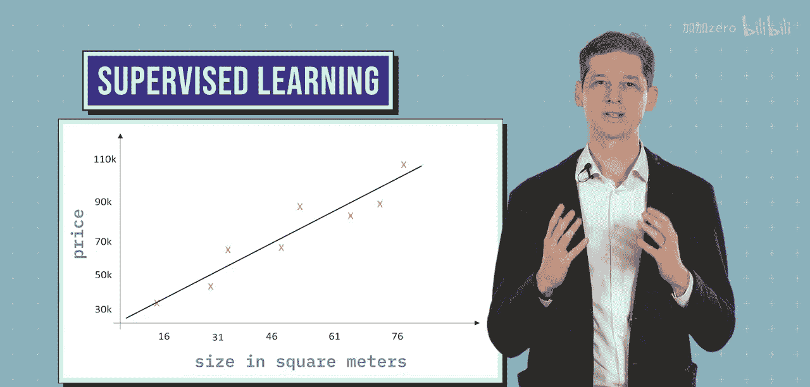
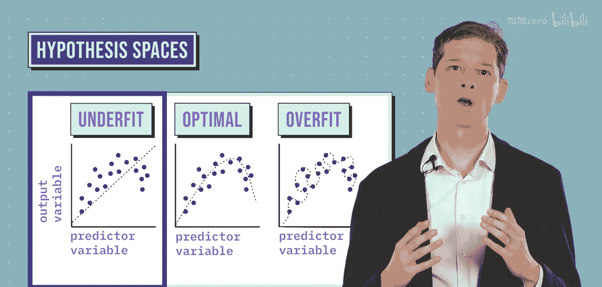
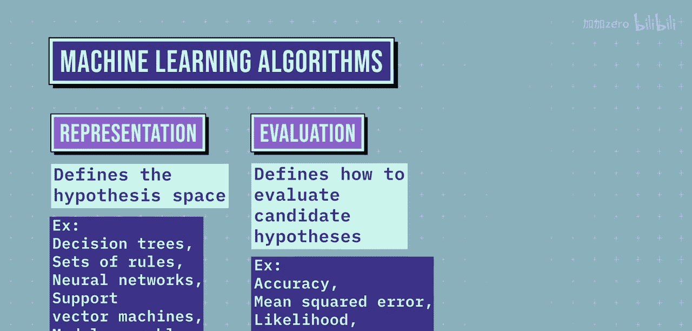

# 人工智能：概述 专项课程：1：监督学习问题

在本节课中，我们将要学习监督学习的基本概念。监督学习是机器学习中最大、最成熟、应用最广泛的领域。我们将了解其定义、适用场景、核心解决框架以及需要注意的关键问题。

预测房屋价格、识别图像中的物体、预测特定地点的天气状况、判断客户评论是正面还是负面，这些都是可以使用监督学习解决的问题。

监督学习是机器学习中规模最大、最成熟、应用最广泛的领域。顾名思义，监督学习涉及在“监督者”的指导下进行学习的机器学习算法。

监督者提供一组示例，通常称为**训练集**。每个示例由一组输入变量 **X**（也称为特征、预测变量或属性）和一个或多个输出变量 **y**（也称为目标、响应或标签）组成。监督学习算法的目标是学习一个模型，该模型能很好地近似输入变量 **X** 和输出变量 **y** 之间的函数关系 **F**。最重要的是，我们希望学习的模型在训练时使用的示例之外也能很好地**泛化**。

例如，在房价预测问题中，监督者可以提供一组示例，其中每栋房屋的价格（即输出变量）与其面积相关。在图中，黄色十字代表示例，黑线代表解释面积与价格之间关系的一个可能模型。

## 监督学习的适用场景

监督学习并非所有问题的正确答案，但在以下四种情况下，我们可以从这项技术中受益：

1.  **没有人类专家的问题**。如果人们不知道答案，就无法编写程序来解决它。例如DNA分析或药物发现。
2.  **人类可以执行任务，但无人能描述如何做的问题**。例如图像中的物体检测或文本分析。
3.  **所需功能频繁变化的问题**。即使人类能够编写程序来实现，但由于问题变化太快，编写程序的成本效益不高。例如股票价格预测。
4.  **每个用户都需要定制功能的问题**。为每个用户编写定制程序的成本效益不高。例如流媒体平台上的电影推荐或垃圾邮件过滤器的开发。

## 如何解决监督学习问题

如前所述，我们的目标是在给定数据集 **D** 的情况下，近似未知的、关联输入 **x** 和输出 **y** 的函数 **F**。

要解决监督学习问题，我们需要定义三个主要组成部分：

1.  **评估**：通过定义**损失函数 L**。
2.  **表示**：通过定义**假设空间 H**。
3.  **优化**：通过定义**优化算法 O**，该算法在假设空间 **H** 上最小化损失函数 **L**。

为了可视化这些概念，让我们来看下面这张图。

我们用大写 **H** 表示所有可能将 **x** 映射到 **y** 的函数的空间。在这个空间中，我们想要学习的函数用一个点表示。小写 **f** 是我们想要近似的未知函数。

**损失函数 L** 用于衡量任何函数与函数 **f** 之间的差异。在图中，每个函数的损失值用不同的强度表示，颜色越浅，损失越低。理想情况下，函数 **f** 本身的损失为0，当我们考虑与 **f** 差异很大的函数时，损失值会增加。

对近似 **f** 的函数的搜索是在所有可能函数的一个子空间上进行的，这个子空间称为**假设空间**，在图中用大写 **H1** 表示。假设空间中的每个假设都是我们问题的一个候选解决方案。如图所示，假设空间可能不包含目标函数 **f**。

最后，为了在我们的假设空间中找到最佳假设（小写 **h1**），我们需要一个优化算法来最小化所选的损失函数。

## 监督学习与函数近似的关键区别

到目前为止，我们描述的是函数近似，还不是监督学习。如果我们想在函数近似中改进解决方案，可以扩大假设空间，增加包含目标函数 **f** 的机会。

但这个场景不适用于监督学习。因为在监督学习中，函数 **f** 是未知的，损失函数无法计算为与 **f** 的距离。因此，理想的损失函数被**经验损失函数**所取代，该函数在训练数据集上计算。经验损失函数可以看作是理想损失函数的一个带噪声的度量。训练数据集中的示例越少，噪声就越大。

这意味着，当数据量较小时，扩大假设空间是有风险的，因为优化算法会受到损失函数上噪声的负面影响。事实上，在图中我们看到，经验损失函数的最小值可能导致一个远离真实函数 **f** 的解决方案。

监督学习的主要秘诀在于，根据可用于训练的数据量，找到合适大小的假设空间。

## 过拟合与欠拟合

如果我们考虑的假设空间相对于样本数量来说**太大**，我们就有**过拟合**数据的风险，即学习到非常复杂的函数，这些函数能很好地解释训练数据，但无法泛化。

另一方面，如果我们将搜索范围限制在一个**太小**的假设空间，我们就有**欠拟合**的风险，即学习到的模型过于简单，无法解释未知函数 **f** 的行为。

正如我们将看到的，任何监督学习技术都有一个或多个**超参数**，可用于找到适当的平衡，避免欠拟合和过拟合。

## 监督学习算法的三大组件

总结来说，有成千上万的机器学习算法，但每个算法都包含三个组件：

1.  **表示**：定义假设空间。例如包括决策树、规则集、神经网络、支持向量机、模型集成等。
2.  **评估**：定义如何评估候选假设。例如包括准确率、均方误差、似然、熵等。

3.  **优化**：定义如何搜索最佳假设。例如组合优化、凸优化、约束优化。

## 监督学习的分类

最后，根据输出变量的类型，监督学习问题可以分为两类：

*   **回归问题**：输出变量是连续的。
*   **分类问题**：输出变量是离散的。

🎼 在接下来的两讲中，我们将概述用于解决这两类问题的技术。

---

**本节课总结**

本节课中，我们一起学习了监督学习的基础知识。我们了解了监督学习是通过带标签的训练数据来学习输入与输出之间映射关系的方法。我们探讨了其四大适用场景，并深入学习了解决监督学习问题的三大核心组件：**表示**（假设空间）、**评估**（损失函数）和**优化**（算法）。我们还区分了监督学习与纯函数近似的关键不同——即目标函数未知，需使用经验损失。最后，我们认识了监督学习中两个需要平衡的关键风险：**过拟合**与**欠拟合**，并了解了监督学习根据输出变量类型可分为**回归**和**分类**两大类。