# 【人工智能：概述 专项课程】米兰理工大学—中英字幕 p67 p2_02_regression-and-classification-problems -BV1Er1PYhE9q_p67-

If we want to forecast future stock prices or we want to understand the relationship between the advertising budgetge spent and our sales。

 and also we want to estimate the value of a house， we are dealing with a regression problem。

That is a supervised learning problem in which the output variable is numerical or continuous。

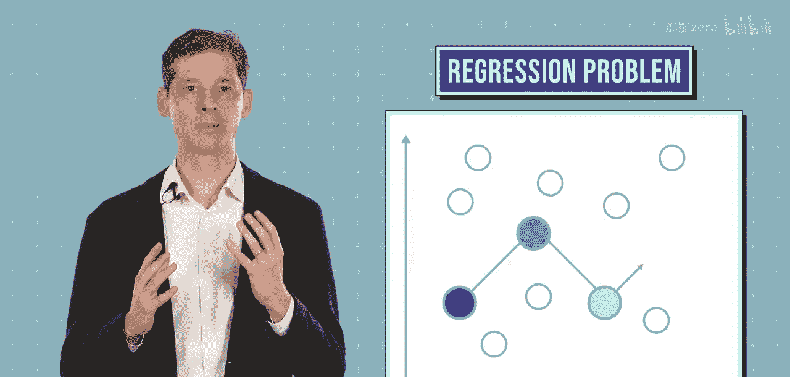

On the other hand， we want to understand if an email is spam or we want to recognize an object in an image。

But also， we want to find the genre of a song。 We are dealing with a classification problem。

 That is a supervised learning problem in which we want to predict a discrete class label。

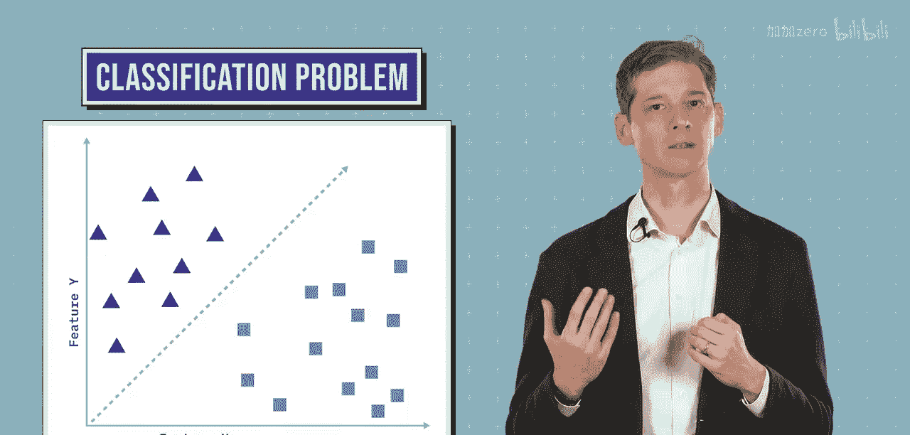

As we have seen in the previous lesson to solve the supervised learning problem。

 we need to specify three components， evaluation， representation and optimization。As for evaluation。

 the most common loss function for regression problem is the mean square error。

The miscor error of the model is calculated by averaging over set of n examples of the square difference between the output variable and the value predicted by the model。

For classification problem instead， the most common evaluation metric is a accuracy。

So that the loss function that we want to minimize is the percentage of misclassified examples。

As for the second component， the representation， we have several options。Some for regression。

 some for classification， and some usable in both cases。

We can categorize the methods as parametric and non parametric。In parametricic method。

 we consider models with a fixed number of parameters， regardless of the size of the training set。

Once the paraic method is trained， we no longer need the training dataset to make prediction。

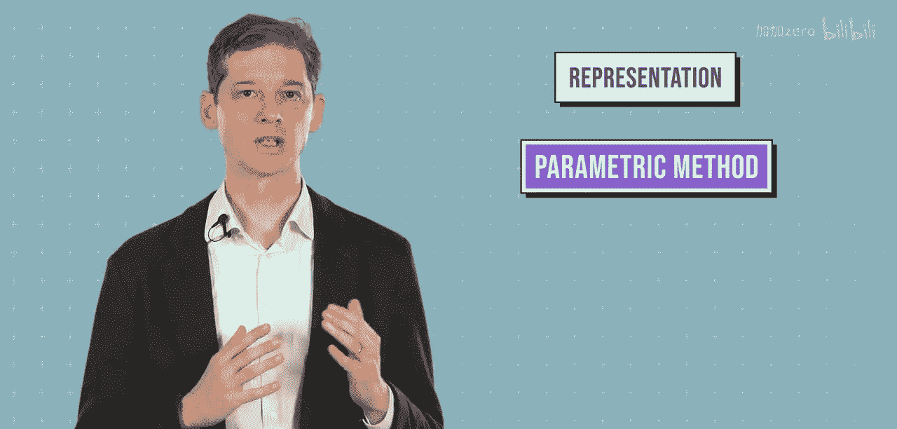

As we have an analytical expression for our model。Examples of parametricic method are linear regression and artificial neural network。

On the other hand， in non parametric method， the complexity of the learner model depends on the size of the training set。

Unlike like parametricic ones， these methods are memory based。

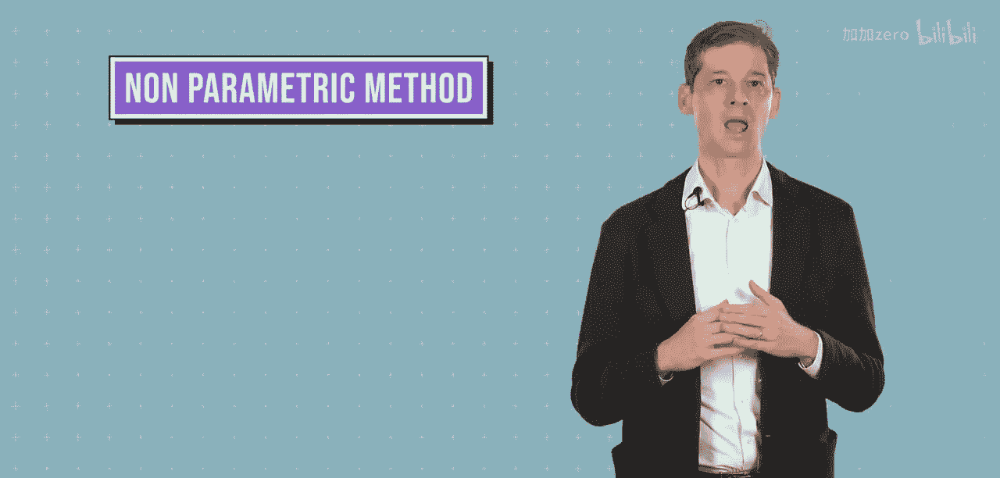

And so they needed the training dataset set to make predictions。

Examples of non paramedic method are keen nearest neighbor， the and trees and Gausian processes。

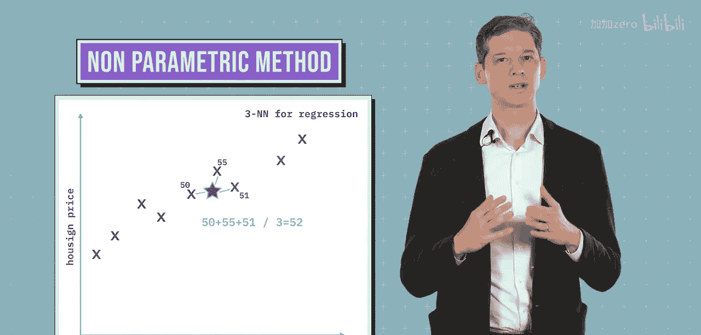

As for the third component optimization， we only have a few options。

The choice of the optimization method is influenced by the evaluation measure and the representation selected。

Together with the computational budget at our disposal。For instance。

 if we need to find the linear model that minimizing the means square error。

 the optimization problem can be solved in close form。

Even if we can choose to use a gradient descent approach。

 when the number of samples and parameters is very large。In the case of neural networks。

 where the loss function is non convex， we usually employ gradient descent methods with multiple starts to avoid getting stuck in local opt。

Other optimization approaches。Used in some techniques are combinatory optimization and constrained optimization。

To fix the ideas， let's consider the house pricing prediction problem and assume that we have a set of examples that relates the size of the house to its price。

In the figure， we can see the example represented by yellow crosses and the black line is the model linear in the input variable size that minimizes the mean square error。

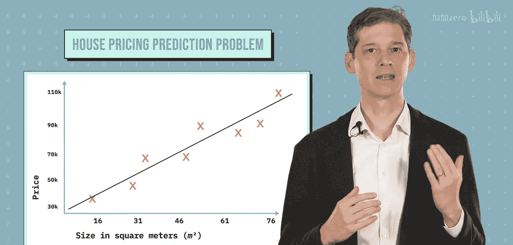

It is important to stress that when we talk about linear models。

 it doesn't mean that these models are linear in the values of the input variables。

 but that they are linear in the parameters。

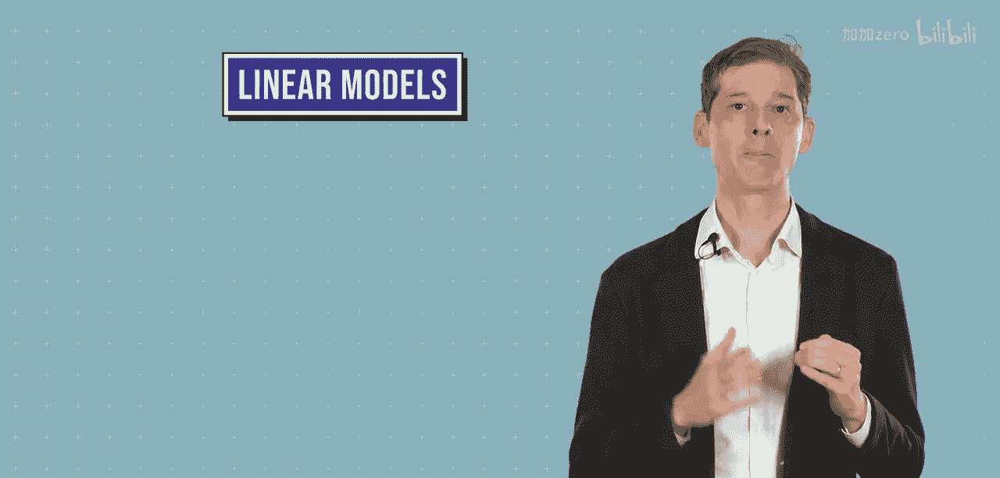

Indeed， starting from the original input variables。

 it is possible to apply any nonlinear transformation to them thus obtain new features whose value can be combined using a linear model。

In this way， we can learn orbitbitly complex functions， such as the one depicted in this figure。

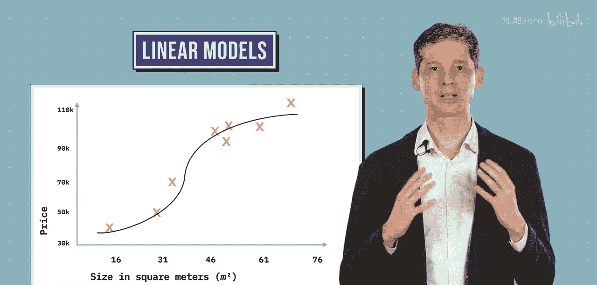

The performance of a linear model is highly dependent on the choice of the features。

 Learn a model with a few features is easier， but the model might be unable to explain the input output the relationship。

 thus underfiing the data。Instead， considering a large number of features increases the expressiveness of the model。

But we need a lot of data to accurately train its parameters。

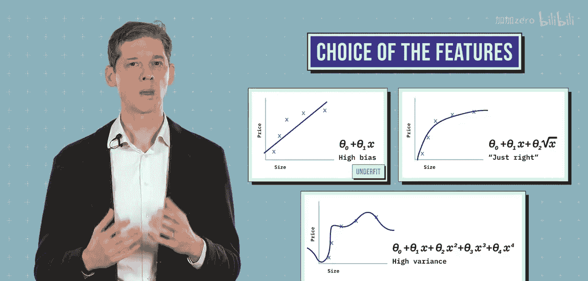

Otherwise， we will suffer from overfitting。To address the problem。

 we can use regularization approaches。The idea is to consider very complex linear models。

 considering several features， and to change the loss function by adding a term that penalizes model with large parameters values。

 as they are prone to overfitting。An example of a regularization approach is rigid regression。

Rer regression is a linear regression method where the loss function is computed as the sum between the means square error and the sum of the parameter squared multiplied by a regularization parameter lambda。

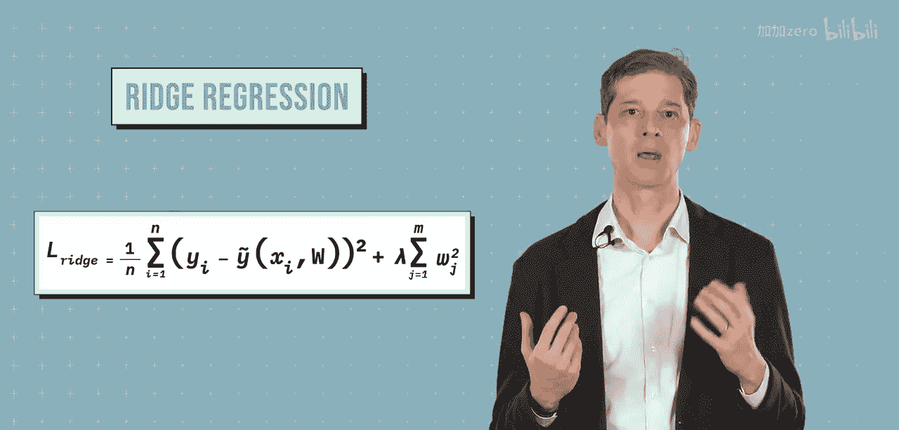

By increasing the value of the regularization parameter。

 we get linear model with small parameter values， which correspond to smoother functions。

On the other hand， when devising a reasonable set of feature is difficult。

 a possible solution is to consider artificialural neural networks。

Artificial neural networks are computational models vaguely inspireded by the way biological brains analyze and process information。

They are nonlinear parametric models that starting from the row input data can automatically extract features useful for solving the task。

Given the non nonlinearity of the parameters of a neural network。

 their optimization cannot be obtained in close form and usually is performed uses to casting gradient descent。

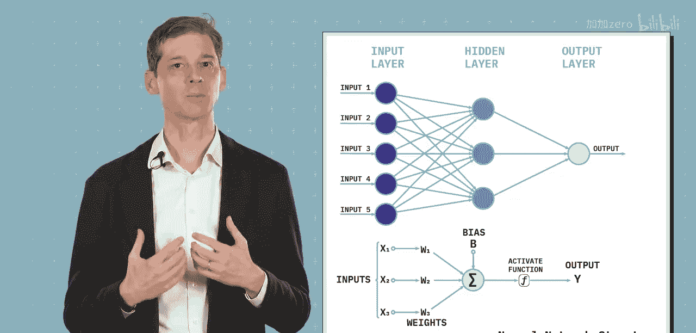

Furthermore， recent development in high performance computing technologies and the availability of big data have made it possible to train very complex neural networks with several millions of parameter。

Give a rise to the so called deep learning algorithms。

Some of the most impressive achievements of artificial intelligence in image classification certification。

 speech recognition， text generation， language translation， drug discovery。

 and so on are due to deep learning。Using non parametric method。

 the prediction is computed by directly combining the output values of the examples stored in the data set where the weights are determined by singularity measure。

Some of the methods in this category are called lazy methods as no computation is needed during training。

 and the whole computational burden is in the evaluation phase。Let's consider， for instance。

 the Ka nearests neighbor approach。Whenever we need a new prediction for a given input point。

 we need to scan the training dataset in search for the K closer training samples。

And if we have a regression problem， we will average their output values。

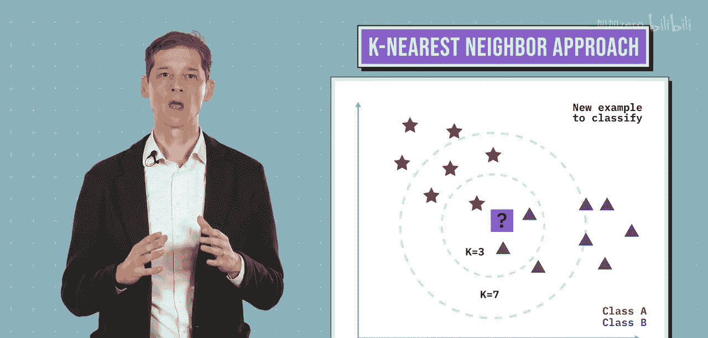

Otherwise， if we have a classification problem， we will predict the most voted class。

The choices of the parameter k and of the matrix for computing the distances are the lever that can be used to improve performance。

After this overview of supervised learning techniques for classification and regression problems。

 in the next lesson we will see how different models can be compared in order to select the most suitable one for the Gon dataset。

