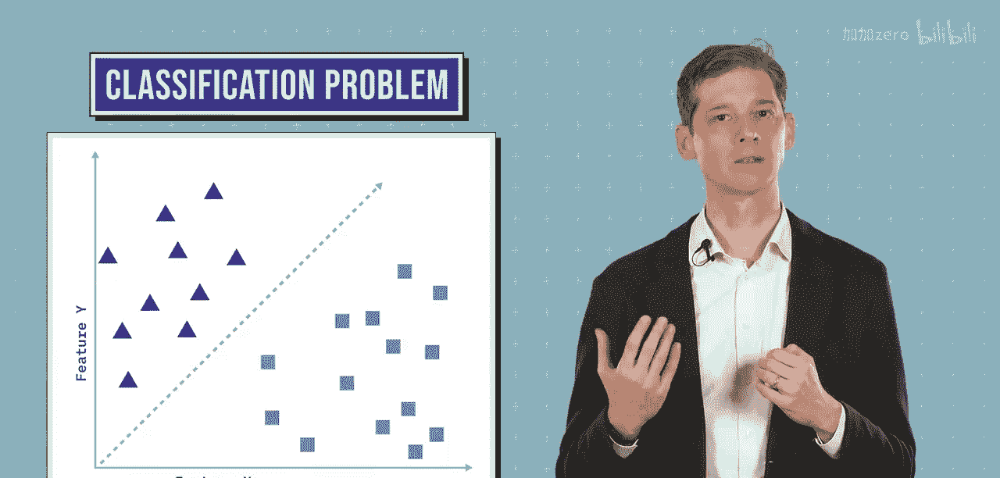
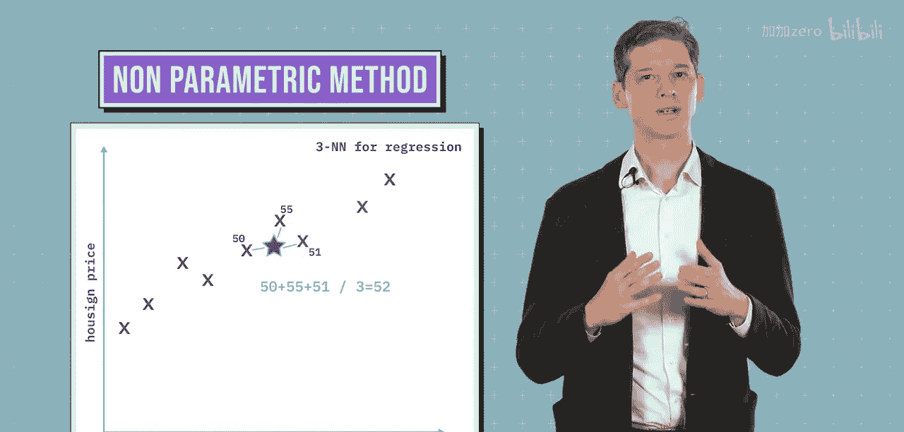
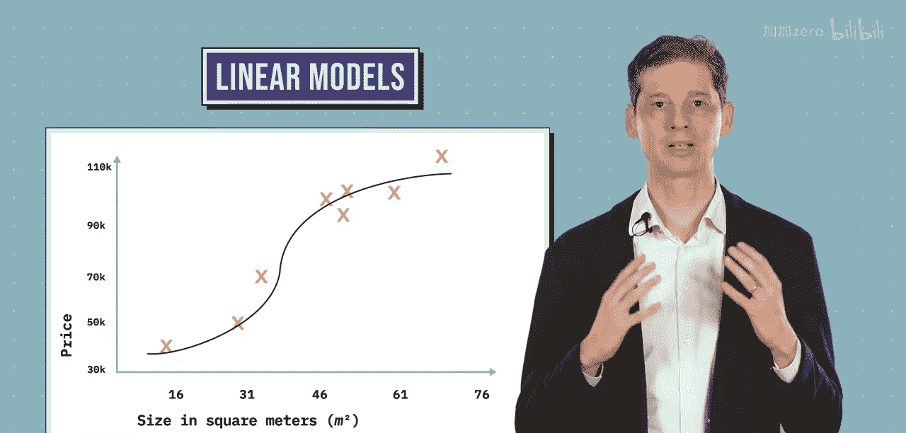
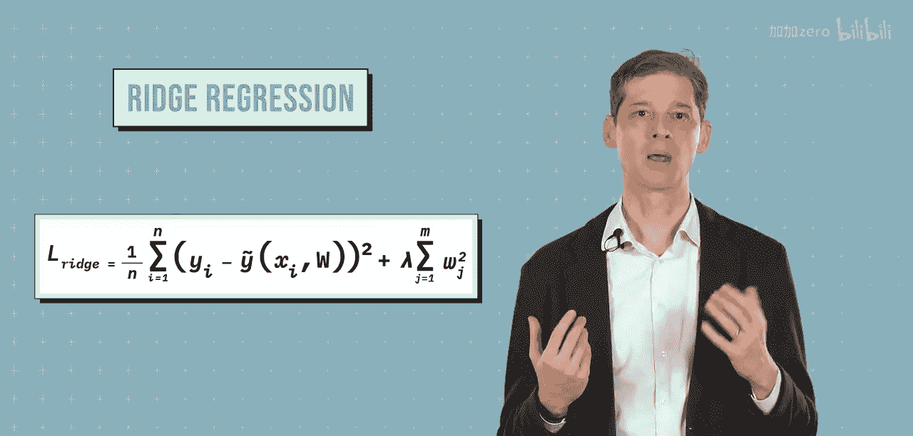
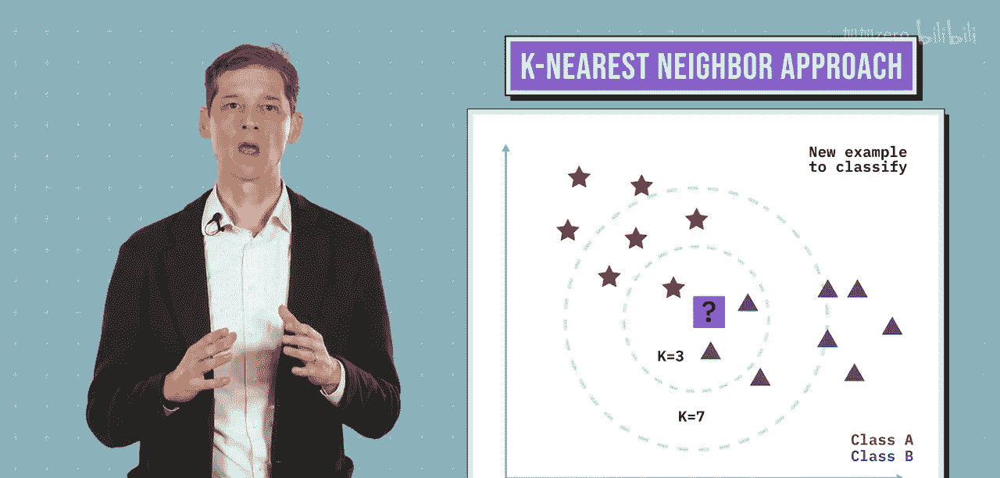

# 人工智能：概述 专项课程：2.2：回归与分类问题 📊

在本节课中，我们将要学习监督学习中的两大核心问题：回归与分类。我们将了解它们的定义、区别，以及解决这些问题时常用的评估方法、模型表示和优化技术。

---

## 回归问题

上一节我们介绍了监督学习的基本概念，本节中我们来看看具体的任务类型。当我们想要预测未来的股票价格、理解广告预算与销售额之间的关系，或者估计房屋价值时，我们面对的就是一个**回归问题**。

回归问题是一种监督学习问题，其输出变量是**数值型**或**连续型**的。

## 分类问题

另一方面，如果我们想判断一封电子邮件是否为垃圾邮件、识别图像中的物体，或者确定一首歌曲的流派，那么我们面对的就是一个**分类问题**。

分类问题是一种监督学习问题，其目标是预测一个**离散的类别标签**。

---

## 解决监督学习问题的三个组件

正如前一课所见，要解决监督学习问题，我们需要指定三个组件：**评估**、**表示**和**优化**。

### 评估方法

以下是常见的评估方法：

*   对于回归问题，最常见的损失函数是**均方误差**。模型的均方误差是通过计算**n**个样本的输出变量与模型预测值之间**平方差**的平均值来得到的。其公式为：
    `MSE = (1/n) * Σ(y_i - ŷ_i)^2`
*   对于分类问题，最常见的评估指标是**准确率**。因此，我们希望最小化的损失函数是**错误分类样本的百分比**。

### 模型表示（参数化与非参数化）

接下来，我们看看模型的表示方法。我们有多种选择，一些适用于回归，一些适用于分类，还有一些两者皆可。这些方法可以分为**参数化方法**和**非参数化方法**。

以下是参数化方法的特点：

*   在参数化方法中，我们考虑具有**固定数量参数**的模型，与训练集的大小无关。
*   一旦参数化模型训练完成，我们就不再需要训练数据集来进行预测，因为我们有了模型的**解析表达式**。
*   参数化方法的例子包括**线性回归**和**人工神经网络**。

以下是参数化方法的特点：

*   在非参数化方法中，学习模型的**复杂度取决于训练集的大小**。
*   与参数化方法不同，这些方法是**基于记忆的**，因此需要训练数据集来进行预测。
*   非参数化方法的例子包括**K最近邻**、**决策树**和**高斯过程**。

### 优化技术

至于第三个组件——优化，我们的选择相对较少。优化方法的选择受到所选评估指标、模型表示以及我们可用的计算资源的共同影响。

例如：

*   如果我们需要找到最小化均方误差的线性模型，这个优化问题可以**以闭式解**的形式求解。
*   即使我们可以选择使用**梯度下降**方法，尤其是在样本和参数数量非常大时。
*   在神经网络中，损失函数是**非凸的**，我们通常采用**多起点梯度下降**方法来避免陷入局部最优。
*   其他在一些技术中使用的优化方法还包括**组合优化**和**约束优化**。

---

## 深入理解线性模型

为了具体说明，让我们考虑房价预测问题，并假设我们有一组将房屋面积与其价格关联起来的样本。

在图中，我们可以看到由黄色十字表示的样本，而黑线是**在输入变量“面积”上线性**且**最小化均方误差**的模型。

需要重点强调的是，当我们谈论线性模型时，并不意味着这些模型在**输入变量的值**上是线性的，而是指它们在**参数**上是线性的。

实际上，从原始输入变量出发，我们可以对它们应用任何**非线性变换**，从而获得新的特征，然后使用线性模型来组合这些特征的值。通过这种方式，我们可以学习任意复杂的函数，例如本图中描绘的函数。

线性模型的性能高度依赖于**特征的选择**。

*   用少量特征学习模型更容易，但模型可能无法解释输入-输出关系，从而导致**欠拟合**数据。
*   相反，考虑大量特征会增加模型的表达能力，但我们需要大量数据来准确训练其参数，否则我们将遭受**过拟合**。

为了解决这个问题，我们可以使用**正则化**方法。其思想是考虑非常复杂的线性模型（包含许多特征），并通过在损失函数中添加一个**惩罚参数值过大**的项来改变损失函数，因为大参数值容易导致过拟合。正则化方法的一个例子是**岭回归**。

岭回归是一种线性回归方法，其损失函数计算为**均方误差**与**参数平方和乘以正则化参数λ**的总和。公式为：
`Loss = MSE + λ * Σ(θ_j^2)`

通过增加正则化参数λ的值，我们得到的线性模型具有较小的参数值，这对应于**更平滑的函数**。

---

## 人工神经网络与深度学习

另一方面，当设计一组合理的特征很困难时，一个可能的解决方案是考虑**人工神经网络**。

人工神经网络是计算模型，其灵感模糊地来源于生物大脑分析和处理信息的方式。它们是**非线性参数模型**，可以从原始输入数据开始，自动提取对解决任务有用的特征。

鉴于神经网络参数的**非线性**，其优化无法以闭式解获得，通常使用**随机梯度下降**来执行。

此外，高性能计算技术的最新发展以及大数据的可用性，使得训练具有数百万个参数的非常复杂的神经网络成为可能，从而催生了所谓的**深度学习**算法。

人工智能在图像分类、语音识别、文本生成、语言翻译、药物发现等领域一些最令人印象深刻的成就，都归功于深度学习。

---

## 非参数化方法：以K最近邻为例

使用非参数化方法，预测是通过直接组合数据集中存储的样本的输出值来计算的，其中权重由相似性度量决定。这类方法中的一些被称为**惰性方法**，因为在训练期间不需要计算，整个计算负担都在评估阶段。

例如，让我们考虑**K最近邻**方法。每当我们需要对给定输入点进行新预测时，我们都需要扫描训练数据集，寻找**K个最接近的训练样本**。

*   如果我们有一个回归问题，我们将**平均**它们的输出值。
*   否则，如果我们有一个分类问题，我们将预测**得票最多的类别**。

参数**K**的选择和用于计算距离的**度量标准**是可以用来提高性能的杠杆。

---

## 总结

本节课中我们一起学习了监督学习中的回归与分类问题。我们探讨了定义它们的核心区别，并详细介绍了解决这些问题所需的三个关键组件：评估指标、模型表示（包括参数化和非参数化方法）以及优化技术。我们还深入了解了线性模型、正则化（如岭回归）、人工神经网络以及非参数化方法（如K最近邻）的工作原理。

在对分类和回归问题的监督学习技术进行了这番概述之后，下一课我们将看看如何比较不同的模型，以便为给定的数据集选择最合适的一个。