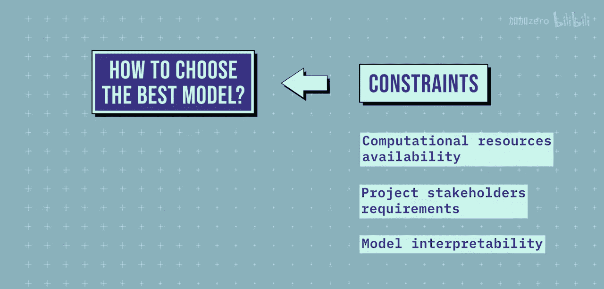
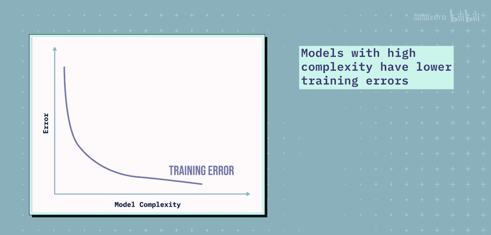
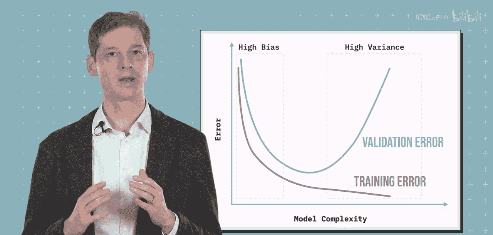
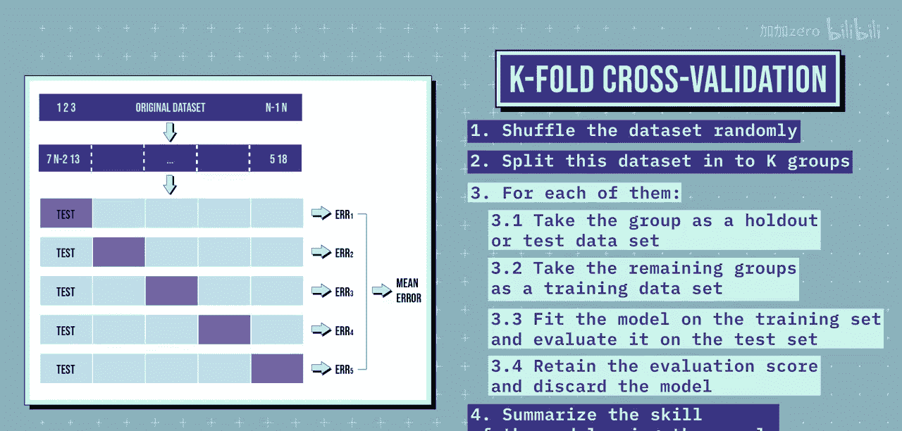

# 【人工智能：概述 专项课程】米兰理工大学—中英字幕 p68 p3_03_model-selection -BV1Er1PYhE9q_p68-

The central problems in machine learning are model selection and model assessment。

Model selection is the process of choosing the best model to be deployed from among a collection of candidate machine learning models trained on the observed data。

Once a model is chosen before its deployment， we need to evaluate it in order to know how well it is expected to perform in general。

 this is the model assessment。Model selection can be applied both across different types of representation。

 such as linear models， neural network， decisionion trees。

 or across models of the same type configured with different models hyperparameter。

Such as the regularization parameter region regression or the number of layers and neurons in neural network。

Or across different input spaces。Obtained through feature selection or dimensional key reduction techniques。

Once we have generated different candidate models， how can we choose the best one？

The choice of a machine learning model is influenced by many constraints related to the available computational resources。

 requirements from project stakeholders， interbittability of the model， and many others。

Here， best means the model with the minimum predictive error with respect to the true function。

Unfortunately， since the true function is unknown， we don't have access to the predictive error。

 but we can try to estimate it from the data。To estimate the predictive error。

 we can also use the training error as it is optimistically biased。

A model selection based on the training error will always choose the most complex model。

In fact， model with high complexity will have lower trend errors compared to simpler one。

That leading to overfitting。In order to have an ambitiousbied estimate of the prediction error。

 we cannot use all the available data for frame。

We need to keep some of them for model selection and other for model assessment。

One solution is to split the data into training， validation， and test sets。

We it candidate models on the training set。

Evaluate and select them on the validation set and report the performance of the final model on the test set。

To have a robust process， we would need many samples in each one of these three datasetta sets。

In many applications， however， the data availability is limited and we wish to make the best use possible of the data。

When data is limited， we can resort to one of these two classes of model selection techniques。

 probabilistic measure and resembling methods。Probabilistic measures involve analytically scoring a candidate model using both its performance on the training dataset and the complexity of the model。

The idea is to paralyze the training error， which is optimistically biased based on the complexity of the model。

A model with fewer parameters is less complex and because of this is preferred because it is likely to generalize better on average。

Some commonly used probabilistic measures are the AakIika information criterion。

 the Bayesian information criterion， the minimum description length。

 and the structural of risk minimization。Probabilizing measures are appropriate when using simple linear models like linear regression or logistic regression。

 where the calculation of model complexity penalty is known and tractable。

 on the other hand resembling methods seek to estimate the performance of the model on out of sample data。

This is achieved by splitting the training dataset into subtrain and test set。

 fitting in a model on the subtrain set and evaluating it on the test set。

This process may then be repeated multiple times， and the mean performance across each trial is reported。

It is a type of Monte Carlo estimate of model performance on out of sample data。

 or for each trial is not strictly independent as depending on the asmbling method chosen。

 the same data may appear multiple times in different training datasets or test dataset。By far。

 the most popular is the cross validation family of methods that includes many subtypes。

An example is the widely used the Kfold cross validation that splits the training dataset into K folds。

The general procedure is as follows。First， shuffle the dataset set randomly。Second。

 split this data into K groups。Third， for each of them， we have to。

Takeaking the group as a holdout or test dataset。Take the remaining group as a training data。

Fit the model on the training set and evaluate it on the test set。

Retrain the evaluation score and discard the model。

The fourth and last step of the general procedure is to summarize the skill of the model using the sample of model evaluation scores。

Importantly。Each observation in the data sample is assigned to an individual group and stay in that group for the duration of the procedure。

This means that each sample is given the opportunity to be using the holdout set one time and used to train the model k minus1 times。

The larger is the number of falses k， the better is the estimation of the error。

 but it can set the price of a higher computational cost as k models need to be trained。

Once the model selection process has been completed。

 how can we assess the performance of the selected model？

We can use neither its error nor its validation error， as both are optimistically biased。

To get an ambitiousbied estimate of the performance of the selected model。

 we need to resort to the test set， which contains data that I was not involved in the learning process。

Pay attention if the performance of the model is not satisfactory。

 we cannot reuse the same test set to evaluate the performance of new models。

Andit will be no longer unbiased， and the risk is to have befit it。In this case。

 we will need to have a different test set with fresh new data。

Proper model selection and model assessment procedures are fundamental to successfullyso supervised learning problems。

Starting from the next lesson， we will move to unsupervised learning。

 the subfield of machine learning that tries to find the inner structure in the data in order to build better representations。

🎼。

