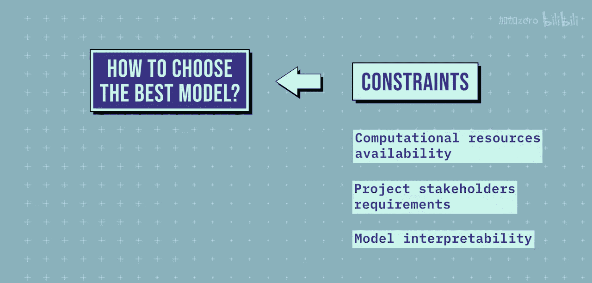
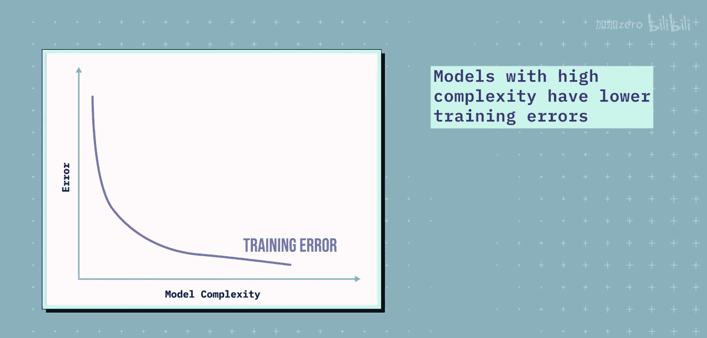
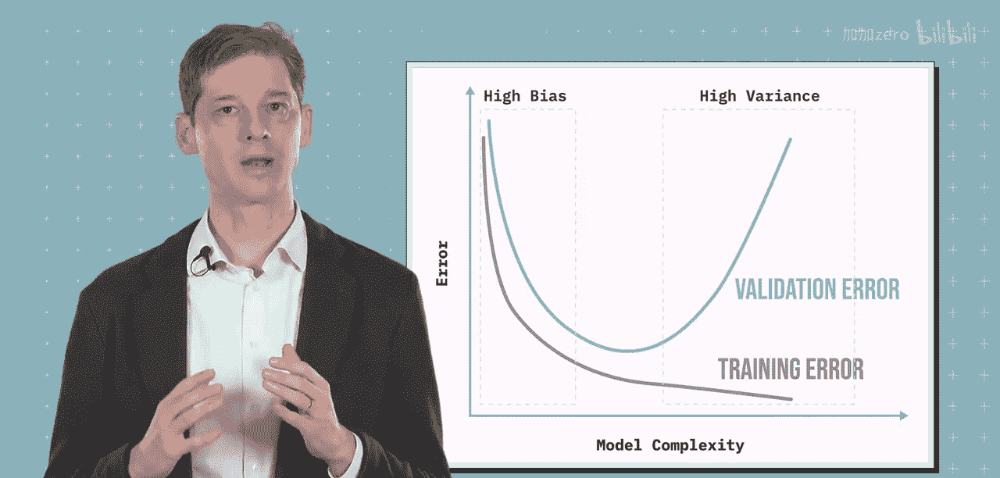
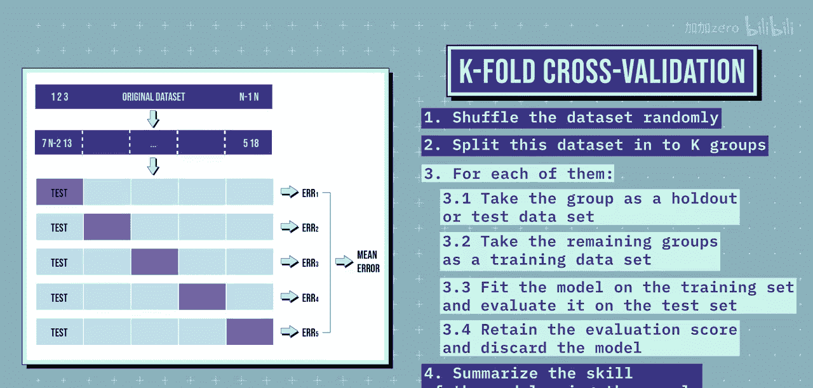

# 人工智能：概述 专项课程：3.03：模型选择与评估 🎯

在本节课中，我们将要学习机器学习中的两个核心问题：**模型选择**与**模型评估**。理解如何从多个候选模型中选出最佳模型，并客观地评估其性能，是构建有效机器学习系统的关键。

---

## 机器学习中的核心问题

机器学习的核心问题是模型选择与模型评估。

模型选择是从一系列基于观测数据训练的候选机器学习模型中，选择出最佳模型以进行部署的过程。

一旦在部署前选定了一个模型，我们需要对其进行评估，以了解其预期的整体表现如何。这就是模型评估。

---

## 模型选择的应用场景

上一节我们介绍了模型选择的基本概念，本节中我们来看看模型选择可以应用在哪些方面。

模型选择可以应用于：
*   不同类型的模型表示之间，例如线性模型、神经网络、决策树。
*   配置了不同模型超参数的同一类型模型之间，例如岭回归中的正则化参数，或神经网络中的层数和神经元数量。
*   通过特征选择或降维技术获得的不同输入空间之间。

一旦我们生成了不同的候选模型，如何选择最佳的一个呢？机器学习模型的选择受到许多约束的影响，这些约束与可用的计算资源、项目利益相关者的要求、模型的可解释性以及其他许多因素有关。

---

## 何为“最佳”模型？

在这里，“最佳”意味着相对于真实函数具有最小预测误差的模型。

不幸的是，由于真实函数未知，我们无法直接获得预测误差，但我们可以尝试从数据中估计它。为了估计预测误差，我们不能使用训练误差，因为它存在乐观偏差。基于训练误差的模型选择总会选择最复杂的模型。

事实上，与更简单的模型相比，高复杂度的模型将具有更低的训练误差，这会导致过拟合。

---

## 数据划分的必要性

为了获得预测误差的无偏估计，我们不能将所有可用数据都用于训练。

我们需要保留一部分数据用于模型选择，另一部分用于模型评估。一种解决方案是将数据划分为**训练集**、**验证集**和**测试集**。

以下是标准流程：
1.  我们在训练集上拟合候选模型。
2.  在验证集上评估并选择它们。
3.  在测试集上报告最终模型的性能。

为了确保流程稳健，我们需要这三个数据集中每一个都有足够多的样本。然而，在许多应用中，数据可用性是有限的，我们希望尽可能充分利用数据。

---

## 数据有限时的模型选择技术

当数据有限时，我们可以求助于以下两类模型选择技术之一：**概率度量法**和**重采样方法**。

概率度量法涉及使用模型在训练数据集上的表现和模型的复杂性来对候选模型进行解析评分。其思想是根据模型的复杂性来惩罚训练误差（训练误差本身是乐观偏差的）。参数较少的模型复杂度较低，因此更受青睐，因为它平均而言可能具有更好的泛化能力。

一些常用的概率度量标准包括：
*   赤池信息准则
*   贝叶斯信息准则
*   最小描述长度
*   结构风险最小化

概率度量法适用于使用简单的线性模型（如线性回归或逻辑回归），其中模型复杂性惩罚的计算是已知且易于处理的。

另一方面，重采样方法旨在估计模型在样本外数据上的性能。这是通过将训练数据集划分为子训练集和测试集，在子训练集上拟合模型并在测试集上评估它来实现的。这个过程可以重复多次，并报告每次试验的平均性能。这是一种对样本外数据模型性能的蒙特卡洛估计。

---

## 交叉验证方法

迄今为止，最流行的是**交叉验证**系列方法，它包含许多子类型。

一个例子是广泛使用的 **K折交叉验证**，它将训练数据集分割成K个折。

其一般过程如下：
1.  首先，随机打乱数据集。
2.  其次，将数据分成K组。
3.  第三，对于每一组，我们需要：
    *   将该组作为保留集或测试数据集。
    *   将剩余组作为训练数据。
    *   在训练集上拟合模型，并在测试集上评估它。
    *   保留评估分数并丢弃该模型。
4.  第四步，也是最后一步，使用模型评估分数的样本来总结模型的技能。

重要的是，数据样本中的每个观测值都被分配到一个单独的组中，并在整个过程中保持在该组内。这意味着每个样本都有一次机会被用作保留集，并有 K-1 次机会用于训练模型。

折数K越大，对误差的估计就越好，但代价是更高的计算成本，因为需要训练K个模型。

---

## 模型性能评估

一旦模型选择过程完成，我们如何评估所选模型的性能呢？

我们既不能使用其训练误差，也不能使用其验证误差，因为两者都存在乐观偏差。为了获得所选模型性能的无偏估计，我们需要求助于**测试集**，它包含了未参与学习过程的数据。

请注意，如果模型的性能不令人满意，我们不能重复使用同一个测试集来评估新模型的性能。这样它将不再是无偏的，并且存在过拟合的风险。在这种情况下，我们将需要一个包含全新数据的不同测试集。

---

## 总结与展望

本节课中我们一起学习了模型选择与评估。正确的模型选择和模型评估程序对于成功解决监督学习问题至关重要。

从下一课开始，我们将转向**无监督学习**，这是机器学习的一个子领域，旨在发现数据的内在结构以构建更好的表示。