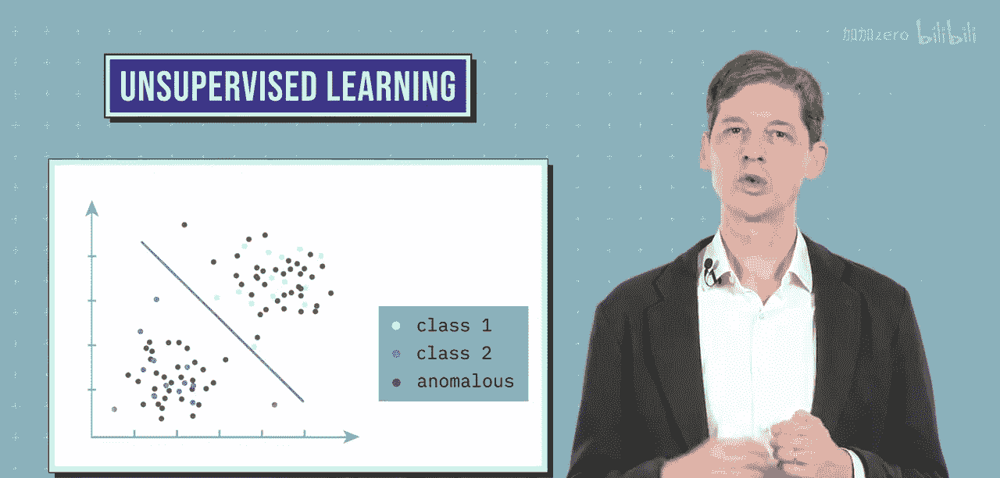
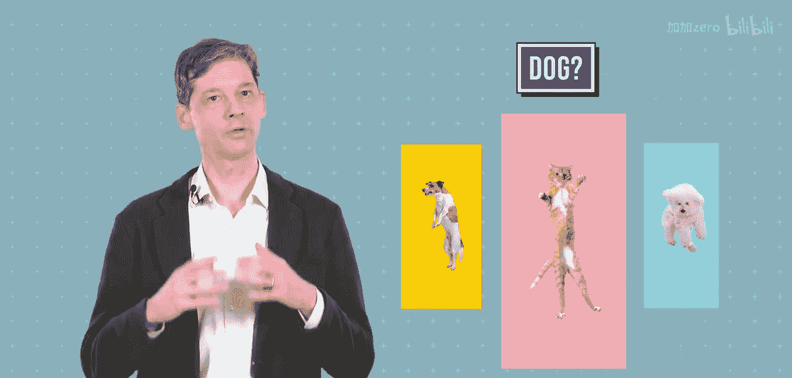
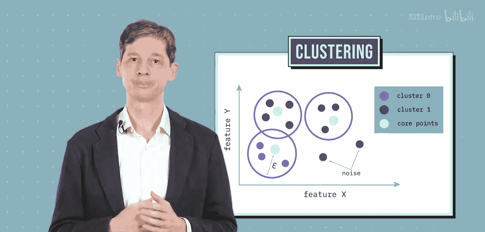
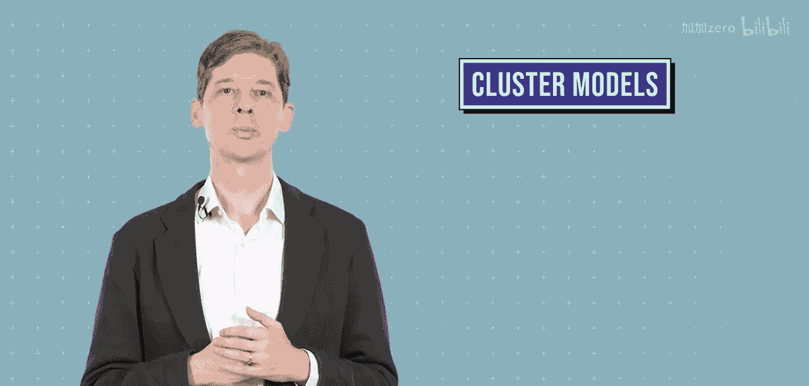
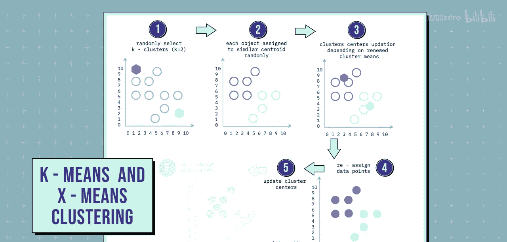
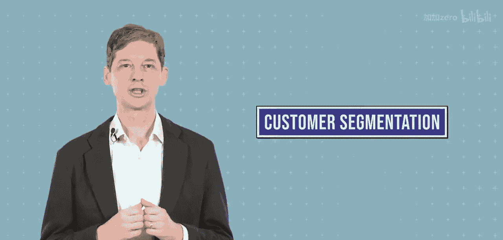
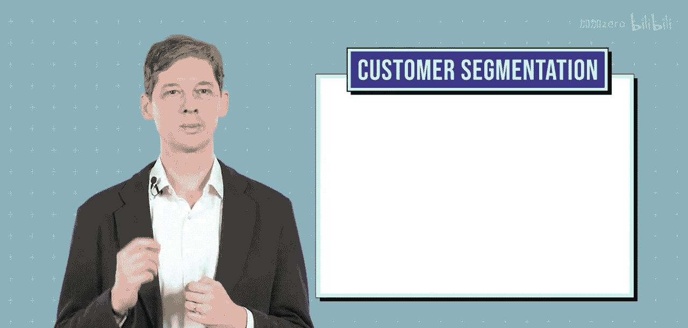
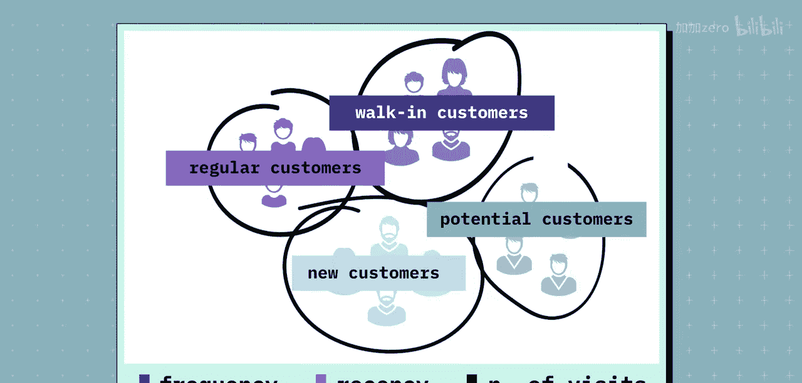
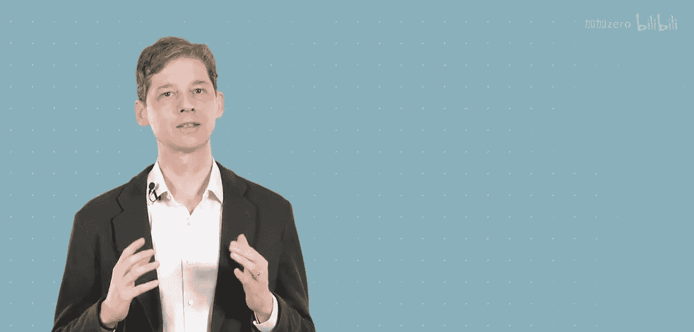
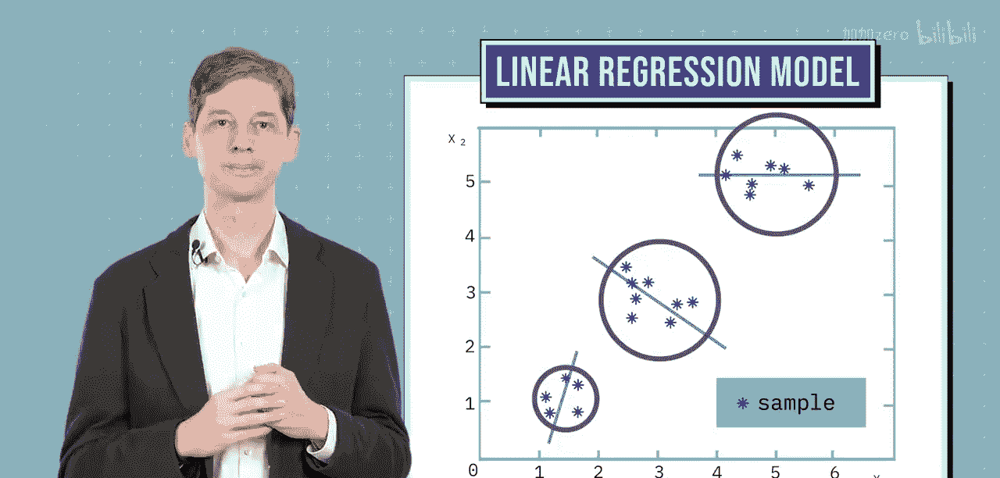

# 【人工智能：概述 专项课程】米兰理工大学—中英字幕 p69 p4_01_unsupervised-learning-clustering -BV1Er1PYhE9q_p69-

While in supervised learning， the goal is to learn a mapping between a set of inputs and outputs provided by a supervisor in unsupervised learning we have only input values and the goal is to unveil the underlying hidden structure in the data。

Unsupervised learning is a set of techniques that allow learning better representation for data。

 which is critical to improve the performance of downstream tasks。

Most of the learning that occurs in our brain can be considered unsupervised。

In the first year of their life， children are provided with very little labeled data with respect to the amount of learning they perform。

A parent or teacher doesn't need to show children every breed of dog to teach them to recognize dogs。

 They can learn from a few examples without a lot of explanation and generalize on their own。

Of course， they can make mistakes in doing this， but developing good representation of what they observe allows them to correct themselves this quickly。

Learning for the sake of learning without a particular task in mind allows the agent Vancouver pattern that can be surprisingly useful for developing Ntongo's intelligence。

Given an unlabeled dataset， an unsupervised learning algorithm might try to group data into cluster or try to reduce the dimensionality of the data by compressing the information with a new set of features or try to discover rules or patterns inside the data。

One of the main tasks in unsupervised learning is clustering。

 that is the task of grouping examples so that the examples in the same cluster are more similar to each other than to those in other clusters。

The similarity is measured according to some matrix。

Since the notion of cluster cannot be precisely defined， there are several cluster models。

 connectivity models， centroid models， distribution models， density models， and Media。

For each of them， many algorithms had been proposed。In order to fix ideas。

 let's consider one of the most popular clustering algorithm， K means。

K means is an iter algorithm that uses a centroid model。

 meaning in that each cluster is represented by its center。

 which corresponds to the mean of the point assigned to the cluster。Initially。

 we must select the desired number K of clusters and we initialize the centroiddoviic cluster by picking a point at random in our dataset。

Then we take each example in our dataset and determine which cluster it belongs to by computing the distances to all the centroids and taking the closest。

The next step is to adjust this enroid to the mean of the examples assigned to each cluster。

These two steps are repeated until the assignments no longer change。

Clustering is used in many applications。News a creators every day look at tens of thousandss of news stories on the web and automatically group them according to their topic without human intervention。

Let's consider， for example， genomics and in particular， DNA microray data analysis。

 where we can group individuals into different categories。

 according to how much certain genes are expressed。

This is unsupervised learning because we are not telling the algorithm which personss are of type 1 or type 2。

 but the groups are inferred by observing similarities in the data。

These kinds of algorithms are also employed in social network analysis， market segmentation。

 astronomical data analysis， and many others。Moreover。

 the output of a clustering algorithm can be used for classification， for anomaly detection。

 for customer segmentation， as well as even improving supervised learning models。

A common use case to start is the classification for data that is not labeled。

Even if your data does not add a column that specified the classes。

 class and algorithm will try to find the heterogeneous grouping within your dataset。

Examples of these include finding groups other than normal mail messages to identify spam。

Another common use case for clustering is anomaly detection。

Imagine that we are working with credit card transactions， and we have a certain user。

 and we see that there is a small cluster compared to the rest of those users transaction that has high volume of1 or perhaps small amounts or at new merchants。

This would create its own new cluster， and that would present an anomaly within the dataset。

 and perhaps that would indicate to the creditbit card company that there is a fraudulent transaction happening。

Customer segmentation is also a common use case。

For example， think about searching groupings that help you find out how many types of customer your business has based on the re。

 the frequency and average amount of visits over the past three months。

It requires a combination of each one of those different features and comes with different segments。

Or another common segmentation is by demographics at that engagement level。For example。

 you can create groups for single customers， new parents， empty nesters， etc cea。

 and determine the preferred marketing channel and use these insight to drive your future marketing campaigns。

Finally， another common use case is to help improve supervised learning。

For example， we can check a good model， for instance。

 a good linear regression model that we train on our entire data set and see how well that performs compared to models trained for subsegments of our data that we found through classrooming。

😊，Perhaps we'll be able to improve our performance if we look at each one of these different classes and come up with different prediction for which one of these different groupings。

😊。

There is no guarantee that this will always work， but it is a common practice to segment the data to find these heterogeneous groups and then train a model for each group to help improve that classification or regression。

In the next lesson， we will overview how unsupervised learning can be used to find a compressed representation of the data by means of dimensionalality reduction techniques。

🎼Oh。

