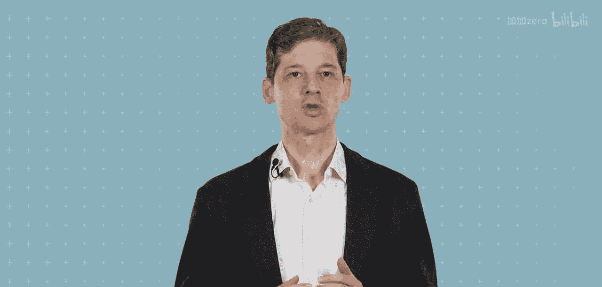
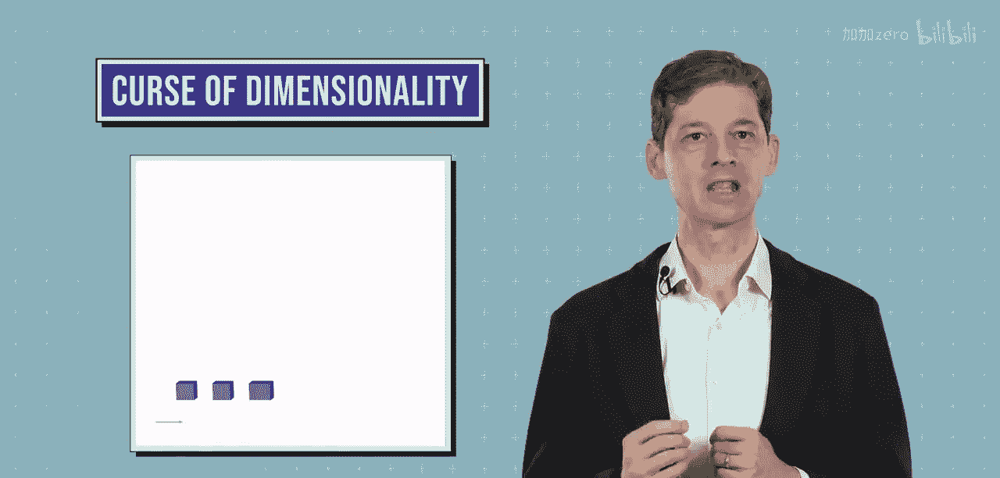
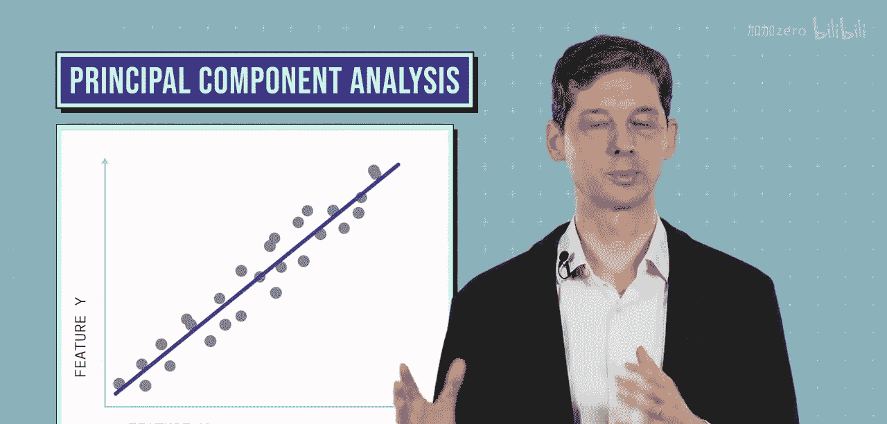
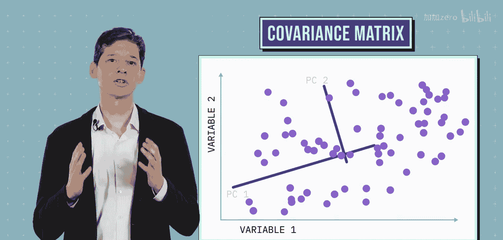
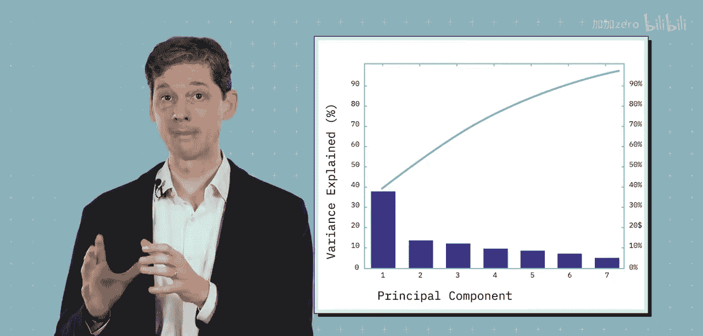
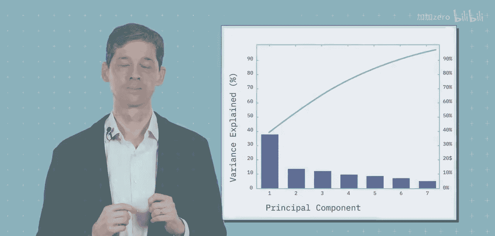
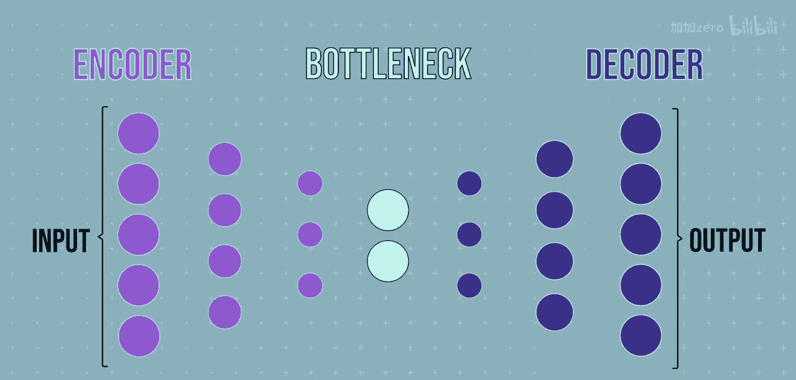

# 【人工智能：概述 专项课程】米兰理工大学—中英字幕 p70 p5_02_unsupervised-learning-dimensionality-reduction -BV1Er1PYhE9q_p70-

Learning in problem with high dimensional input spaces requires to consider complex models。

 which need many samples to be trained。

This is called the curse of dimensionality， Dimenality reduction aims at representing our data set in lower dimensions while maintaining most of the information that is contained in our dataset。

Working on a compressed representation requires less samples。

 but compressing to match can be harmful as we risk losing relevant information。

We need to manage this trade off in relation to the number of examples available in our dataset。

Let's consider， for instance， a data set of a phase images。

Each example is a face represented by an image containing millions of pixels。

Working in such a high dimensional space consumes a large amount of memory and computational power。

 and most of all it is useless。What is the probability of generating the image of a face by picking an image at a random？

Almost zero。This is a symptom that the representation that we are using is not effective for representing the information contained in our dataset。

We can leverage the structure in our data to build a new and more compact representation on which it will be easier to solve new learning tasks。

One of the most popular dimensionality reduction techniques is principal component analysis or PCA。

Starting from the original input features， PCA creates new features which are linear combination of the original ones。

Let's look at this image that shows points in a two dimensional space。As we can see。

 these two features look very correlated one with the other as the points lie very close to a line。

If we want to reduce the input features from two to one， which choice would we make？

If we consider that line and we project all the points onto that line。

 this will entail a linear transformation of our data。

These new features allows us to replace the two original features by preserving the original information as much as possible。

As we will see， the goal of PCA is to produce a new representation that retains the original variances as much as possible。

So how does PCA find out these lines onto which project in the data？

This is obtained by computing the covariance matrix of our dataset。

 then to know which is the most important direction。

 PCA consider the eigenvector associated with the largest eigenvalue。

This is the first principle component that is the direction along which there is the largest variance。

The values in the eigen vector specify the coefficients of the linear combination of the original input features。

The second principal component will be the eigenbe associated with the second largest eigenvalue and so on for all the other components。

Given the properties of eigenvectors， all the new features are orthogonal to each other。Now。

 how can we choose how many and which principal components to select？First。

 we must sort the eigenverctors in the sendinging order of eigenvalue。

 then given a threshold on the percentage of the original variance that we want to retain with the new representation。

 starting from the first principal component， we keep adding new features until the ratio between the sum of the eigenvalue of the selected components and the sum of the eigenvalue of all the components crosses the chosen threshold。

In the picture， we see an application of PCAs to a dataset set of phase images。In the dataset。

 there are 128 images of faces of size 256 times 128 pixels。In this picture。

 we see a visual representation of the first 15 principal components， in this case called eigenphaes。

And at the top left corner， there a construction of the face in this 15 dimensional space。

In this way， instead of using more than 30，000 values to represent the intensity of each pixel。

 we can represent a face with only 15 values。Of course， as shown in this image。

 the accuracy of the reconstruction grows with the number of again phases consideredate。

Unfortunately， linear combination of the original features are not always able to capture the hindance structure in our data。

If we have a data with example distributed as in the picture。

 we will not be able to identify a principal direction。

 even if the data clearly occupies a manifold of the feature space。😊，In this case。

 we need to resort to dimensionality reduction approaches able to create a new features that are no linear combination of the original ones。

 such as local linear embedding， self organizing maps， kernell PCA， ISOMap， and many others。Recently。

 also deep learning methods have been proposed to perform no linear dimensionality reduction。

 a popular approach is called out encodes。

The idea of out encoders is to train a deep neuraldal network to learn the identity function。

We want the network to be able to reproduce the input correctly。

Dimmensality reduction is achieved by using specific neural network architecture composed of an encoder。

 a decor， and in the middle a bottleneck。The encoder compresses the data to their lower dimensional representation。

The bottleneck also called latent space， stores the lower dimensional representation。

The decoder reconstruct our low dimensional data back to their initial dimension。

If such a neural network can correctly reconstruct the input。

 it means that the feature store in the bottleneck contain the relevant information about our dataset。

After training， the decoderery is discarded and the output from the bottomneck is used directly as the reduced dimensionality of the input。

Beyond dimensionality reduction out encoder are also used for image denoising。🎼In the next lesson。

 we will see another set of unsupervised learning techniques used to discover relevant patterns in a data。

 association rules。