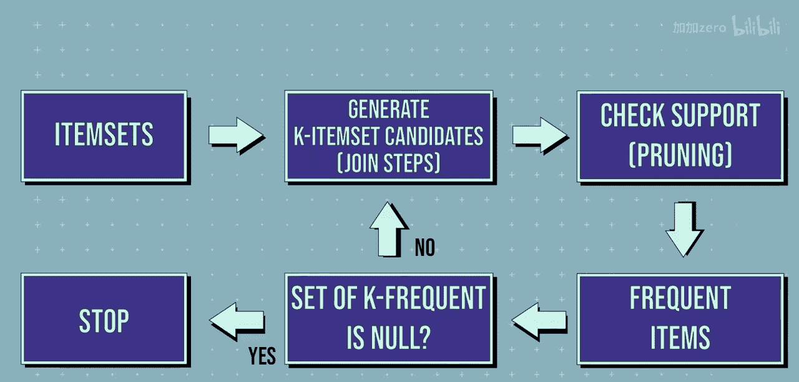
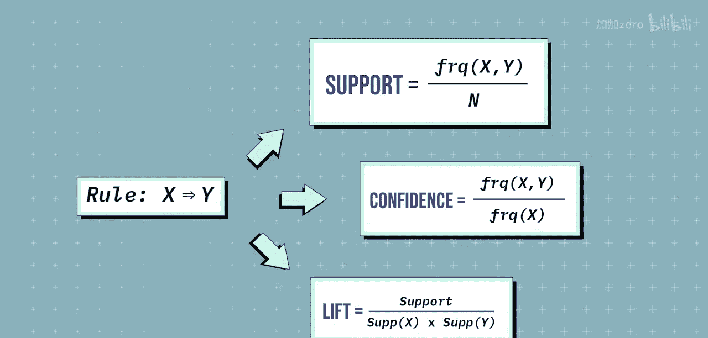
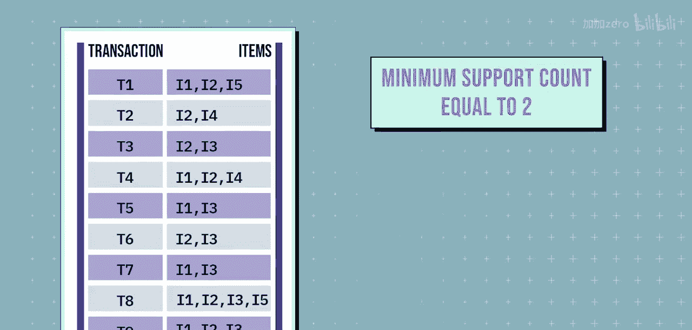
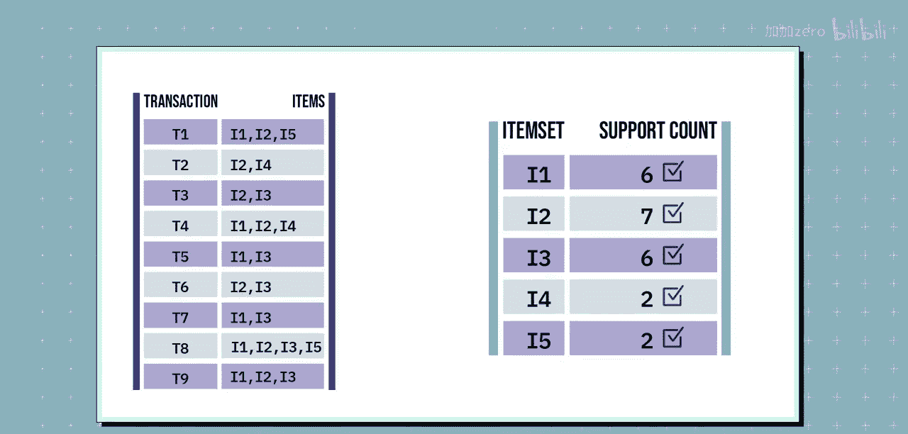
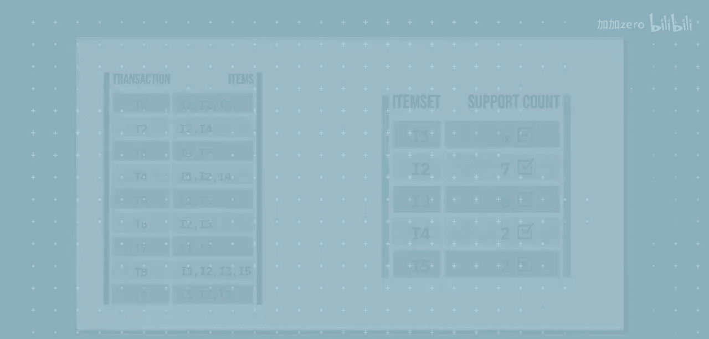
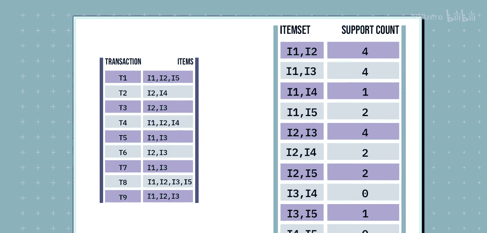
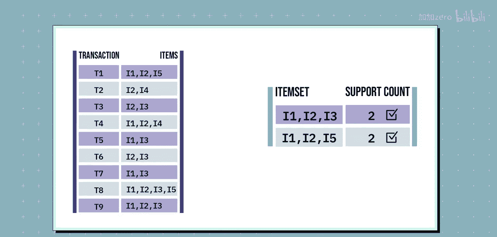

# 【人工智能：概述 专项课程】米兰理工大学—中英字幕 p71 p6_03_unsupervised-learning-association-rules -BV1Er1PYhE9q_p71-

If you have done any online shopping， you have undoubtedly seen a recommendation pop up。

 saying things like people who purchase this and debt， also purchased this and debt。

These suggestions are the result of a market basket analysis aim at identifying frequent shopping habits。

The goal is to increase sales by simplifying additional purchases for the customers。

Besides cross selling， this analysis can be exposed to offer pricing incentives on related products to create product bundling and to make assortment optimization。

In physical store， such analysis provides suggestions on how to place products on the shelves to mutually promote their purchase。

This kind of analysis is carried out using unsupervised learning algorithm called association R Min。

An association rule describes a relationship between variables or objects in a dataset。

In addition to market basket analysis， Association of Rule mining can be used for stock analysis。

 web log mining， social network analysis， medical diagnosis， bioinformatics， etc cea。

One of the oldest and most frequently used algorithm for discovering association rules is called a priori。

It is designed to operate on dataset sets containing transactions such as point of sale transaction。

 which represent items bought together in a single basket by a customer。

A priori user bottom up approach in which frequent subsets are extended to one item at a time。

 a step known as candidate generation， and groups of candidates are tested against the data。

The goal of this phase is to generate all the subset of items with a number of currencies larger than a minimum support threshold。

To improve the efficiency of the generation of the frequent item sets。

 a prioror exploits the anti monotone property， which helps to reduce the search space。

According to the antimontone property， all subjects of a frequent item set must be frequent。

 And if an item set is infrequent， all its supers will be infrequent。

A priori terminates when no more candidate sets can be generated。

Once the frequent item inserts are determined， the most prevailing associational rules can be created and used to benefit the business。

Each rule is composed of two different sets of items called the antecedent and the consequent。

The meaning is that when the items in the antecedent are in a transaction。

 then we expect to find these items also in the con。For instance， considering the supermarket domain。

 a rule could be if butter and bread are the antioxidantcedent and milk is the consequencesequent。

 the rule means that in a basket containing butter and bread。

 there is a high probability of finding milk too。When assessing the power and the usefulness of associational rules。

 some key metrics are considerate。 Support count how often we can find items together in the same basket。

Confidence， how often one or more items go into a basket when other items are already there。Lift。

 how more often should groups of items occur together than expected if they were independent to each other。

A power rule is expected to meet a minimum threshold of support。

 and theres high enough confidence or lift for practical purposes。

Let's see now how it works with another example in the table， we see a set of night transactions。

 and for each one we have the items contained in each of them。

We assume to be interested in rules with a minimum support count equal to2 and the minimum confidence of 60%。

The first step is to consider each item presenting the data candidateid set。

 and to compare its support count with the minimum support count threshold。In this example。

 we can see that all the items are frequent enough。In the second step。

 starting from the frequent items that identified during the previous step。

 we consider all the items that with two items and again we test they are frequently enough。

In this case， only six of the original 10 items that are frequent。

Starting from these item sets， we generate the candidate set with three items。

These new candidate sets are frequent only if all the subsets of them are frequent。 So， for instance。

 the item set I 1， I 2， I 3 may be frequent as the item set I 1， I choose， I 1， I 3 and I 2。

 I 3 are frequent。On the other hand， the item set I 2， I 3， I 4 is not frequent， as I3。

 I 4 is not frequent。After the verification for each candidate set with three items。

 we can see which of them are frequent。

Here， the generation of frequent items set stops， as there is no set with four items that is frequent。

Now， given all the frequent items that with at least two items。

 we must generate all the stronger rules that is all the rules whose confidence is above the minimum confidence threshold。

For instance， looking at the items at I1， I2， I5 and checking in the transaction table。

 we see all the possible rules that can be generated with the related confidence values。

 which are obtained as the ratio between the support count of all the three items and the support count of the items in the antedent of the rule。

Only the rules with more than 60% of confidence are returned。To complete the procedure。

 we do the same check for items at I1 at 2， I 3。As we have just seen。

 the main limitation of the I priori algorithm is the time required to work with very large data sets in which many frequent item set can be generated For instance。

 if there are 10，000 of frequent item set with one item。

 it needs to generate more than 10 million candidates with two items。

So it will check for a lot of sets from the candidate item set。

 and it will scan the database several times for finding candidate item set thus making the algorithm very low。

To overcome this issue， other approaches such as ELt and FB growth have been proposed。

With this lesson， we have concluded our overview on unsupervised learning techniques。

In the next lesson， we will start presenting the first of field of machine learning。

 reinforcement learning。

