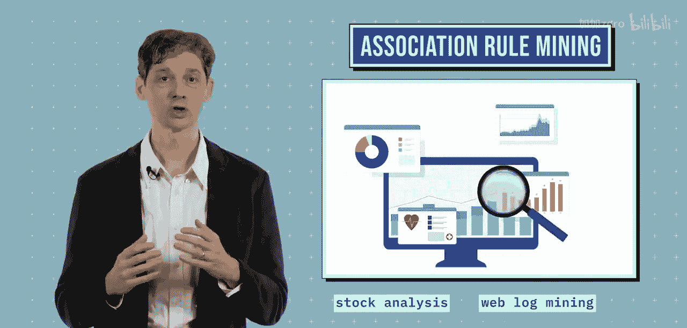
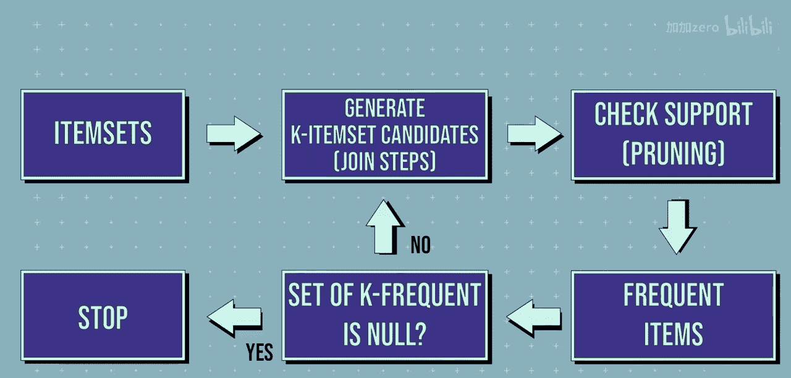
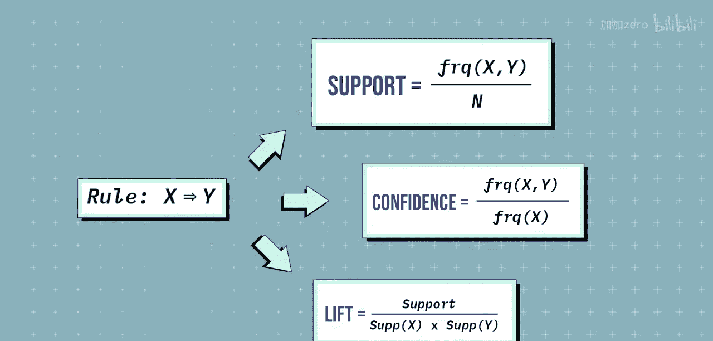
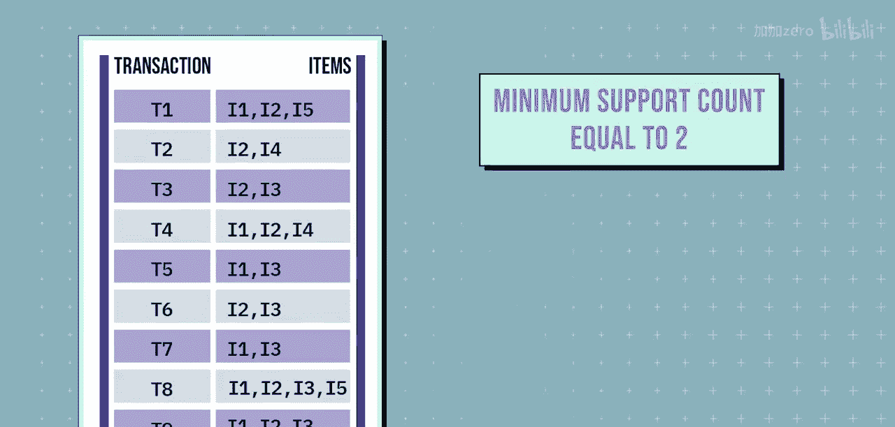
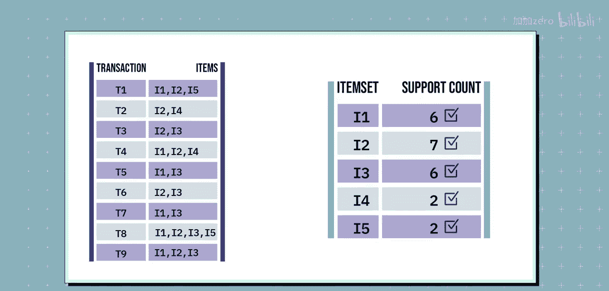
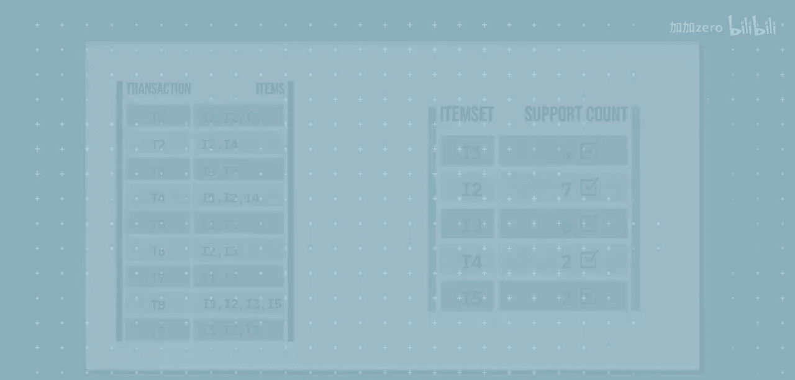
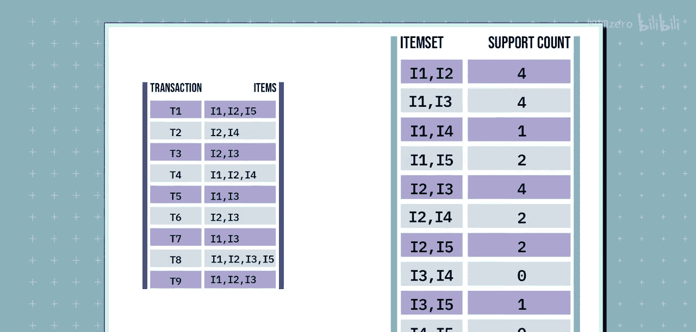
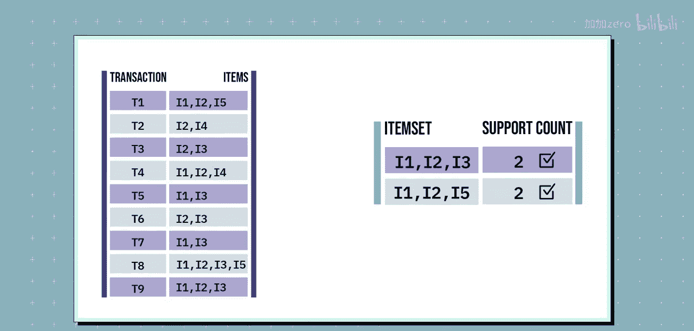

# 人工智能：概述 专项课程：6：关联规则挖掘

在本节课中，我们将要学习一种重要的无监督学习技术——关联规则挖掘。我们将了解它的核心概念、经典算法以及如何评估规则的有效性。关联规则挖掘广泛应用于市场购物篮分析、推荐系统等多个领域。

如果你进行过在线购物，你肯定见过弹出的推荐信息。这些推荐信息会说“购买此商品的顾客也购买了……”。这些建议是市场购物篮分析的结果，旨在识别频繁的购物习惯。其目标是通过简化顾客的额外购买来增加销售额。

除了交叉销售，这种分析还可以用于为相关产品提供定价激励、创建产品捆绑包以及进行品类优化。在实体店中，此类分析为如何摆放货架上的商品以促进其相互购买提供了建议。这种分析是通过一种名为关联规则挖掘的无监督学习算法来进行的。

## 关联规则的概念与应用

上一节我们介绍了关联规则挖掘的背景，本节中我们来看看关联规则的具体定义和应用场景。

一条关联规则描述了数据集中变量或对象之间的关系。除了市场购物篮分析，关联规则挖掘还可用于股票分析、网络日志挖掘、社交网络分析、医疗诊断、生物信息学等领域。

## Apriori算法简介

了解了关联规则的基本概念后，我们来看一个最经典、最常用的关联规则发现算法。

用于发现关联规则的最古老且最常用的算法之一是Apriori算法。它被设计用于处理包含交易的数据集，例如销售点交易数据，这些数据代表了顾客在单个购物篮中一起购买的商品。

## Apriori算法的工作原理

Apriori算法采用自底向上的方法，其中频繁项集每次扩展一个项目，这个步骤称为候选生成，然后候选集组会与数据进行测试。此阶段的目标是生成所有支持度计数大于最小支持度阈值的项目子集。

为了提高频繁项集生成的效率，Apriori利用了反单调性属性，这有助于减少搜索空间。根据反单调性属性，一个频繁项集的所有子集也必须是频繁的。并且，如果一个项集是非频繁的，那么它的所有超集也都是非频繁的。

当无法生成更多候选集时，Apriori算法终止。一旦确定了频繁项集，就可以创建并利用最普遍的关联规则来使业务受益。每条规则由两个不同的项目集组成，分别称为前件和后件。

## 关联规则的构成与评估

上一节我们介绍了Apriori算法如何生成频繁项集，本节中我们来看看如何从这些项集中生成规则，并评估其有效性。

规则的含义是：当交易中包含前件中的项目时，我们预期也能在该交易中找到后件中的项目。例如，在超市领域，一条规则可能是：如果黄油和面包是前件，牛奶是后件，那么这条规则意味着，在一个包含黄油和面包的购物篮中，有很大概率也能找到牛奶。

在评估关联规则的能力和有用性时，会考虑一些关键指标。以下是这些核心指标：

*   **支持度**：衡量项目在同一购物篮中一起出现的频率。
*   **置信度**：衡量当一个或多个项目已经在购物篮中时，其他项目也出现在该购物篮中的频率。
*   **提升度**：衡量一组项目一起出现的频率比它们彼此独立时预期出现的频率高多少。

一条强有力的规则需要满足最小支持度阈值，并且具有足够高的置信度或提升度以满足实际用途。

## 算法实例演示

现在，我们通过一个例子来看看它是如何工作的。在表格中，我们看到一组交易记录，每条记录包含该交易中的商品。

我们假设感兴趣的规则需要满足最小支持度计数等于2，且最小置信度为60%。

第一步是考虑数据中的每个项目作为候选1-项集，并将其支持度计数与最小支持度计数阈值进行比较。在这个例子中，我们可以看到所有项目都足够频繁。

在第二步中，从上一步确定的频繁1-项集开始，我们考虑所有包含两个项目的项集，并再次测试它们是否足够频繁。

在这种情况下，原始的10个2-项集中只有6个是频繁的。

从这些项集出发，我们生成包含三个项目的候选集。这些新的候选集只有在它们的所有子集都是频繁的情况下才可能是频繁的。例如，项集 {I1, I2, I3} 可能是频繁的，因为项集 {I1, I2}、{I1, I3} 和 {I2, I3} 都是频繁的。另一方面，项集 {I2, I3, I4} 不是频繁的，因为 {I3, I4} 不是频繁的。在对每个包含三个项目的候选集进行验证后，我们可以看到哪些是频繁的。

在这里，频繁项集的生成停止了，因为没有包含四个项目的项集是频繁的。

现在，给定所有至少包含两个项目的频繁项集，我们必须生成所有强规则，即所有置信度高于最小置信度阈值的规则。例如，查看项集 {I1, I2, I5} 并检查交易表，我们可以看到所有可能生成的规则及其相关的置信度值，这些值是通过三个项目的支持度计数与规则前件中项目的支持度计数的比值得到的。只有置信度超过60%的规则才会被返回。为了完成该过程，我们对项集 {I1, I2, I3} 进行相同的检查。

## 算法的局限性与总结

正如我们刚刚看到的，Apriori算法的主要局限在于处理非常大的数据集时所需的时间，因为可能会生成许多频繁项集。例如，如果有10,000个频繁1-项集，它需要生成超过1000万个2-项集候选。因此，它需要检查候选项集中的大量集合，并且会多次扫描数据库以寻找候选项集，这使得算法效率较低。为了克服这个问题，人们提出了其他方法，如Eclat和FP-Growth。

本节课中我们一起学习了关联规则挖掘，这是一种用于发现数据集中项目之间有趣关系的无监督学习技术。我们重点介绍了经典的Apriori算法，它通过逐层搜索和利用反单调性属性来高效地发现频繁项集。我们还学习了如何从频繁项集中生成关联规则，并使用支持度、置信度和提升度等关键指标来评估规则的有效性。

随着本课的结束，我们也完成了对无监督学习技术的概述。在下一课中，我们将开始介绍机器学习的第一个领域——强化学习。

