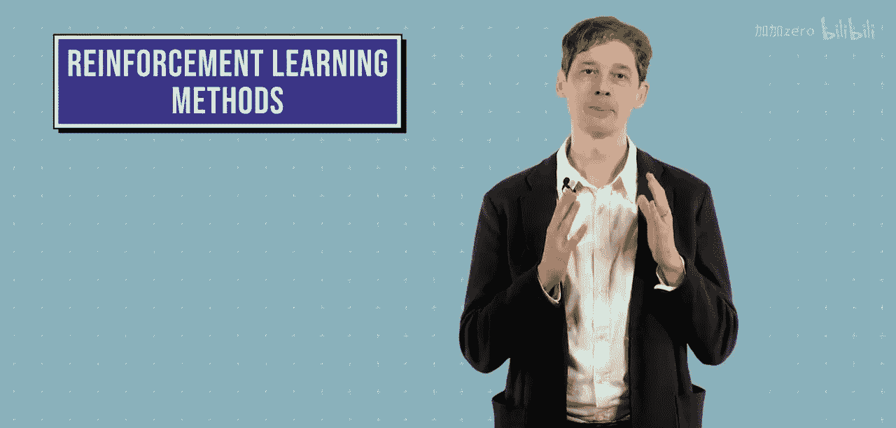
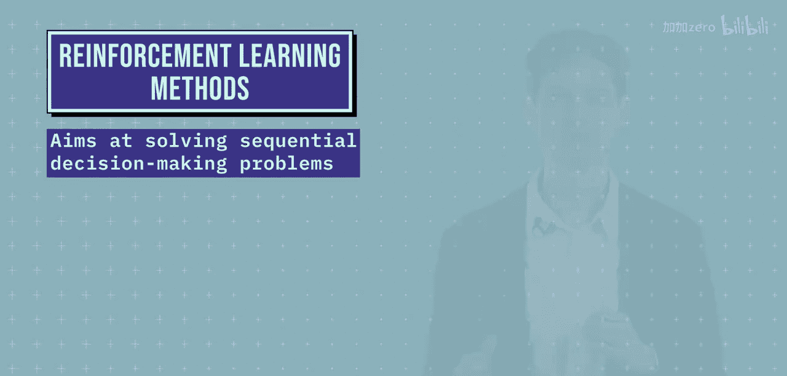
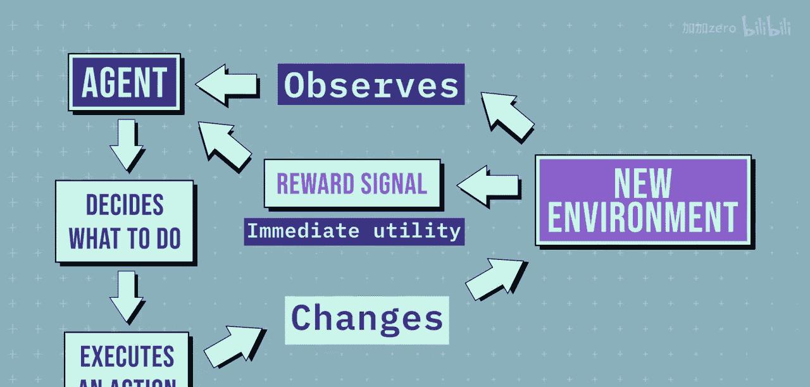
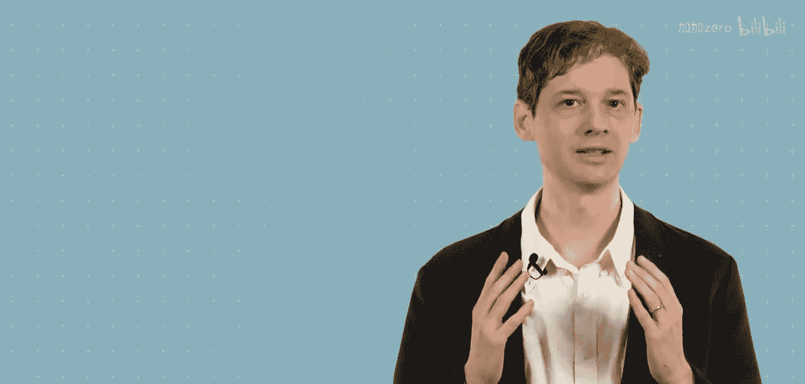
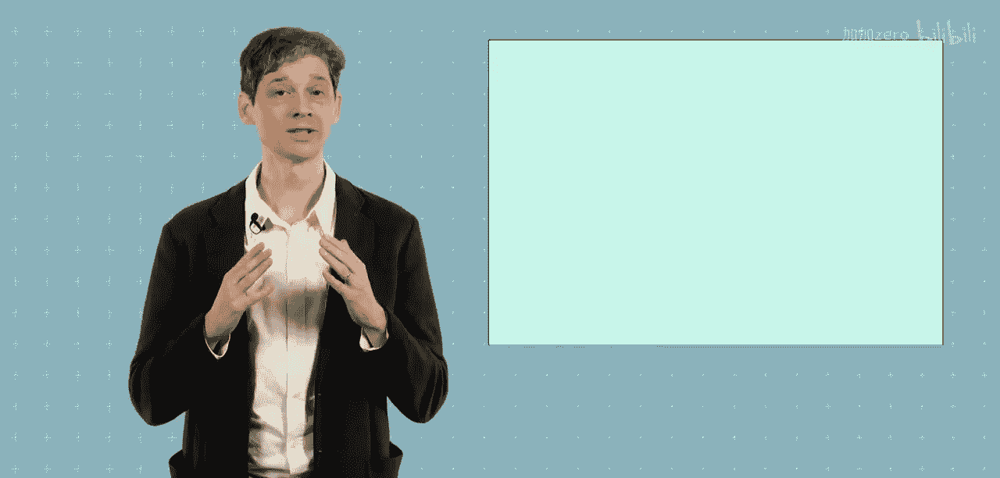

# 【人工智能：概述 专项课程】米兰理工大学—中英字幕 p72 p7_01_sequential-decision-making-problems -BV1Er1PYhE9q_p72-

When we learn to walk， swim or play tennis， we solve the sequential decision making problems。

 and in all these cases， diet experience played a fundamental role。

Actually， we face several sequential decisions in making problems every day。

An average adult is estimated to make more than 35，000 decisionss a day。

Let's consider a child who learns to walk。 Most of us learned to walk when we were about one year old。

 At that age， no one has explicit knowledge of physics and the ability to understand the parental suggestion is limited。

We learn to work primarily through a trial and error process。

Moved by the desire to reach some objects， we try to get up onto two feet and take the first steps。

 In the beginning， this leads to force that teach us which movements are wrong。

By dint of trying again， our brain learns what are the commands that it needs to send that to our muscles to reach our goal in the most effective way。

This is the same principle behind our enforcementment learning methods。

Reinforcement learning is that part of machine learning that aims at solving sequential cheese on making problems。

Unlike a traditional method， reinforcement learning techniques do not require prior knowledge of the dynamics of the problem。

 as they learn to solve the decision making problem through a direct interaction between the agent and the environment in which it operates。

The reinforcement learning process can be moderate as an iter loop that works as follows。

First of all， the agent observes the environments to understand what state it is in。

Then it decides what to do and as as an action。 as a result of this action。

 the environment changes and the agent receives a reward signal。

The reward is a value that specified the immediate utility of the executed action in that specific state。

This completes one iteration， and the next one will start with the observations gathered from the new state of the environment。

The agent's goal is not to select the action that attains the maximum immediate reward。

But to collect as much reward as possible， over a given time horizon。

We often need to sacrifice immediate rewards to achieve a long term goal。

When rewards are temporarily delayed， we have a credit assignment problem。

 which slows down the learning process。In fact， we need to estimate which action among the ones executed by the agent allowed it to get a certain reward。

Recently， thanks also to the combination with deep learning techniques。

 reinforcement learning algorithms have achieved some of the most important milestone in the history of artificial intelligence。

In 2016， the Alphago algorithm developed by Google Deepp managed to defeat the 18 time world champion Li Doll in the board game goal with a score of 4 to1。

 This was a very important and unexpected result， as mostly young experts forecasted such a result and not earlier than 20150。

 Given the complexity of this game， which is more than 10 to the power of 117 board configuration。😊。

Alphago achieved this exceptional result by combining deeper reinforcement learning and planning techniques。

Since 2016， researchers have been developing a new algorithm like Alpha 0 or mu0。

 able to defeat Alphago with much lower computational costs。More recently。

 other successes have been achieved through reinforcement learning。In 2019， Open AI 5。

 developed by Open AI， was able to defeat a team of world champions in the video game Dota 2。😊。

In the same year， Alpha Star， developed by Google Deepmin。

 reached the grand Master level in Dido game Starcraft 2， ranking among the top 0。

2% of human players。These are two very complex strategy games that present several challenges for artificialural intelligence algorithms。

 such as real time decisions， partial observability and high dimensional action spaces。

These are characteristics present in many real world thesium making problems。

 and these recent of sexes show that reinforcement learning algorithms could help us make complex decisionssions in the near future。

Nonetheless， it's worth noting that these results were obtained at the cost of very expensive simulation that generated a much larger amount of experience than required by humans。

For instance， Alalpha Star was trained for more than six weeks。

 generating the equivalent of over 100000 heels of Starcraft playtime。

Such an amount of experience is only possible in simulated problems and with high performance computing infrastructures。

Now， the challenge is to develop reinforcement learning H that can learn with the amount of experience typically used by humans。

To achieve this goal， the inductive approach， which characterizes machine learning approaches。

 needs to be combined with deductive artificial intelligence approaches based on the knowledge of the model。

In order to determine which reinforcement learning techniques must be considered。

 it is important to correctlyclassify the decision making problem and formalize it。

To classify this problem， we need to know whether the observation and the possible actions are finite or continuous。

Whether the agent is able to observe the state of the problem or we have only partial observation。

Whether the state transition are deterministic or stochastic。

Whether the problem is stationary or non stationary and whether the environment is with a single agent or it present other learning agents。

For instance， the Rubik's cube game is a sequential decision of making problem with finite action and finite states。

 which are fully observable。 Moreover， the effect of the action on the state transition is deterministic the game is stationary since it doesn't change over time and in the game there is a single agent。

If we consider apo game instead， we have the finite actions and states。

 which are partially observable as we are not able to observe the private cards of our opponents。

The state transition are stochastic as the cars are drawn randomly from the deck。

The program is stationary， and it presents a multiple agent that are concurrently learning。

In the next lesson， we will analyze the mark of the Chisium processes and we will discuss how they can be used to formalize sequential disium making problems and how it is possible to solve them。

