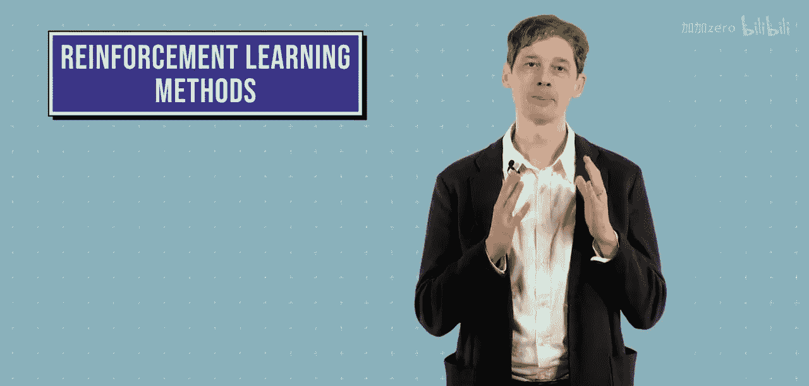
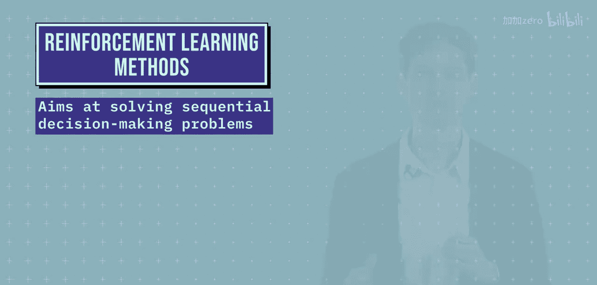
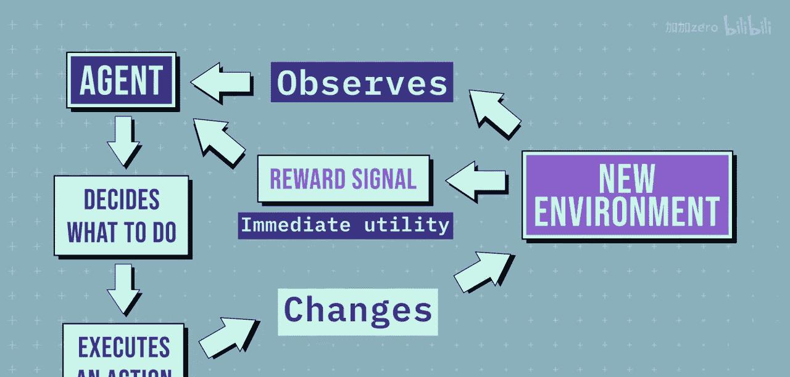

# 人工智能：概述 专项课程：7：序列决策问题 🧠

在本节课中，我们将要学习序列决策问题，并了解强化学习如何通过智能体与环境的交互来学习解决这类问题。

## 概述

序列决策问题是我们日常生活和许多学习过程中的核心。从婴儿学步到掌握复杂游戏，我们都在通过试错来学习如何做出一系列决策以达到目标。强化学习作为机器学习的一个分支，正是为了解决这类问题而设计的。

## 什么是序列决策问题？🤔

当我们学习走路、游泳或打网球时，我们就在解决序列决策问题。在这些过程中，直接经验扮演了基础角色。

实际上，我们每天都会面对许多序列决策问题。据估计，一个普通成年人每天要做超过35，000个决策。

以儿童学步为例。大多数人约在一岁时学会走路。在那个年龄，没有人具备明确的物理知识，理解父母建议的能力也有限。我们主要通过试错过程来学习走路。在想要拿到某些物体的欲望驱使下，我们尝试站起来并迈出第一步。起初，这会导致摔倒，这教会我们哪些动作是错误的。通过反复尝试，我们的大脑学会了需要向肌肉发送哪些指令，才能以最有效的方式达成目标。这正是强化学习方法背后的原理。

强化学习是机器学习的一部分，旨在解决序列决策问题。

## 强化学习的工作原理 🔄

与传统方法不同，强化学习技术不需要问题的动态先验知识，因为它通过智能体与其所处环境之间的直接交互来学习解决决策问题。

强化学习过程可以被建模为一个迭代循环，其工作原理如下：

1.  **观察**：智能体首先观察环境，以理解其所处的状态。
2.  **决策与行动**：然后，它决定要做什么，并执行一个动作。
3.  **环境反馈**：作为这个动作的结果，环境发生变化，并且智能体收到一个奖励信号。奖励是一个数值，用于指定在特定状态下执行该动作的即时效用。

这完成了一次迭代。下一次迭代将从观察环境的新状态开始。

智能体的目标不是选择能获得最大即时奖励的动作，而是在给定的时间范围内收集尽可能多的总奖励。我们常常需要牺牲即时奖励来实现长期目标。

## 挑战与成就 🏆

当奖励被暂时延迟时，我们就遇到了信用分配问题，这会减慢学习过程。实际上，我们需要评估智能体执行的众多动作中，究竟是哪一个使其获得了特定的奖励。

近年来，得益于与深度学习技术的结合，强化学习算法取得了人工智能史上一些最重要的里程碑。

*   **2016年**：谷歌DeepMind开发的AlphaGo算法在围棋比赛中以4比1的比分击败了18次世界冠军李世石。这是一个非常重要且出乎意料的结果，因为大多数专家预测这种结果不会早于2050年出现，考虑到围棋的复杂性（棋盘配置数超过10的117次方）。AlphaGo通过结合深度强化学习和规划技术取得了这一非凡成就。
*   **后续发展**：自2016年以来，研究人员开发了像AlphaZero或MuZero这样的新算法，能够以低得多的计算成本击败AlphaGo。
*   **近期成功**：
    *   2019年，OpenAI开发的OpenAI Five能够在电子游戏Dota 2中击败一支世界冠军队伍。
    *   同年，谷歌DeepMind开发的AlphaStar在即时战略游戏《星际争霸II》中达到了宗师级别，排名位于人类玩家的前0.2%。

这是两款非常复杂的策略游戏，对人工智能算法提出了诸多挑战，例如实时决策、部分可观测性和高维动作空间。这些特性存在于许多现实世界的决策问题中。这些近期的成功表明，强化学习算法可能在不远的将来帮助我们做出复杂的决策。

然而，值得注意的是，这些成果是以非常昂贵的模拟为代价获得的，其产生的经验数据量远超过人类所需。例如，AlphaStar训练了超过六周，生成了相当于超过10万年的《星际争霸》游戏时长。如此大量的经验只有在模拟问题中并借助高性能计算基础设施才可能实现。

## 问题分类与形式化 📊

当前的挑战是开发能够利用人类通常使用的经验量进行学习的强化学习算法。为了实现这一目标，表征机器学习方法的归纳法需要与基于模型知识的演绎式人工智能方法相结合。

为了确定需要考虑哪种强化学习技术，正确地对决策问题进行分类并将其形式化至关重要。

以下是问题分类的关键维度：

*   **观察与动作**：是有限的还是连续的？
*   **可观测性**：智能体能否完全观察到问题状态，还是只有部分观察？
*   **状态转移**：是确定性的还是随机的？
*   **问题性质**：是平稳的还是非平稳的？
*   **环境**：是单智能体环境，还是存在其他学习智能体？

以下是两个例子：

*   **魔方游戏**：这是一个具有有限动作和有限状态的序列决策问题，状态完全可观测。此外，动作对状态转移的影响是确定性的；游戏是平稳的，因为它不随时间变化；并且游戏中只有一个智能体。
*   **扑克游戏**：它具有有限的动作和状态，但状态是部分可观测的，因为我们无法看到对手的私有手牌。状态转移是随机的，因为牌是从牌堆中随机抽取的。游戏是平稳的，并且存在多个同时学习的智能体。

## 总结

本节课中，我们一起学习了序列决策问题的概念。我们了解到强化学习通过智能体与环境的交互试错来学习解决这类问题，其核心是最大化长期累积奖励。我们回顾了强化学习近年来的重大成就，如AlphaGo和AlphaStar，同时也指出了其当前对海量模拟数据的依赖。最后，我们探讨了如何通过观察、动作、可观测性、状态转移等维度对决策问题进行正确分类和形式化，这是选择合适强化学习技术的第一步。

在下一课中，我们将分析马尔可夫决策过程，并讨论如何用它来形式化序列决策问题以及如何解决它们。