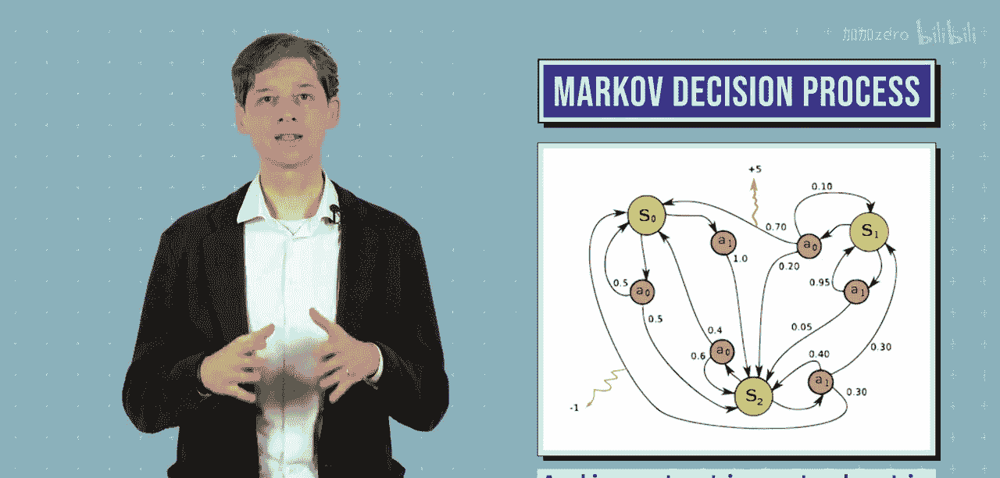
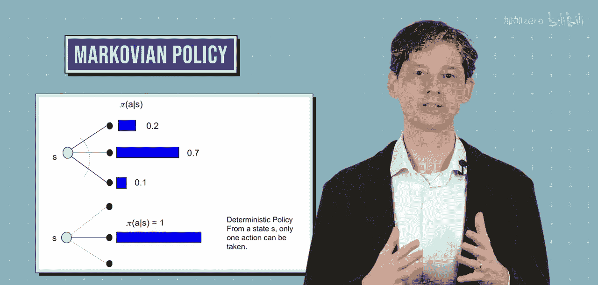
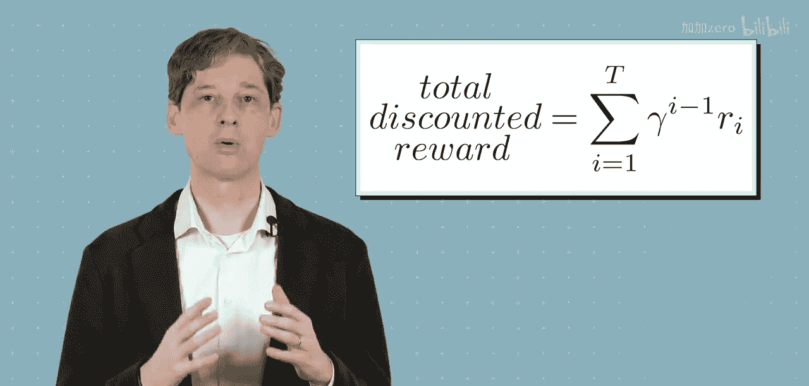
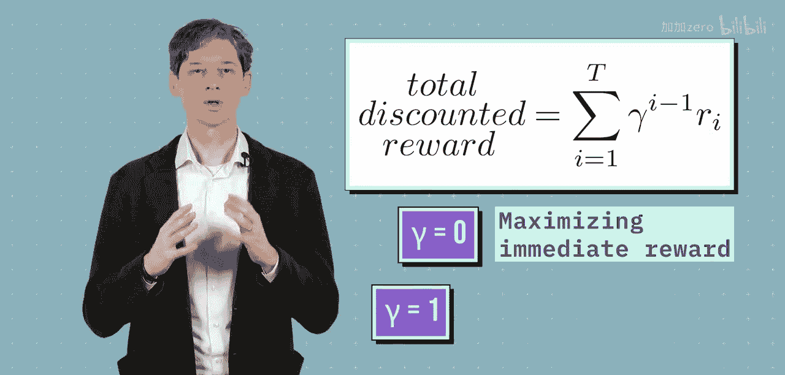
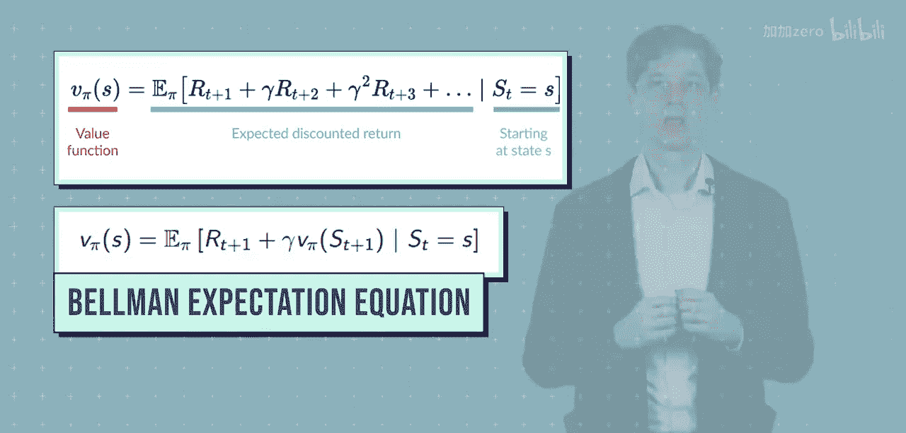
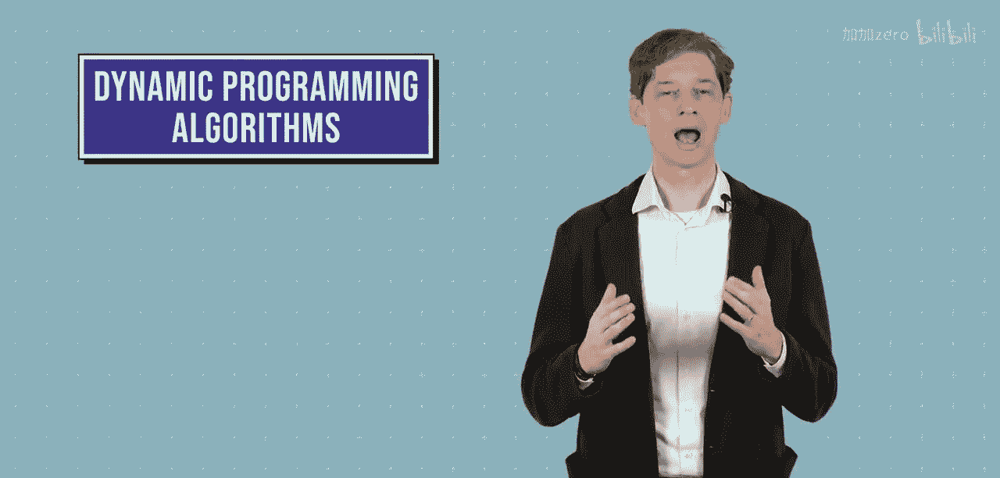

# 【人工智能：概述 专项课程】米兰理工大学—中英字幕 p73 p8_02_markov-decision-processes -BV1Er1PYhE9q_p73-

The mathematical primer most commonly used to describe sequential decisionsm making problems is the mark of the chis process。

A markov decision decision process， MDP for short， describes a discrete time stochastic control process where an agent can observe the state of the problem。

 perform an action， and observe the effect of the action in terms of the immediate world and of the state that is reached because of that action。

An MDP is based on the mark of a sample， which can be formulated as the future is independent of the past。

 given the present。A consequence of the markov assumption is that in order to make the optimal decision。

 we can simply rely on the observation of the current state without the need of remembering how we reach it。

For instance， when we play with the Ruik's cube， it is useless to know how we have reached the current configuration of the cube in order to solve it。

This implies that we do not need to keep in memory the history of the interaction between the agent and the environment。

 thus greatly simplifying the problem。A discrete time finite MP is composed of a finite set S of states。

 a finite set a of action。A state transition function P， in particular。

 P of S A S prime is the probability of reaching state as prime when we perform action A in state S。

A reward function R so that R of S A specifies the immediate reward associated to the execution of action A in state S。

A discount factor gamma， which specified the importance of future rewards compared to the immediate rewards。

To define the behavior of an agent， we use the concept of policy。

A Markovian policy is a function that specifies for each state。

 What is the probability of executing the different actions。If in any state。

 the policy gives all the probability to a single election， we say that the policy is deterministic。

 otherwise， the policy is stochastic。

Solving an MP means finding the optimal policy， which is the policy that maximizes some cumulative function of the reward。

The most common objective function is the expected discounted sum of future rewards。

In this submission， the reward at time I is multiplied by the discount factor raised the power of I-1。

The value of the discount factor， which needs to be in range 01。

 specifies how much future rewards are relevant for the agent。If the discount factor is equal to 0。

 it means that the agent is only interested in maximizing the immediate work。

While a discount factor equal to one means that the agents gives the same importance to all the rewards。

 independently of when they will be collected。

In general， low values of the discount factor will induce myopic behaviors。

 While high values will generate faresightted policies。

In order to understand how to compute the optimal policies for an MP。

 we need to introduce the concept of value function。Given a policy pi， its value function。

 V pi is a function that for each state S specified the expected discounted reward that can be obtained starting from state S and followed the policy pi。

The value of the state S using policy pi can be expressed by acursive equation。

 known as Bellman expectation equation。According to this equation。

 the value of the state S can be expressed as the expected immediate reward that policy pi can get from this state plus the discounted expected value of the state that yous reached after one step。

Considering the Bellman expectation equations for all the states in the MP。

 we get a system of linear equations where the number of equation and the number of unknowns are above equal to the number of states。

Under the assumption that the discount factor is less than1。

 the value function of any policy pi can be obtained by solving the system of beman equation in closed form。

In order to solve an MDP， we need to find a policy that achieves the maximum value possible in any state。

It can be proved that for any MP， it always exists at least one deterministic Markovbian policy that is optimal。

Furthermore， all the optimal policies add the same value function called optimal value function。

 whose values are optimal in any state。As done for the value function of a poing。

 we can write our cursive equation， also for the optimal value function using this socalled beman optimality equation。

We can see that in this equation， the expected value over the action present in the Bellllman expectation equation has been replaced by a maximization over the action。

Unfortunately， this small change has a significant impact。

As the equation are no longer linear in Indian unknowns， therefore， no close form solution exists。

However， it is possible to solve MDps using iterative approaches。

The most used ones are two dynamic programming algorithms， valueeration and policy iteration。

In value iteration， we start from an arbitrary value function。 and iteratively。

 we apply the right hand side of the Belman optimality equation to the value function output in the previous iteration。

In this way， we produce a sequence of value function that has the property of convertverging to the optimal value function。

In policy iteration， we started from an arbitrary policy， and then we reiterated over two steps。

 policy evaluation and policy improvement。In the policy evaluation step。

 we compute the value function of the given policy pi。 While in the policy improvement step。

 we compute the so called greedy policy pi prime， which is the policy that maximize the utility estimated from the value function of policy pi。

It can be proved that policy pi prime is never worse than policy pi in any state。

When during the iteration， we find the policy pi prime that has the same value function of policy pi。

 It means that we have found the optimal value function and that pi and pi prime are optimal policies。

Dynamic programming algorithm allow us to solve MDP when the state transition model and the reward function are known。

When one or both of these elements are unknown， we need to resort to reinforcement learning algorithm。

 which will be overed in the next lesson。

