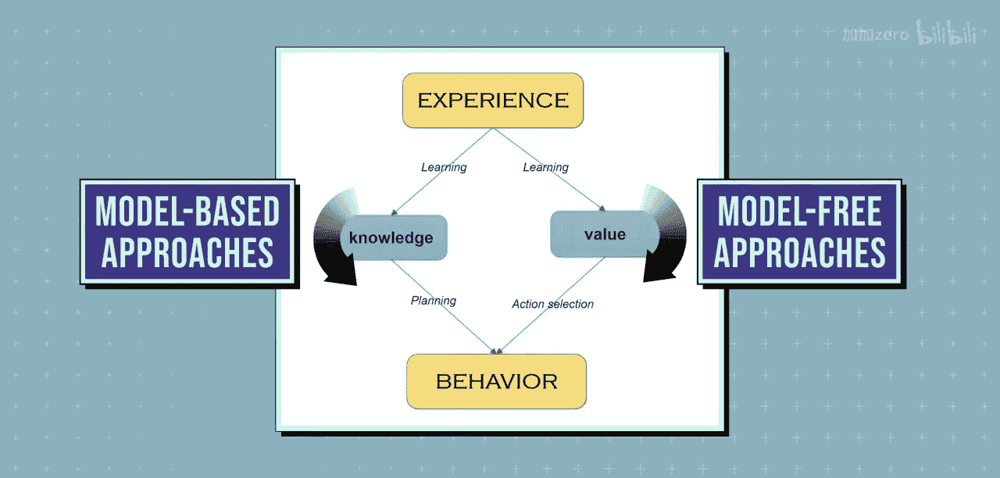
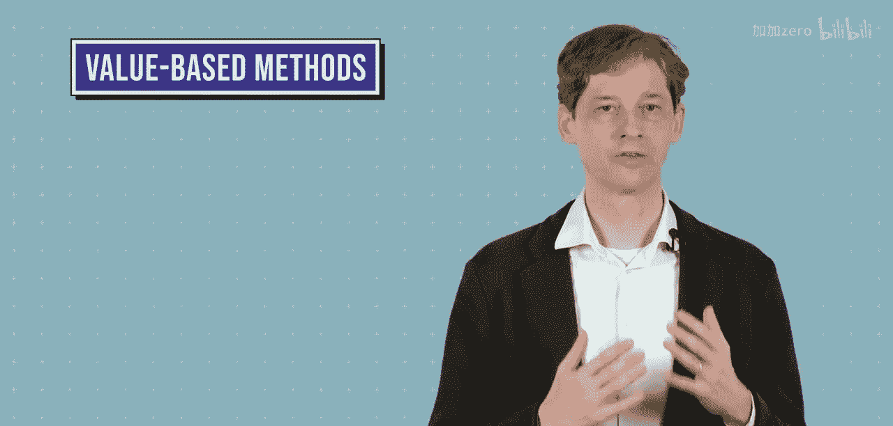
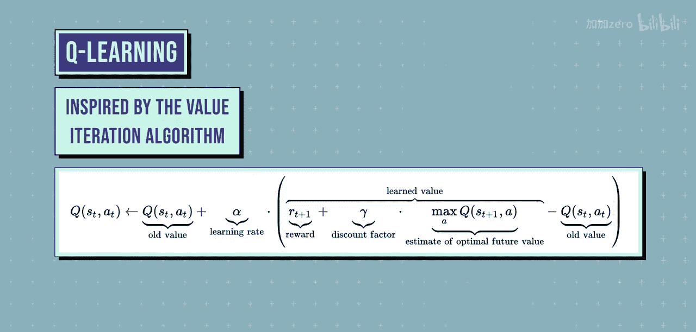
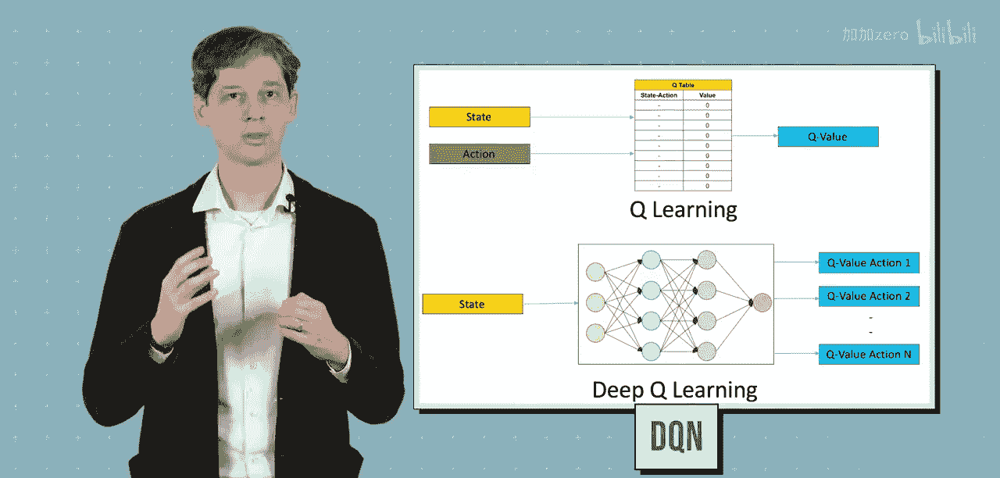
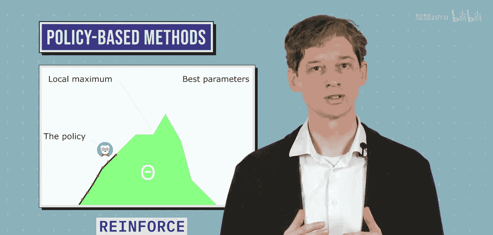
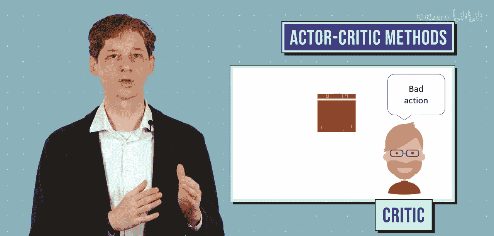
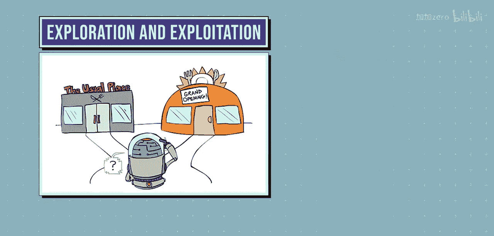

# 【人工智能：概述 专项课程】米兰理工大学—中英字幕 p74 p9_03_reinforcement-learning-algorithms -BV1Er1PYhE9q_p74-

Very often in the real world， when we have to solve the tissue making problems。

 we have little or no knowledge of environmental dynamics。

In other cases， even if we have good state transition models。

 when the number of state inductions is too large， we cant solve these problems by means of exact method such as dynamic programming。

In all these cases， we can use reinforcement learning techniques。

 which are able to learn the solution by direct， interacting with the environment or with the simulator。

In reinforcement learning， the knowledge of the transition model is replaced by observing the effect of the action on the environment。

We call experience sample a sequence composed of state action， next state and reward。

Reinforcement learning techniques can be classified along several dimensions。

One important distinction is between model free and model based approaches。In both cases。

 we do not assume to have prior knowledge of the transition model。In model free approaches。

 we aim to learn the optimal policies by directly evaluating their performance。

In model based approaches instead， we observe the interaction between the agent and the environment in order to estimate a model of environmental dynamics。

 then we apply an exact approach to this model。

Model free approaches are more computationally efficient than model based ones。

 and they do not require us to specify a parametricic model to be estimated。On the other hand。

 model based methods are usually more simple efficient。That is。

 they can learn with fewer experience samples， but they may fail to learn the optimal policy if the consider parametric model is not adequate to represent the environment dynamic。

Another important dimension for the classification of reinforcement learning techniques is related to what the method estimate。

Along this dimension， we have three main categories。Value based， policy based， actor critic。

Value based methods use experience samples to directly learn the optimal value function。

This method take inspiration from dynamic programming algorithm and replace the expected values contained in the Belllman equation with a samplingvari that considers only the action chosen by the agent and the next state reached。

In particular， Q learning， one of the most popular reinforcement learning algorithms is a model free value based method that is inspired by the value iteration algorithm。

After performing action A in state S， Q learning updates the value associated to the state action pairer S A。

 using the immediate collected reward and the value associated with the best estimated action in the next state。

Q learning is guaranteed to convert to the optimal value function under the assumption that each state action pair is visited infinitely often and that the learning rate alpha is decreased to0 according to a proper decay schedule。

Value based methods usually perform well in Mark processes。

 where they struggle in the choosing problems characterized by partial observability or with very large action spaces。

In 2013， Q learning was combined with deep learning techniques。

 giving birth to the deep Qnet or algorithm， D QN for short。In DQN。

 the value function is approximated using a convolutional neural network。

 which allows the algorithm to learn in the tissues making problem with an extremely large number of states。

Originally， the Q N was used to train agent to play。57 At0 games directly from pixelixel input。

Achieving human level performance in most games。Since then， the QN has been improved in many ways。

 Now， we have a deeper reinforce learning algorithm that reach or even exceed the human level across all 57 games。

😊，The second category for the classification of reinforcement learning techniques is the policy based methods。

Here， the idea is to define a space of parametricic policies and then search for the parameter that achieve the best performance。

The most popular algorithm in this category are the policy gradientd methods such as reinforce and GM DP。

Starting from an initial policy， policy gradient methods perform a gradient ascent optimization over the policy parameters。

 where the gradient direction is estimated through trajectories generated by the execution of the current policy in the environment。

Policy based methods allow us to deal with decision making problems characterized by high dimensional and continuous state action spaces。

Furthermore， compared to value based method， they are less sensitive to violation of the Markov assumption and can learn a good solution。

 even in partiallyly observable problems。

For these reasons， they are often employed in a robotic application， in addition。

 they can allow us to learn stochastic policies， which can be useful in the problems in which multiple agents interact。

On the other hand， they require a lot of data to estimate direction for improvement。 and in general。

 they may converge it to a local optimum rather than a global one。

The third category of methods tries to combine the strong points of the previous two。

In actor critic method， there are two main components。 The critic。

 whose goal is to estimate the value function of the current policy， the actor。

 whose goal is to implement the agent policy and update it according to the suggestion coming from the critic。

In this way， actualri method can enjoy the simple efficiency of value based method。

 as well as the ability to operate in a dimension and continuous control problems such as policy based one。

Popular atic algorithm are A2 C， T RRPO， PPO， and DDPG。

Reinforcement learning research is growing quickly and in many directions。

One of the central problems is finding the right balance between exploration and exploitation。

Indeed， we need to explore in order to understand the effects of our action。 But at the same time。

 we want to reduce our exploration as our knowledge becomes more reliable。

Finding the best way to move from exploration to exploitation is paramount for the success of reinforce milling algorithms。

