#  001：课程介绍与MDP基础

## 概述
在本节课中，我们将学习强化学习的基本概念及其数学基础。课程将从应用实例引入，逐步深入到马尔可夫决策过程（MDP）的核心模型，并介绍本学期的学习内容与目标。

## 课程简介与目标
我是Chi J，来自电子与计算机工程系。本学期我们将共同学习名为“强化学习基础”的课程。这门课程虽然名为“基础”，但实际上是强化学习的数学基础。

课程将被录像，主要面向公开讲座和校外学生。课堂上如有任何疑问，欢迎随时提问，所有问题都很有价值。

我们将首先对课程进行简要介绍。由于课程侧重于数学基础，大部分时间将用于黑板推导和概念讲解。但第一讲会使用幻灯片进行概览。

## 强化学习的应用
在深入探讨数学基础之前，我们首先需要了解强化学习的目标和应用领域。现代强化学习已广泛应用于多个领域。

以下是几个著名且已取得部分成功的应用实例：
*   **机器人操作**：例如谷歌和伯克利等机构发布的RT-2，利用强化学习和其他方法训练机器人操作多种物体，并适用于不同类型的机器人。机器人学是强化学习的主要应用领域之一。
*   **策略游戏**：例如《星际争霸》等视频游戏。你可能听说过AlphaStar，谷歌DeepMind训练出的超级人工智能，能够击败世界冠军。这类场景涉及大量策略。
*   **自动驾驶**与**大型语言模型**：例如ChatGPT，据称在最后阶段使用了基于人类反馈的强化学习技术来微调模型。

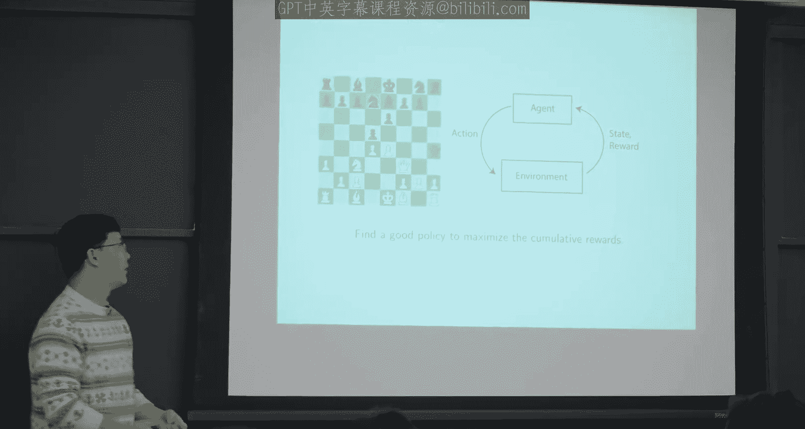

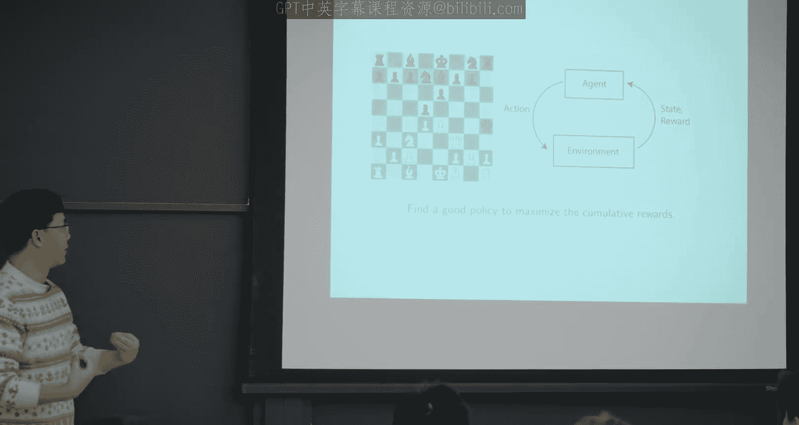

观察这些应用，其共同点是都需要进行决策，并且不是单一决策，而是一系列决策，即**顺序决策问题**。强化学习正是为处理这类顺序决策问题而设计的框架。

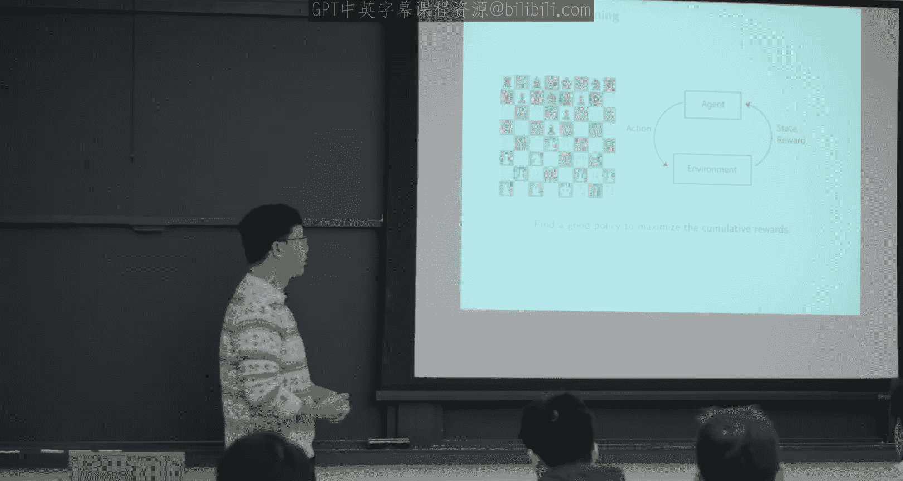

## 课程内容：模型、挑战与算法
以上是前沿应用，本学期我们将更深入地探讨其背后的数学原理。

所有应用都可以抽象为以下图示：我们有一个**智能体**和一个**环境**。智能体是学习者或我们想要构建的人工智能，它会采取**动作**。这个动作会影响环境如何变化或**转移**到下一个**状态**。我们用状态来描述环境。此外，环境还会提供**奖励**。

以国际象棋为例，环境是棋盘，智能体是执白棋的一方。动作是将特定棋子移动到某个位置。环境将变为下一个状态，即棋盘的新配置。奖励可以理解为最终赢得比赛获得奖励1，输掉比赛获得奖励0。

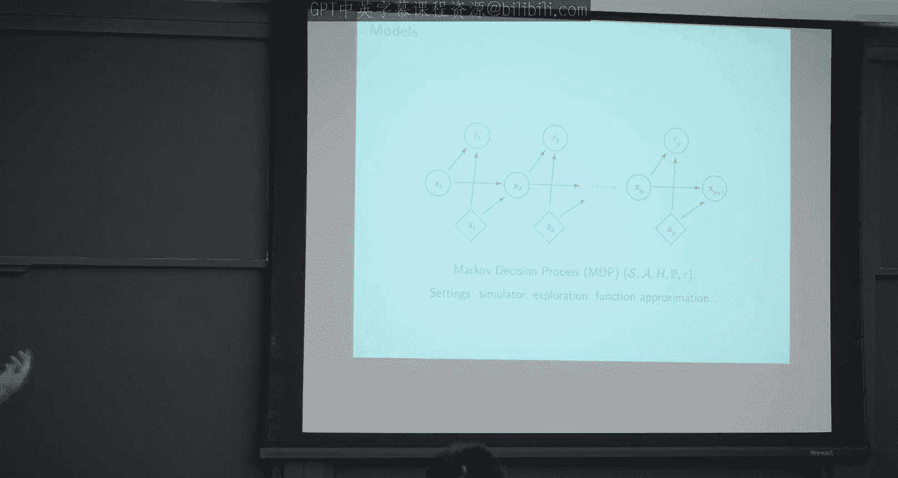

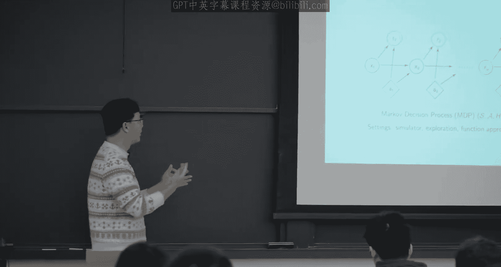

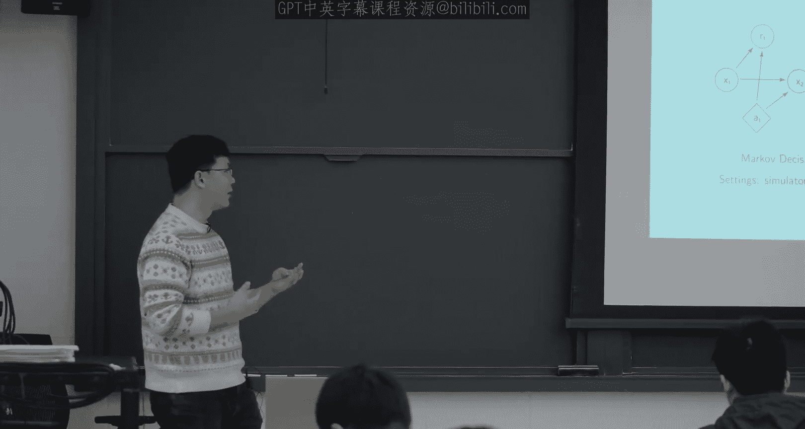

通常，强化学习可以表述为寻找一个良好的**策略**，以最大化**累积奖励**。

这是从应用和基础模型角度对强化学习的简要介绍。

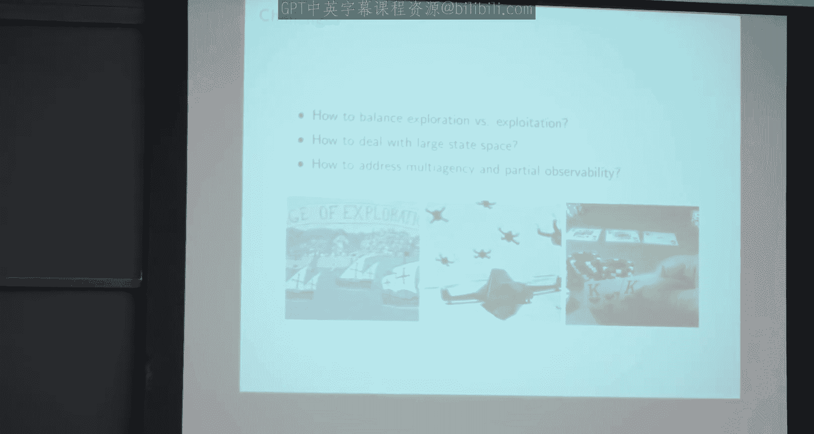

接下来，我们将简要介绍本课程将涵盖和不会涵盖的内容。

首先，我们将涵盖强化学习背后的数学模型。本课程很大一部分将致力于所谓的**马尔可夫决策过程**。我们将在本节课稍后介绍这个模型，严谨地阐述这个顺序过程如何进行，以及哪些量控制着环境状态的向前转移。

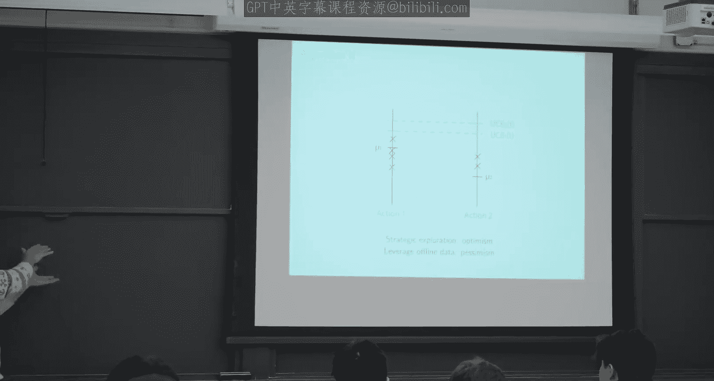

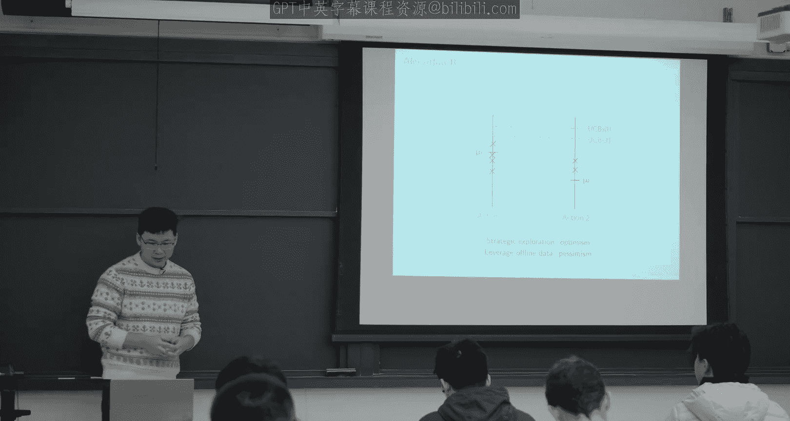

我们还将考虑许多不同的设置，例如模拟器设置、需要探索的设置以及需要函数近似的设置。我们将识别其中的挑战，并讨论解决这些挑战的策略。挑战包括处理顺序决策中的时间相关性，以及如何平衡**探索与利用**，这在在线决策或在线强化学习中是一个重要议题，因为我们需要自行收集样本或数据。

我们还将讨论如何处理**大状态空间**的问题。经典的强化学习通常讨论有限状态，但像视频游戏这样的实际应用通常有数百万个状态。我们将讨论如何使用函数近似来处理这些挑战。

最后，我们将在学期末部分讨论**多智能体强化学习**中的协作与竞争，以及如何处理**部分可观测性**，即某些状态可能无法完全观测，我们需要从有限的观测中推断潜在状态。

我们将讨论模型、挑战以及如何解决这些挑战。课程中一个非常重要的部分将致力于设计算法，或讨论哪些算法能够解决这些挑战。这些算法包括经典的重要算法，如**价值迭代**，以及函数近似算法，如**拟合Q迭代**。基本上，所有重要的强化学习算法都会涉及。

我们还将讨论一些额外的算法组件，这些组件不直接属于规划类算法，而是帮助核心强化学习算法取得成功。例如，在探索与利用方面，除了评估、迭代等经典强化学习算法外，我们还需要进行探索。我们将利用所谓的**乐观原则**，设计一些如上置信界算法，并将其与标准强化学习算法结合，展示这些算法的性能。

我们还将讨论**离线**场景，即我们已经拥有大量可用数据，可以使用悲观主义而非乐观主义。以上是算法和算法设计部分。

最后，除了模型和算法，课程最重要的部分还将讨论**理论保证**。这真正体现了本课程与其他更多经验性的机器学习或强化学习课程的区别。我们关心使用数学为算法提供保证，确保其能够为广泛的应用类别找到所需的量或最优策略。

## 理论保证：样本效率与计算效率
本课程将讨论的理论保证主要有两类。

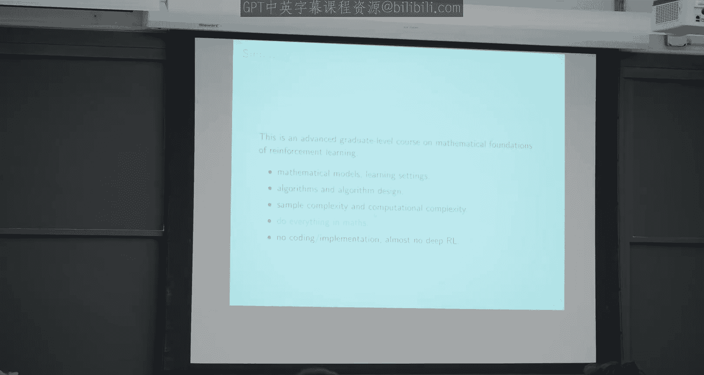

第一类是**样本效率**。样本效率本质上是一个统计问题：我们需要多少样本来学习最优策略？例如，对于自动驾驶或机器人学，样本数量意味着我们需要玩多少局游戏。现有算法通常需要海量样本，动辄数百万甚至数亿。对于许多应用，收集样本可能非常昂贵或耗时。因此，如何降低样本复杂度对于这类应用非常重要。我们的理论将重点讨论能够达到的样本复杂度，以及是否最优，是否存在更好的算法可以达到更低的样本复杂度。

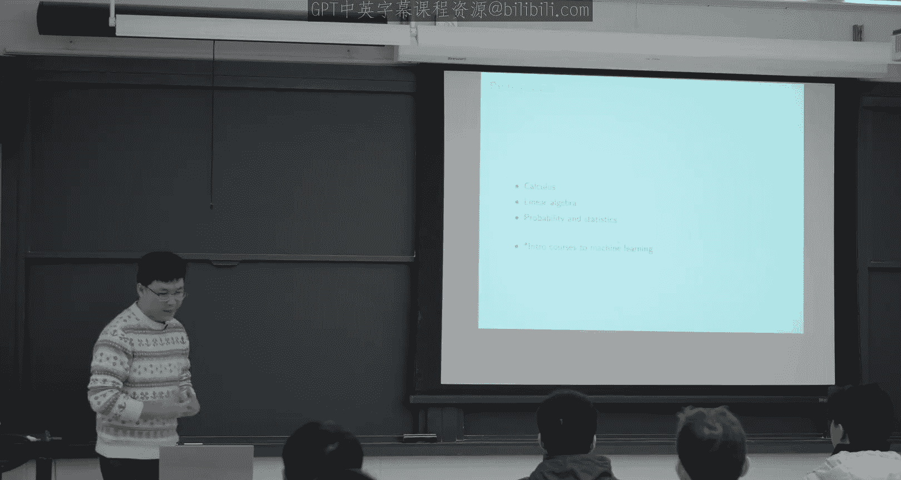

第二类保证是**计算效率**。机器学习本质上是统计学和计算机科学。统计学对应于样本容量，计算机科学则对应于计算效率。最先进的模型通常需要训练数周甚至一个月。如何降低计算效率，使其更易于管理或更易于学术界甚至日常计算使用，是我们理论中的另一个重要议题。

以上是本课程将讨论的内容。更重要的是，我们将严格使用数学和证明来进行一切推导。

## 课程不涵盖的内容
由于我们专注于数学和证明，本课程将不涉及任何编码项目或实际算法的实现。我们不会为课程设置任何编程作业。

总结来说，这是一门关于强化学习数学基础的高级研究生课程。它不适合作为机器学习的第一门入门课程。我们将涵盖数学模型、不同设置和挑战、算法和算法设计，最重要的是理论分析和理论保证。我们将用数学完成所有内容。最后，没有编码或实现部分。我们会讨论一些动态规划算法，但主要是从算法公式和原理层面，不会实现这些算法。如果你真的想学习实现，这可能不是适合的课程。

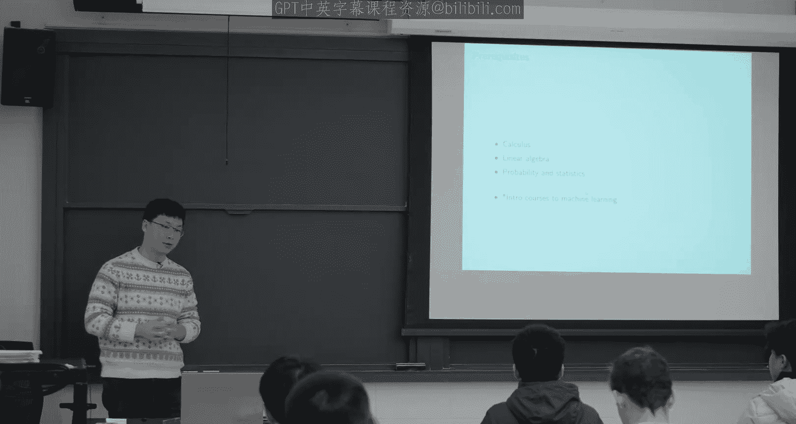

## 先修要求
由于我们建立的是数学基础，因此需要一些数学背景。本课程大部分内容将是自包含的，只需要本科入门级的数学知识。基础的微积分和线性代数非常重要，课程中会大量使用梯度和积分等概念。概率论和统计学也非常重要，本科水平即可，至少需要了解概率、条件概率、边缘概率、期望等概念。对随机过程如马尔可夫链有所了解会很有帮助，但并非必需，我们会在课程中涵盖相关内容。

最后，如果你上过一些机器学习入门课程，那将是有益的。因为我们在做基础研究，通常最好心中有一个目标应用。这样除了数学推导，还能对实际应用和数学所讨论的内容有一些直觉。因此，入门课程是推荐的。如果你将本课程作为第一门机器学习课程，可能会有些挑战。

## 课程安排与后勤
关于课程的后勤安排，你们已经知道了时间和地点。我是讲师，Wen Hao Z是助教。我们的办公时间将在本周公布。

如前所述，本课程内容确实是强化学习的数学基础，我们主要进行定理和证明。

课程成绩将由五次作业和一次期末考试组成。五次作业占总成绩的60%，期末考试占40%。我们希望没有迟交作业的情况。如果确实有紧急情况，请至少在截止日期前几天给我发邮件，请不要在最后一刻发邮件要求延期。

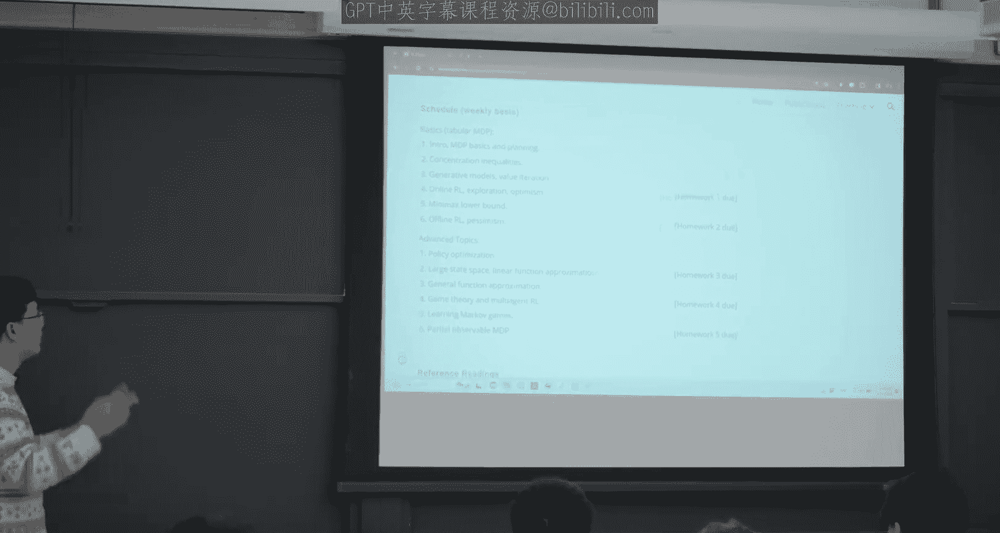

如前所述，课程将被录像。我们还会更新2020年版本的初步讲义。课程网站上有2020年版本的讲义。本学期的大部分内容将基于这些讲义，我们也会发布更新后的讲义，修正一些错误并使内容更清晰。课程录像将在课后几天发布。

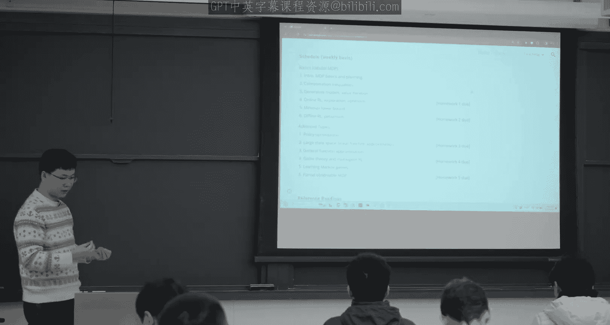

关于教学大纲，本学期计划与往年大致相同，但在某些主题上略有调整。首先，我们有五次作业，从作业2开始，每两周一次。课程将分为两部分。第一部分是强化学习的基础知识，我们将在一个非常清晰的设置中讨论强化学习的各个方面，以便清晰理解每个视角。因此，学期前半部分将专注于**表格型MDP**，即具有有限状态和有限动作的马尔可夫决策过程。

第一周，我们将讨论一些介绍性内容、基础知识和规划算法，即如何基于转移和奖励找到最优策略。

从第二周开始，我们将更多地讨论**学习视角**，即我们需要从数据中学习MDP或学习转移和奖励。每当讨论学习时，我们需要一些统计和概率工具。因此，从第二周开始，我们将首先讨论进行分析所需的数学工具，即集中不等式和一些联合界等。然后，我们将直接进入最重要的不同设置，以及如何建立保证。第一个设置称为**生成模型**或**模拟器**，这是强化学习中较容易的学习设置。接着，我们将讨论两个部分：**在线学习**和**离线强化学习**。在线强化学习中，我们将讨论探索与利用之间的权衡，以及乐观原则如何对此有帮助。离线强化学习则相反，采用悲观主义。

在中间，我们还将讨论**极小极大下界**。如前所述，样本复杂度非常重要，我们为特定算法提供需要多少样本的保证。但同样重要的是，我们还需要知道我们设计的算法是否已经最优，是否存在更好的算法可以达到更低的样本复杂度或计算效率。下界正是为了回答这些问题而发展起来的。我们将看到，对于某些算法类别，某些样本复杂度确实是必需的，没有算法能够规避这种样本复杂度。这可以用来证明某些算法是最优的。

课程的第二部分，即春假之后，我们将讨论更高级的主题。包括**策略优化**，这更类似于实践中的PPO算法，以及我们如何为这类策略优化算法提供保证。

然后，我们将讨论如何处理**大状态空间**的挑战，这超越了经典的表格型设置。在大状态设置中，我们将讨论例如拥有无限状态时如何处理，这其中的关键概念是所谓的**函数近似**。我们将使用一些平滑函数来近似价值或策略，讨论线性函数近似和一般函数近似。如果你不了解这些概念，没关系，我们会在讲到时进行讨论。

课程的最后三周将致力于强化学习中的其他额外挑战。其中两周将讨论博弈论视角，即多智能体强化学习，我们可以研究哪些数学模型，以及算法和保证是什么。最后一周将致力于部分可观测场景，讨论部分可观测MDP及其算法和保证。

期末考试是**开卷考试**，通常有几天时间完成，你可以花费任意多的时间。

## 参考读物
除了讲义，我推荐的第一份资料可能与本课程最相关。它涵盖了除多智能体和部分可观测性之外的大部分类似内容。尽管表述可能略有不同，但它提供了对大致相似内容的另一种视角。如果你真的想阅读其他材料，这可能是最相关的读物。但课程大部分内容是自包含的，不需要大量额外阅读。

其他推荐的优秀教材包括Richard Sutton和Barto的《强化学习导论》，这确实是一本强化学习入门书籍。还有Csaba的两本关于赌博机技术的书，我也推荐。如果你真的想在强化学习领域进行研究生水平的研究，赌博机是一个非常重要的基础案例，这本书全面涵盖了不同设置、算法设计以及不同场景下的保证。

最后两份资料是第二周关于集中不等式材料的补充读物。如果你觉得想多了解一些集中不等式，可以阅读这两份调查或教科书。

## 相关课程
本课程是我第三次讲授。自2020年设计以来，许多大学已经开设了强化学习课程，包括UIUC、康奈尔、MIT等。不同课程有不同的风格。前两门课程主要基于第一份资料。Dylan和Alexandra Rackling的课程在统计方面更深入，会介绍更高级的工具。我个人觉得有点复杂，我会在本课程中简要提及，但不会重点讲解。最后，Alexagro和Alex Svins也讲授赌博机和强化学习课程。

还有一些更经验性或实践性的课程，例如Sergey在UC伯克利讲授的深度强化学习课程。我相信伯克利和普林斯顿本学期也会有强化学习入门课程，面向高年级本科生和研究生，会讨论很多经验性案例研究和实际应用。如果你对这些感兴趣，也可以参考那些材料。

我们将使用Canvas平台上传所有作业，你的解决方案也应上传到Canvas。

如果没有更多问题，我们将直接开始讲课。

## 马尔可夫决策过程（MDP）公式
现在，让我们直接进入数学基础。首先讨论MDP公式。

MDP代表**马尔可夫决策过程**。如前所述，这是强化学习背后最基本的数学模型。本学期大部分时间，我们将专注于学习MDP的不同视角和设置。

我们将分步骤逐步引入MDP。首先讨论一些更简单的模型，它们是MDP的特殊情况，然后逐步添加元素，最终得到MDP。

第一个基本模型是**多臂赌博机问题**。

想象你走进一个赌场，面对一个K臂赌博机。你面前有K个摇臂。每次你需要拉动其中一个摇臂，并获得一些奖励。

假设在这个模型下，当我拉动第1个摇臂时，我会得到一个随机奖励，奖励金额从某个高斯分布中采样。这个高斯分布的均值为R1，方差为σ²。如果我拉动第2个摇臂，我会得到一个从均值为R2、方差为σ²的高斯分布中采样的随机奖励。类似地，如果我拉动最后一个摇臂K，我会得到一个从均值为RK、方差为σ²的高斯分布中采样的随机奖励。

在这种情况下，每次拉动摇臂都会获得随机奖励。多臂赌博机问题的目标之一是**识别最佳摇臂**。最佳摇臂可以定义为具有最高平均奖励的摇臂。

对于这类问题，我们可以通过两个元素来指定：一个是**动作集A**，在我们的例子中是{1, 2, ..., K}；另一个是**奖励分布**。这两个元素定义了多臂赌博机问题。

接下来，我们将讨论一个稍微复杂一点的设置，称为**上下文多臂赌博机**。

上下文多臂赌博机不是只有一个赌博机，而是有多个K臂赌博机。例如，第一个是蓝色赌博机，第二个是红色赌博机，第三个是黄色赌博机。

上下文多臂赌博机的交互协议如下：我们与这个上下文多臂赌博机进行K轮交互。在每一轮K中，环境首先选择一个**上下文S**，在我们的例子中，上下文S就是蓝色、红色或黄色。然后，智能体采取一个动作。最后，环境揭示随机奖励。

本质上，环境与我互动，首先告诉我应该玩蓝色赌博机，然后我拉动一个摇臂；接着他告诉我只能玩红色赌博机，然后我从红色赌博机拉动另一个摇臂。

这个场景的目标当然是**为每个上下文识别最佳摇臂**。换句话说，如果你告诉我玩蓝色赌博机，我想知道蓝色赌博机的哪个摇臂最好；同样，我也想知道红色和黄色赌博机的最佳摇臂。

在这种情况下，我们可以从数学上描述识别每个上下文最佳摇臂的目标，这等价于找到一个**最优策略π**。策略定义为从每个上下文（状态集S）到动作集A的映射。这是一个确定性策略。有时，特别是在课程最后部分的多智能体场景中，考虑随机策略也是有益的，即从状态映射到动作的概率单纯形。

上下文多臂赌博机可以通过相同的元素来指定：动作集A和奖励分布R。额外的元素是**上下文集S**。

你可以认为第二个模型，上下文多臂赌博机，是多臂赌博机的有状态版本。它不仅有一个赌博机，而且有多个不同的赌博机，这些不同的赌博机由状态或上下文描述。

我想介绍这个模型，是因为在课程后期，当我们为强化学习开发一些非常复杂或相当复杂的解决方案时，始终记住这些是特殊情况是很好的。如果你觉得理解MDP或强化学习的某些概念非常困难，回到简单案例首先理解其工作原理将非常有益，然后再思考它如何适用于MDP，从而对一切有更深入的理解。

最后，我们将讨论**马尔可夫决策过程**。我们将使用大量符号来表示它。

它有上下文集或状态集S、动作集A、奖励R。此外，它还有转移概率P和步长H。

我认为MDP试图建模的最重要的事情，除了上下文多臂赌博机之外，是**时间相关性**。本质上，我们想说动作会对未来状态产生影响。我们不再只是重复玩同一个上下文赌博机，而是状态会以某种特定方式转移，这实际上取决于你采取何种动作。

首先讨论交互协议。交互协议有些类似，我们有不同的**回合**，t = 1, ..., T。

通常，如果我们能想到一些目标应用会更好。我有时想到的目标应用是玩超级马里奥或下棋。每个回合就像游戏的一次通关，从初始状态开始，直到最终玩家死亡，然后开始另一局游戏，这就是一个回合。

以超级马里奥为例。首先是环境揭示初始状态S1。从初始状态开始，我们需要做出一系列决策，然后环境状态将转移到未来的一系列状态。因此，内部还有一个循环。步骤h从1到H。想象我们玩超级马里奥H步。在每一步，智能体选择某个动作A_h。然后，环境将转移到下一个状态S_{h+1}，并给出奖励R_h。

本质上，在我们采取某个动作后，我们可以立即看到动作的效果。在超级马里奥中，如果我们吃了蘑菇，玩家会变大；如果我们跳进某个地方，玩家可能会死亡。然后我们会看到环境如何转移到下一个状态，环境也会给出一些即时奖励。

如果我们可以用图表来说明其工作原理，会更清楚。环境首先从某个状态S1开始。玩家采取第一个动作A1。S1和A1共同决定环境将进入的下一个状态是什么。S1和A1也共同决定我将获得的即时奖励。然后游戏过程继续。在第二步，游戏转移到S2，我将采取另一个动作A2。S2和A2共同决定第三步的状态，以及第二步将获得的即时奖励。这个过程持续进行，直到达到最终状态。在这种情况下，我们考虑的是**回合制设置**。为简单起见，我们假设每个游戏只有H步。H是游戏的最终**步长**。游戏在达到S_{H+1}后停止。

在直觉层面上，你可以认为MDP只是上下文多臂赌博机的一个稍微复杂的版本，其中上下文多臂赌博机已经有状态、动作和奖励。现在MDP的不同之处在于我们额外有了**转移概率P**，即状态如何从第一步的S1变化到第二步、第三步，以及动作如何影响这些转移。转移概率P是MDP中的新内容。我们将更具体地讨论这些内容。

## MDP的正式定义
我们将正式定义MDP的元素。

首先是**状态集S**。这个集合可以是任何东西，可以是1, 2, 3, ..., n个状态，或者蓝色、黄色等。这并不重要，它只是你拥有的状态的集合。

**动作集A**是有限动作的集合。你在每个不同状态下可以采取的动作类型。

为简单起见，我们讨论**奖励函数R**。我们说R是每个单独的R_h。R_h是一个从状态-动作对映射到[0, 1]区间的实数的映射。本质上，它是一个以状态和动作为输入，映射到0到1之间某个实值的函数。这只是归一化条件，奖励总是限制在0到1范围内。数字R_h(s, a)是如果当前处于状态s并采取动作a将获得的奖励。

为简单起见，我们在这里考虑确定性奖励。我们不再有奖励分布，奖励只是一个单一函数。我认为我们通常可以这样做的原因是，转移本身具有随机性，而转移的随机性通常比奖励的随机性更难处理。因此，我们之后开发的任何适用于随机转移和确定性奖励的理论分析，都可以轻松扩展到随机转移和随机奖励的情况。这只是为了简化符号，我们当然可以处理随机奖励，只是符号会更复杂一些。

我认为关键重要的部分是**转移矩阵P**。同样，P是概率P_h(s' | s, a)。这确实是在当前处于状态s并采取动作a的条件下，转移到下一个状态s'的概率。

最后，我们还有最后一个元素H，即回合的长度。

## 马尔可夫性
我想稍微评论一下，这看起来像是一般的转移，但为什么它被称为马尔可夫决策过程？马尔可夫部分体现在哪里？

一个非常简单的原因是，考虑一个固定的动作序列A1, A2, ..., A_H。如果你看这个图表，如果A1, A2是固定的，那么我们基本上就去掉了动作的影响，因为动作已经预先固定，我们只看剩余的链。这就像S1到S2，S2到S3，本质上剩余的状态形成了一个**马尔可夫链**。

因此，状态序列S1到S_{H+1}是一个马尔可夫链。对于那些不熟悉随机过程的人，马尔可夫链是你会学到的最基本的随机过程之一。我认为马尔可夫链最重要的性质是**无记忆性**。

无记忆性本质上意味着，例如，如果这只是一个链，那么以当前步骤发生的情况为条件，例如以S2为条件，之前发生的一切和之后发生的一切是独立的。这本质上意味着，以S_h为条件，S1到S_{h-1}之前发生的一切和S_{h+1}到最后状态S_{H+1}之后发生的一切，这两个集合的概率分布是独立的。这是一个非常重要的性质，本质上，当前状态已经是过去的充分统计量，如果你想对未来做出预测。我们有时会在MDP中利用这个性质，马尔可夫性质已经内嵌在这个假设中：转移概率仅取决于当前状态和动作，与之前的状态无关。这种性质已经假设了这是一个马尔可夫链。

## 重要概念：环境、价值与策略
在介绍了基本公式之后，我们将讨论几个非常重要的概念，这些概念将贯穿整个课程。

我们将讨论三个最重要的概念：**环境**、**价值**和**策略**。

首先，当我们谈论学习环境或探索未知环境时，在MDP场景中，“未知环境”通常意味着MDP的两个属性：转移概率P和奖励R。后来的许多不同场景将根据我们如何了解环境以及如何与环境交互来划分。

有许多不同的设置。一种是已知环境，我们只进行**规划**，这是一个较容易的设置。未知环境又可以进一步划分为模拟器场景，我们有一些非常强大的工具，可以轻松地从数据中学习这些转移和奖励；或者更具挑战性的设置，如在线场景，我们必须进行在线交互；或者离线场景，我们无法再与MDP交互，但可以访问一些预先收集的数据。基本上，许多不同的设置都围绕着我们如何假设访问环境的方式展开。我们将在后面更具体地讨论这些设置。

接下来，我们将讨论**策略**。如果你还记得，我们已经在上下文赌博机中遇到了策略的概念，策略只是一个从状态到动作或动作分布的映射。本质上，策略告诉你在每个状态下要采取何种动作。

这里的MDP本质上是上下文多臂赌博机的顺序版本，因此策略具有类似的结构。策略也是一个映射。它不仅以状态作为输入，还以你采取动作的步骤作为输入。它从状态空间S和步骤h（h属于集合{1, 2, ..., H}）映射到动作集A。这是确定性策略。你也可以说对于随机或随机策略，你将其映射到动作的概率单纯形。

等价地，如果你不习惯这种符号，我们也可以使用其他符号。我们也可以在课程中交替使用。我们可以说策略π是H个不同策略的集合。本质上，我们对每个步骤有不同的策略。每个π_h是一个从状态到动作或动作概率单纯形的映射，取决于确定性策略还是随机策略。这本质上是等价的表述。你可以将π视为从S和h的映射，也可以说有H个不同的函数，每个函数只是从状态到动作的映射。

我想强调一点，这种讨论策略的方式实际上是所谓的**马尔可夫策略**。因为在每一步h，策略只依赖于当前状态，本质上利用了马尔可夫性质。但我们也可以有**一般策略**。一般策略可能更复杂。在步骤h，当我想做出决策采取某个动作A时，我有更多信息。我不仅拥有当前状态，还可以访问所有之前的状态和动作。因此，一般策略本质上是我想要跳出框框思考：为什么不利用所有关于历史的先前信息来做出决策？因此，一般策略也可以定义为π = {π_h}_{h=1}^{H}。唯一的不同是，每个策略不再是从状态到动作的映射，而是从整个历史到动作的映射。整个历史本质上是S1, A1, S2, A2, ..., S_h。

我想在这里讨论一般策略，因为我不想给人留下策略必须像这样的形式的初步印象，特别是在课程后期，当我们讨论多智能体强化学习或部分可观测强化学习时，事实上这种马尔可夫策略并不总是好的。在许多场景中，我们需要讨论这种一般策略，需要依赖于历史。但对于MDP，有一个非常好的性质，我们不再需要讨论这种一般策略。我们将在下一讲介绍，本质上，如果我们想讨论最优策略，即最佳策略，你可以证明最优策略总是马尔可夫的。因此，这就是为什么在无损一般性的情况下，我们总是可以只讨论马尔可夫策略，而在课程的很大一部分中可以忽略一般策略。

## 价值函数
最后，我们可以讨论**价值**。

我们将首先介绍策略π的**价值**。我们介绍两种类型的价值：一种是**V价值**，另一种是**Q价值**。

V价值V_h^π定义在每个步骤h，对应于一个特定的策略π，定义在一个状态s上。Q价值Q_h^π定义在一个状态-动作对(s, a)上。

V价值的定义本质上是**累积奖励**，如果我**从状态s开始**，在步骤h，并**遵循策略π**。你可以想象这类似于一个概念。例如，如果你在下棋，并且你知道你正在使用的策略，那么对于当前的棋盘配置，你会大致估计从这个配置开始，遵循策略π赢得比赛的概率。这本质上是价值的概念，即如果你从当前状态s开始并持续遵循策略π，你将获得的所有未来奖励的总和。

类似地，Q价值基本上是相同的概念。唯一的不同是，你不是从某个状态s开始，而是从状态-动作对(s, a)开始，同样在步骤h并遵循策略π。唯一的区别是，在步骤h，我们是从状态s开始，并且立即采取的动作是遵循策略π的π_h(s)；而在Q价值中，立即采取的动作可以是任意动作a。除此之外，其他一切都相同。

V价值有时等于Q价值对动作的期望。我们将在下一讲讨论这个关系。

最后，我想快速讨论一下这两个的数学定义。这是用文字给出的定义。

V价值V_h^π(s)等于从步骤h到最终步骤所有未来奖励的期望，条件是目前S_h = s。Q价值的定义非常相似，是未来奖励的期望，条件是目前S_h = s且A_h = a，并遵循策略π。

我想多解释一下这个符号，我们实际上对什么取期望。为了理解这一点，我们首先需要从这个符号中理解什么是随机的。

我们知道S_h在每一步都是固定的。因此，超出此范围的一切，未来的所有事情都可能是随机的，我们需要对其取期望。这包括S_{h+1}可能是随机的，A_{h+1}可能是随机的，S_{h+2}，一直到S_{H+1}。本质上，我们可以将这个期望展开。这个期望也等于我们对每个随机变量逐一取期望。在最外层，我们首先对S_{h+1}取期望，其中这个状态是从给定S_h和A_h的转移概率中采样的。然后，我们采样A_{h+1}，它来自π_{h+1}，给定S_{h+1}。然后我们得到下一个状态S_{h+2}，再次从转移概率中采样，给定S_{h+1}和A_{h+1}。然后我们得到A_{h+2}，依此类推，直到最后。这本质上是这个期望的展开。

## 强化学习的目标
有了MDP的所有定义，我们最终可以得出强化学习的目标。

将MDP想象成国际象棋游戏。我们真正想要的是有一个策略，一种下棋的方式，以便最大化我们的胜率。从数学上讲，我们本质上可以说我们想要找到某个**最优策略π***，以最大化初始状态的价值。本质上，我们想要找到最优的π，以实现这个价值，这是第一步的价值，也是初始状态的价值。

通常有几种场景：我们可以首先考虑一个固定的初始状态。或者有时，如果你不满意固定的初始状态，想讨论一些随机的初始状态，那么你本质上想要最大化从某个初始分布μ中采样的S1的期望值V_1^π(S1)。但为简单起见，在本课程的许多设置中，我们只考虑一个简单的设置，即有一个固定的初始状态，这确实是我们想要实现的目标。我们想要找到一个策略，以便从一开始就能实现最大价值。

## 总结
本节课中，我们一起学习了强化学习的基本介绍及其数学基础——马尔可夫决策过程。我们从实际应用出发，了解了强化学习在机器人、游戏、自动驾驶和大型语言模型等领域的应用。接着，我们深入探讨了MDP的核心组成部分：状态、动作、奖励、转移概率和步长。我们还介绍了策略和价值函数的概念，并明确了强化学习的目标是寻找最优策略以最大化累积奖励。最后，我们概述了本课程将涵盖的理论保证、算法设计以及不包含的实践编码部分，为后续深入学习奠定了坚实的基础。