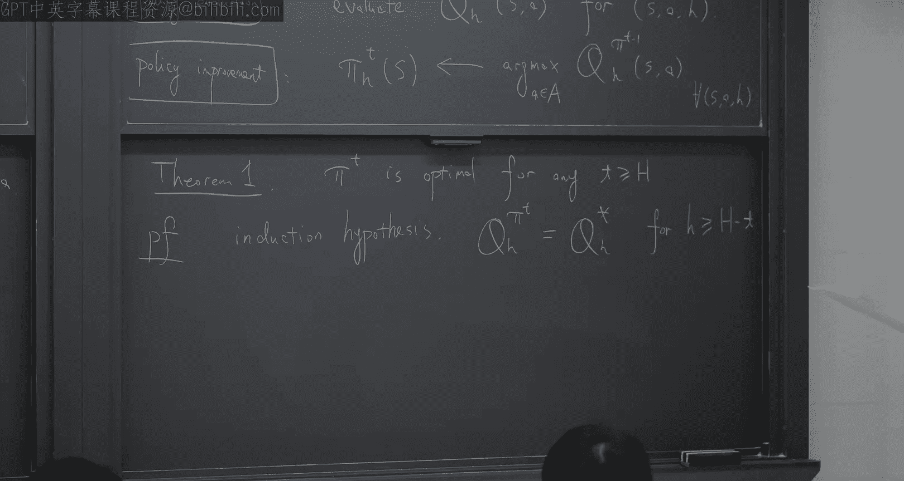

#  003：规划与集中不等式

在本节课中，我们将要学习两个核心主题。首先，我们将继续探讨如何找到最优策略，即**规划**问题，并介绍两种经典算法：值迭代和策略迭代。其次，我们将转向**学习**问题的基础，即如何从与未知环境的交互中学习。为此，我们需要引入关键的数学工具——**集中不等式**，它帮助我们理解样本估计的精确度。

## 回顾贝尔曼最优方程

上一节我们介绍了贝尔曼最优方程，本节中我们来看看它的具体形式及其与规划算法的联系。

贝尔曼最优方程与贝尔曼方程类似，但关键区别在于它取的是最大动作值，而非对策略求平均。它包含两个方程：

1.  最优状态值函数：**V\*(s) = max_a Q\*(s, a)**
2.  最优动作值函数：**Q\*(s, a) = R(s, a) + E[V\*(s')]**

在上一讲的最后，我们证明了由贝尔曼最优方程直接导出的贪婪策略 **π\*(s) = argmax_a Q\*(s, a)** 就是最优策略，它能在所有时间步和状态下同时达到最优值。

## 规划算法

给定已知的环境动态 **P** 和奖励函数 **R**，规划的目标是计算最优策略 **π\***。这与策略评估不同，策略评估是评估一个固定策略的价值，而规划则是要找到最优策略本身。

以下是两种解决规划问题的经典算法。

### 值迭代算法

值迭代算法直接利用贝尔曼最优方程的递归形式，通过动态规划来计算最优策略。

算法步骤如下：

1.  初始化：设最终步 **H+1** 的状态值为0，即 **V_{H+1}(s) = 0**。
2.  反向迭代：对于步数 **h** 从 **H** 递减到 **1**，执行以下操作：
    *   计算所有状态-动作对的最优动作值：**Q_h(s, a) = R_h(s, a) + P_h V_{h+1}(s, a)**
    *   计算所有状态的最优状态值：**V_h(s) = max_a Q_h(s, a)**
3.  输出最优策略：**π_h(s) = argmax_a Q_h(s, a)**

值迭代的工作原理非常直观，它直接实现了贝尔曼最优方程，因此能保证找到最优策略。其计算复杂度与时间步数 **H** 成线性关系。

### 策略迭代算法

策略迭代算法不直接使用贝尔曼最优方程，而是通过交替进行策略评估和策略改进来逐步优化策略。

算法步骤如下：

1.  初始化：任意选择一个初始策略 **π_0**。
2.  迭代优化：对于迭代轮次 **t = 1, 2, ...**，执行以下两步：
    *   **策略评估**：计算当前策略 **π_{t-1}** 的价值函数 **Q^{π_{t-1}}**。
    *   **策略改进**：基于计算出的价值函数，更新策略为贪婪策略：**π_t(s) = argmax_a Q^{π_{t-1}}(s, a)**

一个关键问题是：策略迭代需要多少次迭代才能收敛到最优策略？下面的定理给出了答案。

**定理**：在有限步长 **H** 的设定下，策略迭代算法最多经过 **H** 轮迭代就能找到最优策略，即对于任意 **t ≥ H**，都有 **π_t = π\***。

**证明概要**：我们使用归纳法证明一个更强的结论：在第 **t** 轮迭代后，对于所有满足 **h ≥ H - t** 的步数 **h**，策略 **π_t** 的价值函数 **Q_h^{π_t}** 等于最优价值函数 **Q_h\***。
*   **基础情况 (t=0)**：在最后一步 **H**，任何策略的价值都只等于即时奖励 **R_H(s, a)**，这与最优价值相同。
*   **归纳步骤**：假设第 **t** 轮后结论成立。在第 **t+1** 轮，策略改进步骤会针对满足 **h ≥ H - t** 的步数，选择贪婪动作。根据归纳假设，这些步数的 **Q** 值已是最优值，因此贪婪动作就是最优动作，即对于这些步数有 **π_{t+1} = π\***。由于 **h-1** 步的 **Q** 值只依赖于未来策略，而未来策略已是最优，因此 **Q_{h-1}^{π_{t+1}}** 也等于最优值。这等价于在第 **t+1** 轮后，结论对 **h ≥ H - (t+1)** 的步数成立。

因此，经过 **H** 轮迭代后，所有步数的策略都变为最优。

**值迭代与策略迭代的比较**：在最坏情况下，值迭代通常更快，因为它的一次反向扫描（复杂度 **O(H)**）就等价于策略迭代的一整轮（包含一次策略评估，复杂度也是 **O(H)**）。但在某些无限视野或平稳策略设定下，策略迭代可能更高效。

## 有限视野与无限视野设定

到目前为止，我们讨论的都是**有限视野**的阶段性任务。另一种常见设定是**无限视野折扣**设定。

在无限视野设定中，我们引入折扣因子 **γ (0 < γ < 1)**，价值函数定义为未来所有折扣奖励的期望和：**V^π(s) = E[ Σ_{h=0}^∞ γ^h R_h ]**。

**两种设定的联系**：
1.  **有效视野**：由于奖励有界（例如在[0,1]之间），未来 **H** 步之后的累积折扣奖励总和不超过 **γ^H / (1-γ)**。当 **H ≈ O(1/(1-γ) * log(1/ε))** 时，这个尾巴可以忽略不计（小于 **ε**）。因此，无限视野问题可以近似为一个有效视野 **H̃ = O(1/(1-γ))** 的有限视野问题。
2.  **算法对应**：在无限视野设定中，贝尔曼最优方程变为 **Q\*(s,a) = R(s,a) + γ E[V\*(s')]** 和 **V\*(s) = max_a Q\*(s,a)**。对应的值迭代算法变为**不动点迭代**：反复应用这两个方程更新 **V** 和 **Q**，直至收敛。

本课程将主要关注有限视野设定，因为其动态规划结构更清晰，易于分析，并且结果可以推广到无限视野设定。

## 从规划到学习

规划假设我们完全了解环境（**P** 和 **R**）。然而在现实中，环境通常是未知的。**强化学习**的核心就是通过与未知环境的交互来学习最优策略。

这引出了统计估计问题：我们需要用样本来估计转移概率和奖励函数。

考虑一个简单例子：估计从一个固定的状态-动作对 **(s, a)** 转移到某个新状态 **s'** 的概率 **p**。这类似于投掷一枚正面概率为 **p** 的硬币。我们通过 **n** 次独立观测的样本 **X_1, ..., X_n** 来估计 **p**。

根据大数定律，样本均值 **\hat{p} = (1/n) Σ X_i** 会几乎必然地收敛到真实值 **p**。但这对学习来说不够，我们需要知道**需要多少样本（样本复杂度）**才能以高概率保证估计误差小于某个值 **ε**。这就需要更强大的工具——**集中不等式**。

## 集中不等式简介

集中不等式量化了随机变量（如样本均值）偏离其期望值的概率上界。它是分析学习算法样本复杂度的核心数学工具。

在介绍具体不等式之前，我们先定义一些用于简化表述的渐近记号。

### 渐近记号

*   **大O记号 (O)**：**g(x) = O(f(x))** 表示当 **x** 足够大时，**g(x)** 的增长速度不超过 **f(x)** 的某个常数倍。它隐藏了常数因子。
*   **大Ω记号 (Ω)**：**g(x) = Ω(f(x))** 表示 **g(x)** 的增长速度至少是 **f(x)** 的某个常数倍。即 **f(x) = O(g(x))**。
*   **大Θ记号 (Θ)**：**g(x) = Θ(f(x))** 表示 **g(x)** 的增长速度与 **f(x)** 同阶，即既有 **g(x) = O(f(x))**，也有 **g(x) = Ω(f(x))**。
*   **小o记号 (o)**：**g(x) = o(f(x))** 表示当 **x** 足够大时，**g(x)** 的增长速度严格慢于 **f(x)**，即 **g(x)/f(x) → 0**。
*   **带对数的大O记号 (Õ)**：**g(x) = Õ(f(x))** 表示 **g(x)** 不超过 **f(x)** 乘以某个对数多项式的常数倍。它隐藏了常数因子和对数因子。

### 霍夫丁不等式

对于独立随机变量，一个最基本且重要的集中不等式是**霍夫丁不等式**。

**定理（霍夫丁不等式）**：设 **X_1, ..., X_n** 为 **n** 个独立随机变量，且第 **i** 个变量以概率1满足 **a_i ≤ X_i ≤ b_i**。令 **L_i = b_i - a_i** 为其取值范围。那么，对于任意 **t > 0**，有：
**P( Σ_{i=1}^n (X_i - E[X_i]) ≥ t ) ≤ exp( -2t^2 / Σ_{i=1}^n L_i^2 )**

**直观理解**：这个不等式表明，**n** 个独立有界随机变量之和偏离其期望值超过 **t** 的概率，随着 **t** 的增大呈指数级衰减（衰减速度与 **t^2** 成正比）。这意味着随机变量之和的分布会高度“集中”在其期望值附近。

这个单边不等式同样适用于另一边，即 **P( Σ (X_i - E[X_i]) ≤ -t )**。结合两者，我们可以得到和值以高概率落在期望值附近的一个区间内。

在下一讲中，我们将进一步探讨集中不等式的含义，并学习如何推导它。

## 总结

本节课中我们一起学习了：
1.  **规划**：在已知环境模型下寻找最优策略。我们掌握了两种算法：**值迭代**（直接求解贝尔曼最优方程）和**策略迭代**（交替进行策略评估与改进）。
2.  **设定对比**：理解了有限视野与无限视野折扣设定之间的联系，无限视野问题可以通过有效视野近似为有限视野问题。
3.  **学习问题引入**：认识到在环境未知时，我们需要通过与环境的交互来学习，这本质上是统计估计问题。
4.  **集中不等式基础**：为了分析学习算法的样本效率，我们引入了关键的数学工具——集中不等式，并重点介绍了适用于独立有界随机变量的**霍夫丁不等式**，它描述了样本均值围绕真实期望的集中现象。

这些概念为后续深入探讨强化学习算法奠定了坚实的基础。