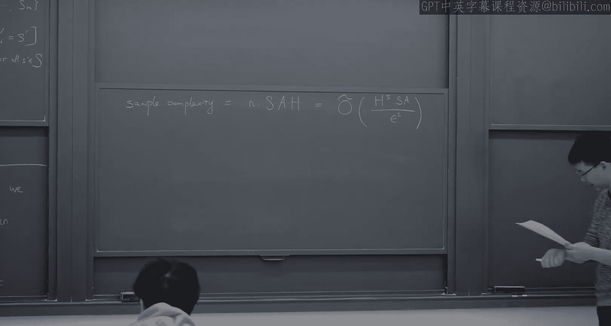
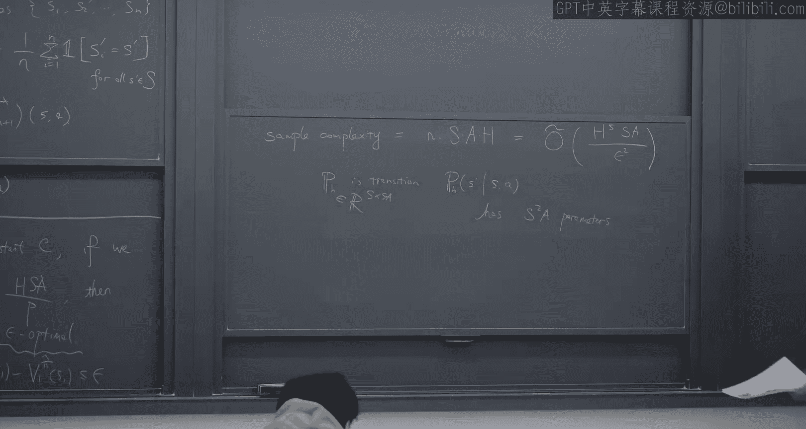
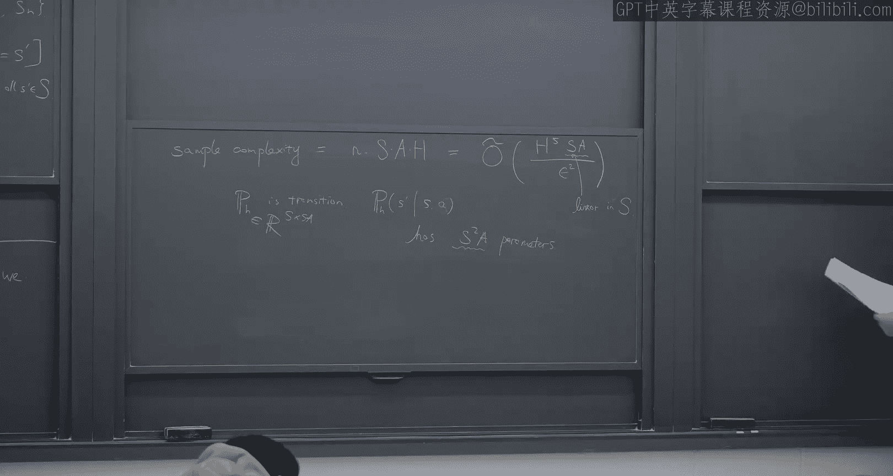
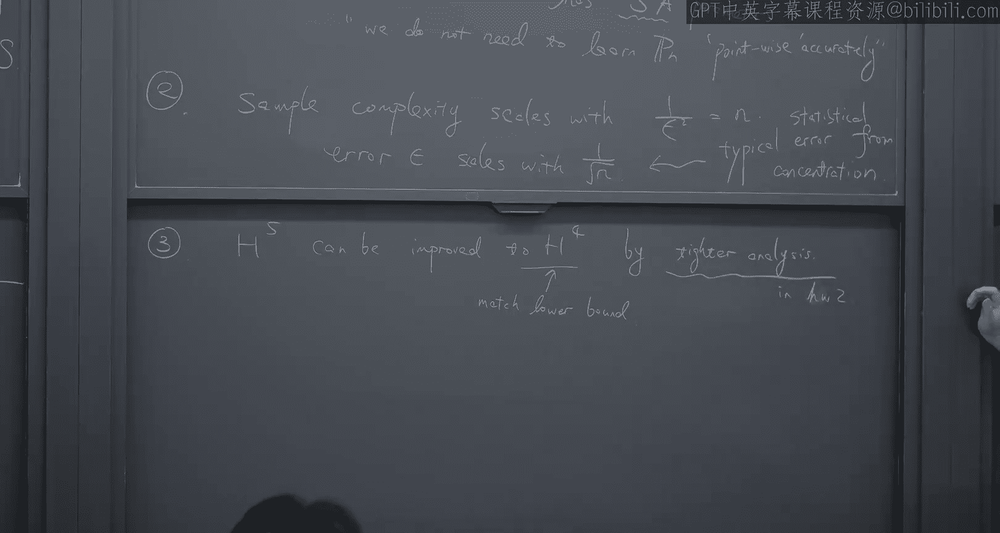
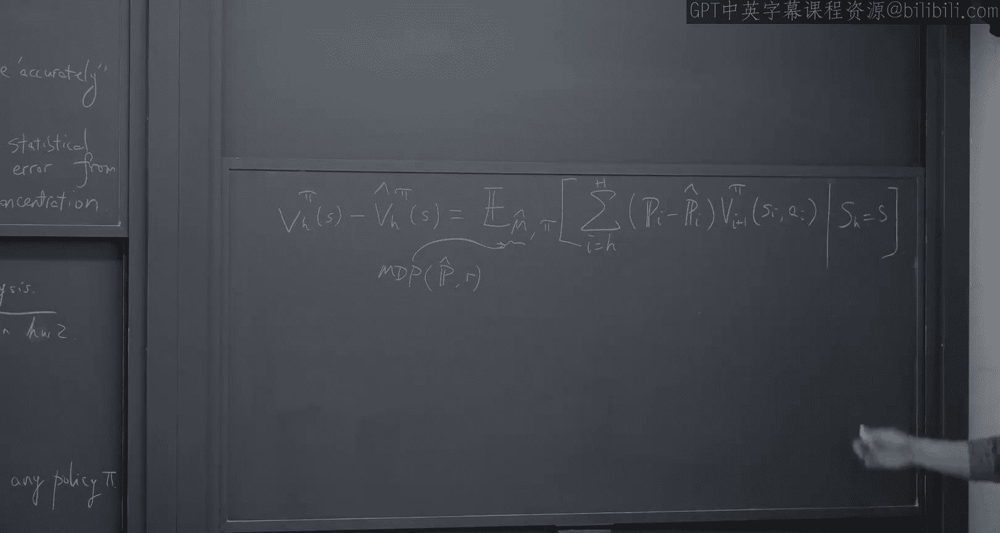
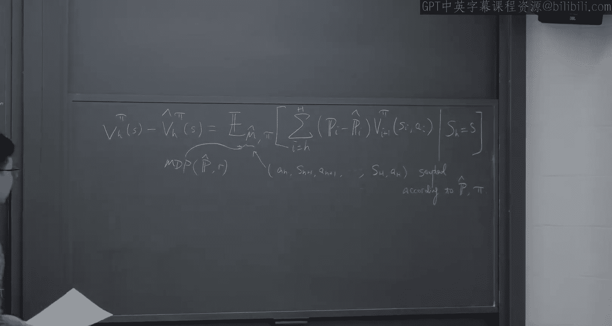
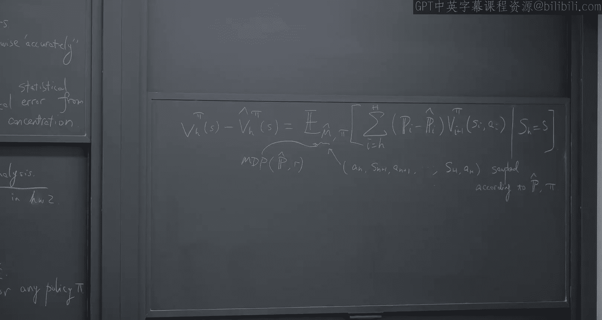
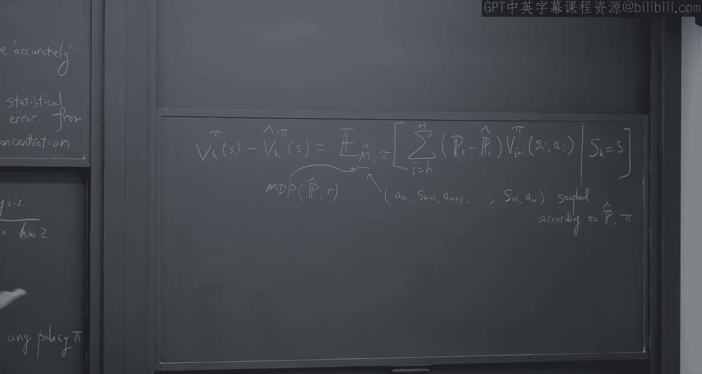

#  006：生成模型 🎯

在本节课中，我们将学习在**模拟器（生成模型）** 设置下的强化学习算法。我们将重点介绍**值迭代（Value Iteration）** 算法，并深入探讨其背后的理论保证，特别是关于样本复杂度的首个统计性定理。

---

## 算法回顾 🔄

上一节我们介绍了在规划任务（已知转移和奖励）中的值迭代算法。本节中，我们来看看在模拟器设置下的情况。关键区别在于，我们现在**不知道真实的转移概率**。

因此，算法分为两个主要阶段：
1.  **估计转移概率**：通过查询模拟器收集样本来估计转移模型。
2.  **执行值迭代**：基于估计的转移模型，使用贝尔曼最优方程计算最优值函数和策略。

以下是算法的核心步骤：

### 第一阶段：估计转移概率
对于每个状态-动作-步数三元组 `(s, a, h)`，我们查询模拟器 `n` 次，收集下一状态样本 `s'1, s'2, ..., s'n`。然后，我们使用经验频率来估计转移概率：

**公式**：
`P̂_h(s' | s, a) = (1/n) * Σ_{i=1 to n} 1[s'_i = s']`

### 第二阶段：基于估计模型的值迭代
我们使用估计的转移概率 `P̂` 代替真实的 `P`，执行标准的贝尔曼最优方程迭代（动态规划）。

**代码/公式描述**：
对于步数 `h = H, H-1, ..., 1`：
1.  计算 Q 值：
    `Q̂*_h(s, a) = R_h(s, a) + Σ_{s'} P̂_h(s' | s, a) * V̂*_{h+1}(s')`
2.  计算 V 值：
    `V̂*_h(s) = max_a Q̂*_h(s, a)`

最后，输出由 `Q̂*` 诱导的贪婪策略 `π̂`。

直观上，当样本数 `n → ∞` 时，根据大数定律，`P̂` 会收敛到真实的 `P`，因此算法会输出正确的最优策略。

---

## 理论保证：样本复杂度定理 📊

然而，我们不仅能给出渐近正确的结论，还能精确地分析需要多少样本才能找到一个 **ε-最优策略**。

**定理 1**：
存在一个绝对常数 `C`，使得如果我们为每个 `(s, a, h)` 对选择的样本数 `n` 满足：
`n ≥ C * (H^4 * η) / ε^2`
其中 `η = log(HSA / δ)`（一个对数因子）。
那么，以至少 `1 - δ` 的概率，值迭代算法输出的策略 `π̂` 是 **ε-最优** 的。
（即 `V*_1(s1) - V^{π̂}_1(s1) ≤ ε`）

### 对定理的解读
以下是关于样本复杂度的几个关键点：

*   **总样本复杂度**：由于我们需要为每个 `(s, a, h)` 对收集 `n` 个样本，总样本数为 `n * S * A * H`。忽略常数和对数项后，总复杂度约为 `O( (H^5 * S * A) / ε^2 )`。
*   **与参数数量的对比**：转移概率 `P` 本身有 `S^2 * A * H` 个参数。但我们的算法只需要 **线性于状态数 `S`** 的样本，而不是平方项 `S^2`。这是因为学习一个良好策略并不需要精确估计转移矩阵的每一个条目，只需在某些“友好”的意义上估计准确即可。
*   **ε 依赖关系**：误差 `ε` 以 `1/√n` 的速率下降，这是典型的统计收敛速率。
*   **H 依赖关系**：定理中给出 `H^5`，通过更精细的分析可以改进到 `H^4`，并且这在下界意义下是最优的。部分 `H` 的幂次来源于值函数本身的量级是 `O(H)`。

---

## 定理证明的核心思路 🧠

证明主要依赖两个引理，将值函数的误差与转移概率的误差联系起来。

### 引理 1：值差与转移差的关系
对于任意策略 `π` 和任意状态-步数对 `(s, h)`，有：
`V^π_h(s) - V̂^π_h(s) = E_{M̂, π}[ Σ_{i=h}^{H} (P_i - P̂_i) V^π_{i+1} (s_i, a_i) | s_h = s ]`
其中，`V̂^π` 是在估计模型 `M̂`（使用 `P̂`）下的值函数，期望是在模型 `M̂` 和策略 `π` 下对未来轨迹求取。

**证明思路**：直接从贝尔曼方程出发，进行递归展开和代数变形即可得证。该引理表明，值函数的差异可以表示为各步转移概率差异的加权和。

### 引理 2：转移估计的集中不等式
对于固定的 `(s, a, h)` 和一个值函数 `V`（取值在 `[0, H]` 之间），以至少 `1 - δ` 的概率，有：
`| (P_h - P̂_h) V (s, a) | ≤ C * H * √(η / n)`
其中 `η = log(1/δ)`。

**证明思路**：这是作业1的内容，利用霍夫丁（Hoeffding）不等式等集中不等式工具即可证明。关键在于，这个界对于**固定的**或**与样本独立的随机**值函数 `V` 都成立。如果 `V` 是敌对的（依赖于样本），则无法得到如此紧的界（会多出一个 `√S` 因子）。

### 定理证明的最终步骤
我们想要界住次优性差距：`V*_1(s1) - V^{π̂}_1(s1)`。
1.  **拆解**：通过加减项技巧，将其拆分为三部分：
    *   `A = V*_1 - V̂*_1` （在真实模型和估计模型下的最优值差）
    *   `B = V̂^{π̂}_1 - V^{π̂}_1` （在估计模型和真实模型下，输出策略的值差）
    *   `C = V̂*_1 - V̂^{π̂}_1` （在估计模型下，最优策略与输出策略的值差）
    其中 `C ≤ 0`，因为 `π̂` 在估计模型 `M̂` 下是最优的。
2.  **利用引理1**：项 `A` 和 `B` 都可以表示为引理1的形式。
3.  **利用引理2和独立性**：
    *   对于项 `A`，其中的值函数 `V*` 是固定的（与样本无关），可直接应用引理2并对所有 `(s,a,h)` 做联合界（Union Bound）。
    *   对于项 `B`，其中的值函数 `V^{π̂}` 依赖于样本（因为 `π̂` 依赖于样本）。但关键观察是：`V^{π̂}_{h+1}` 只依赖于第 `h+1` 步及之后的转移概率估计 `P̂_{h+1}, ...`，而这些与当前步 `h` 的估计 `P̂_h` 所用的样本是**独立**的。因此，在条件于后续步骤的样本后，`V^{π̂}_{h+1}` 可以视为固定的，从而也能应用引理2。
4.  **合并结果**：将 `A` 和 `B` 的界（均为 `O(H^2 √(η/n))`）代入，并利用定理中对 `n` 的选择条件 `n ≥ C * (H^4 * η) / ε^2`，即可推出总误差 `≤ ε`。

---

## 另一种算法：Q学习简介 ⚡

值迭代算法是一种**批量（Batch）** 更新方法：先收集所有数据估计模型，再进行规划。在实践中，另一种更常用的方法是**在线（Online）** 更新的 **Q学习（Q-Learning）**。

Q学习不显式估计转移模型，而是直接更新Q值。其核心更新规则如下：

**公式**：
`Q_{t+1}(s, a) = (1 - α_t) * Q_t(s, a) + α_t * [ R + γ * max_{a'} Q_t(s', a') ]`
其中 `α_t` 是学习率，`(s, a, r, s')` 是当前时间步从模拟器（或环境）中采样到的转移数据。

与值迭代对比：
*   **值迭代**：基于模型（即使是估计的），使用动态规划。
*   **Q学习**：无模型，基于采样数据和时间差分（Temporal Difference）进行迭代更新。

在下一讲中，我们将继续探讨Q学习的细节、其与值迭代的优劣比较，并开始进入更具挑战性的**在线探索（Online Exploration）** 场景。

---

## 总结 📝

本节课中我们一起学习了：
1.  **模拟器设置下的值迭代算法**：通过采样估计转移概率，然后在估计模型上执行动态规划。
2.  **首个样本复杂度定理**：该定理定量地给出了算法获得ε-最优策略所需样本数与状态数 `S`、动作数 `A`、步数 `H` 以及精度 `ε` 之间的关系，关键点是样本复杂度仅线性于 `S`，而非其平方。
3.  **定理证明的核心工具**：通过引理1建立值误差与转移误差的递归关系；通过引理2（集中不等式）控制转移估计误差。证明中巧妙利用了估计模型下策略的最优性以及不同步数间样本的独立性。
4.  **Q学习算法的引入**：作为另一种重要的无模型、在线学习算法，为后续课程内容做了铺垫。

理解在生成模型下的样本复杂度理论，是迈向更复杂的在线强化学习场景的重要基石。