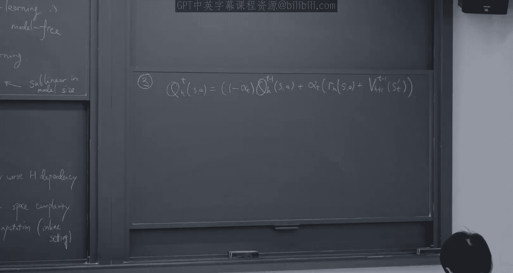

#  007：探索入门 🧭

在本节课中，我们将学习探索（Exploration）的基本概念。我们将首先回顾上一讲的内容，然后深入探讨Q学习算法的细节，并分析其性能。接着，我们将从模拟器（Simulator）设定转向更具挑战性的在线强化学习（Online RL）设定，并理解为什么简单的随机探索策略会失败。最后，我们将引入多臂老虎机（Multi-Armed Bandit）问题，作为理解探索与利用（Exploration-Exploitation）权衡的起点。

## 回顾与Q学习算法 📝

上一讲我们讨论了模拟器设定。该设定最重要的特点是，我们拥有一个模拟器，可以查询任何状态-动作-步数三元组 `(s, a, h)`，并获得下一个状态和奖励作为反馈。我们重点介绍了第一个算法——值迭代（Value Iteration, VI）。

在本课程中，我们将其简称为VI。在上次课的最后，我们介绍了一种称为Q学习（Q-learning）的RL算法。主要区别在于：在值迭代中，我们进行的是批量更新；而在Q学习中，我们尝试进行在线更新或增量更新。值迭代是收集所有数据后进行一次更新，而Q学习是每收集一个数据就进行一次更新。

今天，我们将更具体地讨论Q学习算法及其能够达到的效果。

### Q学习算法形式化

Q学习算法需要输入一个序列 `{α_t}`，即学习率（learning rate）。`α_t` 权衡了我们信任先前Q值的程度（`1 - α_t` 比例）和新更新的程度（`α_t` 比例）。我们将在最后讨论如何选择这个学习率。

算法的主要步骤如下：
1.  **初始化**：对于所有状态 `s` 和动作 `a`，初始化 `Q_h^0(s, a)`。可以初始化为0，或任意值。
2.  **迭代更新**：对于 `t = 1, 2, ...` 和 `h = 1, 2, ..., H`，执行以下循环：
    *   查询模拟器，获得当前状态-动作对 `(s, a, h)` 的一个样本下一个状态 `s'`。
    *   执行以下增量更新：
        `Q_h^t(s, a) = (1 - α_t) * Q_h^{t-1}(s, a) + α_t * [r_h(s, a) + V_{h+1}^{t-1}(s')]`
    *   然后，对于该步的所有状态 `s`，计算值函数：
        `V_h^t(s) = max_a Q_h^t(s, a)`

该算法的关键步骤是增量更新：将Q值更新为旧Q值的 `(1 - α)` 部分加上新更新的 `α` 部分。之后，通过取Q值在所有动作上的最大值来计算V值。

### 关于算法的几点说明

1.  **基于模型 vs. 无模型**：在该算法中，我们不再显式地构建转移模型。在经典文献中，这被称为基于模型（model-based）与无模型（model-free）的区别。值迭代算法是**基于模型**的，因为它在第一阶段直接估计转移概率。而Q学习算法是**无模型**的，因为转移学习部分隐含在这个增量更新中。
2.  **空间复杂度**：我们可以用空间复杂度来区分这两类算法。
    *   对于VI算法，由于需要估计转移模型，空间复杂度约为 `O(H * S^2)`。
    *   对于Q学习，我们只需要存储Q值表，空间复杂度为 `O(H * S * A)`。这相对于模型参数数量是次线性的，因此被称为无模型。
3.  **样本复杂度**：
    *   值迭代（VI）的样本复杂度为 `Õ(H^4 * S * A / ε^2)`。
    *   Q学习的样本复杂度类似，但略差，约为 `Õ(H^5 * S * A / ε^2)`。这是因为增量更新不能像批量更新那样最大限度地利用每个样本的信息，导致对早期数据的利用效率较低，因此需要付出额外的 `H` 因子代价。
4.  **计算复杂度**：在在线设定（我们即将讨论）中，Q学习的计算复杂度也更优。因为在模拟器设定中，VI收集所有数据后只进行一次动态规划，计算量尚可。但在在线设定中，VI每收集一条轨迹都需要进行一次完整的动态规划，而Q学习每收集一个数据只需进行一次增量更新，因此速度更快。

### Q学习分析的关键步骤

为了分析Q学习，我们关注其核心更新公式：
`Q_h^t(s, a) = (1 - α_t) * Q_h^{t-1}(s, a) + α_t * [r_h(s, a) + V_{h+1}^{t-1}(s'_t)]`

通过递归展开这个公式，我们可以将Q值等价地表示为所有先前更新的加权和：
`Q_h^t(s, a) = r_h(s, a) + Σ_{i=1}^{t} γ_{t,i} * V_{h+1}^{i-1}(s'_i)`
其中权重 `γ_{t,i} = α_i * Π_{j=i+1}^{t} (1 - α_j)`，且所有权重之和为1。

我们将此与值迭代的更新进行比较。值迭代中，Q值更新为：
`Q_h^{hat}(s, a) = r_h(s, a) + (1/n) * Σ_{i=1}^{n} V_{h+1}^{hat}(s'_i)`
这里使用的是收集所有数据后计算的、相对准确的 `V^{hat}`，并且是等权重的求和。

Q学习的更新有两个主要区别：
1.  **加权和 vs. 等权和**：Q学习使用加权和，我们可以通过选择学习率来调整权重。
2.  **使用的值函数不同**：Q学习使用的是前一次迭代的值函数 `V_{h+1}^{i-1}`，这在迭代早期可能非常不准确。

### 如何选择权重（学习率）

选择权重 `γ_{t,i}` 时，我们需要处理两个相互冲突的目标：
1.  **减少偏差**：我们希望 `γ_{t,i}` 对后期更新赋予更多权重，因为早期的 `V_{h+1}^{i-1}` 非常不准确。
2.  **减少方差**：我们不应将所有权重集中在一个样本上，因为单个样本噪声很大。我们希望 `γ_{t,i}` 在一定程度上均匀分布，以降低方差。

因此，理想的选择是：对后期更新赋予较高权重，同时对多个更新保持一定的权重分布。

*   **基线选择**：如果选择 `α_t = 1/t`，则计算出的权重 `γ_{t,i}` 是均匀的（均为 `1/t`）。这有利于降低方差，但不利于处理偏差，因此不能带来良好的样本复杂度。
*   **理论上的好选择**：理论上可以证明，选择 `α_t ≈ H / t`（例如 `(H+1)/(H+t)`）可以达到前述样本复杂度。这大致相当于对最新的 `1/H` 比例的数据赋予相对均匀的权重。为了处理偏差-方差权衡，我们本质上需要在一定程度上忽略早期数据，这就是为什么我们需要付出额外的 `H` 因子，导致样本复杂度略差。

## 模拟器设定小结 📊

具体来说，我们讨论了非平稳转移情况（即不同步的转移概率可以不同）。我们介绍了两种算法：
*   **基于模型**：值迭代（VI）
*   **无模型**：Q学习

最重要的性能保证是样本复杂度和空间复杂度。VI的样本复杂度为 `Õ(H^4 * S * A / ε^2)`，空间复杂度为 `O(H * S^2)`。Q学习的样本复杂度为 `Õ(H^5 * S * A / ε^2)`，稍差，但空间复杂度仅为 `O(H * S * A)`，节省了空间。

在后续关于下界或基本极限的课程中，我们会看到存在一个信息理论下界，表明任何算法在最坏情况下都需要至少 `Ω(H^3 * S * A / ε^2)` 个样本来学习最优策略。这大致说明，VI几乎达到了极小化最优（minimax optimal）的样本复杂度（忽略对数因子）。因此，在这个设定下，VI在样本复杂度方面是最优的算法。

## 在线强化学习（探索设定）🎮

现在，我们开始讨论下一个主题：在线强化学习，也称为探索设定。这是一个更具挑战性的设定，我们不再假设拥有模拟器。

### 什么是在线强化学习设定？

首先，回顾我们与MDP交互的协议。在在线强化学习设定中，我们只观察初始状态 `s_1`。然后，对于每一步 `h = 1` 到 `H`：
1.  智能体采取动作 `a_h`。
2.  环境转移到下一个状态 `s_{h+1}` 并给出奖励 `r_h`。

**最关键的是**，在在线设定中，我们只能在完成整个轨迹后重置到初始状态，然后重新开始。这与模拟器的最大区别在于：在模拟器中，你可以自由选择任何状态和动作；而在在线设定中，你只能选择动作序列，没有选择状态的自由。这更像玩一个真实的游戏：死亡后回到起点重新开始。

### 数据收集的挑战

在模拟器设定中，我们可以使用简单的策略收集数据：遍历所有状态-动作对。但在在线强化学习中，我们无法做到这一点，因为我们不能自由地设置到任何状态。例如，在《超级马里奥》游戏中，到达最后一关的状态本身就需要复杂的策略。

因此，在线强化学习中的一个重要问题是：**如何高效地收集信息丰富的数据**？在模拟器中，只要遍历所有状态-动作对，就是在收集信息丰富的数据。但在在线设定中，这一点不再明确。我们将通过一个例子说明，为什么这是一个不平凡的问题。

### 随机探索的失败案例

在在线设定中收集数据的第一个想法可能是随机探索：每次随机选择动作。然而，事实证明，MDP中的随机探索策略效率极低，可能会遭受 `A^H` 级别的复杂度，即关于时间范围 `H` 是指数级的。对于长范围的问题（例如H=20），这种方法完全不可行。

我们通过构造一个困难的MDP实例来说明这一点。这个实例在文献中非常著名，称为**组合锁**。

#### 组合锁 MDP 实例

该MDP只有两个状态：`S0` 和 `S1`，但有 `A` 个动作。它是一个确定性MDP。
*   **转移**：如果当前在状态 `S0`，无论采取什么动作，下一步都转移到 `S0`。如果当前在状态 `S1`，只有一个特定的动作 `a_h^*` 能使下一步保持在 `S1`，其他所有动作都会导致下一步转移到 `S0`。这个结构在每一步 `h` 重复，但每个步骤 `h` 的“正确”动作 `a_h^*` 可能不同。
*   **奖励**：除了最后一步（`h=H`）之外，所有奖励都为0。在最后一步，只有到达状态 `S1` 才能获得奖励1。

这个MDP的最优策略是：在每一步 `h`，如果状态是 `S1`，则必须选择特定的动作 `a_h^*`。遵循这个策略，最终在最后一步获得奖励1。任何其他动作序列获得的奖励都是0。

#### 随机探索在组合锁上的表现

随机探索策略（每一步均匀随机选择动作）在尝试到精确的动作序列 `a_1^*, a_2^*, ..., a_H^*` 之前，不会意识到最优策略是什么。而随机采样到这个精确序列的概率是 `(1/A)^H`，是指数级小的。

因此，随机探索至少需要 `Ω(A^H)` 条轨迹才能找到最优策略。由于奖励只有0和1，这甚至使得找到一个ε-最优策略都很难。这是因为强化学习具有时间相关性，如果只是随机探索而不使用任何智能信息，那么采样到良好策略的概率极低，导致需要付出指数级代价。

即使是ε-贪心（ε-greedy）这类简单策略（以1-ε概率遵循当前最优策略，以ε概率随机探索），只要它包含随机尝试动作的成分，在这个困难实例上同样会失败。需要注意的是，许多实践中的Atari游戏并不需要复杂的探索，因此ε-贪心表现尚可。但我们的目标是设计能解决所有MDP（包括那些需要挑战性探索的MDP）的算法。

因此，我们需要更智能的算法来进行探索。探索的本质是收集数据。每当讨论探索时，人们也会讨论**探索与利用的权衡**。

## 引入多臂老虎机与乐观原则 🎰

事实证明，处理强化学习中探索问题的核心思想叫做**乐观原则**。我们将在本讲和下一讲介绍这个最重要的思想。

为了更好地理解探索与利用的权衡，我们从一个更简单的模型开始：**多臂老虎机**。

### 多臂老虎机模型

想象一个老虎机有 `A` 个摇臂。协议如下：
对于 `t = 1` 到 `T`：
1.  学习者选择一个摇臂 `I_t`。
2.  学习者观察到该摇臂产生的随机奖励 `r_t`。

我们假设随机奖励有界，例如在 `[0, 1]` 之间，并且每个摇臂 `i` 有一个期望奖励 `μ_i`。

最佳摇臂定义为：`i^* = argmax_i μ_i`。

### 两种目标

在多臂老虎机文献中，有两种标准目标：
1.  **纯探索 / 最佳臂识别**：目标是最终找到一个ε-最优的摇臂 `î`，使得 `μ_î ≥ μ_{i^*} - ε`。或者，找到一个ε-最优的分布 `D`，使得从 `D` 中采样的摇臂的期望奖励至少为 `μ_{i^*} - ε`。这个目标不关心中间过程玩得有多差，只关心最终识别结果。
2.  **遗憾最小化**：这是一个更强的目标。遗憾（Regret）定义为：`Regret(T) = T * μ_{i^*} - Σ_{t=1}^{T} E[μ_{I_t}]`。即，始终玩最优臂所能获得的总期望奖励，减去学习者实际获得的期望奖励。遗憾越小，说明学习者玩得越好。由于奖励有界，遗憾在 `[0, T]` 之间。非平凡的遗憾目标通常是次线性的，例如 `O(√T)`。

目标1和目标2的关键区别在于：目标1只关心最终识别出好臂；而目标2要求学习者**在大多数步骤中**也玩得相当好，不能在前面的步骤中玩得太差，否则会累积线性遗憾。因此，遗憾目标自然地反映了**探索与利用之间的权衡**。

在强化学习中，虽然我们目前只讨论了探索（例如样本复杂度），但由于其序列结构以及随机探索的失败，为平衡探索与利用而发展的**乐观原则**实际上非常有用。

在接下来的多臂老虎机讨论中，我们将更多地探讨如何平衡探索与利用，并引出乐观原则。然后，我们将讨论如何将乐观原则算法应用到强化学习中。

---

**本节课总结**：我们一起回顾了Q学习算法的细节及其与值迭代的比较，理解了无模型方法的优缺点。然后，我们转向了更具挑战性的在线强化学习设定，并通过组合锁实例认识到简单随机探索的局限性。最后，我们引入了多臂老虎机问题及其两种目标（最佳臂识别和遗憾最小化），为理解探索与利用的权衡以及核心的乐观原则奠定了基础。