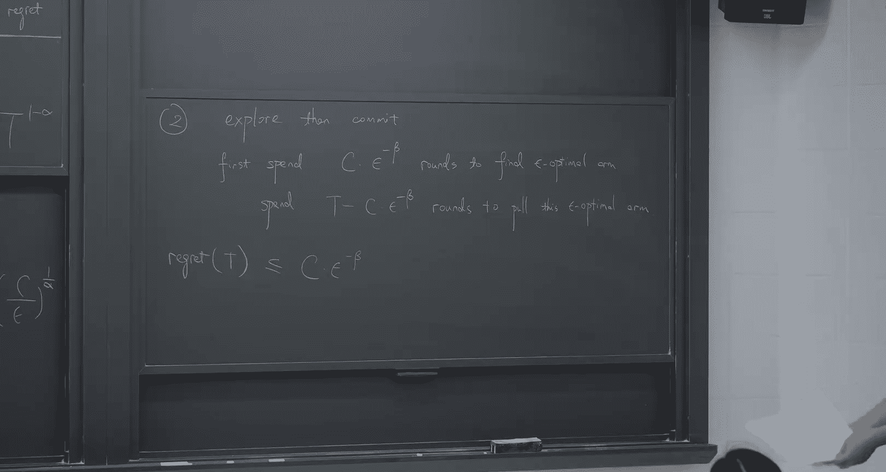

#  008：多臂老虎机中的探索

## 概述
在本节课中，我们将学习多臂老虎机问题中的探索策略。我们将讨论两种不同的目标：识别近似最优臂和最小化遗憾。我们将介绍几种算法，包括ε-first、ε-greedy和UCB算法，并分析它们的性能。最后，我们将看到如何利用“面对不确定性的乐观”原则来更好地平衡探索与利用。

---

## 多臂老虎机的目标

在上节课的最后，我们讨论了多臂老虎机问题。它有两个主要目标。

**目标一**：我们希望识别一个ε-最优臂。就平均奖励而言，我们希望识别的臂与最优臂的差距最多为ε。

**目标二**：我们希望实现低遗憾。我们定义遗憾为：
`Regret(T) = T * R* - Σ_{t=1}^{T} R_{I_t}`
其中`R*`是始终拉动最优臂所能获得的总奖励期望，`I_t`是智能体在时间`t`选择的臂。

这两个目标的主要区别在于：在第一个目标中，我们最终只想找到一个ε-最优臂，并不关心中间学习过程我们拉动了哪些臂。只要最终能找到ε-最优臂，即使中间拉动了一些很差的臂也可以。另一方面，目标二似乎更困难，因为它不仅要求最终找到近似最优臂，还要求在整个学习过程中，每一步选择的臂也接近最优。即使在早期阶段，我们也不希望拉动一些非常糟糕的臂，从而遭受显著的遗憾。因此，这是一个更困难的目标，我们需要做更多的工作来平衡探索与利用之间的权衡。

---

## 目标间的转换

我们首先讨论这两个目标之间的转换关系。很多时候我们可以进行转换，但我们会看到这种转换通常会带来一些性能损失。这个引理虽然是在多臂老虎机背景下提出的，但也可以很容易地扩展到强化学习场景。

这个转换关系是双向的。

**第一方向**：如果算法A的遗憾为`C * T^{1-α}`（其中`C`是常数，`α ∈ (0,1)`），那么算法A可以在`C / ε^{1/α}`次采样内找到一个ε-最优臂。

**第二方向**：如果算法A能在`C * ε^{-β}`次采样内找到一个ε-最优臂，那么我们可以使用算法A来实现`2 * C^{1/(1+β)} * T^{β/(1+β)}`的遗憾。

这个结果对任何α和β都成立。我们可以将`T^{3/4}`的遗憾或`√T`的遗憾转换为相应的采样复杂度。

---

### 转换示例

让我们看一些具体的例子。很多时候我们处理的是`√T`遗憾。例如，如果我们有一个算法实现了`√T`遗憾，那么`α = 1/2`。这意味着我们可以实现`1/ε^2`的采样复杂度。另一方面，如果我们有一个算法实现了`1/ε^2`的采样复杂度，我们可以将其转换为遗憾保证。在这种情况下，`β = 2`，我们得到的遗憾是`T^{2/3}`。我们注意到，在遗憾中，最坏情况的遗憾是`T`。就指数而言，`√T`遗憾实际上优于`T^{2/3}`遗憾。指数越接近`T`，遗憾就越差。

当我们进行这种黑盒转换时，我们无法免费地回到原始结果。最主要的原因是，正如我们所说，遗憾是一个更困难的目标。当我们把一个需要平衡探索与利用的困难目标，转换为一个只需要探索的目标，然后再转换回原始的困难目标时，我们在这个过程中会损失一些东西。因此，这种转换并非没有代价。

---

### 转换证明

这个引理只讨论了速率转换，我们仍然需要提供明确的构造。当我们有一个算法A实现了某种遗憾时，为什么该算法已经实现了某种采样复杂度？我们需要进行证明。

**第一个主张的证明（从遗憾到采样复杂度）**：
根据遗憾的前提条件，由遗憾的定义可知：
`Regret(T) = T * R* - Σ_{t=1}^{T} R_{I_t} ≤ C * T^{1-α}`
这意味着我们可以两边同时除以`T`并重新排列项：
`(1/T) * Σ_{t=1}^{T} R_{I_t} ≥ R* - C / T^α`
左边可以看作是按照某种经验分布`D_hat`拉动臂的期望奖励，其中`D_hat`是迄今为止所有拉动臂上的均匀分布。这是一个ε-最优的臂分布。我们只需要使`C / T^α = ε`，解出`T = C / ε^{1/α}`。这样，当我们有这么多样本时，就可以实现绝对ε最优。

**第二个主张的证明（从采样复杂度到遗憾）**：
第二个主张需要稍微多一些工作，因为遗憾是更困难的目标，而采样复杂度是更容易的目标。因此，我们需要损失一些东西，并需要做更多的工作。我们将采用的策略称为“探索-提交”策略。

首先，我们花费`C * ε^{-β}`轮来找到一个ε-最优臂。这是由算法A的前提条件保证的。然后，在剩余的`T - C * ε^{-β}`轮中，我们始终拉动这个ε-最优臂。

这个算法诱导的遗憾`Regret(T)`可以计算为：
`Regret(T) ≤ C * ε^{-β} * 1 + (T - C * ε^{-β}) * ε`
在第一阶段，我们花费这么多轮。在最坏情况下，每轮可能最多损失1。在第二阶段，因为我们保证拉动的臂是ε-最优的，所以每轮最多遭受ε遗憾。我们简化这个表达式，忽略减法项，得到一个上界：`C * ε^{-β} + T * ε`。最后，我们选择最小化这个遗憾的ε，即令`ε = (C/T)^{1/(1+β)}`。代入后得到遗憾为`2 * C^{1/(1+β)} * T^{β/(1+β)}`。证明完成。

---

## 多臂老虎机算法

到目前为止，我们还没有讨论任何多臂老虎机算法，我们只讨论了如何转换两个不同的目标。接下来，我们将纯粹专注于遗憾，因为这是在在线学习中使用的标准概念。我们知道遗憾比采样复杂度更强，所以每当我们想要采样复杂度时，我们可以使用这种转换将其转换回来。

---

### ε-first 算法

我们将介绍的第一个多臂老虎机算法叫做ε-first算法。ε-first算法本质上就是使用探索-提交策略。唯一的区别是，在这个转换中，我们明确地在第一阶段进行随机探索。

在第一阶段，我们首先拉动每个臂`N`次，并获得经验估计：
`R_hat_i = (1/N) * Σ_{j=1}^{N} R_{i,j}`
其中`R_{i,j}`表示我们为臂`i`在第`j`次拉动时收到的随机奖励。我们使用经验平均值作为每个臂平均奖励的估计。

在第二阶段，我们将只拉动`I_hat = argmax_i R_hat_i`，即在第一阶段具有最高估计值的臂，持续剩余的步数。

这个算法有效是因为当`N`足够大时，我们对每个臂的估计在第一阶段非常准确。例如，如果它是ε准确的，那么我们就可以通过探索-提交获得合理的遗憾。

**定理1**：对于`N ≥ C * η / ε^2`，其中`η = log(A/δ)`，我们以至少`1-δ`的概率保证，所有臂的估计值与真实均值之间的最大差异小于ε。这或多或少意味着我们只需支付`N * A`的采样复杂度（因为这是每个臂需要的拉动次数），总样本数为`N * A = C * A * η / ε^2`，我们就能找到一个ε-最优臂。

**证明**：证明实际上非常简单，给定我们学过的所有数学工具，这本质上是霍夫丁不等式。我们知道对于任何固定的臂`i`，有概率`1 - δ/A`满足`|R_hat_i - R_i| ≤ C' * sqrt(η / N)`。最后，因为我们知道通过选择这样的`N`，当我们将其代入时，可以保证这个值小于等于ε。然后我们对所有臂进行联合界，就完成了证明。

一旦我们实现了这个保证，我们就可以确保我们选择的臂是ε-最优的。我们可以稍微计算一下：`R* - R_{I_hat} ≤ 2ε`。你可以调整常数，通过设置`ε/2`来获得绝对的ε最优。

**遗憾保证**：以至少`1-δ`的概率，ε-first算法的遗憾最多为`C * (A * η)^{1/3} * T^{2/3}`。这个证明基本上就是进行我们已有的转换，因为这就是探索-提交算法。在第一阶段，我们已经知道采样复杂度是`C * A * η / ε^2`，可以写成`A * η * ε^{-2}`。所以我们知道`β = 2`。应用引理，我们可以将整个东西打包成之前转换中的常数`C`。根据引理，探索-提交将给出遗憾`2 * (C * A * η)^{1/(1+β)} * T^{β/(1+β)}`。我们只需将`β=2`代入，然后看到常数`C`在外面，就完成了。

---

### ε-greedy 算法

我们刚刚介绍了一个非常基础的算法，它首先进行探索，然后提交给在探索中找到的最佳臂。你可能会想，这种算法似乎有点人为或低效，因为你将所有事情都分为两个阶段：一个是探索，然后提交给最优臂。第一个朴素的想法是，也许我们可以将两者合并，这就产生了另一个叫做ε-greedy的算法。

我认为对于现在的许多从业者来说，很多时候如果你真的不知道如何进行探索，比如你不知道什么是好算法，我认为首选的算法仍然是ε-greedy，因为它非常简单，你可以将ε-greedy算法与任何现有算法一起使用。

**算法描述**：
我们维护一个经验估计`R_hat_i`，与之前相同。算法如下进行：
对于`t = 1`到`T`：
*   以概率`ε`（一个小概率），拉动一个随机臂，从动作集`A`中均匀采样。
*   否则（以概率`1-ε`），拉动贪婪臂`I_t = argmax_i R_hat_i`。
在拉动这个臂之后，我们观察收到的随机奖励`R_{I_t}`，并更新我们的估计`R_hat_{I_t}`。

你可以认为这是ε-first的一种变体，在ε-first中，我先进行探索，然后进行利用。而在这里，我某种程度上将它们交织在一起，即有时我会进行一些探索，有时我会通过拉动估计的最优臂来进行利用。

**定理**：以至少`1-δ`的概率，ε-greedy算法仍然具有相同的遗憾，即`O( (A * η)^{1/3} * T^{2/3} )`。隐藏一些对数因子，这与ε-first算法实现的遗憾完全相同。证明本质上也非常类似于ε-first算法，我们将留到作业3。

这就引出了一个非常直接的问题：我们能否实现比这更好的东西？我们能否实现探索与利用之间更好的权衡？

---

## UCB算法：面对不确定性的乐观

事实证明，答案在老虎机领域早已为人所知，其关键思想叫做“乐观”。这被称为“面对不确定性的乐观”原则，相应的算法通常称为UCB算法。

我们首先讨论为什么这个算法与以前的算法有根本性的不同，然后讨论具体的算法和保证。

**高层次思想**：
我们可以先总结一下以前的算法。以前的算法本质上有两个部分：探索步骤（拉动随机臂）和利用步骤（采取贪婪动作以最大化`R_hat`）。ε-first是首先进行一堆探索步骤，然后进行利用步骤。ε-greedy是有时进行探索步骤，有时进行利用步骤。这些算法的缺点在于，每当你进行探索时，你都在进行随机探索。这是低效的，因为它没有充分利用我们已有的信息。

关键思想是如何将探索和利用结合在一起。以前的算法只是说有时我利用，有时我探索，我的组合非常朴素。一个更好的策略是，我将计算一个新的量`R_tilde_i`。你可以认为`R_tilde_i`就像是`R_hat_i`（我的均值估计）加上一些奖励项。这个奖励反映了我们对真实值与估计值之间偏差的置信度。本质上，这个奖励包含了利用（如果我只想看均值）和探索（因为我们会给尚未访问的臂或空间部分添加更多的奖励）。我将对这个`R_tilde`进行`argmax`。

在多臂老虎机中，这个想法通过UCB变得非常直接。例如，我有多个臂。对于臂1，我有很多样本；对于臂2，我只拉动了很少次数；对于臂3，我拉动了一些次数。UCB算法的方式是，我们不仅有一个均值估计，还有一个置信区间。对于臂1，真实奖励可能落在这个区间内；对于臂2，因为我只有两个样本，我的置信度较低，所以区间可能像这样；对于臂3，我有更多样本，区间更短。通过UCB，我们使用置信区间的上界作为我们的`R_tilde_1`，`R_tilde_2`，`R_tilde_3`，并根据这个上置信界进行拉动。

通过上置信界，我们本质上希望保证属性：`R_tilde_i`总是以高概率大于等于`R_i`。我们希望我的上置信界以高概率成为真实奖励的真实上界。

---

### 正式算法

UCB算法实际上非常简单。唯一不同的部分是，我们现在不是直接维护一个均值估计，而是维护一个所谓的乐观估计，我们称之为`R_tilde_i`。

`R_tilde_i = (1/N_i) * Σ_{j=1}^{N_i} R_{i,j} + Bonus`
奖励项取决于`N_i`，它给了我们估计的置信水平。你可以想象，如果`N_i`非常小，即我只有两三个样本，那么我应该添加一个大的奖励来反映我对这个估计不是很有信心。但如果`N_i`非常大，那么我应该认为我的估计相对准确，所以添加一个小的奖励。在我们的例子中，奖励的选择是：
`Bonus = C * sqrt( log(A*T/δ) / N_i )`
我们选择这个奖励的原因在后面讨论时会更加清楚。

一旦我们做出这个选择，算法就很简单了。我们每次只是拉动臂`I_t = argmax_i R_tilde_i`。我们采取关于这个乐观估计的贪婪动作。然后我们观察一个新的奖励，并更新`R_tilde_i`。

关于这个算法的另一个重要事情是，我们看到以前的ε-first和ε-greedy算法我们只是进行一些随机探索，我们真的只是拉动一个随机臂。但在这里，通过选择不同的奖励，我们可以加入不同的先验或关于我们如何估计置信度或估计这个奖励项中的随机性的不同知识，因此我们可以比以前的算法（只是拉动随机臂）利用更多的信息。我们将证明这本质上是一些标准差，我们使用一些标准差来更好地指导探索。

**定理3**：我们可以证明，以至少`1-δ`的概率，UCB算法的遗憾最多为`√(A * η * T)`，其中`η`包含一些对数项。最重要的是，我们现在观察到UCB实际上具有平方根遗憾。现在它是`√T`而不是`T^{2/3}`。所以这个算法实际上可能实现了探索与利用之间更好的平衡。因此，它实际上有更好的遗憾。

---

### UCB算法分析

为了讨论这个算法的保证，我们首先明确一些符号。我们用`N_i^t`表示在轮次`t`之前臂`i`被拉动的次数。`R_tilde_i^t`表示在轮次`t`时臂`i`的乐观估计。

**引理1**：我们可以证明，以至少`1-δ`的概率，对于所有轮次`t`和所有臂`i`，经验平均值与真实均值之间的差异小于等于`C * sqrt(η / N_i^t)`，这 precisely 是我们的奖励选择。其中`η = log(A*T/δ)`。

这本质上是集中性。我说“本质上是”而不是“完全是”，因为有一个注意事项：当我们应用霍夫丁不等式时，我们通常只说对于n个独立随机变量的和，然而这里的`N_i^t`，求和的总数也是随机的。因为`N_i^t`表示在轮次`t`之前我将拉动这个臂`i`的次数，而这实际上与随机抽取的奖励有关。所以`N_i^t`实际上是一个随机变量。但好处是我们知道`N_i^t`最多是`T`。所以它不会非常大。我们可以本质上使用一些鞅论证加上对所有可能的`N_i^t`数值的联合界来 essentially 解决这个问题。这需要一点技术上的微妙之处，我们也将把它留到作业3。这是一个很好的鞅集中性练习。但现在，如果你不理解我们如何处理这个技术上的微妙之处也没关系，你可以就认为如果`N_i^t`是固定的，那么这显然是霍夫丁不等式，所以这个奖励是一个有效的奖励。

这个引理立即给出了一个推论：以至少`1-δ`的概率，我们有`R_tilde_i^t ≥ R_i` 对于所有`t`和所有`i ∈ A`。这就是为什么它被称为上置信界。

---

### 定理证明

现在我们最终讨论如何证明定理3，即为什么我们得到平方根遗憾。

我们从遗憾的定义开始：
`Regret(T) = Σ_{t=1}^{T} [R* - R_{I_t}]`
第一步将立即利用UCB性质。我们知道最优臂的奖励肯定小于等于在迭代`t`时最优臂的`R_tilde`，因为我们保证这总是真实奖励的一个上置信界（以高概率）。然后减去`R_{I_t}`。

下一步，我们实际上使用算法的性质。我们知道在每一轮，算法实际上是关于这个`R_tilde^t`贪婪地选择的。也就是说，我们总是选择最大化`R_tilde_i^t`的臂。所以这小于等于`R_tilde_{I_t}^t - R_{I_t}`。

现在我们处于一个非常好的状态，因为我们看的是在`I_t`处的估计，并且两个奖励都是在同一个臂`I_t`处评估的。所以我们说这等于从`t=1`到`T`的和，我们只需代入我们将如何估计这个`R_tilde`，我们知道`R_tilde`等于经验平均值加上关于`N_{I_t}^t`的奖励。我们减去`R_{I_t}`。好处是我实际上可以交换这两项。我们先看这个经验平均值减去`R_{I_t}`，然后加上奖励。根据引理1，我们实际上知道经验平均值减去`R_{I_t}`再次以奖励为界。所以我们实际上知道这以两倍的奖励为上界。这等于某个常数乘以从`t=1`到`T`的`sqrt(η / N_{I_t}^t)`的和。

最后，我们需要做的就是计算最后一项。对于这个求和，我可以改变求和顺序。不是从`t=1`到`T`计数，我可以先计算每个臂。对于每个臂，本质上就是`1 + 1/√2 + 1/√3 + ... + 1/√(N_i^T)`的和。最后，我们将使用不等式`1 + 1/√2 + ... + 1/√n ≤ 2√n`。所以我们知道这小于等于`2 * Σ_{i=1}^{A} sqrt(N_i^T)`。最后一步是通过柯西-施瓦茨不等式，我们得到`2 * sqrt( Σ_{i=1}^{A} 1 * Σ_{i=1}^{A} N_i^T )`。我们知道这等于`2 * sqrt( A * T )`，因为每个臂的拉动次数总和等于`T`。这 essentially 完成了证明。

---

## 总结

本节课中，我们一起学习了多臂老虎机中的探索策略。我们首先区分了识别ε-最优臂和最小化遗憾两个目标，并学习了它们之间通过“探索-提交”策略进行转换的方法及其性能损失。接着，我们介绍了三种经典算法：ε-first算法明确划分探索和利用阶段；ε-greedy算法以概率ε随机探索，否则利用当前最优估计；最后，我们重点学习了UCB算法，它通过“面对不确定性的乐观”原则，将探索的置信度作为奖励项加入估计值中，从而智能地平衡探索与利用，实现了更优的`O(√T)`遗憾界。在下一讲中，我们将把UCB的乐观思想扩展到强化学习，看看这个想法如何帮助我们避免上节课讨论的探索困难实例。