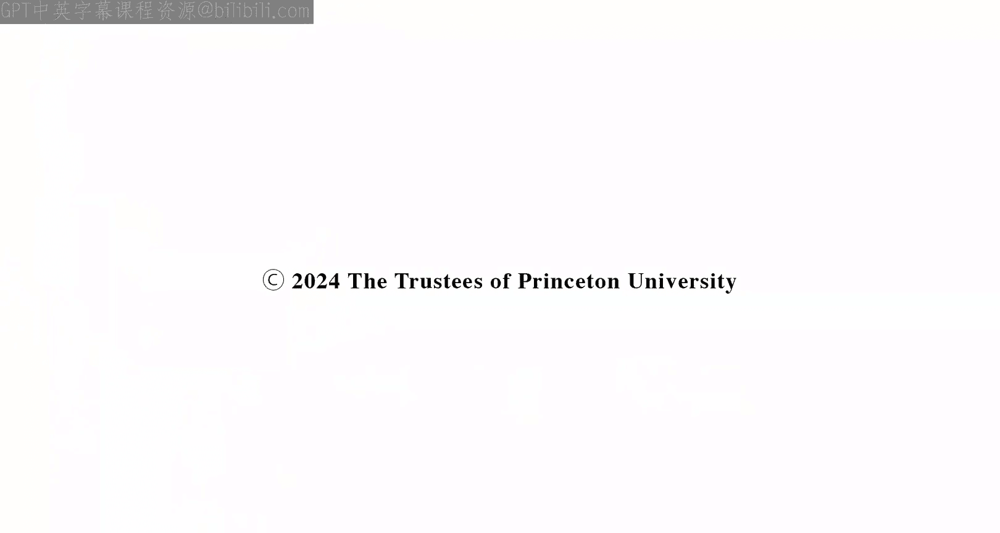

#  011：MDP下界证明 🧠

在本节课中，我们将学习如何为强化学习问题构建理论下界。我们将从多臂老虎机问题入手，详细推导其遗憾下界，并探讨如何将这一证明思路扩展到马尔可夫决策过程。

## 多臂老虎机下界回顾

上一讲我们介绍了证明下界的通用策略：通过归约，将随机算法的下界问题转化为确定性算法在特定问题分布上的期望分析。本节中，我们来看看如何具体应用这一策略来证明多臂老虎机的下界。

**核心定理**：对于任何算法 **A**，都存在一个多臂老虎机问题，使得其直到时间 **T** 的遗憾下界为 **Ω(√(A T))**。

### 困难实例构造

我们构造的困难实例是一个经典的多臂老虎机问题。设有 **A** 个臂（arm），其中绝大多数臂的奖励服从参数为 **1/2** 的伯努利分布。只有一个特殊的“好臂”，其奖励服从参数为 **1/2 + ε** 的伯努利分布。这个好臂是从所有臂中均匀随机选出的。这就构成了我们问题实例的分布。

我们定义以下符号：
*   **E***：对包括好臂随机选择在内的所有随机性取期望。
*   **E_a**：当好臂固定为臂 **a** 时，对奖励随机性取期望。
*   **E_0**：当不存在好臂（即所有臂奖励均为 **1/2**）时，对奖励随机性取期望。
*   **R_1:T**：算法在前 **T** 轮中从环境接收到的所有信息（即奖励序列）。

### 遗憾计算与上界

首先，我们计算算法在特定好臂 **a** 下的期望遗憾。经过推导，其核心项是 **E_a[N_a]**，即在好臂为 **a** 的条件下，算法拉动臂 **a** 的期望次数。

我们的核心思路是比较 **E_a[N_a]** 和 **E_0[N_a]**。当 **ε** 很小时，是否存在好臂难以区分，因此算法拉动臂 **a** 的次数不应有显著差异。我们得到以下上界：

**|E_a[N_a] - E_0[N_a]| ≤ T * TV(P_0, P_a)**

其中 **TV(P_0, P_a)** 是分布 **P_0**（无好臂）和 **P_a**（好臂为 **a**）之间的总变差距离。

### 利用KL散度与Pinsker不等式

总变差距离不易分解，我们转而使用更易于处理的KL散度。根据Pinsker不等式：

**TV(P, Q) ≤ √( (1/2) * KL(P || Q) )**

应用此不等式，我们将问题转化为对 **KL(P_0 || P_a)** 的上界估计。通过对奖励序列进行条件分解，并利用算法在给定历史下动作确定这一事实，我们最终得到：

**KL(P_0 || P_a) = E_0[N_a] * KL( Bern(1/2) || Bern(1/2+ε) )**

其中 **KL( Bern(1/2) || Bern(1/2+ε) )** 经计算约为 **2ε²**（当 **ε** 很小时）。

### 综合推导得出下界

接下来，我们对所有臂 **a** 求和，并利用柯西-施瓦茨不等式进行放缩。结合算法在所有臂上的拉动次数总和为 **T** 这一事实，我们得到：

**Σ_a E_a[N_a] ≤ T + T * √( A * T * 2ε² )**

将此上界代回最初的遗憾表达式，我们得到遗憾的下界形式：

**Regret ≥ εT * (1 - 1/A) - √(T/A) * O(ε²T)**

通过选择 **ε = Θ(√(A/T))** 来最大化这个下界，最终得到遗憾的下界为 **Ω(√(A T))**。

## 扩展到最佳臂识别问题

利用类似的技术，我们也可以证明最佳臂识别问题的样本复杂度下界。

**定理**：对于任何只能进行 **T** 次拉动并输出一个臂的算法，存在一个多臂老虎机问题，使得最优臂的期望奖励与算法输出臂的期望奖励之差至少为 **Ω(√(A/T))**。

这意味着，要达到 **ε** 的最优性差距，所需的样本复杂度 **T** 至少为 **Ω(A/ε²)**。此证明将作为练习。

## 扩展到马尔可夫决策过程

现在，我们将下界证明的思路扩展到马尔可夫决策过程。我们关注**平稳MDP**（每一步的转移概率相同）的情况。

**目标定理**：对于任何算法 **A**，存在一个MDP（其初始状态由对抗者选择），使得期望遗憾的下界为 **Ω(√(H S A T))**，这与UBVI等算法的上界匹配。

### 基础困难实例构造（3状态）

我们首先构造一个3状态的MDP困难实例：
*   **状态0**：有一个特殊动作 **a***，以概率 **(1/2+ε)** 转移到状态1，以概率 **(1/2-ε)** 转移到状态2。所有其他动作都以 **1/2** 的概率分别转移到状态1和2。
*   **状态1**：吸收状态，任何动作都返回自身，且每一步产生奖励 **1**。
*   **状态2**：吸收状态，任何动作都返回自身，且每一步产生奖励 **0**。

初始状态固定为0。特殊动作 **a*** 从所有动作中均匀随机选取。

### 与老虎机问题的关联

观察从状态0开始的第一步：选择特殊动作意味着以略高的概率进入高奖励的吸收状态（状态1），从而在后续 **H-1** 步中获得高累积奖励。这本质上等同于一个奖励缩放为 **H-1** 倍的多臂老虎机问题。

因此，其遗憾下界也按比例缩放，对于 **K** 幕（episode）的情况，遗憾下界为 **Ω(H √(A K))**。由于总时间步 **T = K * H**，可写为 **Ω(√(H A T))**。

### 扩展到更多状态（S状态）

对于具有 **S** 个状态的MDP，我们可以构造大约 **S/3** 个相互独立的上述3状态困难实例（“分支”）。对抗者可以选择从任何一个分支的初始状态（即该分支的状态0）开始。

通过均匀地将 **T** 个时间步（或 **K** 幕）分配到各个分支，每个分支获得的交互次数约为 **T / (S/3)**。每个分支产生的遗憾下界为 **Ω(√(H A * (T/(S/3))))**。对 **S/3** 个分支求和，总遗憾下界为 **Ω(√(H S A T))**。

## 总结与展望

本节课中，我们一起学习了如何为强化学习问题构建理论下界。
1.  我们首先回顾并完成了多臂老虎机问题 **Ω(√(A T))** 遗憾下界的详细证明，核心是利用了信息论中的KL散度和Pinsker不等式。
2.  接着，我们探讨了如何将同样的技术用于证明最佳臂识别问题的样本复杂度下界。
3.  最后，我们展示了如何通过巧妙的MDP构造，将老虎机的下界证明思路扩展到平稳MDP，得到了 **Ω(√(H S A T))** 的遗憾下界，这证明了我们之前学习的某些算法（如UBVI）在最坏情况下是最优的。

从下一讲开始，我们将进入表格型MDP的最后一个主题：离线强化学习。随后，我们将探讨函数逼近方法，以处理大规模状态空间的问题。