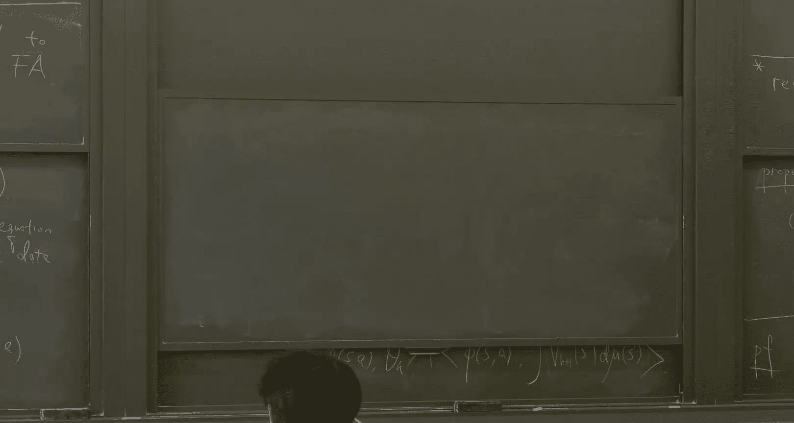
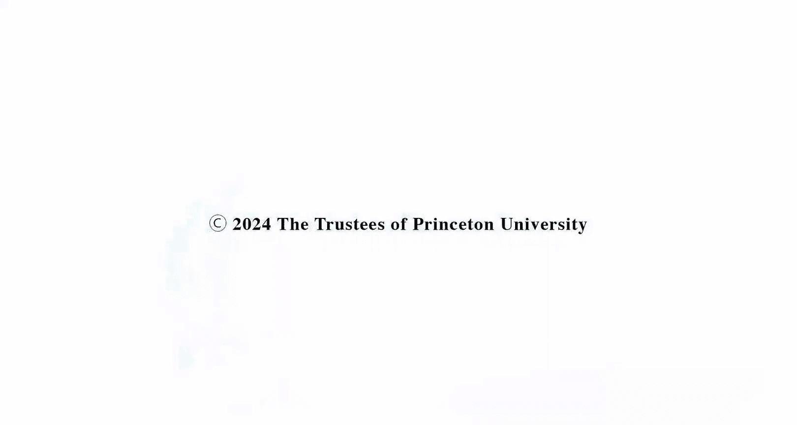

#  013：大规模状态空间中的强化学习

在本节课中，我们将要学习如何处理状态空间巨大的强化学习问题。我们将从表格化方法的局限性出发，引入函数逼近这一核心概念，并重点探讨线性函数逼近及其理论基础——线性马尔可夫决策过程。

## 概述：从表格化方法到函数逼近

到目前为止，本学期的课程主要聚焦于**表格化**设定，即状态和动作的数量都是有限的。然而，在接下来的两周，我们将进入一个新主题：处理**大规模状态和动作空间**的强化学习。

当状态空间巨大时，我们之前讨论的、样本复杂度与状态数 `S` 呈线性关系的算法将变得不可行。例如，在雅达利游戏中，状态由像素值构成，其可能组合的数量是天文数字。此外，在实际应用中（如机器人控制），我们可能永远无法两次访问完全相同的连续状态。因此，我们需要一种新的机制：**泛化**。这意味着我们需要从已观测到的状态中学习，并将知识推广到未观测到的状态。实现泛化的关键在于编码状态之间的**相似性结构**。

这引出了处理大规模状态空间的主要方法：**函数逼近**。其核心思想是，我们不再为每个状态或状态-动作对存储单独的值（表格法），而是用带参数的函数来参数化模型、价值函数或策略。通过这种参数化，我们在不同状态之间引入了隐含的约束，从而编码了相似性。

函数逼近主要有以下几种方式：
*   **参数化模型**：例如，使用神经网络参数化转移概率 `P(s'|s, a; θ)`。
*   **逼近价值函数**：例如，用参数为 `θ` 的函数（如神经网络）来近似 `Q(s, a)`。这是本节课重点讨论的方法。
*   **参数化策略**：直接参数化策略函数 `π(a|s; θ)`。
*   **演员-评论家方法**：同时参数化价值和策略，并交替学习。

函数逼近也带来了新的挑战：
1.  **稀疏性**：大多数状态未被访问，算法必须具备从已观测状态泛化到未观测状态的能力。
2.  **设定错误**：真实的最优价值函数 `Q*` 可能不在我们选择的函数类别（如线性函数）中，这会导致近似误差。
3.  **探索与利用**：在在线场景中，仍需在稀疏性和设定错误的背景下处理探索与利用的权衡。

在本节课及后续课程中，我们将首先关注**价值函数逼近**，并暂时**避免设定错误**的挑战，专注于处理稀疏性和探索问题。

---

## 线性函数逼近与线性MDP

上一节我们介绍了函数逼近的必要性和基本概念。本节中，我们来看看一个简化且理论清晰的起点：**线性函数逼近**。

我们假设智能体已知一个**特征映射** `φ`，它将状态-动作对 `(s, a)` 映射到一个 `d` 维特征向量。我们将所有 `Q` 值参数化为一个权重向量 `w` 与该特征向量的内积：
`Q(s, a) ≈ w^T φ(s, a)`
我们的目标就是学习这个权重向量 `w`。

然而，在一般情况下，简单地用线性函数近似 `Q` 值会引入设定错误。为了首先理解在什么条件下线性逼近是合理的，我们研究一个**充分条件**，它能确保最优价值函数 `Q*` 本身是线性的。这个条件对应的模型称为**线性马尔可夫决策过程**。

一个线性MDP除了具有标准MDP的元素（状态集 `S`、动作集 `A`、奖励、转移、时域 `H`）外，其奖励和转移概率被假定为关于特征 `φ` 是线性的：
*   **奖励**：`r_h(s, a) = φ(s, a)^T θ_h`，其中 `θ_h` 是一个 `d` 维参数向量。
*   **转移**：对于任何可测的下一状态集合 `B`，有 `P_h(B | s, a) = φ(s, a)^T μ_h(B)`。这里 `μ_h` 是一个 `d` 维的**测度向量**，每个分量都是一个概率测度。这个公式意味着转移概率是特征向量的线性函数。

### 线性MDP的性质与例子

线性MDP有一个关键性质：**对于任意策略 `π`，其对应的 `Q` 值函数 `Q_h^π(s, a)` 都是关于特征 `φ(s, a)` 的线性函数**。证明直接利用贝尔曼方程和线性MDP的定义即可完成。这个性质非常强，它意味着整个价值函数空间都被限制在线性空间内，从而避免了设定错误。

我们可以通过两个例子来理解线性MDP：
1.  **表格化MDP是线性MDP的特例**：假设有 `S` 个状态和 `A` 个动作。我们构造 `d = S * A` 维的特征，`φ(s, a)` 是一个“独热”向量，仅在对应 `(s, a)` 的维度为1，其余为0。通过适当定义参数 `θ_h` 和测度 `μ_h`，可以精确还原表格化MDP的奖励和转移概率。
2.  **单纯形特征空间**：如果所有状态-动作对的特征向量 `φ(s, a)` 都位于 `d` 维单纯形内（即各分量非负且和为1），并且测度 `μ_h` 的每个分量都是概率测度，那么构造出的奖励和转移概率是良定义的。这个例子允许状态空间是无限的。

然而，线性MDP的假设也有很强的限制性。由于转移概率必须是非负且和为1的概率，这反过来对特征空间施加了约束。具体来说，对于所有 `(s, a)`，特征 `φ(s, a)` 必须落在某个特定的超平面内（因为与一个固定向量的内积必须为1）。这意味着，像 `L2` 球这样常见的特征空间**不满足**线性MDP的条件。因此，线性MDP是一个用于理论研究线性函数逼近的**基础但限制性较强**的模型。

---

## 学习方法：最小二乘价值迭代

在理解了线性MDP这个简化模型后，我们接下来探讨如何学习它。我们将采用与价值迭代类似的思路，但由于使用函数逼近，无法精确求解贝尔曼方程。因此，我们引入**最小二乘价值迭代**（LSVI）方法。

回顾表格化设定，我们通过采样数据来估计 `Q` 值：`Q̂_h(s, a) = r_h(s, a) + P̂_h V̂_{h+1}(s, a)`，其中 `P̂_h` 是经验转移概率。在线性设定中，我们参数化 `Q̂_h(s, a) = w_h^T φ(s, a)`。权重向量 `w_h` 通过最小化平方误差来学习：

假设我们有一批数据 `{(s_i, a_i, r_i, s'_i)}_{i=1}^n`。对于第 `h` 步，我们求解以下最小二乘问题：
`w_h = argmin_w Σ_{i=1}^n [ w^T φ(s_i, a_i) - (r_i + V̂_{h+1}(s'_i)) ]^2`
其中 `V̂_{h+1}(s') = max_a Q̂_{h+1}(s', a)`。通过逐步（从 `H` 到 `1`）求解这些最小二乘问题，我们可以得到近似的 `Q` 值函数。

在表格化情况下，如果特征 `φ` 是独热编码，那么上述最小二乘解就是精确的表格 `Q` 值。在线性情况下，我们通过最小化平方残差来寻找最佳线性拟合。

---

## 总结

本节课我们一起学习了强化学习从表格化方法扩展到大规模状态空间的核心思想。我们首先指出了表格化方法的局限性，并引入了**函数逼近**作为解决方案，其关键在于通过参数化函数来实现状态间的**泛化**。接着，我们聚焦于**线性函数逼近**，并介绍了**线性MDP**这一理论模型。线性MDP通过假设奖励和转移概率关于特征是线性的，确保了所有策略的价值函数都是线性的，从而避免了设定错误。最后，我们介绍了**最小二乘价值迭代**这一适用于线性函数逼近的学习算法框架。在接下来的课程中，我们将深入探讨LSVI的理论保证及其在实践中的应用。