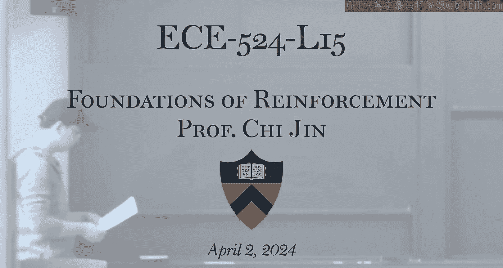
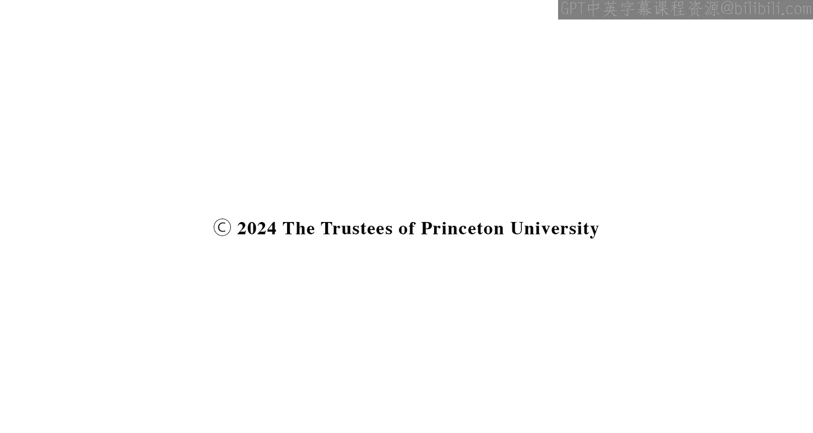

#  015：大规模状态空间中的探索

## 概述
在本节课中，我们将学习如何将探索策略扩展到使用函数近似的强化学习场景中。我们将首先回顾线性函数近似下的算法，然后讨论如何将其扩展到在线探索设置，最后介绍一种更通用的、超越线性MDP假设的算法框架。

## 回顾：线性函数近似与LSVI

在上一讲中，我们重点讨论了线性函数近似。我们聚焦于一个称为线性MDP的基本模型，并深入探讨了一种名为最小二乘值迭代的算法。该算法本质上修改了值迭代的更新规则，通过求解最小二乘问题来适应线性函数近似。

我们特别花了大量时间研究该算法在核心集设置下的保证。你可以将其视为表格型MDP中模拟器设置的类比。在表格型设置中，模拟器设置允许我们均匀查询所有状态-动作对。在线性函数近似中，尽管状态空间是无限的，但我们只需在核心集中遍历所有状态-动作对。

我们知道，在表格型MDP场景中，讨论完模拟器设置后，我们会转向更高级的设置，例如在线设置和离线设置。今天，我们将花一些时间讨论如何将这种方法扩展到探索设置或在线设置。

## 在线探索设置与LSVI-UCB算法

在探索设置中，与表格型设置的动机类似，我们不再能够随意查询特定的状态和动作对，而必须从初始状态开始。在这种情况下，我们无法再遍历核心集中所有可能的状态-动作对。这是一个更实际的场景。

如果你还记得，在表格型设置中，处理在线强化学习的核心思想是融入乐观主义。这里我们将尝试采用相同的策略，即将乐观主义或置信上界融入LSVI算法。

以下是LSVI-UCB算法的步骤。

对于每个回合 k = 1, 2, ..., K，执行以下操作：
1.  接收初始状态 s1_k。
2.  对于步骤 h 从 H 递减到 1，执行值迭代预计算：
    *   计算格拉姆矩阵 Λ_h = Σ_{τ=1}^{k-1} φ_{h,τ} φ_{h,τ}^T + λI，其中 φ_{h,τ} 是第 τ 回合第 h 步访问的状态-动作对的特征映射。
    *   求解最小二乘权重 w_h = Λ_h^{-1} * Σ_{τ=1}^{k-1} φ_{h,τ} * [r_{h,τ} + max_{a'} Q_{h+1}(s'_{h+1,τ}, a')]。
    *   计算Q值：Q_h(s, a) = min(H, w_h^T φ(s, a) + β * sqrt(φ(s, a)^T Λ_h^{-1} φ(s, a)) )。
3.  对于步骤 h 从 1 到 H，执行策略：
    *   采取动作 a_{h,k} = argmax_a Q_h(s_{h,k}, a)。
    *   观察下一个状态和奖励。

该算法有两个主要部分：第一部分是带有奖励项的LSVI，第二部分是执行贪婪策略。

## 奖励项的设计原理

现在的问题是，为什么选择这种特定形式的奖励项？原因与线性函数近似的特性有关。

你可以将其大致解释为类似 1 / sqrt(n) 的形式，其中 n 是在该特征方向上的有效样本数。在表格型设置中，奖励函数是 1/n，其中 n 是观察到特定状态-动作对的次数。在线性函数近似中，这大致相当于 1 / sqrt(n)，其中 n 是在特征方向 φ 上的有效样本数。

在表格型MDP的特殊情况下，特征空间是所有可能的基向量 e_i。此时，Λ 矩阵是对所有先前观察到的特征向量的求和。奖励项 φ^T Λ^{-1} φ 恰好等于 1/N_j，这与表格型设置中的置信界相对应。

在一般情况下，特征向量可能不正交。任何先前的观察，只要其 φ_i^T φ 不为零，就会以 0 到 1 之间的某个数值增加 φ 方向的有效样本数。这是对该奖励函数形式的直观理解。

更严格的数学原因源于线性赌博机场景。线性赌博机的UCB算法使用了这种形式的奖励，我们可以将其借鉴并应用到强化学习中。

## LSVI-UCB的算法保证

对于任何线性MDP，以至少 1 - δ 的概率，LSVI-UCB算法的遗憾界为：Regret ≤ C * sqrt(d^3 H^3 T * log(dT/δ))。

其中，d 是特征维度，H 是回合步数，T 是总步数。这个结果是用遗憾来表述的，你可以通过在线到批次的转换定理，将其转换为样本复杂度。

关于此结果有两点重要说明：
1.  与之前需要核心集的方法相比，LSVI-UCB的改进是显著的。我们不再需要模拟器访问权限，也不关心是否存在好的核心集。事实上，该保证完全独立于核心集的L因子。
2.  我们不再有 |S||A| 的依赖关系，这在线性函数近似中非常重要。我们将其替换为维度 d。在表格型设置中，d 就等于 |S|，但在一般情况下，d 可以更通用，即使对于无限状态空间，也可以有固定的或较小的 d。

证明涉及上置信界、最小二乘值迭代和回归分析的结合，更为复杂，我们将其留给相关论文。

## 超越线性MDP：线性完备性类

接下来，我们讨论超越线性MDP的线性函数近似。线性MDP的假设很强，它要求转移和奖励都是线性的。但在实践中，例如深度强化学习，我们通常只关心价值函数可以用线性函数近似。

人们一直在思考如何放宽假设。这里介绍一种更通用的类别，称为线性完备性类。这个类别很优雅，其算法解决方案可以推广到一般的函数近似。

线性完备性类有两个主要假设：
1.  可实现性：假设最优Q值函数 Q* 在考虑的线性函数类 F 中。
2.  完备性：对于该线性函数类 F 中的任何函数，应用贝尔曼最优算子 T* 后，得到的新函数仍然在 F 中。

可以验证，线性MDP是线性完备性类的一个子集。线性MDP满足这两个假设。

## 线性二次型调节器示例

我们还需要一个超越原始线性MDP但仍属于线性完备性类的例子。这就是控制文献中非常重要的线性二次型调节器。

LQR模型抽象了许多实际应用，例如控制机器人直升机的高度。其一般形式如下：
*   状态：x_t ∈ R^d，动作：u_t ∈ R^{d'}。
*   线性动态：x_{t+1} = A x_t + B u_t + w_t。
*   二次型奖励：r_t = - (x_t^T Q x_t + u_t^T R u_t)，其中 Q 和 R 是半正定矩阵。

LQR满足线性完备性，但它本身不是线性MDP。在LQR中，最优价值函数实际上是状态和动作的二次型函数。为了使其符合线性完备性框架，我们可以通过特征映射进行扩展，例如将特征定义为包含 x, u, xx^T, uu^T, xu^T 等项的向量化形式。这样，关于 x 和 u 的二次型函数就变成了关于这个扩展特征的线性函数。

## 全局乐观主义与ELEANOR算法

对于线性完备性类，原来的LSVI-UCB算法不再适用。新算法的核心思想是使用全局乐观主义。

之前的LSVI-UCB添加奖励项的方式可以称为局部乐观主义。新的ELEANOR算法则采用全局乐观主义，这带来了一些权衡。

ELEANOR算法步骤如下：
对于每个回合 k = 1, 2, ..., K：
1.  接收初始状态 s1_k。
2.  构建置信集 Θ_k，它是一组权重向量 (θ_{1,bar}, ..., θ_{H,bar}) 的集合，满足对于所有 h，有 ||θ_{h,bar} - θ_{h,hat}||_{Λ_h} ≤ β。其中 θ_{h,hat} 是基于之前数据和 θ_{h+1,bar} 的最小二乘解。
3.  执行乐观规划：选择 (θ_{1,bar}, ..., θ_{H,bar}) ∈ Θ_k，以最大化初始状态的价值 V1(s1_k) = max_a φ(s1_k, a)^T θ_{1,bar}。
4.  对于步骤 h = 1 到 H，执行动作 a_{h,k} = argmax_a φ(s_{h,k}, a)^T θ_{h,bar}。

## 局部乐观主义与全局乐观主义的比较

全局乐观主义与局部乐观主义的主要区别在于约束的强度：
*   **局部乐观主义**：保证对于所有步骤 h 和所有状态 s，有 V_h(s) ≥ V*_h(s)。LSVI-UCB和表格型值迭代UCB都属于此类。
*   **全局乐观主义**：只保证在初始状态 s1_k 处，有 V_1(s1_k) ≥ V*_1(s1_k)。对于中间步骤和状态，不要求是上界。

乐观主义需要平衡两个目标：奖励项要足够大以保证上界；奖励项要足够小以保证遗憾界小。局部乐观主义在上界部分施加了很强的约束，可能导致奖励项过大，进而使遗憾界变差。全局乐观主义约束更弱，允许使用更小的奖励项，从而可能获得更小的遗憾界。对于线性完备性类，局部乐观主义可能导致遗憾界呈指数级增长，而全局乐观主义可以得到多项式级的遗憾界。

然而，全局乐观主义并非没有代价，其主要缺点是计算效率低。置信集具有嵌套约束，其表示和内部的优化问题非常复杂。而局部乐观主义算法（如LSVI-UCB）通常是计算高效的。

## 总结
本节课我们一起学习了在大规模状态空间中进行探索的策略。我们从线性函数近似下的LSVI算法出发，探讨了如何通过融入UCB思想将其扩展到在线设置，形成了LSVI-UCB算法。接着，我们介绍了超越线性MDP假设的线性完备性类，并以LQR为例说明了其应用。最后，我们对比了局部乐观主义和全局乐观主义，并介绍了基于全局乐观主义的ELEANOR算法，分析了其在约束强度和计算效率上的权衡。这些内容为我们理解和使用函数近似下的探索方法提供了基础。