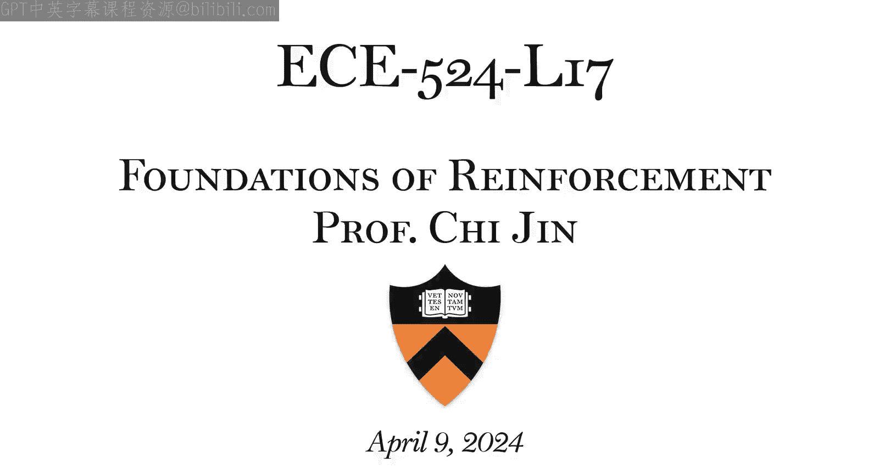
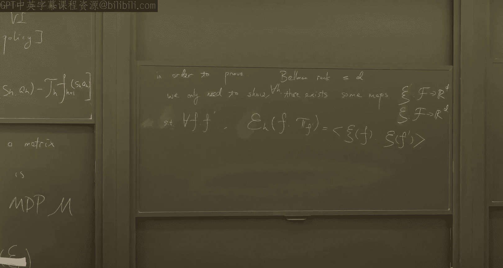
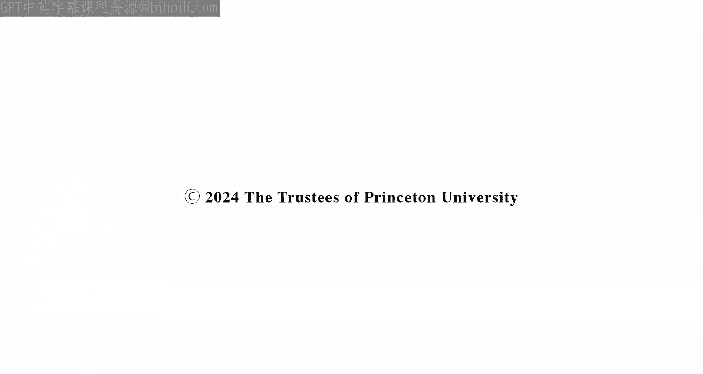

#  017：一般函数逼近中的探索





在本节课中，我们将学习一般函数逼近框架下的探索问题。上一讲我们介绍了贝尔曼秩的概念，它是一种衡量在线强化学习问题复杂度的新方法。本节我们将通过具体例子理解贝尔曼秩，并介绍一个能利用低贝尔曼秩实现高效学习的算法。

## 贝尔曼秩回顾

上一节我们介绍了贝尔曼秩，本节中我们来看看它的定义和一些关键性质。

贝尔曼秩的引入是为了描述在线强化学习中函数类的复杂度。为了定义贝尔曼秩，我们首先需要定义平均贝尔曼误差。



对于函数类 **F** 中的任意值函数 **f** 和任意策略 **π**，在第 **h** 步的平均贝尔曼误差定义如下：

```
L_h(f, π) = E_{(s_h, a_h) ~ (π_{1:h-1}, π_f^h)} [ (f_h(s_h, a_h) - (T_h f_{h+1})(s_h, a_h)) ]
```

其中，在前 **h-1** 步我们遵循策略 **π**，在第 **h** 步我们遵循由 **f** 诱导的贪婪策略 **π_f**。然后我们计算该步的贝尔曼误差。

贝尔曼秩本质上考察了这个平均贝尔曼误差的复杂度。具体来说，我们为每一步 **h** 构造一个矩阵 **E_h**，其行和列都由函数类 **F** 中的函数索引。矩阵中 **(f, f‘)** 位置上的元素就是平均贝尔曼误差 **L_h(f, π_{f‘})**。

**MDP M** 关于函数类 **F** 的贝尔曼秩定义为所有这些矩阵 **E_h** 的秩的最大值。

一个非常重要的观察是：要证明贝尔曼秩小于等于 **d**，只需证明存在一个映射，将函数映射到 **d** 维空间，使得对于任意 **f, f‘** 和 **h**，平均贝尔曼误差 **L_h(f, π_{f‘})** 可以分解为两个 **d** 维向量的内积形式：

```
L_h(f, π_{f‘}) = < ψ_h(f), ζ_h(f‘) >
```

如果能证明这种分解，就意味着矩阵 **E_h** 的秩最多为 **d**。我们将利用这个特性来证明许多我们已讨论过的强化学习问题都具有低贝尔曼秩。

## 贝尔曼秩示例

现在我们已经理解了贝尔曼秩的定义，接下来通过几个具体例子来看看它是如何应用的。

### 表格型MDP

第一个例子是表格型MDP。

**命题1**：对于表格型MDP，令函数类 **F** 为所有可能的值函数。那么贝尔曼秩小于等于状态数 **S**。

**证明**：我们利用上述分解特性来证明。观察平均贝尔曼误差 **L_h(f, π_{f‘})**，我们可以将其显式展开为期望形式：

```
L_h(f, π_{f‘}) = Σ_{s_h} P_{π_{f‘}}(s_h) * E_{a_h ~ π_f(·|s_h)} [ δ_h(f, s_h, a_h) ]
```

其中 **δ_h(f, s_h, a_h)** 是贝尔曼误差项。这个表达式已经是内积形式：对状态 **s_h** 求和。第一部分 **P_{π_{f‘}}(s_h)** 只依赖于 **f‘**，第二部分 **E_{a_h ~ π_f(·|s_h)} [ δ_h(f, s_h, a_h) ]** 只依赖于 **f**。因此，我们可以定义 **d = S** 维的向量 **ψ_h(f‘)** 和 **ζ_h(f)**，使得它们的内积等于上述表达式。这就证明了贝尔曼秩最多为 **S**。

### 线性MDP

第二个例子是线性MDP。

**命题2**：对于线性MDP，贝尔曼秩小于等于特征维度 **d**。

**证明**：我们再次对平均贝尔曼误差进行分解。利用线性MDP的转移特性，我们可以将期望回推一步：

```
L_h(f, π_{f‘}) = E_{(s_{h-1}, a_{h-1}) ~ π_{f‘}} [ φ(s_{h-1}, a_{h-1})^T * μ_h ]
```

其中 **μ_h** 是一个只依赖于 **f** 的 **d** 维向量。这样，左边是依赖于 **f‘** 的期望（关于特征向量），右边是依赖于 **f** 的向量 **μ_h**。这构成了一个 **d** 维的内积分解，因此贝尔曼秩最多为 **d**。

### 分块MDP

第三个例子是分块MDP，它可以看作是部分可观测MDP的一个特例。

在分块MDP中，我们有一个潜在的、小的状态空间 **S**，但我们观察到的是从一个“解码器”生成的、可能非常复杂的观测值 **O**（例如图像）。函数类 **F** 定义在观测空间 **O** 上。

如果我们天真地应用表格型结果，复杂度将取决于巨大的观测空间大小 **|O|**，这是不可接受的。然而，在贝尔曼秩框架下，我们可以证明其贝尔曼秩仅取决于潜在的小状态空间大小 **S**，而不是 **|O|**。

**证明思路**：与表格型MDP类似，我们可以将平均贝尔曼误差的期望首先对潜在状态 **s_h** 求和，然后考虑给定 **s_h** 下观测 **o_h** 的生成概率。最终表达式可以分解为两个仅依赖于 **f‘** 和 **f** 的部分，其内积的维度是 **S**。因此，贝尔曼秩最多为 **S**。

这些例子表明，贝尔曼秩是一个强大的工具，它能够捕捉问题的本质复杂度，而不受表象（如巨大的观测空间）的影响。

## GOLF 算法

既然我们已经知道许多问题具有低贝尔曼秩，那么下一个问题是：如何利用这一点设计高效的算法？本节介绍GOLF算法。

GOLF 代表 **G**lobal **O**ptimism based on **L**ocal **F**itting（基于局部拟合的全局乐观算法）。你可以将其视为一般函数逼近版的ELEANOR算法，它结合了拟合值迭代和全局乐观思想。

以下是GOLF算法的步骤：

1.  **初始化**：对于所有步数 **h=1,...,H**，初始化数据集 **D_h = ∅**，置信集 **C_1^h = F**（整个函数类）。
2.  **循环**：对于回合 **k = 1 到 K**：
    *   **乐观规划**：选择值函数 **f_k**，使其在置信集 **C_{k-1}** 中能最大化初始状态的值：**f_k = argmax_{f ∈ C_{k-1}} V_1^{π_f}(s_1)**。
    *   **执行策略**：执行由 **f_k** 诱导的贪婪策略 **π_k = π_{f_k}**，收集一条轨迹数据。
    *   **更新数据集**：将新收集的数据加入到各步的数据集 **D_h** 中。
    *   **更新置信集**：这是算法的核心。新的置信集 **C_k** 包含所有满足以下条件的函数 **f ∈ F**：对于每一步 **h**，其贝尔曼残差平方损失不超过最小可能损失加上一个边界项 **β**。

置信集的构造是FQI（拟合值迭代）思想的扩展。在FQI中，我们选择最小化贝尔曼残差平方损失的值函数。在GOLF中，我们构造一个置信集，包含所有损失“接近”最小损失的函数。参数 **β** 是一个统计松弛项，通常选择为：
```
β = O( log(|F| * K * H / δ) )
```
以保证真实的最优值函数以高概率始终包含在置信集内。

## 理论保证

在可实现性和完备性这两个基本假设下，GOLF算法有以下理论保证：

**定理**：存在常数 **c**，使得如果选择 **β** 如上式，那么以至少 **1-δ** 的概率，算法在 **K** 回合内的累积遗憾满足：
```
Regret(K) ≤ O( H * √(D * K * β) )
```
其中 **D** 是贝尔曼秩。

这个保证非常通用，它不显式依赖于状态或动作的数量。遗憾界主要取决于两个关键量：
1.  贝尔曼秩 **D**。
2.  函数类对数复杂度 **log |F|**。

在离线设置中，我们需要小的 **log |F|** 和集中性系数。在在线设置中，集中性系数的角色被贝尔曼秩所取代。这个定理表明，只要一个强化学习问题的贝尔曼秩较小，GOLF这个自然算法就能高效地找到最优策略。

## 总结与过渡

本节课我们一起学习了一般函数逼近中的探索。我们回顾了贝尔曼秩的概念，它量化了在线学习的复杂度。我们通过表格型MDP、线性MDP和分块MDP的例子，看到许多问题天然具有低贝尔曼秩。接着，我们介绍了GOLF算法，它巧妙地将拟合值迭代与全局乐观法结合，并能够利用低贝尔曼秩获得次线性遗憾界。



从下节课开始，我们将进入课程的新篇章：多智能体强化学习。我们将首先从最简单的形式——正规形式博弈开始，逐步深入到更复杂的马尔可夫博弈。