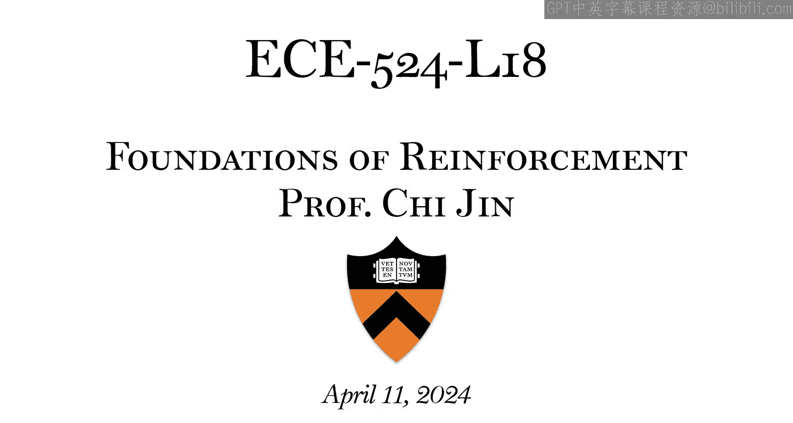
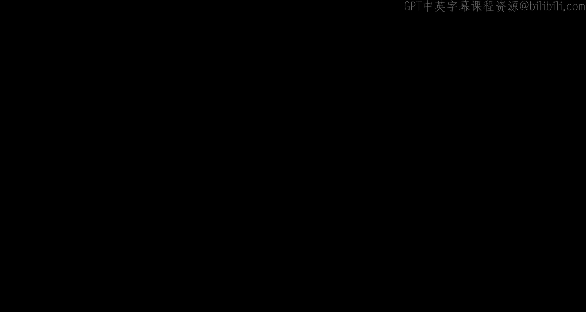

#  018：多智能体强化学习

在本节课中，我们将要学习多智能体强化学习的基础知识。我们将从最简单的无状态博弈模型开始，逐步引入状态和转移，最终探讨马尔可夫博弈的解决方案概念和规划算法。

## 概述

上一讲我们初步接触了多智能体强化学习，并介绍了一个基本模型——标准形式博弈。本节课我们将深入探讨该模型的解决方案概念，并学习如何求解这些博弈。随后，我们将超越这种无状态的设定，引入状态和转移，学习更一般的马尔可夫博弈模型。

## 标准形式博弈与纳什均衡

正如我们在上一讲提到的，我们总是从最基本的设定开始，即没有任何状态或转移的博弈。这就是标准形式博弈。

一个两人零和博弈可以由一个效用矩阵来指定。其中，行代表最大化玩家（Max Player）的行动，列代表最小化玩家（Min Player）的行动。在零和博弈中，一个玩家的收益就是另一个玩家的损失。

在单智能体强化学习中，我们的目标是找到最优策略。但在博弈中，最重要的特点是你的对手不再是固定的环境，而是具有适应性的。因此，我们不再仅仅是寻找一个能获得最大价值的单一策略，而是旨在达到玩家之间的某种均衡。

一个非常著名的“最优策略”概念是由约翰·纳什提出的**纳什均衡**。从概念上讲，纳什均衡指的是一组策略组合，它满足一个直观的条件：**没有任何一个玩家可以通过单方面改变自己的策略而获得收益**。这意味着，如果达到了纳什均衡策略组合，那么当对手坚持其均衡策略时，任何玩家都没有动机去偏离自己的均衡策略。

为了讨论纳什均衡，我们首先需要明确“策略”的含义。最直接的想法是**纯策略**，即每个玩家始终承诺执行一个确定的行动。然而，纯策略纳什均衡可能并不总是存在。

以“石头剪刀布”游戏为例。其效用矩阵如下：平局得0分，赢则得1分，输则得-1分。可以证明，在这个游戏中不存在纯策略的纳什均衡。因此，在博弈论中，我们通常关注更一般的策略类别——**混合策略**。

混合策略意味着玩家不再承诺一个确定的行动，而是承诺一个随机的策略，即行动集上的一个概率分布。我们可以用分布来指定双方的策略。此时，当双方都采用混合策略时，期望效用可以写成矩阵形式。

当我们把策略空间扩展到混合策略时，情况得到了改善。根据著名的**极小极大定理**，对于满足一定条件的双线性函数，其极小极大值等于极大极小值。在标准形式博弈中，效用函数关于混合策略是双线性的，因此该定理成立。该定理不仅保证了极小极大值等于极大极小值，还保证了存在一组混合策略能达到这个值。而这组策略恰好构成了一个纳什均衡。

因此，极小极大定理保证了在标准形式博弈中，混合策略纳什均衡总是存在的。例如，在“石头剪刀布”游戏中，纳什均衡就是双方都以1/3的概率均匀随机选择石头、剪刀或布。

## 最佳反应

除了纳什均衡，博弈论中另一个非常重要的概念是**最佳反应**。这个概念很容易理解：假设对手正在执行某个固定的策略，为了对抗对手，我应该采取的最佳策略是什么？

在两人零和博弈中，最大化玩家对最小化玩家策略的最佳反应，是选择一个能最大化期望效用的策略。反之亦然。

最佳反应与纳什均衡密切相关。纳什均衡可以重新解释为：**均衡策略是面对对手的最佳反应时，己方所能采取的最优策略**。这意味着，如果你的对手非常了解你，并且总是能神奇地采取针对你的最佳反应策略来对抗你，那么在这种情况下，如果你仍想最大化自己的效用，你应该采取的策略就是纳什均衡策略。

## 马尔可夫博弈

因为本课程是关于强化学习的，所以我们总是处理具有时间相关性的问题。因此，我们将引入状态和转移，定义**马尔可夫博弈**。

马尔可夫博弈本质上是标准形式博弈的扩展，它包含了状态。你也可以将其视为马尔可夫决策过程向两个玩家的扩展。马尔可夫博弈由以下组件指定：状态空间、最大化玩家的行动空间、最小化玩家的行动空间、转移概率、奖励函数和折扣因子。与MDP的主要区别在于，转移概率和奖励现在同时依赖于两个玩家的行动。

类似于强化学习，在引入模型后，我们会讨论策略和价值函数等基本概念。这里的策略对于双方玩家都存在。重要的是，我们应该始终考虑**随机策略**。原因在于，从标准形式博弈的例子我们已经看到，如果我们只关注确定性策略，可能无法找到纳什均衡。

价值的定义与单智能体情况基本相同，是折扣累积奖励的期望，只不过现在期望是在双方策略共同作用下计算的。

对于固定策略的情况，贝尔曼方程与单智能体情况类似。真正的区别在于最优性的概念。我们不再仅仅想最大化价值，而是想找到均衡。因此，我们需要将最佳反应和纳什均衡的概念扩展到马尔可夫博弈中。

首先，对于最佳反应概念，可以证明：对于对手的任何固定策略，存在一个最佳反应策略，使得己方能在所有状态和所有时间步上同时达到最优价值。原因在于，当对手策略固定时，从己方视角看，问题就退化成了一个标准的MDP，而MDP的最优策略具有这种全局最优性。

基于最佳反应，我们可以定义**极小极大策略**和**极大极小策略**。可以证明，在马尔可夫博弈中，纳什均衡同样存在，并且均衡策略既是极小极大策略，也是极大极小策略，同时均衡价值满足极小极大值等于极大极小值。

## 次优性度量

在实际算法中，我们几乎不可能找到精确的纳什均衡，总是存在一些误差。那么，我们如何衡量一组策略与纳什均衡的接近程度呢？

我们将使用基于最佳反应的度量。自然地，我们可以分别考察双方策略的次优性。对于最小化玩家的策略，我们考察当对手（最大化玩家）采取最佳反应来利用它时，所能获得的效用，与真正的最优策略（即面对最佳反应时的最优策略）所能获得的效用之间的差距。对于最大化玩家，可以进行对称的考察。

由于纳什均衡的存在保证了极小极大值等于极大极小值，这两个差距的和可以合并为一个度量，称为**对偶间隙**。如果策略组合是精确的纳什均衡，那么这个对偶间隙将为零。因此，对偶间隙是衡量策略组合接近纳什均衡程度的一个自然指标。

## 规划算法

接下来，我们将讨论求解最佳反应和纳什均衡的算法。类似于单智能体强化学习，我们先考虑最简单的**已知模型**的情况。

如果我们只是想找到针对某个固定策略的**最佳反应**，那么问题就简化为一个MDP。我们可以直接写出其贝尔曼最优方程，并使用像值迭代这样的规划算法来求解。

更有趣的部分是如何找到**纳什均衡**。对于马尔可夫博弈，我们也可以写出类似的最优性方程。我们定义均衡价值函数和均衡动作价值函数。其贝尔曼方程与单智能体情况类似，关键区别在于状态价值的更新：不再是取单个行动的最大值，而是需要求解一个基于当前动作价值的矩阵博弈，即计算该博弈的极小极大值。

一旦我们通过规划算法（如值迭代）计算出了均衡Q值，要提取均衡策略，就需要在每个状态独立地求解一个标准形式博弈（即基于该状态的Q值矩阵），找到其纳什均衡混合策略，这个策略就是该状态下的均衡策略。

## 总结

本节课我们一起学习了多智能体强化学习的核心内容。我们从标准形式博弈入手，理解了纳什均衡和最佳反应这两个核心解决方案概念，并认识到混合策略的重要性。随后，我们将模型扩展到包含状态的马尔可夫博弈，并将这些概念成功迁移过来。我们还学习了如何度量策略与均衡的差距，即对偶间隙。最后，我们探讨了在模型已知的情况下，如何通过规划算法来求解最佳反应和纳什均衡。从下一讲开始，我们将进入学习算法部分，探讨如何在与环境交互中学习这些均衡策略。