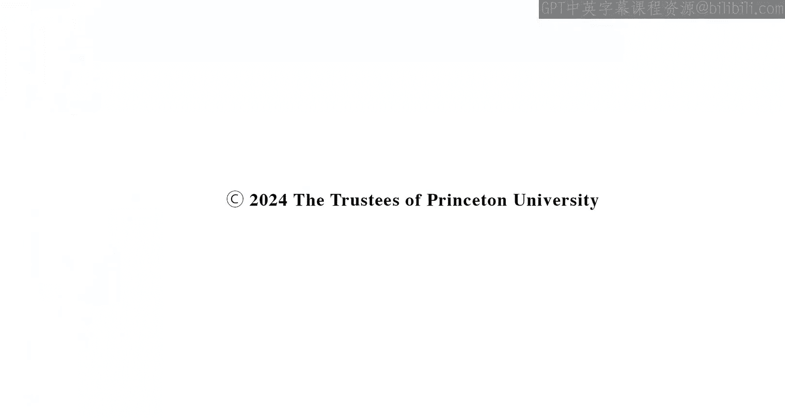

#  019：双人零和博弈

在本节课中，我们将继续学习多智能体强化学习。上一节我们介绍了马尔可夫博弈的公式化描述及其贝尔曼最优方程。本节中，我们将重点探讨基于“最佳响应”的学习算法，并分析其优缺点，最后介绍一种基于动态规划的、更高效且理论完备的算法。

## 基于最佳响应的算法

上一节我们介绍了马尔可夫博弈的贝尔曼最优方程，其核心是将单智能体问题中的最大化操作替换为极小极大化。然而，许多早期的多智能体强化学习算法并非基于此方程设计，而是源于另一种思路：**最佳响应**。

该思路的关键在于：**给定一个固定的对手策略，计算针对该对手的最佳响应本质上是一个单智能体问题**。虽然这个“单智能体”问题与我们之前讨论的标准单智能体问题略有不同，但我们可以暂时将其视为环境的一部分。

基于此，这类算法通常包含两个部分：
1.  **纳什均衡求解算法**：针对**正规形式博弈**（即无状态和转移的马尔可夫博弈），设计一个仅需访问“最佳响应计算器”的算法。
2.  **最佳响应计算**：使用标准的单智能体强化学习算法（如价值迭代、Q学习、PPO、DQN等）来计算针对固定对手策略的最佳响应。

因此，只要我们能设计出第一部分的高效算法，就能通过这个通用框架解决多智能体强化学习问题。接下来，我们来看看几种具体的算法。

### 自我对弈算法

首先，我们来看一个非常简单的启发式算法：**自我对弈**。该算法迭代更新双方策略，具体步骤如下：

对于迭代轮次 `k = 1` 到 `K`：
*   `π₁^(k+1) = BR(π₂^(k))`
*   `π₂^(k+1) = BR(π₁^(k+1))`

其中，`BR(·)` 表示计算针对给定对手策略的**最佳响应**，`π₁` 和 `π₂` 分别表示玩家一和玩家二的混合策略。

然而，这个算法存在严重问题。以“石头剪刀布”游戏为例，如果初始化玩家二出“石头”，那么玩家一的最佳响应是出“布”，接着玩家二的最佳响应变为出“剪刀”，玩家一又变为出“石头”……如此循环，算法永远无法收敛到纳什均衡。即使对策略取平均，在一般性游戏中也不能保证收敛。因此，自我对弈算法不是一个好算法。

### 虚拟对弈算法

为了改进自我对弈，我们引入一个著名的变体：**虚拟对弈**算法。该算法由 Brown 于 1949 年提出。

算法同样进行迭代，但更新规则有所不同：

对于迭代轮次 `k = 1` 到 `K`：
*   `π₁^(k+1) = BR( (1/k) * Σ_{i=1}^{k} π₂^(i) )`
*   `π₂^(k+1) = BR( (1/k) * Σ_{i=1}^{k} π₁^(i) )`

与自我对弈的关键区别在于：**虚拟对弈计算的是针对对手所有历史策略的*平均策略*的最佳响应**，而不是针对当前瞬时策略的最佳响应。

在“石头剪刀布”游戏中，这种平均化操作最终能使策略收敛到纳什均衡。事实上，Robinson 在 1951 年证明了虚拟对弈算法**能渐近收敛到纳什均衡**。

然而，我们更关心算法的**收敛速度**。原始证明表明，找到 ε-近似纳什均衡所需的迭代次数可能高达 `(1/ε)^(Ω(|A|))`，其中 |A| 是动作数量。这意味着对于动作空间稍大的游戏，收敛速度会非常慢。

后续研究尝试改进这一复杂度。虽然存在一些关于更快速率（如 `O(|A|/ε²)`）的猜想，但在最坏情况下，虚拟对弈可能确实需要指数级时间。因此，在实践中，虚拟对弈算法可能并不高效。

### 双重预言机与元策略求解

为了获得更快的算法，我们引入另一类算法，其代表是**双重预言机**。其核心思想是：利用双方历史策略构建一个收益矩阵，并基于此计算一个更智能的“元策略”权重，而非简单平均。

具体来说，假设我们已有双方的历史策略序列 `{π₁^(i)}` 和 `{π₂^(i)}`，我们可以构建一个 K×K 的收益矩阵 `M_K`，其中 `M_K(i, j)` 表示玩家一使用策略 `π₁^(i)` 对抗玩家二使用策略 `π₂^(j)` 时的收益。

双重预言机算法的更新步骤如下：

对于迭代轮次 `k = 1` 到 `K`：
1.  计算收益矩阵 `M_k` 的纳什均衡，得到一组元策略权重向量 **p** 和 **q**（分别对应玩家一和玩家二的历史策略权重）。
2.  玩家一的新策略是：`π₁^(k+1) = BR( Σ_{i=1}^{k} p_i * π₂^(i) )`
3.  玩家二的新策略是：`π₂^(k+1) = BR( Σ_{i=1}^{k} q_i * π₁^(i) )`

这里的 **p** 和 **q** 是通过求解 `M_k` 的纳什均衡得到的，它比虚拟对弈的均匀平均更智能。这类算法（包括其泛化形式，如策略空间响应预言机）在实践中被广泛应用（例如 AlphaStar 中的联赛训练）。

对于双重预言机，有一个重要的性质：它能在 `O(|A|)` 次迭代内找到一个正规形式博弈的纳什均衡。这看起来比虚拟对弈的指数级复杂度好得多。但需要注意的是，这里的 |A| 指的是**策略的数量**，在将马尔可夫博弈转化为正规形式博弈时，策略空间是极其庞大的。

## 将最佳响应算法应用于马尔可夫博弈

当我们尝试将上述正规形式博弈算法（如双重预言机）与单智能体强化学习结合，以解决马尔可夫博弈时，会遇到两个主要问题：

1.  **策略空间爆炸**：在正规形式博弈分析中，复杂度依赖于动作数量 |A|。但在马尔可夫博弈中，当我们将其视为一个“大”的正规形式博弈时，“动作”实际上对应着所有可能的**策略**。策略空间的大小通常是 `(1/ε)^(HSA)` 量级，这已经是指数级别。因此，即使双重预言机只需要线性于“动作”数的迭代，这个“动作”数本身也是指数级的，导致整体效率低下。

2.  **最佳响应计算困难**：在双重预言机等算法中，我们需要计算针对一个**混合策略**（多个策略的加权组合）的最佳响应。然而，**对手的混合策略不再是一个马尔可夫策略**（即仅依赖于当前状态）。因此，从玩家一的视角看，环境不再是一个标准的马尔可夫决策过程。此时，直接使用为 MDP 设计的单智能体强化学习算法（如 Q-learning、PPO）来计算最佳响应只是一种启发式方法，缺乏理论保证，可能无法找到真正的最佳响应。

综上所述，基于最佳响应和纳什均衡求解器的算法路线，未能充分利用马尔可夫博弈本身的结构特性，因此在理论和效率上存在局限。

## 基于动态规划的算法

为了设计出更原则、更高效的算法，我们需要回归到类似于解决 MDP 的动态规划方法。我们将首先讨论**生成模型**（模拟器）下的算法。

### 生成模型下的纳什价值迭代

在生成模型设定下，我们可以通过均匀采样 `(s, a, b)` 来获得下一个状态 `s‘` 和奖励 `r` 的样本，从而估计出经验转移概率 `P̂`。

有了经验转移模型后，我们可以运行**纳什价值迭代**算法。该算法与标准的价值迭代非常相似，只是将贝尔曼最优方程中的最大化操作替换为极小极大化。

算法从最后一步 `H` 反向迭代到第一步 `1`：
*   **Q值更新**：`Q_h(s, a, b) = R_h(s, a, b) + E_{s’~P̂(·|s,a,b)}[ V_{h+1}(s’) ]`
*   **V值更新**：`V_h(s) = max_{μ∈Δ_A} min_{ν∈Δ_B} E_{a~μ, b~ν}[ Q_h(s, a, b) ]`

其中，`μ` 和 `ν` 分别是玩家一和玩家二在状态 `s` 下的随机策略。V值更新步骤实质上是在求解一个以 `Q_h(s, ·, ·)` 为收益矩阵的瞬时零和博弈的纳什均衡值。

我们可以借鉴对生成模型下 VI 算法的分析，来推导 NV 算法的样本复杂度，这是一个很好的练习。

### 探索设定下的乐观纳什价值迭代

在需要主动探索的设定下，我们需要结合**纳什价值迭代**与**乐观原则**。这引出了**乐观纳什价值迭代**算法。

回忆一下，乐观的价值迭代包含两部分：计算乐观的 Q 值，以及执行策略收集数据。在这里，由于存在两个玩家（一个最大化，一个最小化），仅有一个乐观的上界是不够的，我们还需要一个乐观的**下界**来为最小化玩家服务。

因此，我们需要维护两组 Q 值：
*   **乐观上界 Q̅**：`Q̅_h(s, a, b) = R_h(s, a, b) + E_{s’~P̂}[ V̅_{h+1}(s’) ] + bonus`
*   **乐观下界 Q̲**：`Q̲_h(s, a, b) = R_h(s, a, b) + E_{s’~P̂}[ V̲_{h+1}(s’) ] - bonus`

接下来是关键的 V 值更新。一个朴素的想法是：计算一个策略 `(μ, ν)`，使其成为以 `Q̅_h(s, ·, ·)` 为玩家一收益、以 `Q̲_h(s, ·, ·)` 为玩家二收益的**一般和博弈**的纳什均衡。然后，用这个策略去计算 V 值：
*   `V̅_h(s) = E_{a~μ, b~ν}[ Q̅_h(s, a, b) ]`
*   `V̲_h(s) = E_{a~μ, b~ν}[ Q̲_h(s, a, b) ]`

然而，这里存在一个严重问题：**计算一般和博弈的纳什均衡是 PPAD-hard 问题**，目前没有已知的最坏情况多项式时间算法。这与我们之前设计的表格化算法都具备计算高效性的目标相悖。

幸运的是，我们可以通过修改算法来规避这个计算难题。诀窍在于将纳什均衡求解子程序替换为求解 **粗相关均衡**。

### 使用粗相关均衡

我们不再求解一般和博弈的纳什均衡，而是计算 `Q̅` 和 `Q̲` 的一个 **CCE**。CCE 是一个在联合动作空间 `A × B` 上的联合分布 `π(a, b | s)`，它满足以下条件：
*   对于玩家一（最大化者）：`E_{(a,b)~π}[ Q̅(a, b) ] >= max_{a*} E_{b~π|a*}[ Q̅(a*, b) ]`
*   对于玩家二（最小化者）：`E_{(a,b)~π}[ Q̲(a, b) ] <= min_{b*} E_{a~π|b*}[ Q̲(a, b*) ]`

直观上，这意味着在 CCE 中，任何玩家如果单方面背离这个“共享协议”（即不再根据联合分布 π 进行相关抽样，而是固定选择一个动作），其期望收益不会变得更好。

使用 CCE 有两个关键原因：
1.  **可高效计算**：CCE 可以通过线性规划求解，是多项式时间的。
2.  **与纳什均衡的关系**：在**零和博弈**中，如果一个联合分布 `π` 是关于同一个收益矩阵的 CCE，那么它的边缘分布 `μ(a) = Σ_b π(a, b)` 和 `ν(b) = Σ_a π(a, b)` 就构成了该零和博弈的一个纳什均衡。

在我们的算法中，随着样本增多，`Q̅` 和 `Q̲` 会越来越接近。当它们足够接近时，我们就可以利用上述性质，通过求解 CCE 并取其边缘分布，来得到一个近似纳什均衡策略，从而保证算法的正确性和计算效率。

本节课中，我们一起学习了多智能体强化学习中基于最佳响应的经典算法（自我对弈、虚拟对弈、双重预言机）及其局限性，并介绍了更原则性的基于动态规划的方法，特别是如何在探索设定下通过使用粗相关均衡来设计高效且理论完备的乐观纳什价值迭代算法。下一讲我们将深入探讨该算法的形式化保证。