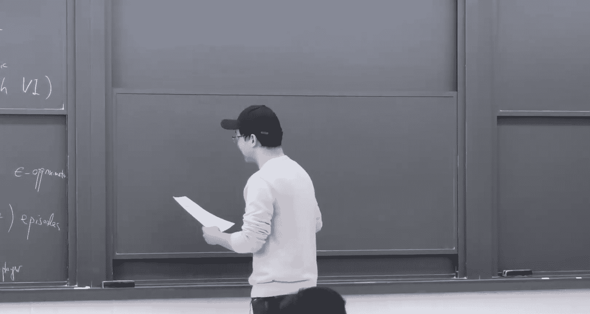
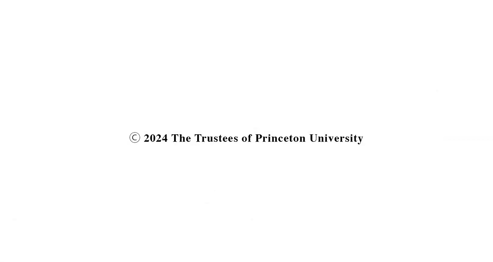

#  020：多人一般和博弈


在本节课中，我们将要学习多人一般和马尔可夫博弈，探讨多智能体强化学习中的独特挑战，并介绍一种名为V-learning的新型算法，旨在设计去中心化算法并突破“多智能体诅咒”。

## 概述

上一讲我们介绍了求解马尔可夫博弈的几种方法。我们讨论了第一种方法，即结合基于经典标准型的最佳响应算法与单智能体强化学习。虽然该算法很直观，但缺乏坚实的理论保证。接着，我们转向了第二种基于强化学习的方法，即直接进行值迭代，例如纳什值迭代算法。我们讨论了生成模型和在线探索场景，并介绍了乐观纳什值迭代算法，该算法通过使用上下界来处理一般和博弈中的相关均衡问题。

本节课，我们将首先回顾乐观纳什值迭代算法的理论保证，然后深入探讨多智能体强化学习中两个独特的核心挑战：“多智能体诅咒”和去中心化算法的设计。最后，我们将介绍一种名为V-learning的新算法，它结合了值迭代和无悔学习的思想，为解决这些挑战提供了新的思路。



## 乐观纳什值迭代算法的理论保证

上一节我们介绍了乐观纳什值迭代算法，本节我们来看看其理论保证。

该保证表明，以高概率，乐观纳什值迭代算法能在以下数量的回合内找到一个ε-近似纳什均衡：

**公式**：`Õ(H³ * S * A * B / ε²)` 回合

其中，`H`是时间步长，`S`是状态数，`A`和`B`分别是最大玩家和最小玩家的动作数。最重要的区别在于，样本复杂度取决于两个玩家动作数的乘积 `A * B`，这相当于所有可能动作组合的总数。

这个定理的重要性在于，它证明了我们拥有一个多项式时间和样本复杂度的算法来求解纳什均衡。然而，一个自然的问题是，这个界限是否最优？

信息理论下界可以证明为：

**公式**：`Ω(H³ * S * max(A, B) / ε²)`

在下界中，我们只需要支付两个玩家中最大动作数的代价，而非乘积。这引出了多智能体强化学习中的第一个独特挑战。

## 多智能体强化学习的独特挑战

到目前为止，我们似乎只是直接借用了单智能体强化学习的方法，将最大化操作替换为求解纳什均衡。然而，在多智能体设置中，我们面临着新的挑战。

### 挑战一：多智能体诅咒

在两人零和博弈中，样本复杂度随双方动作数的乘积 `A * B` 增长。在多人（M个玩家）马尔可夫博弈中，如果直接将纳什值迭代算法扩展到多人场景，复杂度将变为所有玩家动作数的乘积：

**公式**：`Ω(∏_{i=1}^{M} A_i) ≈ Ω(A^M)`

其中，`A` 是每个玩家的典型动作数。这显然随玩家数量 `M` 呈指数级增长。原因在于，这类算法需要维护一个联合Q值函数 `Q(s, a1, ..., aM)`，其表格大小是状态数乘以所有玩家动作数的乘积。因此，估计这样的Q值需要支付指数级的代价。问题是，我们能否超越这类算法，获得多项式复杂度的解？

### 挑战二：去中心化算法的设计

像VI-ULCB或纳什值迭代这样的算法需要一个中心化服务器来计算联合Q值。然而，在实践中，我们通常更青睐去中心化算法。

以下是去中心化算法的理想形式：
*   **每个智能体独立运行自己的算法**。
*   **仅使用自身的观察信息**，就像在单智能体设置中一样。

我们关注去中心化算法的原因如下：
1.  **易于实现**：只需设计单智能体算法，然后复制给每个智能体。
2.  **更具通用性**：算法不关心其他智能体的行为，对其他智能体的动作具有鲁棒性。
3.  **通信开销低**：无需中心化协调，因此几乎没有通信需求。

因此，多智能体强化学习中的一个核心问题是：

**我们能否设计一种去中心化多智能体强化学习算法，同时突破多智能体诅咒？**

在探讨解决方案之前，我们需要先简要了解多人一般和马尔可夫博弈的形式化定义。

## 多人一般和马尔可夫博弈

本节我们将形式化定义多人一般和马尔可夫博弈，其与两人零和博弈类似，但有一些关键扩展。

一个一般和马尔可夫博弈由以下元素定义：
*   **状态集合** `S`
*   **智能体集合**：共 `M` 个智能体。
*   **动作集合**：对于第 `i` 个智能体，其动作集为 `A_i`。
*   **转移函数**：`P(s_{h+1} | s_h, a_h)`，其中 `a_h = (a_{h,1}, ..., a_{h,M})` 是联合动作向量。
*   **奖励函数**：每个智能体 `i` 有自己的奖励函数 `R_{i,h}(s_h, a_h)`。
*   **时间步长**：`H`

策略 `π_i` 是第 `i` 个智能体从状态到其自身动作分布 `Δ(A_i)` 的映射。联合策略 `π = (π_1, ..., π_M)` 下的值函数 `V_{i,1}^π(s_1)` 表示智能体 `i` 的期望累积奖励。

在博弈论中，我们寻找均衡解。对于多人一般和博弈，我们可以定义纳什均衡。

**纳什均衡**定义为一个乘积策略 `π* = (π*_1, ..., π*_M)`，使得没有玩家有动机单方面偏离自己的策略。即，对于所有智能体 `i` 和所有可能的策略 `π_i`，有：
**公式**：`V_{i,1}^{π*_i, π*_{-i}} ≥ V_{i,1}^{π_i, π*_{-i}}`

然而，即使在标准型博弈中，寻找一般和博弈的纳什均衡也是PPAD难的，没有已知的多项式时间算法。因此，我们通常使用替代的均衡概念，如相关均衡（CE）或粗糙相关均衡（CCE）。

**乘积策略**与**相关策略**的区别在于：
*   **乘积策略**：每个智能体独立地根据各自的分布选择动作。联合分布是各边缘分布的乘积。
*   **相关策略**：存在一个中心化的映射，从状态直接输出所有智能体的联合动作分布。这个分布可以包含智能体动作之间的相关性。

**相关均衡（CE）** 和**粗糙相关均衡（CCE）** 都是针对相关策略定义的均衡概念，区别在于玩家偏离时能否观察到中心化随机源的采样结果。它们都比纳什均衡更容易计算（通过线性规划），并且满足包含关系：纳什均衡 ⊆ 相关均衡 ⊆ 粗糙相关均衡。

现在，让我们回到核心问题：如何设计去中心化算法并突破多智能体诅咒。

## 从标准型博弈中汲取灵感：无悔算法

要设计去中心化算法，一个朴素的想法是让每个玩家独立运行单智能体算法（如Q-learning）。但问题在于，在其他智能体也非平稳且自适应的情况下，将其视为平稳环境是不正确的，这类算法通常无法收敛到有意义的解。

在标准型博弈中，这个问题的答案是使用**无悔算法**。

核心思想是：设计一种即使面对**对抗性对手**也能保证性能的算法。这种算法被称为无悔算法。

无悔算法的定义是：对于任意对抗性选择的损失序列 `{l_t}`，算法产生的动作分布序列 `{μ_t}` 满足以下**次线性遗憾**保证：
**公式**：`∑_{t=1}^T μ_t · l_t - min_{a} ∑_{t=1}^T l_t(a) ≤ o(T)`

一个著名的无悔算法是**EXP3**（用于对抗性多臂老虎机）。其伪代码如下：

```
初始化：对于每个动作a，设置权重 w_a = 1。
for 每一轮 t = 1, 2, ..., T do
    1. 根据分布 p_t(a) = w_a / (∑_{a'} w_{a'}) 选择动作 a_t。
    2. 观察到损失 l_t(a_t)。
    3. 为所有动作a计算估计损失：
        \hat{l}_t(a) = l_t(a) / p_t(a) 如果 a == a_t，否则为 0。
    4. 更新权重：w_a ← w_a * exp(-η * \hat{l}_t(a))。
end for
```

EXP3算法可以证明满足 `O(√(A T log A))` 的遗憾上界，其中 `A` 是动作数。关键在于，这个保证对**任何对抗性损失序列**都成立。

在标准型博弈中，如果每个玩家都运行某种无悔算法（不需要协调具体算法），会产生以下结果：
*   **两人零和博弈**：时间平均策略 `(1/T ∑_t μ^1_t, 1/T ∑_t μ^2_t)` 会收敛到一个纳什均衡。
*   **多人一般和博弈**：时间平均的联合策略 `1/T ∑_t (μ^1_t × ... × μ^M_t)` 会收敛到一个粗糙相关均衡（CCE）。

最重要的是，每个玩家的遗憾只依赖于其自身的动作数 `A_i`，而与联合动作空间大小或其他玩家的动作数无关。因此，这打破了“多智能体诅咒”。

## 扩展到马尔可夫博弈：挑战与V-learning算法

既然在标准型博弈中无悔算法如此有效，一个直接的想法是：能否将其扩展到马尔可夫博弈？

我们希望在马尔可夫博弈中也能实现无悔保证：即对于任何对抗性对手的策略，我的策略序列 `{π_t}` 满足：
**公式**：`max_π ∑_{t=1}^T V^{π_t}_1 - ∑_{t=1}^T V^{π}_1 ≤ poly(H, S, A) * T^{1-α}`

遗憾的是，答案是否定的。由于时间步之间的状态转移和长期依赖，在马尔可夫博弈中实现多项式依赖的无悔保证被证明是不可能的，其下界包含对时间步长 `H` 的指数依赖。

但这并不意味着设计去中心化算法和突破多智能体诅咒的任务是徒劳的。关键洞察在于：**设计无悔算法是一个比寻找纳什均衡或CCE更难的任务**。我们无法设计出完全无悔的马尔可夫博弈算法，但我们或许可以设计出能找到均衡（如CCE）的算法。

这就引出了**V-learning算法**。

V-learning算法的核心思想是：**将值迭代的思想与状态层面的无悔算法相结合**。

以下是V-learning的简化伪代码框架：

```
初始化：对于每个状态s和步数h，初始化 V_h(s)，并为其维护一个独立的无悔老虎机算法（如EXP3）。
for 回合 k = 1, 2, ... do
    初始化状态 s_1。
    for 步数 h = 1, 2, ..., H do
        1. 在当前状态 s_h，使用该状态对应的无悔老虎机算法选择动作 a_h。
        2. 执行 a_h，观察奖励 r_h 和下一个状态 s_{h+1}。
        3. 更新计数：N_h(s_h) += 1。
        4. 更新值函数 V_h(s_h)：
            α = 学习率(如 1/N_h(s_h))
            V_h(s_h) ← (1-α) * V_h(s_h) + α * [r_h + V_{h+1}(s_{h+1}) + bonus]
        5. 为状态 s_h 的无悔老虎机算法提供反馈：
            损失或收益 = -(r_h + V_{h+1}(s_{h+1}))
            （算法用此更新其内部权重，从而更新策略）
    end for
end for
```

V-learning与Q-learning的主要区别在于：
*   **Q-learning**：维护Q值 `Q(s, a)`，策略通常是对Q值的贪心策略。
*   **V-learning**：只维护状态值 `V(s)`，没有直接的动作值。策略是通过为**每个状态独立运行一个无悔老虎机算法**来生成的。该算法根据从 `r_h + V_{h+1}(s_{h+1})` 获得的反馈来学习该状态下的最佳动作分布。

通过在每个状态层面利用无悔算法，V-learning能够以去中心化的方式运行（每个智能体维护自己的V值和状态策略），并且其理论保证可以避免对联合动作空间大小的指数依赖，从而有望突破多智能体诅咒。

## 总结

本节课我们一起学习了多人一般和马尔可夫博弈。我们首先回顾了乐观纳什值迭代算法的理论保证，并指出了其样本复杂度随玩家动作数乘积增长的局限性，这被称为“多智能体诅咒”。接着，我们探讨了多智能体强化学习的两个核心挑战：多智能体诅咒和去中心化算法设计。

我们从标准型博弈中找到了灵感，即**无悔算法**（如EXP3），它能在面对对抗性对手时提供性能保证，并可用于寻找纳什均衡或相关均衡。然而，直接将无悔算法扩展到马尔可夫博弈被证明是困难的。



最后，我们介绍了一种有前景的解决方案——**V-learning算法**。该算法巧妙地将值迭代与状态层面的无悔学习相结合，通过维护状态值函数 `V(s)` 并为每个状态运行独立的无悔老虎机来生成策略。这为设计既能去中心化运行，又能突破多智能体诅咒的多智能体强化学习算法提供了新的思路。在下一讲中，我们将深入探讨V-learning的理论保证，并结束多智能体强化学习部分的讨论。