# 普林斯顿大学《强化学习基础｜ECE524 Foundations of Reinforcement Learning Sp24》中英字幕claude-3.7-s p01 Lecture 1_  Introduction and MDP Basics.zh_en -BV1vewWeRE5X_p1-

Hello everyone， I'm Chi J， I'm mean from ECE departments。

 so this year we will be working together on this course called Foundations of reinforceinforment Learning。

 it's called Foundations but it's really the mathematical foundations of reinforceinforment learning。

And as you can see， and this course will be videotaped。

 but it's basically for like open lecture and for external students and you are still like very welcome to ask questions if you have anything you're unclear like free free to ask and they will be all very valuable。

We'll first do a very brief intro of the course and most of the course because it's like ready the mathematical foundation。

 most of the course we will do Blackboard like derivation and on the concepts。

 but just the very first lecture， well do a slightly like slides。Do a your overview。So。First。

 I want to talk about this is like foundations of reinforcement learning。

 I think in before like digging into the details of what is the mathematical foundations。

 we first should have some， something in mind。 like， what are the。

N goal or what are the applications we will develop like this reinforcement learning for。

 I think the modern reinforcement learning essentially has been applied to a wide range of areas。

 A lot of applications。 I would just say something like very famous and have been successful like partially successful in the field。

 I think the first thing you can probably say is like robotics like manipulation。

 if you have ever saw like recently like Google and Berkeley。

 a lot of institute has has announced this R T too， essentially。

 they can use like reinforcement learning and also some other methodology to extreme robot robots to manipulate on a lot of different objects and across different type of robots。

And robotics， I think I would say is a top one major application of reinforcement learning and the second thing is like the Starcraft or like this strategic game video games or I think I think it' like a prototype of this reinforcement learning。

 you probably have already heard of this Apha star which has been already several years and like Google Deep Min。

 they trained a very good superhuman AI， they able to beat the world championmp on this complicated video games where there are a lot of strategy involved in this kind of scenario and the last two applications you probably all well known the first one is Thomas driving and the second one is like a very。

 very hot last year chat GBT and they claim also to use some technology about reinforcement learning from human feedback in the last stage to fine tune this large language model。

So if you look at all those applications， what are the common things over those applications it really like all those complications involve to make decisions and not only just to make a single decision but to make a sequence of decisions so it's like sequential decision making problems So I would say the reinforcement learning is really the framework which is designed to handle those sequential decision making problems。

OkaySo those are like the fancy applications， but this semester we will dig more into like these foundations。

 so we will look more for what is underlying those applications like what is the mathematical principles that's going on like behind those applications so in order to talk about reinforcement learning。

 I think all those applications can be abstracted into this like diagram where basically we have agents and we also have an environment agent is essentially the learner or the AI we want to build which will take some action and this action will affect how environment is going to change or transition to the next stage where the next stage we call it like states so we will still states to describe the environment and in addition to states environment will also give us the reward so we can basically look at this chess game as an example where essentially the environment is this like chess board and agent is like for example we want to play this white piece。

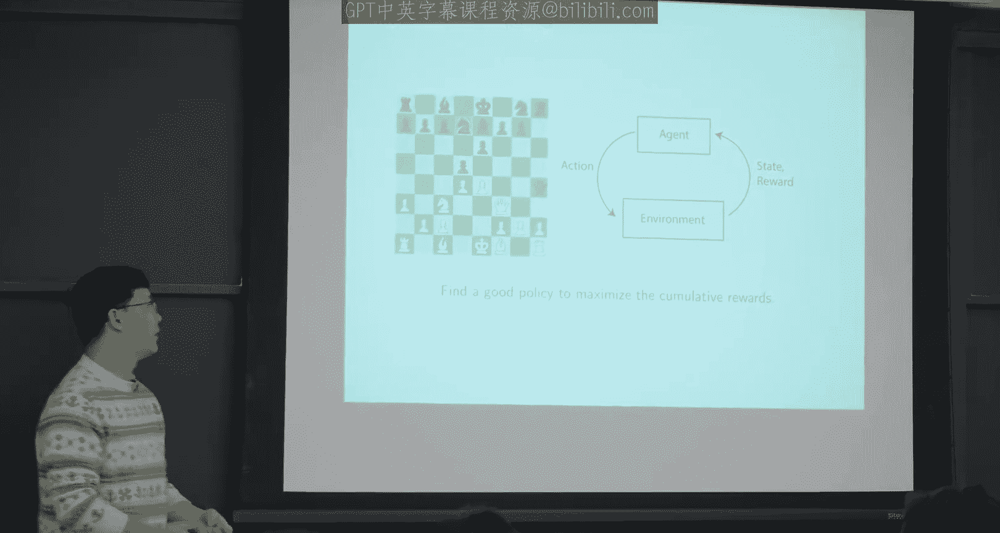

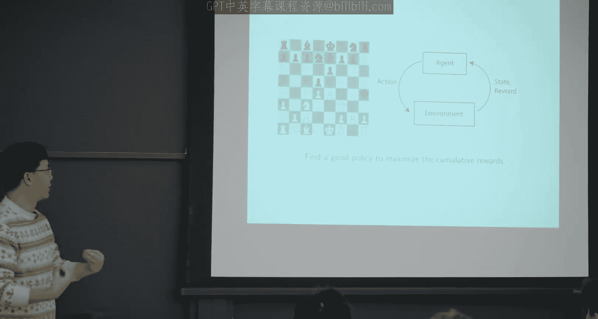

And the action we're going to take is like we're going to move specific pieces to some other location and the environment will change to the next days。

 which is essentially the configuration of this chessboard and the reward you can think reward is just like eventually if you win the game you get a reward one and if you lose you get a reward0。

😊。

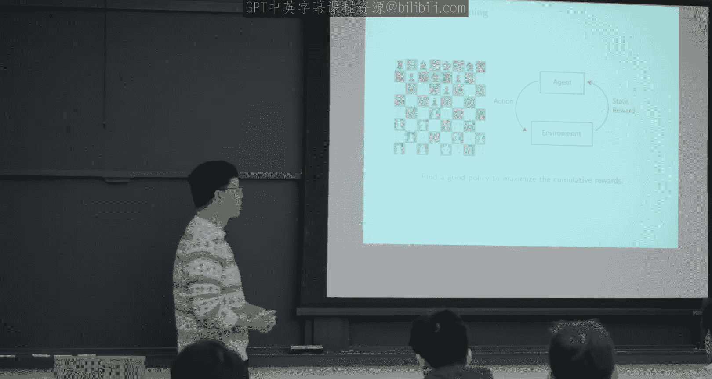

， and in general， reinforcement can be formulated as a find a good policy to maximize a cumulative reward。

So this is like a brief， very， very brief like introduction of what is the reinforcement about from the application and from like a little bit of the like the model underlines it。

So we， I think we'll briefly talk about what will be covered in this course about this reinforcement learning and will not be covered。

So first we will cover some mathematical models like underlying the reinforcement learning。

 like I think a big part of this course will be devoted to this so-called Markov decision process we will actually introduce this model later in this class but essentially will like very rigorous formulate how this sequential process goes on and what kind of quantity governs like how this states sort of the environment like move forwards and we will also consider a lot of different settings like simulator and setting we require exploration and also setting will require function approximation。

 something like that which essentially we will also essentially identify the challenges and also talk about the strategies how to how to solve those challenges I think challenges involve like sequential decision making so we handle a lot of like temporal correlation we will also talk about how to balance exploration versus explorationation which is very important。

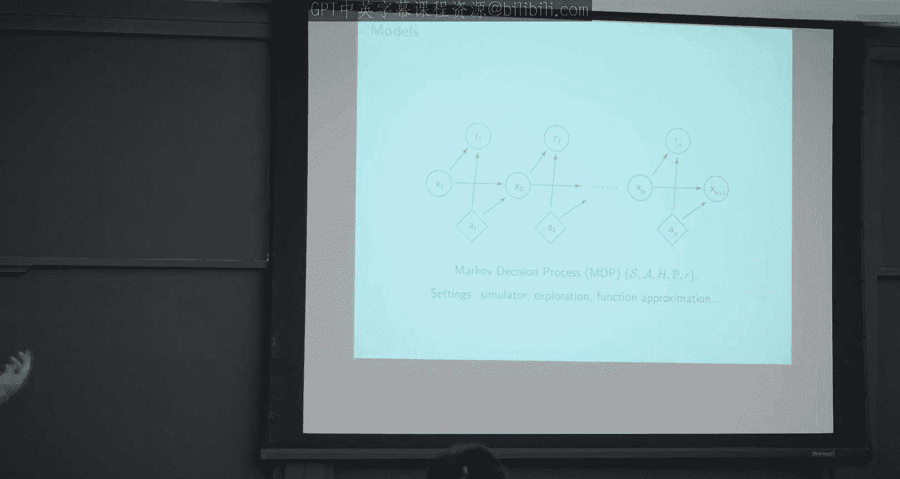

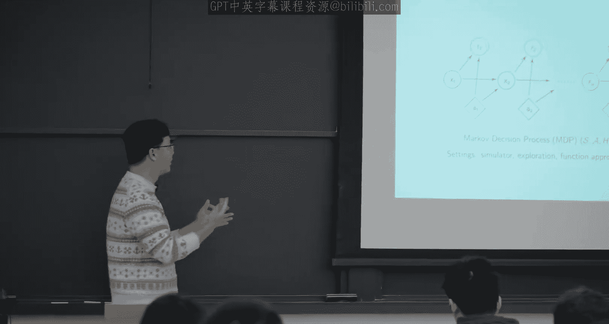

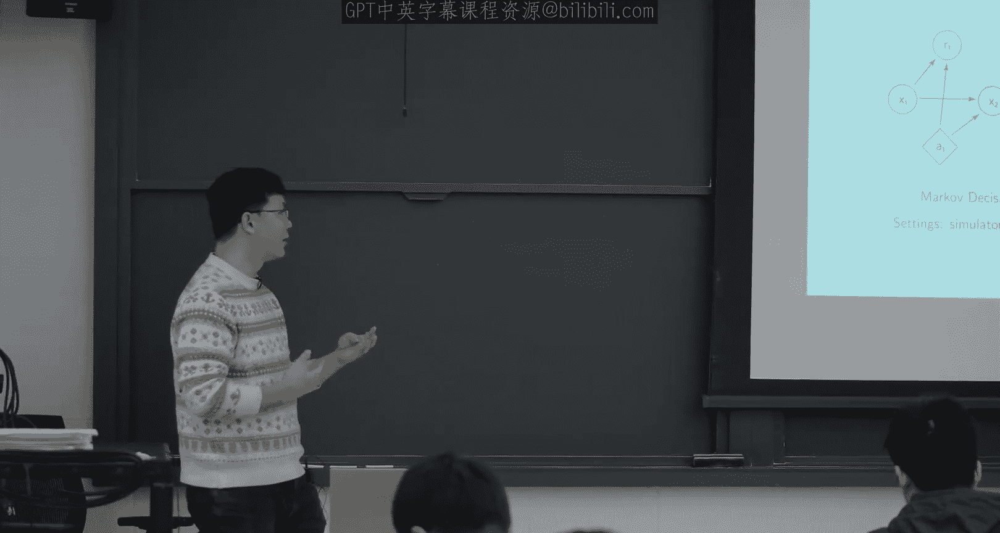

topicss in like the online decision making or online reinforcement learning where we need to collect samples or collect data by ourselves。

 We also talk about how to handle like the large states in the sense。

 like classical reinforcement learning always talk about we have finance states。

 but the real application like video games usually have like millions of states and how were gonna use function approximation to handle those challenges。

 And finally， we will also spend the last part of the lecture。

 of the semester talking about how to do like multiaging reinforcement learning。

 like the multi agencyency part collaboration and competition and finally。

 how were gonna handle some partial observability， like in the sense。

 some states may not be fully observable and we need to infer what is underlying states from the limited observation。

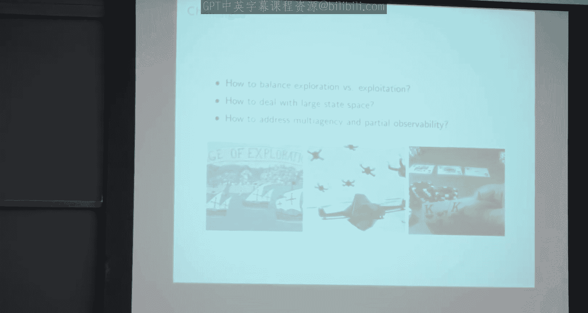

So we'll talk about a model， we'll talk about challenge and how to solve those challenges and also one very important part of the course will be devoted on like designing algorithms or talk about what kind of algorithm would work for those kind of to solve those challenges and the algorithms including the classical important like algorithm like value。

 cur learning and also function approximation like fiter curism and basically all the important reinforcement algorithm。

We will also talk about some additional algorithm component。

 which is not considered just directly like planning like the curing type of algorithm。

 but more like to help those like core reinforcement algorithms to success。 For example。

 like we talk about exploration versus exploitation。 So in addition to like evaluation。

 curing those like classical reinforcement algorithm。 we also need to do some exploration。

 So what is like principle way to do exploration And this course we will essentially like leverage socalled optimism principle and design some like upper confidence bound algorithm and combine is with standard reinforcement algorithm and show how those algorithm would perform and。

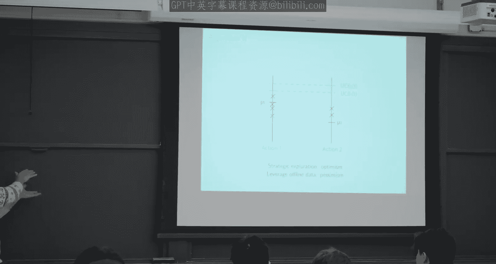

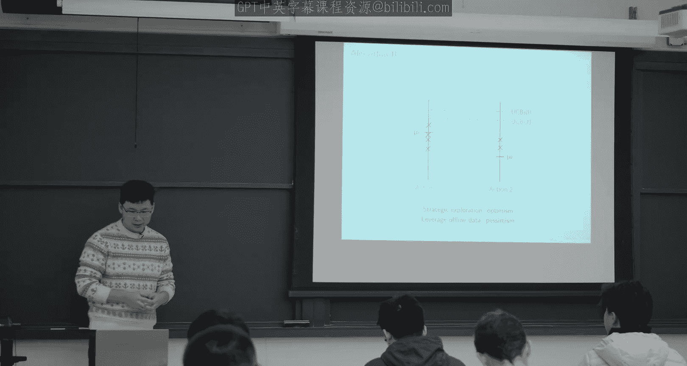

And also we will also talk about some offline scenario where we have a lot of data already available and we can use instead of optimism like pessimism。

 so those are the algorithms and algorithm design part。And finally。

 also the most important part of the course in addition to models and algorithm we'll also talk about theoretical guarantees。

 so this is really like the mathematical foundation part which really differentiate this course from a lot of other more empirical version of the machine learning course or reinforcement learning course。

 essentially we care about use mathematics to provide guarantees to algorithms say it always probablyably going to find the quantity or optimal policy or the quantity we want to find for like a wide range class of applications。

So what type of theoretical guarantees we will talk about in this class。

 I think I would say mostly we talk about two type of theoretical guarantees。

 The first type is like the sample efficiency sample efficiency is essentially says how many samples how many like its a statistical question like how many samples we need to learn the optimal policy of for example。

 autonomous driving or robotics So in terms of samples essentially like how many games we need to play like in the sense of if we do the starcraft as application or like how many trajectories we need to like。

Do like in terms of robotics。So classical algorithms or like was history of art。

 existing algorithm always require like a massive number of samples。

 easily go to like millions or sometimes even like hundreds of millions samples。

 and for a lot of applications like for example， harmm driving like collectapping samples can be really expensive。

 like you need to spend all gas and on those kind of applications and also it can be time consuming like one trajectory would take 10 minutes or half an hour or something like that。

 So in this kind of scenario， how to reduce sample complexityities like very important topics for for like those kind of applications。

 So that's why our theory would I think one very important thing like centered on this sample complexity really talking about what kind of sample complexity we can achieve and whether those are optimal。

 whether there are some better algorithm that can achieve like better sample complexity。

The second part， second kind of guarantees I will talk about is the computational efficiency okay so I think I would say like in general。

 machine learning is just statistics and computer science。

 so statistics are like corresponding to aemble capacity and computer science more less corresponding to like computational efficiency and state of art models usually like train in weeks and a month if you already know like theres a big projects are of our start。

 they need like the entire Google Deep Min cluster and they actually trace like several weeks which basically in academia we can never like we can now really do something like that。

 So how we can reduce this competition efficiency and eventually make it more manageable or more like。

More accessible to like academia or like even the daily computing， that kind of thing。

 So this is also another important topics in our theory。Okay。

So those are things we will talk about in this class and more importantly。

 we will just do everything very rigorously in math and using proofs。

And we will also talk about what we will not talk about in this class。

 because we really devoted to this math。 and like the proofs， I think， including some。

Coding projects or everything would make this course like too too big and too much and so we will not talk about anything about like coding some real real algorithms like for some like benchmarks or we will not have like any coab for this course。

O。Just to summarize and I would like to say this is like a really advanced grad level course on mathematical foundations for reinforcement learning so this is supposed to not be like some intro level like your first course in machine learning or something I don't think that will be a good idea I think we talk about we will cover mathematical models we will talk about different settings challenges we'll talk about algorithms and algorithm designs and most importantly we'll talk about theoretical analysis and theoretical guarantees in terms of both sample complexity and computational complexity。

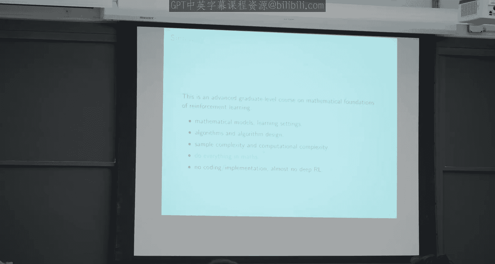

And we'll do everything in mass。 And finally， there's no coding or implementation。

 and we will talk a little bit about some DP algorithms。

 but mostly like from the algorithm formulation part and why it works。

 we will not implement those DP algorithms。 So if you really want to like learn some implementation。

 I would say probably this is not the course for it。Okay。

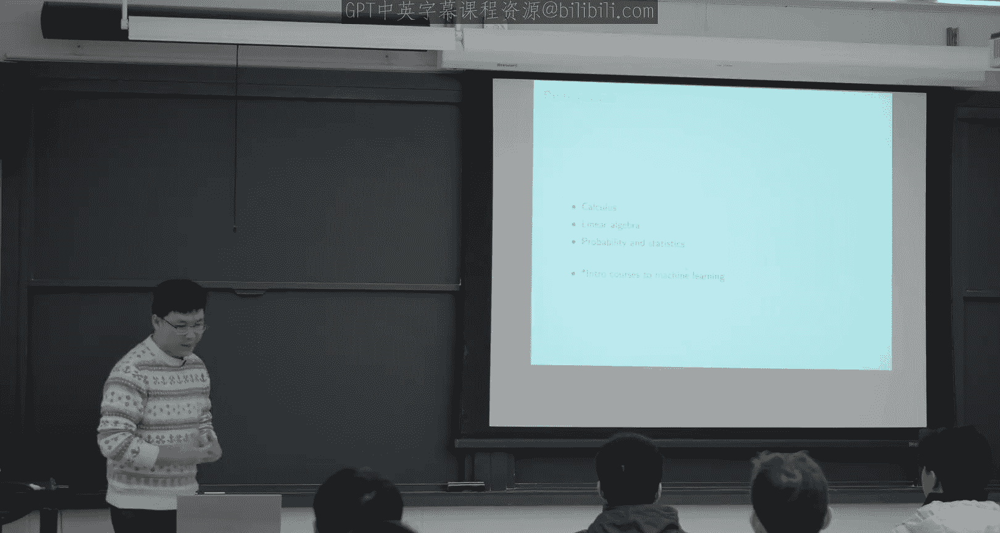

And finally I will want to talk a little bit about the prerequisite for like because we're establishing this like mathematical foundations。

 so we definitely need some mathematical backgrounds and I will say most of the course will be essentially self-con which just require some like undergraduate entry level like mathematics for this course So definitely like the basic calculus and linear algebra or very important and we'll use a lot of this course will gradient like integral or something like that and I think one more thing very important is like the probability and statistics。

 I think undergraduate level is fine， we don't really need the gradual level probability or statistics。

 but I think you at least need to know like all the concepts of like what is probability。

 conditional probability， marginal probability like expectation that kind of stuff and I think some some exposure or some knowledge of so process like Markov chain would be important would be helpful but it's not。

We essentially will cover that kind of probability here。And finally。

 I would say some intro level previous， if you have take some intro level course to machine learning。

 I think those will be recommended， it's not like harder to require。

 but I think usually I would personally say like because we're doing the foundations。

 usually it's very good to have。ATarget application in mind。

 So have some sense what we are actually doing like like besides like those mathematical derivativerivations。

 we have like some intuition of what kind of application it is and what we are talking about using this math。

 So I would say the intro course is really recommended， if you have not taken this course。

 And if you're taking this course as like the first machine learning course that will be a little bit challenging。

Okay。I think this is essentially everything I want to say about some brief overview of the course。

 any questions so far？

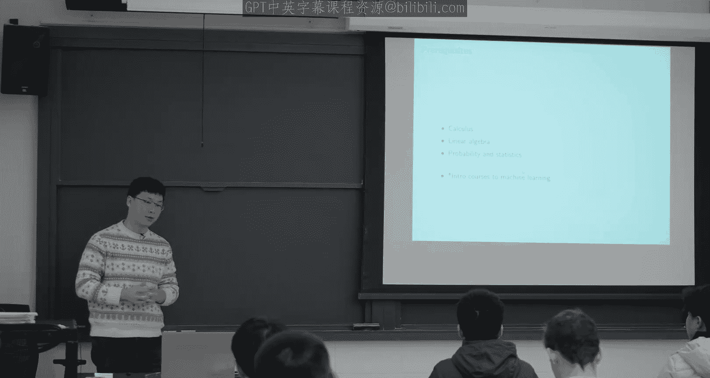

If no questions， we will talk about some logistics of this course。

And you already know the time and sorry， maybe let's do a bit bigger。How about this？ Yeah。

 you already know the little slightly。We already know the time and the location of this course and I'm the instructor and Wen Hao Z is the TA for this course and our office hour will be announced this week。

And as we already said， the content of this course is really just a mathematical foundation of reinforcement learning。

 and we' mostly doing theorems and proofs。And about the grade of this course and this course essentially will just have five problem sets and one final exams that will consist of all the grades and five problem sets will consist 60 percentage of the grades so like 12 percentage age and a final exam will take up the 40 percentage of the entire grade and our policies like we hope there's no late homeworks and if there's really something emergent and please like send me email at least several days earlier like several days prior to the deadline like please don't send me like the last minute like email saying like I want some extension and maybe I didn't see the email and I didn't reply and then say something about that。

And as you already said you already saw like we will videotape the lecture and we will also update。

 there are some preliminary version of the lecture notes which is scribe notes in 2020 and you can look at the course like if you go to I think this course website is on my homepage and if you go to Te they are like ECE524 and theyre like previous version in 2020 version there are a lot of like lecture notes I think the big part of the course will based on those lecture notes and we will also post updated lecture notes for this semester which will fix some typos and make things cleaner。

And we will also post videotapes after the class， probably several days after the class。

And I just want to talk a little bit about syllabus like what we plan to do for this semester and this is mostly similar to previous years。

 but with some little changes in certain topics the first thing is as we all said we will have like five homeworks so starting from homework2 we essentially have each homework like do in every two weeks so that will consist of entire five homeworks and I think the course will divide it into two parts the first part is like really basics of reinforcement learning and I want to talk about all perspective reinforcement learning in some like very clean setting so we can understand those those each perspective very cleanly and very clearly so I think the first half of the semester will be focused on the tabular MDP by tabular MDP really means the Markov division process which has like finite number of states and a finite number of actions so the first week we will talk about some intros well talk about。

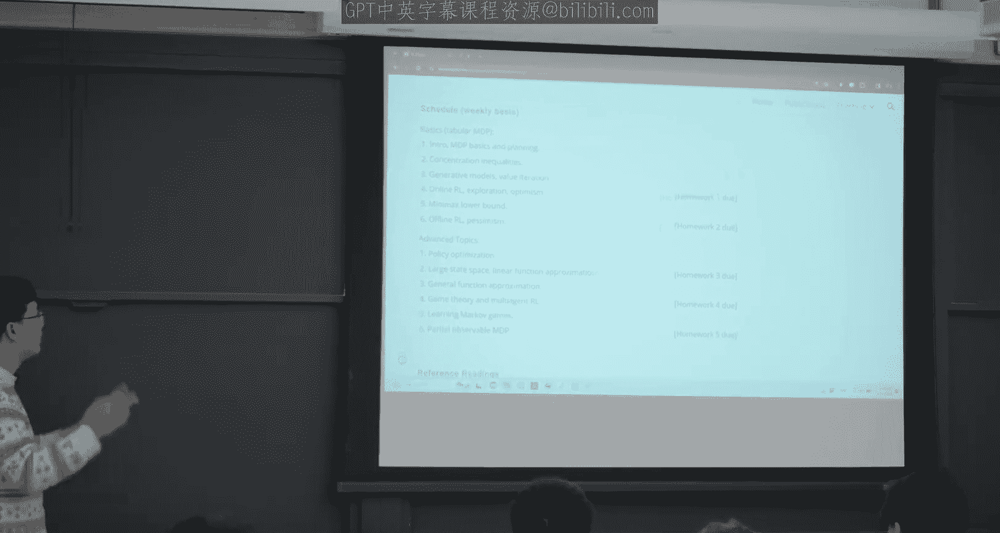

Basics and planning algorithm essentially how to find an optimal policy based on the transition and the rewards。

And starting from the second week we will then talk more about the learning perspective。

 which essentially we need to learn the MDP or learn the transition rewards from the data where whenever we talk about learning we need some statistics and probability tools so from the second week starting from second week we'll first talk about the mathematical tools which we require to do this analysis which is concentration inequ quality and some like union bound。

 something like that， and then we will just jump to the direct most important different settings and how we going to establish the guarantees the first setting is called generative models or the simulator which is really the easier setting for reinforcement learning like in terms of learning perspective and then we'll talk about twopart which is online learning and offline reinforcement learning online reinforcement learning we'll talk about this like tradeoff between exploration versus exploitation and we'll talk about the optimism principle how this is really helpful。

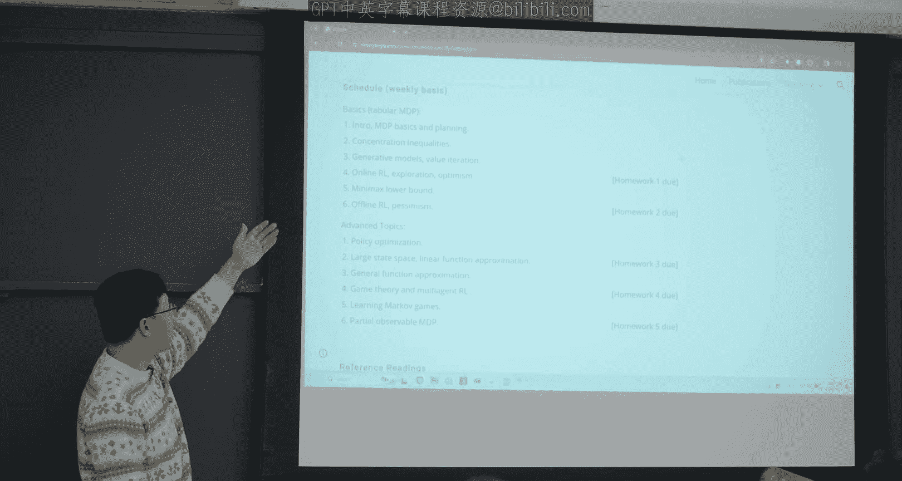

for online reinforcement learning。And offline reinforcement on the country will do the pessimism。

And in the middle， we will also talk about the minimax lower bound。 essentially。

 as we said in in the previous slides， one very important thing is a sample complexity and we provide guarantees on how many samples when you learn for specific algorithm。

 But the other thing very importantly is we also know like whether this algorithm we design is already the optimal。

 whether there's some better algorithm can achieve like better sample complexity or better competition efficiency。

 So the lower bound essentially is developed to answer those questions will see for certain class of algorithm。

Certain type of certain number of sample complexityities like really require theres really no algorithm can kind circumvent that kind of sample complexity。

 So this is like to say some algorithm is tied。 Some algorithm is optimal。Good start。

And the second part of the lecture， really， after the spring break。

 well talk about more advanced topics。 Okay， some advanced topics。

 including like we want to do policy optimization， which is like more similar to the practice like PPO algorithm and how we accept some guarantees for those policy optimization type of algorithm。

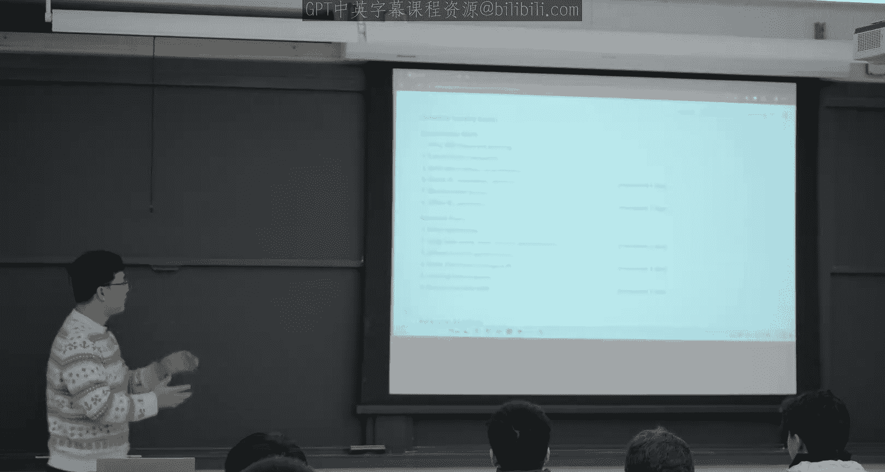

And then we will talk about the challenge of like how to handle in the large state space。

 which is really beyond those classical tabular setting where we assume we have finite number of states and so in this large stage setting we'll talk about like for example。

 if we have infinite number of states and how we're gonna handle those kind of scenario。

 which is really the key concepts as so- called function approximation。

 we will approximate value or policy like use some smooth functions where we'll talk about linear function approximation and general function approximation。

 those are like some abstract concepts which just give you some brief idea of we were gonna talk about if you don't know this concepts。

 it doesn't matter， we will talk about those concepts when we go there。

And the final three week of the course will be devoted into some like other additional challenges in reinforcement learning like the two weeks well talk about some game theoretical perspective。

 like multiage reinforcement learning， what are the mathematical models we can study for multiage reinforcement learning and what is algorithm and guarantees and the final week will be devoted to partially observable scenario we will talk about partially observable MDP and what are algorithm and guarantees。

Okay。Any questions about this like a brief syllabus and schedule？Yes， final exam is take Home。Sorry。

 the question is whether final exam is take home or in person。

 just take home and usually will spend like several days。

And you can spend as much as time you want for the take home exam。Okay， and finally。

 I just want to briefly talk about some reference readings like besides what we what we the lectures we give。

 I think the first draft is really what I would recommend it。

 I think it's probably the most relevant readings like complementary to this lecture and it will talk about I think probably not much about multiagent and partially observable。

 but all the previous parts I think have some similar type like chapters talking about some some similar contents。

 and I think although the formulation will be slightly different like they will use infinite horizon thing and we will usually use like finite horizon formulation。

 but I think more it gives you some alternative viewpoint on like roughly similar。Type of contents。

 So I think this will be the most relevant readings if you really want to like read some other materials。

 but I think most like for the most part of lecture will be self- contained。

 we really don't require a lot of like additional reading。And also。

 some other very good textbook I would recommend， like including the reinforcement learning and introduction from Richard Sutton and Bartto。

 I think this is really the intro to reinforcement learning book。 I also read this book。

 Like when I first started like learning reinforcement learning。 I think the book has a lot of。

About like application formulation and algorithm didn't talk a lot about the。

Didn't talk a lot about analysis or guarantees， but I think as an intro level like a textbook。

 this is really awesome and I think also two additional book from Chaba。

 which has a lot of bandits and like techniques in this book。

 which I would also recommend and this banded algorithm tour and Chaba and if you really want to do this research。

 especially like graduate level research in reinforcement and learning and I think one very important part is like a basic case like bandit。

 this banded algorithm book really gets very comprehensive like every different settings and how you're going design algorithm and what kind of guarantees you can have for different scenarios。

And the last two will be some compliment readings for the second week material about the concentration inequality where essentially as we introduce some newest probability tools to study those MDP and learning MDP problems and if you feel you want to learn a bit more about concentration inequality。

 you can read like those two text to like survey or textbooks。There are some related courses already。

 I think this course is like I've been giving this course。

 this is my third time giving this course and initially we designed this course in 2020 and since then there are already a lot of like reinforcement course happening at different university including like UIUC I think this is Cornell。

 this is MIT so different courses have like different flavors I believe the first two course are mostly about like the first draft and Dylan and Alexandra Rackling's course will be more in terms of statistical flavor they will introduce like more advanced they will be a little bit more advanced tools I think I personally feel a little bit too complicated and I can I will briefly mention those and we will now focus on this in in this class and finally like Alexagro and Alex Svins and also give this like Bennetts and reinforcement learning course。

And there will also like some more empirical version or practical version of the course， for example。

 like Sergey gives deep reinforcement learning course at UC Berkeley and there I'm sure there are like a bunch of other like deep reinforcement course at Berkeley at the Prince in this semester will also have like intro to reinforcement learning course which should target like both I think junior graduate level and a lot of undergraduate level which will talk a lot about like。

empiricalm， like some， some case study and some。Some real applications。

 I think if those are like what interests you， you can also like look at those materials。Okay。

 and that's all about the logistics。Any questions？Yes， do you use canvas。Yes。

 we will actually upload all the homeworks in Cans and also your solution also should be also uploaded to like Canvas。

Thank you。Okay， if no lot of questions， we will directly start the lecture。Ohpe。Okay。

 so let's directly。Jump into like， the。Mathematicical foundations。

 So first talk about the MP formulations。So the MDP， we really stand for the Markov decision process。

So we mentioned in the intro， I think this is like the mathematical model。

 which underlines essentially everything we're going to study for reinforcement learning and we'll spend most of this semester like focusing on learning different perspective and different setting of this MDP。

So we will take some steps to eventually introduce this MDP。 okay， so we'll first talk about。

 as we already said， the reinforcement learning in general is has this diagram， we have the learner。

 we have the agents。And we also have the environments。

An agent is essentially the learner or the decision maker is going to take some action。

To affect the environment。An environment is going to send some feedback。To the agents。

And in the intro slides， we kind of say this feedback into including stay and reward and we'll talk about those things。

Later on， but just in general， we have that like this interaction loop。

So in order to to introduce this MDP formulation， I would like to first talk about some。

Easier like a model， which basically is some special case of MDP and we were starting from there and we adding one by a little bit by a little bit and eventually we go to the MDP and we will see what its about。

So I think the first basic model I want to talk about is called a multi arm bandit。

So what is a multiam banded problem，Essential， imagine youre going to a casino and you are faced with a so called K arm banded machine。

So what is this current bend machine essentially youre presented with K arms？Okay。

 this is like arm 1。 This is arm 2， and this is arm 3。 And now you have like arm K。

let's say they're connected by a single machine。And so every time you require to pull one of the arm and you're getting some reward。

 essentially， you're getting some coin out of this bending machine。

So let's suppose we are under this model so that when I pull the arm1。

 I will get in some stochastic reward， essentially the amount of coin I'm going to get is sampled from some Gaussian distribution。

This is like Gaussian distribution。With some reward one one as a， as my。

Is the mean of the Gaussian distribution and Sigma square as the standard as as like the variance of the Gaussian distribution。

 And this is like。I'm going to getting in some stochastic reward from the first arm if I pull the first arm and the stochastic reward is going to sample from the Gaussian diffusion with m R1 and variance sigma squared。

And if I pull arm 2， I'm going to get a stochastic reward that is sampled from Gaussian distribution with Ming R2 and sigma square as a variance。

And similarly， if I gonna sample from。If I going to pull the last arm arm K。

 I'm gonna get a sastic reward， which is sampled from Gaussian distribution with M R K and Sigma squared。

Okay。So in this case， you can imagine every time I pull an arm I get some stochastic reward and the final goal of this multiar bandt。

One of the goal is we want to identify the best arm。Essentially。

 we know because this is like each reward is assembled from Gaussian。

 and which best armor can be defined as the arm with highest mean reward。Okay。

And so for this kind of problem， we can see this we can call this as like a multi arm banded problem。

Where we can specify the multi uned problem by two elements， one is the action set。The， u。

This is action sets。Which in our case， is essentially the 12K。

We can also we also require to specify the reward in terms of this the reward distribution。

So those two elements identify what is the multiam managed problem。Okay。

So we are starting the very basic setting and to make it slightly more complicated for the next setting。

 So the next setting we will talk about is so calledled contextual multi。

Or people just call it contextual bandit。So what is contextual mode I'm Ben about？

So this multihand benefit just says I have1 K arm band version。

So suppose contextual me arm multi arm band can like tells you in instead of having just one machine。

 I have like a， like a multiple like this K arm banded machine。 So， for example。

 I have a first machine that is the。Like， for example， this is like blue by name machine。

We also have a red band machine。That is also like K arm bandending machine。

We also have a yellow band machine。So the contextual multi Ben has the following interaction protocols。

So we interact this with this like a connection multi on vanish in K rounds。 So for each round， K。

From 1，2 to a bunch of phone numbers。So environment。We'll first pick a context。S， and in our example。

 this context S is just like whether it's blue or red or yellow。

And then the agent will take an action。And finally。

 the environment will reveal the stochastic reward。

So essentially I have some environment iss playing with me and he will first ask me， oh。

 you should first play the blue band machine and then I will pull one arm and then he next tell me I you can only play like the red band machine and then we pull another arm from the red band machine。

So the goal in this scenario。Of course， is identify。The bass arm。For each content， for each。

 for contact。Or sometimes later in MDP， we use the language call call like state。

Essentially， what I want to learn is like if you tell me to play the blue bend machine。

 I want to know which arm is the best for blue band machine。 and on the other hand。

 I also want to know which arm is best for the red and which arm is best for the yellow one。

And in this case， we can essentially， like mathematically describe what。

 what is like the object of this， like identifying the best arm for the， for each context。

 we can call it optimal policy。Essentially， this is equivalent to。And optimal policy。

Wry how we define the policy， policy defined as a map pi。Which we map each context。

Where the set of complexs is s。To the action set a。This is a deterministic policy。

And sometimes only in the very last part of the lecture， like in some multiian scenario。

 it's also beneficial to consider the randomized policy where essentially it's not only just a map states to action set。

 but you map states to some simplex over action like this is a probability probability space over action。

 essentially you will map states to like to our probability， for example， I will have a 0。

5 probability play action 1，05 probability play action 2， like this is like the probability simplex。

Overaction。And this is for run randomized policy， So policy。Okay。

So we haven't set it here like a contextual band， multi on Ben。

Can be essentially specified by the same thing。 We have action set， and we have reward distribution。

 And the additional thing we have is like the compact set。It's like comeex it。Okay。

So you can think this second model， the contextual multi essentially has a state version of the multi arm。

 it's not only just a single betting machine， but it has a different betting machine in it and the different betting machine is like described by this state or the context。

O。Any questions so far about this model？I want to introduce this model because also later later in the later phase of this course。

 like when we develop some very complex complex like solutions for reinforcement learning or reasonably complex solution for reinforcement learning。

 it's always good to keep in mind like those are the special case and if you fail like if you feel like very difficult to understand some concepts for MDP of reinforcement learning it will be very beneficial to go back to a simple case to understand how it works first for like Mo and ban and connection Mo and Benit and then think about how it works for MDP and then you have a deeper understanding of everything。

Okay， so yeah， yes， please。 Oh So in the map， does R have like a larger size than in the normal。 Yes。

 the question is in the contextual modium band is， is R like has a like is R different from the modium band bended。

 Yes， I think this un benefit just this R is a reward distribution of every arm。 And now this。

 this R need to be the reward distribution for every arm and every different motion。

 different context。 So it's larger。Quite。Yes。What is。It dress。Previous letter。Yes。

 state space in this example is just the blue， red， and yellow。Essentially。

 different vending machines select the state space。Okay。So finally。

 we will talk about the markov decision process。So we will use a lot of。Notation for it。

 So it has some contact set or stay set us。It has a。Action set A and reward。 And in addition。

 it has some transition。 and H， well talk about what are those later， okay。

So I think the most important thing this macro process is trying to model in addition to this compactual multi embedded is some temporal correlation。

Essentially， we want to say the action。Would have some influence。On the future state。Essentially。

 the were now no longer just repeatedly play the same connectionual band， but where essentially。

 states will be。Like transitioned to some specific way。

 which actually depends on what kind of action you take。So we'll first talk about the protocols。

So it's an interaction protocol。In actionction protocol is kind of like similar。

 we have like different episodes for episodes。Okay， equal to one。T。遮倒。

I think usually it it's great if we can think some target applications。

 I think the card target application I have some sometimes in mind is like， for example。

 we are playing super Mario or we are playing some chairess。Essential。

 each episode is is like one pass of the game like you can think one episode is like we play from the start initial states till the eventually the super Mario in the case like the player die or something and we start another game that is like one episode。

And so think about your Maria how it goes。 The first is environment。Will reveal initial states。S 1。

Okay。And starting from initial states， we need to make a sequence of decision。

 and then the the state of the environment will transition into a bunch of like states in the future。

 So we had have another for loop inside。So this is a fourth step。H。From one dot do dot to capital H。

So imagine we're playing super Mario for like age steps。So at every step agents。

We'll pick some action。A H。Okay， is the action for H step。 We will use H as a。

Subscript H has denoted like the action the agent take for edge steps。And then environment。

Will transition。To the next states。S，H plus one。And give reward。Orange。So essentially。

 after we take some action， we can immediately see the effect of the action。 for example。

 in a super Mariio， if we eat some mushroom and the player like become bigger。

 and if we like jump into some。Some， some some like some different。

 And then like the player just died。 And so we will see how the environment gonna transition to the next days。

 and the environment will also give some immediate reward。

 This reward is like immediately given at a steps to。

 Sometimes it's called also called immediate reward。

So it will be much clear if we can illustrate this in terms of some diagram and how things works。

 So the environment will first start with some state S1。 this is like the initial state。

 Sometimes it says fixed， sometimes's a random sample from some distribution。

 and the player will take a1 as the first action。And the S1 and A1 will jointly determine。

What is the next states？The environment goes。And S1 and A1 will also jointly determine what is the immediate three reward I'm going to collect。

And then the process of the game goes on。 at the second step， essentially。

 I I know the the game transition to the S2， and I will take another action A2。

And S2 and A2 jointly determines the third states。The states at the third step。

 and then S2 and A2 also join to determine what is the intermediate reward we're going to get at the second step。

And we will say this goes on and goes on and on。 And eventually， until we reach the final states。

 And in this case， we consider the episodic setting。 So we just for simplicity。

 we consider each game has only H step。 So H is the final horizon of the game。

 So the game will stop after S H plus one is reached。 And then this is done。 Okay。

 this is like final lens MP。MDP usually is fantasticastic。What is Yes， yes。

 and we'll talk about how how theia involved here。Well the question is whether MDP is still classic and yes。

 we're just going to talk about it right now。So at the intuitive level。

 you can think this MDP is really just slightly more complicated version of contextual Ben a multi on。

 where contextual multi arm already have states and have action have reward。

 And now the thing different in MDP is like we now have additional have a transition。

Essential how the states is gonna change from S1 and to the first step to the second step to the third step and how the action gonna affect thoseEssential the transition。

 The P thing is the new thing in this MDP。 and we will talk more specifically about what are those things。

So well， we will formally define elements of MDP。So the first S。What we said is the set of states。

This set can be anything can be like1，2，3，4 Ti and and n states， or like you can say， it's blue。

 yellow or something。 It doesn't really matter， but it's just whatever the states you have。

 and this is a set of states。And also， a is the set of action。Fin of actions。

So what type of actions you can take at each different states。And for simplicity。

 we will talk about R where we say this R is just a reward function。

Essentially R is defined as each individual RH。You can think his R is orange。Where R is。From 1 to H。

WhereRH is a map from state。Aa。To something， let's say 0 to1。So essentially。

 it's a map which take a state and action pair and map to some real value in 0 and1。

 which this is just normalization condition， we say。you can pick some other number。

 but just for normalization， we say reward is always restricted to like0 and1 range and essentially the number RHSA is the reward we're going to receive if we're currently at S state S and we take action A。

And I want to also say for simplicity， we consider deterministic reward here。 This is like a。So。

 so we no longer have like reward distribution。 We really just reward is' just a single function。

 And so this is like make it slightly different from the our multi arm bandit and connection multi arm bandit。

 I think the reason we can usually do this kind of thing here is because。

Because we will actually see the transition has some stoastic schastic in it and usually the transition in schity in transition is much more difficult to handle than the stochity in the reward。

 So usually like whatever the results or theoretical analysis we develop later。

 which works for stochastic transition will also and stochastic transition and de reward will be easily extended to the case of stochastic transition and stochastic reward。

 So this is like just for simplicity like we write this we can definitely handle the stochastic reward。

 It's just a little bit more complicated notation and we don't want to make everything more complicated。

So I think the key important part is this P， which is the transition matrix。Okay， so again， P is。

Because this is like episodic segmentdi。 So we have， we can possibly have each different piece。

 so each， each each step will have a different transition matrix。

Where the P is really the probability。P， H of S prime given S A。

This is really the probability of I'm going to transition to the next state as prime。

 given currently I'm at state S andm taking action A。Okay。嗯。I just just want to say it again。

 this is like the probability。 Maybe I should write it down。To transition to。To state as prime。

Given currently， Im at state S。And taking action。And finally， we have the last element that is H。

 which is just the length of the episode。Yeah， any questions？You subscribe the。Motion， because。

It can be different， yes。I think you can also make it the same， but that is basically a special case。

 let's just consider the more general case。So finally。

 I also want to comment a little bit about this is like seems like some generic transition。

 but why it's called a markov decision process， like what is the markov part for it？

Like why it's called a mark of digital process？I think a very simple reason is let's just consider the situation for。

For a fixed action sequence。Let's see this， this A1， A2 till A H is， is like fixed。

Then if you look at this diagram， if a12 are fixed。

 then this basically we just get rid of this like we we longer this will no longer play a role in this here because its just we already prefix this action and we look at the remaining chain This is like just S1 goes to S2 S2 goes to S3 and then essentially this remaining state forms a Markov chain。

So the， then the state sequence。Like S1 to S H plus one。Is a markov chin。

So for those of you who are not very familiar with stochastic process。

 I think one of very important Markov chain， like one of the very basic stochastic process you would learn in that class。

 and I think the most important property about the Markov。Chain is the inency。Okay。

So the independentlyency essentially says， for example。

 if this is just one chain and then condition on what happening in the in the current step。

 For example， if I condition on S 2， whatever happened before and whatever happened after is like independent。

So this essentially says condition on， for example， SH。

Whatever happened before S 1 till S H -1 and whatever happened after S， H plus1 till。

Till the last state， S H plus one， those two thing the probability distribution of those two。

 they set are like independent。So which was like a very important property。

 essentially the current states。Is already the sufficient statistics of the past if you want to make some prediction for the future。

 and we will sometimes leverage this property， this micro property in this MP where micro property is basically baked already in this in this assumption like the transition is assumed in this way。

 essentially the next states only is some distribution only condition on the current state and action。

 which is irrelevant to the previous days。 this kind of property already assumes this is like markov chain。

 so we already have this mark property here。Okay， any question about this is basic yes。

Since the matrix is changing over time， it's not homogeneous。 It's not necessarily time Yeah， Yeah。

 since transition is different at different age， so it's not necessarily time homogeneous。Okay。

So we yes。The question is that the number of states has to be finite。

 So I think in this basic formulation， I think for easy understanding。

 you can think it's like a finite set， but you can also like in this formulation。

 you can also make the finite set to be like countably infinite or incountably infinite or even like infinite and large later we were actually dealing with the case。

 which is infinite and large like a function approximation essentially the topic we were dealing with MP with infinite large number of states。

 So the answer is in this formulation， you don't necessarily require the coron of the status like finite or something。

 It can be it can be infinite large。Okay， so after we introduce the basic formulation。

 we will talk about a few very important concepts， which we essentially talk about those concepts throughout the course。

Okay， we'll talk about。3 most important concepts， called environment。Value and policy。Okay， so first。

 what are the。Essentially， when we talk about we want to learn the environment or we want to like understand like explore some unknown environment。

 So what what do we mean by like no environment and unknown environment in this MDP scenario。

 usually women environment just means the two property。

 like two very important quantities in this MP， that is this transition。P and reward R。So a lot of。

 later like different scenario will be like divided by like how we gonna。

 whether we know the environment and how we're going interact with the environment。

So there are a lot of different settings One it's like no environment where essentially we will just do planning。

 which is an easier setting。 And then the unknown environment can also be further divided by some like simulator scenario。

 We have like some very strong thing we don't， although we don't know the trans reward。

 but we have something very strong。 we can easily learn those transparent reward from or it's like more challenging setting。

 we can we can handle like this online scenario where we have to do this online interaction or or we have offline scenario where we can no longer interact with MDP。

 but we but we have access to some pre collecteded data。

 So basically a lot of different setting like a revolve around how we gonna assume about how to access to this environment。

And we will talk about more specifically about what kind of those setting later。This is like。

Learning from interaction。This is learning from pre collecteded data。O。

 so next we will talk about the policy。So if you still recall。

 like we already like kind of encounter the concepts of policy in the contextual bandit where the policy is just a map。

 mapping from states to action or distribution of action。Essentially。

 policy tells you at each states what kind of action you're gonna take。

So here the MDP is really just a sequential version of thisual contextual multi un bandit。

 so the policy roughly have like similar structure。So the policy is also a map。

And it's mapped not only like taking the states as an input。

 but also taking which step you are making this action as an input。And it maps from a stage space。

 And this H， H is essentially defined as a set of 1，2 da Q H， a set of integers， which is from1 to H。

 And so this pi is a map from S and each set to the action set。This is for deterministic policy。

 And you can also say for randomized or for stochastic policy， you， you map this too。

To the like a probability simplex of a。This is a。这是都开。So I just also want to say equivalently。

If you're not comfortable with this notation， we can also use some other notation。

 We will kind of also just use this interchangeably in the class。 According。

 we can also say this pie。Is a collection of H different policy。 Okay， essentially， we have a policy。

We have a different policy for different steps。And each page。Is a map。

From states to either action or the probability synax of action。

 depending on determinative policy or sto policy， This is essentially the equivalent of formulation。

 You can either do this pi as a map from S， H， or you can say have like H different functions and and each functions is just map from state to action。

Okay。I just want to emphasize a little bit。 this， this way of talking about policy is actually so called markov policy。

Or like basically I call the Marhal policy because the policy at every step H will only depend on the current states。

 essentially kind of use some mar property here， but we can also have some general policy。Okay。

 so general policy can be more complicated。 essentially。

 at H steps when I want to make some decision to take some action A， I have some more information。

 I not only have the current states， but I also can have like access to。

 I can also see the all the previous states and all the previous action。

 So the general policy is essentially I want to think out of box。

 Why not I just leverage all the previous information about history to make my decision。

 So the general policy is。Can be also defined as again， like this pi equal to pi H。From H1 to H。

 And the general policy， the only difference is like each policy。

Will no longer be defined from a map from state to action。

 but actually map from entire history to the action。 Okay。

 so the history in this case is something S。The set of S times a to the power of S H -1 times S。

To action and or the distribution over action。So what is entire history， entire history。

 essentially is the S 1， A 1， S 2， A 2， and the till finally S H。So which essentially is in this set。

So I want to talk about the general policy here， because I just don't want to have some like。

Some initial impression that a policy has to be some form like like this。

 and especially in the later stage， like when we talk about multi-ageian reinforcement learning or partially observable reinforcement learning。

 In fact， this is not this micro policy is not always good。 Like we need to， in a lot of scenario。

 talk about this generic policy。 We need to depend on the history。But for MDP。

 there's a very good property so that we no longer need to talk about this general policy。

 I think we will introduce in the next lecture， which essentially when we。

 if we want to talk about some optimal policy， that is the best policy。

 you can actually prove the optimal policy is always Markov。 Okay。

 so we will formally talk about this in the next lecture。 So that's why without。

 without loss of generality， we can always just talk about the Markov policy。

 and we can ignore the general policy for， for a very big part of the the course。Okay。

 any questions about this difference？O， so finally， we can talk about the value。

So we'll first introduce the value of policy pi。Of some policy pie。

So we introduce two types of values， one is called V value， the other one is Q value。

So we will denote that V value V H value at each value will be deed at each each different steps。

 And its it will only corresponding to one particular policy pi。

 and V value is defined on one state state， and Q value is defined on one state and action pair。Okay。

So the definition of this V value is essentially the cumulative reward。

If I start starting from status。At a stop edge。And the following policy pie。Okay。

So you can imagine this would be something like similar to the concepts。 For example。

 if you are playing chess and you really know what is the policy you are playing。 So， for example。

 you fix on policy and you will roughly have estimate。 Okay， So currently。

 I'm on this configuration of the board。 I like with this each different piece on different locations。

 I would like to know like， what is the probability。 I'm gonna win this。

Win this game starting from the current configuration。

 This is essentially like the the concept of a value， essentially， what is the future。

 what is summation of all the future reward you're gonna to get if you start from the current state S and keep following policy pie。

And similarly， the Q value is basically the same idea。

 The only thing different is instead of starting from some state S。

 you are starting from the state action pair。AS。And also， at step H and following policy plan。

So the only difference is this is like starting from S。

 So in the H step we are starting from the state S and this is in the H step we are starting from state S and immediate action。

 I'm going taking in this A action。 Well here the immediate action I'm going take is follow the policy pi this is the only difference。

 Everything else is the same。So any questions about this definition。

V value will also be always be Q value time time times times pi Yeah sumvation。

 We will talk about this relation it A。Isn't A always equal to pi F this A is not necessary。

 This A can be any arbitrary A。 So that's why I'm saying like， yeah。In this definition， the。

 the in the H steps， the A will always sample from pi。 But， but this A can be anything。

 So this is V is equal to Q。Yeah， yeah， this is correct。We were talking about desation。

In the next lecture， okay。So I think finally， I would just want to be very quickly。

And talk about the mathematical definition of for those two。 So this is like a definition by words。

So the mathematical definition essentially， is。There's v pie。VH high。Off as。

It's equal to the expectation of everything。That is expected。Cumulative reward。

 which is all the future reward， starting from each step to the final step。

 and the reward I'm gonna collect that is S H。Prime H prime at H steps。 Oh sorry。 It's a prime。

Conditional， currently， S， H is equal to S。Okay。And this is。

This is the definition of the value of V value and the Q value is very similar。

I's taking expectation of all the future reward。 I'm going to collect it。From stop page。RH prime， S。

 H prime， age prime。Conditional。S， H equal to S and A H equal to a。O， and following the policy pie。

I want to explain a little bit more about like this notation。

 what do we actually take in expectation， So in order to understand this thing。

 we first need to understand from this notation， what are the random thing。

So we know SHH is already fixed at each step。So everything goes beyond this。

 Everything in the future is actually random， possibly random。 And we need to take expectation over。

 So that includes like S， H plus1 can be random。 H plus1 can be random and S， H plus 2。

And the t the S， H plus one， right， S capital H plus one。So essentially。

 we can like expand this expectation。Into this expectation will be also equal to we take expectation like each each each random variable。

 like 1，1 by one。 So in the out， like in the outside， we first take expectation over S， H plus  one。

With this， where this state is sampled from the transition probability， given the S H and A H。Okay。

 this is well defined。 Well come first sample SH plus1。And then。We will sample age plus  one。

Which is from the page。Give an message。Okay， so I sorry， page plus 1 S H plus 1。

 I written this way is in sense， like， for example， if this is s policy， If it's determines a policy。

 you can just write the A H plus1， which is equal to the the map that value of page plus1 and and taking on the S H plus one。

And then we will have the next days。S， H plus 2。Again， sampled from the transition。S， H plus1。

 A H plus one。And then we will have A H plus 2。Sample from blah， blah， blah。And t the very at。

This essentially is the expansion of this expectation。Okay。

So with this definition of all the MP things， we can finally come to the objective or the goal in reinforcement learning。

Imagine reinforcement MP as like chess game。 What we want is we really want to have some policy。

 the way of playing a chess so that we can like maximize our win rate。

 So in terms of the mathematics of this， we can essentially says we want to find some optimal policy。

P star。To maximize。The value。Of the initial states。Okay， so essentially。

 we want to find the optimal pi So to achieve this， the value for， for this value。

And this is the value at first step， and this is the initial states。

So usually there are several scenarios like we can first consider like one fixed initial states。

Or sometimes if you are not happy with fixed initial states。

 you want to talk about some like stochastic initial states。Then youre。

 you essentially want to maximize something like expectation of S1 sample from some initial distribution mu and V1 pi S1。

Okay。But the for simplicity for a lot of these cars。

 we would just consider a simple setting where we have a fixed initial states。

 and this is really the objective we want to do。 We want to find a policy so that starting from the beginning。

 we can achieve the maximum value。O。And we will talk about。

This is essentially some very intro level explanation of MDP。

 and we will talk about how we're going to compute this value and how we're going to find optimal policy in the next lecture。

I think。