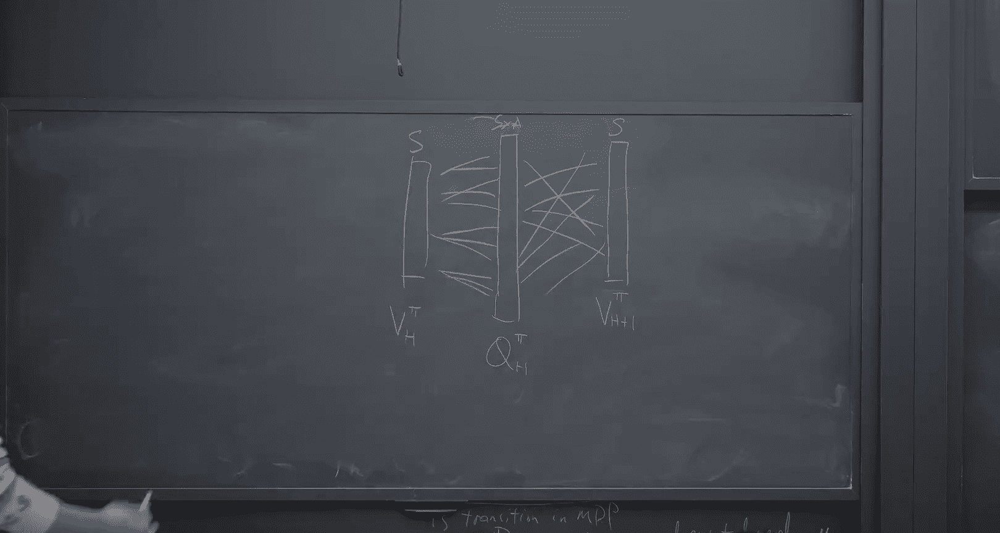
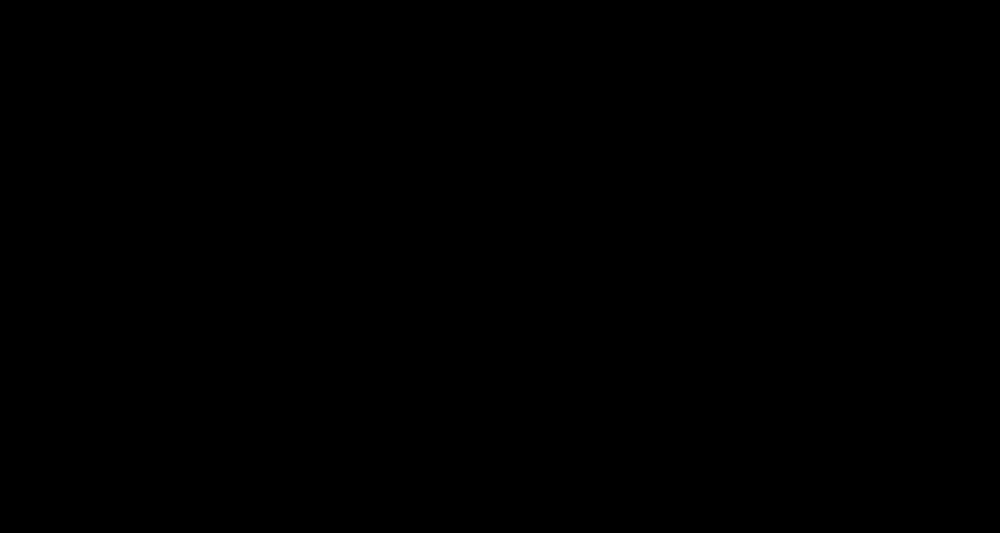

# 普林斯顿大学《强化学习基础｜ECE524 Foundations of Reinforcement Learning Sp24》中英字幕claude-3.7-s p02 Lecture 2_ _ Bellman Equations.zh_en -BV1vewWeRE5X_p2-

Let's first record what we have been talking about in the last lecture。

 We have been talking about the basic MP formulation。

 Just very briefly recall when we talk about MDP， we talk about MDP as the following elements。

The first， we have set of states， and we also have a set of actions。

 and we have a reward function and a transition probability， transition matrix。 And finally。

 since we are always talking about the episodic setting in this class。

 So we would have a final horizon H。Okay， and this is first thing were talking about。

 And then the next we talk about what have we called environments and policies and values。

So we know the environments。We typically just means the elements P andR。

And we will first talk about the case of known environments today。

 and later we will talk about the learning scenario we are actually exploring in the unknown environments。

 so we actually need to learn those PNR from some data， from observations。

And then we also talk about the policy。So policy is the first tricky part。

 so we first talk about there are two kinds of policy。

 One is we will spend a lot of time on that it's called mar policy。

Marco policy can be viewed as I have a policy pi。 That is equal to。A bunch of function。

 We actually have H functions。And each function。Is a map from states。

To either the action set or the probability simplex of action set depends on the whether it's determin policy or it's a stochastic policy。

So we also have a general policy。We say in general。

 we don't necessarily need to pick this special form of policy。So the general policy is， again。

 we have this tie is equal to。We need to specify this policy。

 We just need to specify the policy at each step。The only difference is now this policy。

Can be a map from all the possible histories。That is S times a the power of H -1 times says。

 These is all possible histories， again to the set of action or set of distribution of action。Okay。

 so in general， like you can think this general policy is basically history dependent policy。

 while this macro policy is you can think it's more like history independently。

 it only depends on the current states， but does not depend on the history before the current states。

And finally， we talk about the value in the last lecture。So we just quickly talk about the。VH。

So this is the value of， I would just first say this is like。

You should think this is a value of Mar policy。We'll talk about the reason later， later。

 So the value is defined as expected cumulative rewards。After a stopage。

So it's a summation of the rewards from each step to the final step。Condition on the current state。

 S is equal to S。O， we also talk about the Q value， which is a function of S A， which。

 which is essentially the same thing。 But the condition on the current step。

 the state is S and the actions A。So one thing I I want to emphasize a little bit is。This value。Okay。

 so because we have like two different policies， we have mar policy。And the general policy。Clearly。

 this VH is defined for Marco policy。This definition。Is well defined。For all HN S。

For all states and steps， this has no problem。But the only thing I want to be careful is when we written this kind of definition。

 and when we talk about later。Like later steps or later states。

 we actually realize like the general for general policy， it's not very well defined。

 I think the reason is this kind like already assumes the whatever the cumulative rewards。

In the future， only depends on the current state S。 O， it doesn't depend on the history。 Well， Well。

 on the other hand， general policy depends on history。 So for general policy。

 you cannot necessarily write a value only depends on current state。

 but also need to depend on entire history。Okay， so in general， like this VH。

Should depends on the entire history。Okay， I will use the tall to， to specify the。S 1， A 1， S 2， A 2。

 till S， H。Okay， so we we can no longer just use this definition。 However。

 we notice at the very first step， V1 is still defined the same。Because in the very first step。

 we don't have like any further history。 So in a V1 case， in， in the first step。

 we can still use exactly this definition。Okay。So finally。

 I think in the very last part of the last lecture， we talk about objective file file。

We want to define the optimal policy pie。H star。Which maximize。The value at the initial stage。

 which essentially。At the beginning stage of the game。

And let's just for simplicityly consider without lots of geneity。

 consider we have a fixed initial states case。We already said we can。

 if you are not happy with fixed initial states， you can think initial states is sample from some distribution。

 but all proof all the analysis we're going to talk about today easily extend to the kind of scenario。

 So for simplicity， we just say we have a fixed initial states。😊，And for chess。

 essentially we always start with the same configuration which is initial states。

 and this essentially kind of says if you' are playing some policy pie and what is your win rate like by using that kind of policy。

Okay。Okay， so we stop here in the last lecture。 So today we will continue talking about like how we're gonna compute the value and also what's a relation like how we compute the value and how we compute the optimal policy。

I think the first thing I want to do is like things we kind of raise this general policy issue。

 it seems like a very complicated。 like if we， if we always need to talk about macro policy and general policy。

 And in the last lecture， I kind like。Already kind of said that in the MDP scenario。

 in a single agent， like this markov this process， we can without lots of generality talking about markov policy only。

 So we don't need to go to the complexity of talking about this general policy。

 So what is this reason。 So this is the first proposition we're gonna talk about today。

Proposition  one。We're going to say for any general policy。Hi。There exists。A mar policy mule。So。

 that。The value。Of the entire game that is at starting at the first step with initial states is equal。

Okay。Just want to syn check that macro policy can define this。 And for general policy。

 the later step is more complicated， depends on entire history， but even the first step。

 you can still define it in terms of the initial states。 So both quantity are well defined。

And this is essentially， says。If my final goal is I just want to maximize my winning probability or something。

 I want to achieve the highest value without losses generally。

 we can talk about Mar policy because for whatever the value can be achieved by general policy。

 I can essentially construct some other macro policy that may depend on this general policy and achieve the same value okay。

So， this immediately implies。That there exists， at least an optimal policy。That is Markov。

any question about the logic here？If not a question I think we will first just spend some time prove this proposition one。

 since this is like a mathematical foundation， I think a lot of mathematical courses are like constructuring in this way we first talk about the proposition。

 which proposition or theorem or Lamma which is are the important thing like carry the meaning of like a high levelvel idea。

 what is going on and then we talk about the mathematical proofs， like to support this kind of claim。

So the proof of this proposition is relatively easy if youre very familiar with like this kind of notation and probability。

 So we'll just do the proof for now and。And a lot of proof in the reinforced millenia is by like induction because it's like we need to prove like first step is correct and second step is correct and those kind of thing okay。

 so we will just do it here。So let's first write out what is the value of。After there so。Complicated。

 like a general policy pie。 So we start with some general policy。 We want to， essentially。

 we say there exists on Markov policy。 We will prove by construction。

 So we'll construction on Markov policy that depends on this general policy so that we can achieve the same value。

So let's first write out a definition of this value。

 we already kind of say here is summation of H equal to1 to capital H。

We kind of put the summ outside and inside， we have the expectation。Over pi。And the reward edge step。

S， H， H。Conditional on the first status S1。Okay。This is just basic definition。

 the only thing we did is like exchange your expectation of an sumation。

 which we already know is we can't do it。Okay。So the second thing is we explicitly write out what is this expectation？

So expectation， essentially， we just summation over。 So here， the only randomness。In this reward。

 it's just this S H and age， those are the random variables。

So the expectation essentially is just summation over all the possible values of those random variable and times the probability of those random variable。

 So with summation over all the possible values of SH H。And we say we use the probability。Parch。Of S。

 H， H。Conditional S1， this is the probability of reaching S， H A H。

 followll the policy pie at step H。And times the reward。Of I say church。Just want to say。

 this is the probability。Visits。S， H， H。At a stopage。If starting from S1。And follow Taiwan。扣了po牌。

Okay。So， and also things we always just consider we kind of start from the fixed initial states S1。

 So for simplicity to simplify the notation。We will use。ThisP pi。S， H A H。

To directly just means its conditional S1。Okay， because this is like fixed initial status。

 This is fixed。So when it's clear from the context， let's just always say if we don't。

 even if we don't anything， we actually just mean we condition we fix this initial states。

So来试试新法律什么程试。So what do we learn from this equation？

This essentially the value is just equal to the reward of each possible state action pair times the probability of possibly visit those kind of state action pair。

 and then we sum of all of them together。And this not only holds for pi， also holds for meal。

Essentially， this holds for any policy。 Okay， not not only just the particular general policy pi。

 but also holds for whatever the macro policy we're going construct for mu。So this implies。

If finally， we just want to prove。V1 pi S1 is equal to V1 mu S1。

There's another way we can prove these statements。Which essentially we just need to prove。

The probability。Of reaching any state action pair at H step。

If follow policy pi is the same as the probability。

Of reaching any state action pair at step H for the policy mu。For any。S A H。

Because we can see on the right hand side， there's only one thing that depends on the policy。

 That is this probability。 Everything else is independent of policy。

So that's why as long as we can prove the visitation， this is also called the visitation measure。

 as long as this visitation measure is the same for different policy， then the value is the same。

Okay。So the way we're gonna construct this macro policy to match the value is basically。

By this criterion， we will construct a macro policy so that we will match the visitation measure。

 We will match the probability of visiting any possible state action pair。Okay。

So in order to prove this， let's first will do this proof by construction。

So the idea is we're going to construct some policy mu so that this is true。 Just remember。

 in order to construct some mar policy， all we need to do is we constructed the Mar policy at each step so we essentially need to specify what is the value。

Of this macro policy muH at each step， that is the probability of taking action A condition on current state S。

Let's say in general， this is like ser policy。So this is what we want to construct。

And what we have here is we have some macro general policy that pi。

Which kind like depends on the action A and also the entire history to。Where the toage。

Its equal to S1， A1 w till S H。O， so this depends on the entire history。

So a simple idea of connecting those two policies， like we want to match this probability is how about we just。

Do some averaging thing because on the left hand side。

 we only depend on current data and current action， where on the right hand side。

 we depend on the entire history。So one thing we can get rid of this history is we're just taking expectation over those histories。

 Okay， so this is essentially the idea we're going to do。 So we're going to say we。

 we will construct this policy， which is equal to taking average。

Over the general policy and the condition on this SH equal to S。

That is the right hand side originally depends on A， S1， A 1， S 2 A2 till S H。

 And then we're gonna just fix the last date to equal to S。 A is equal to A。

 And I'm I'm gonna take an expectation over everything。So this is essentially the some。

straightforwardight idea we can think of。And then our left is we need to test whether our construction actually。

Deliver something like this， actually deliver this property like this。O。So first thing is we need to。

 since this is a conditional expectation， we need to write the mathematical definition or like how we gonna compute this this conditional expectation。

So we know the conditional expectation is just equal to the probability of this joint probability over the probability of this whatever we condition now。

So we can write this equation， which is equal to on the。Denominator， that is the probability。

They're following a pie。To reach us in each step。Okay。

 so this is a probability of what we condition now。 And then on the top on the numerators。

 the joint probability。Which we can write it out， that is equal to summation of all how。So that S。

 H equal to S。And then， the probability。Of visiting Ta。Times the。派。Wch of a。A， given touch。Okay。

 so this is essentially the definition of this conditional expectation， or we just compute it out。

And the only thing relies on is we kind like we require the denominator to be non0。Otherwise。

 this is like L defined find。So that means we need to fix something if this is equal to  zero。

 so what are we going to do？So it turns out when this is equal to 0。

 it doesn't matter because when we follow the policy pi， we will never visit that kind of states。

 so it doesn't really matter what kind of policy you play on that states so you can just be arbitrary policy。

For， for the states that。The probability is equal to 0。Okay。

 so this gives a more rigorous way of like defining what is this micro policy to be。

 And all the remaining thing is we just need to check。 They generate the same visitation measure。嗯。

Any questions so far？Okay。So now it remains we will use induction。To prove。

This stronger claim that is by our construction of meal。

 the meal and pi will generate the same visitation measure over all state action and step。

And the approach we're going to do induction is essentially we're going to argue in the very first step。

 this is true。 And then the second step， this is true。 And then third step is true。

 So we're gonna to do induction over H。Specifically。

 we're going to do the following that is we will first argue。We'll first argue that。P， H。M有S。

It's equal to。P，H。PH派。If this is true， then this is going to imply。PH谬 essay。

That is the probability of visiting S A at each step is also equal to P。Pi is following policy。

 Pi is visiting essay。And then we're gonna use this to imply that P plus one。没有S。Is equal to P。

 H pi S。So we're going to prove。First up and a second step。

So this is how we're going to do induction。 that is for NH。

 I'm going to prove that this claim will improve， it will imply this claim。

And the second step is prove this claim will also imply this claim。

And then we can do induction from the first step， because we can check the very basic case。

So the base case， essentially， we just need to check at the very first step。Because first up。

 we're doing the fixed initial stay。 So actually the probability of visiting S1。

It's kind of irrelevant to the policy。 So we immediately know this is true。

This is the true things as is fixed。Okay。So all remains is just to we proof one and two。

 like y one2 true。And one， to， essentially followed by some calculation of basic。Probability。

So we first say the。PH mu will prove one first。So essentially， we want to first look at this P U。

 This is what we want to prove this is equal to this。And。This， we know， because it's micro policy。

 it's equal to。Probability of visiting。State S at edge stop。And times， the。The。

 the probability of taking some action A given condition， given S。

 this is essentially the probability。 This is essentially the s policy where the probability of taking some action A condition S。

And finally， we know this is equal to。P。Pi of S。And much。A given S， this is by induction hypothesis。

So on the other hand， we can also start from the the other side we want to prove， which is a P。

The probability of reaching some state action S pair at step H followed the policy general policy pie。

And this we need to be slightly careful， and this we can no longer do this decomposition。

 essentially， we need to sum over all the possible history。So that the final step is equal to S。

And we see the probability。Of H of if following policy Pi to visit those。historytory and action pair。

Okay。By doing this decomposition is because now we can do the similar decomposition that we can decouple a from this trajectory pi because now the general policy actually depends on the entire history。

So this is equal to summation over。Tau H， S， H equal to S。

And we say this is equal to the probability。Following policy pie to visit some trajectory toage。

Times the general probability of taking some action A condition on to。Okay。

So this is essentially also everything we can do on this side。

So we can see if we want this two to be equal， then we have to make some policy pie to satisfy some special condition。

Fortunately， we already says our construction of pi is equal to this formula。

And we can directly plug this in。And we realize when we do this。

 this kind of cancels out with a denominator。And whatever on the numerator is exactly equal to this。

So this is essentially， those two are equal by definition， by construction of mu。Okay。

 that is our construction seems like to have some reason。

 and which precise reason is to make these two equal to each other so that。Our first step。

 essentially holds。I think this is a bit more about mathematical calculation。

 but the whole intuition is like we just want to have some constructs on macro policy。

 which is averaging so that we're more less guarantee this is true。我。Now the first step is true。

 all we need to do is the second step。T mi SH plus one SH plus呃。We also start from the。

For probability here。Of visiting some S in the next step， H plus one step。Okay。

 let's just say this is actually S plus one so that I to make it clear。

And we know this is obviously equal to summation over all S， H H， the probability of visiting。

All the tuil of her。S， H。H。FH plus one。And in general。We can say this is一棵 two。F， H， H。

The probability。Of milk。That essentially we deco decouple this thing that is equal to the probability of visiting F。

 H plus one condition on F， H H。Times the probability of visiting SHH。Nothing very fancy。

I think the most important part is now we realize。This thing。

This thing essentially is the transition in MP。So essentially the we already say the transition structure actually incorporates some markov structure in it。

So that the key thing to observe is this thing only depends on transition P。

But it does not depend on meal。So essentially， we can get rid of this mu dependence here。

And this is essentially the key step where we kind of use this Mar property。

So that we can say we don't need the general policy。

So the remaining steps become relatively straightforward that we say this is equal to So first。

 we want to use the induction hypothesis where induction hypothesis says P mu on S is equal to P pi on S。

 so we can replace this meal by pi。 So this is equal to summation S H， H。P， H。Of a。S， H plus one。

 given the current step state in S H action and H。 and times we just replace this by pi。

 This is by induction hypothesis。And finally， we can also do the same argument that this， this。

 this thing doesn't depend on pi。 So it doesn't matter we put pi here or not。

 They are the same thing。 So we can also just add a pie here。 And then this becomes。P， H pi of S。

 H H。F H plus one。Which was exactly just equal to。Sorry。Yeah。PH plus one。A。

WHhich plus one pi and S H plus one。Okay， and this finished the entire proof。

So after get a note like you get used to like this notation of MDP and how the probability is going to generate each other and those proof are going to be a piece of cake and only important idea how we're going to construct the Mar policy that's going to essentially match the same value of general policy is just by aver。

 averaging over all the history。Okay。Any question about this part so far？Yes。

Just making sure that second part of the group is just saying like， oh。

 if they both have the same probability of getting to stay as。As they age。

 then they both have the same probability。H plus， yes， exactly， yeah。That's cool。

Okay so don't worry if you can feel some steps missing here。

 and I guess the important part is about the claim。

 like we realize now that we don't need to look at the general policy at all if we only care about MDP and we can without loss of generality。

 only talk about macro policy。 So from now on in the odd MDP part。

 we will just focus on the macro policy。 So whenever we talk about policy。

 we actually mean macro policy。Okay。So before we go move forward。

 I want to talk a little bit about some notation I'm probably going to be used in this lecture。

So for now， I think we just consider everything as a tabular setting。

 so we consider like we have some finite states and a finite action。Like the state set。

 coron is equal to S and coron of action set is equal to a。 Let's。

 let's what now say something like that。And then we use this value。Of。

 of some state at each stuff is this is like some single value。 Its some single scr。

 real value value， single scr。And sometimes we will use some notation like this V pie H。

Without indicating what is S， you can think this is a function。

 but you can also think this is a vector。 So this is a vector is in like the。S dimensional vector。

 you can essentially， this is a vector so that the first dimension is like the value on the first states。

 Second value， Second dimension is second coordinate is the value on the second states。O。

 so similarly， you can also consider the Q value。As a vector。Of S A dimension。

Because essentially each state action pair correspondent to one coordinate of this vector。

And finally， we will also use some succinct notation in reinforcement learning because we're going to use this a lot of time。

So a lot of times we're going to face some expectation。Of the value。Of the value of the next step。

As prime condition on essay。Okay， let's say this is at H step。And this thing we know， by definition。

 is equal to taking expectation that S prime is generating from the probability of。

Like a transition probability， you condition our current state action。

 and it goes to the next states。And then， V， S prime。

So the complicated part about this notation is like we have this dummy variable S prime and S prime。

 like we need to write it twice and which makes this notation a bit more complicated。

 So for a lot of times we will just write a succinc notation， we will just use this P V。

And depends on essay。So， as it here。So we define this notation to。

 to essentially surprise the depend like dependence on on on S prime。

So it really is just taking expectation of the value at the next step。

Condition on the current state in action so we can read this we start from the current state in action and we take a transition to the next step and we evaluate value on the next states。

So this is the notion we're going to use。要继训这个。Oh essentially you can think we star on the current state in action and we take a transition to the next states and we take an average overvalue on the next states。

 This is like essentially a definition that star from the current state action。

And if we go to the next states， we go to the next states and take an expectation on a value there。

So that we I think this notation is thin。 so we don't need to write a dummy variable as prim to make it more succct。

Okay。So after we did all the cleanup work and now let's get to the interesting part。

So the first part is about policy evaluation。So policy evaluation ask this kind of question that is。

I think the first step， just remember， just remember the the goal of reinforcement learning is we want to find a policy so that the maximize the value。

 So the policy evaluation is essentially the first step。 It basically ask a question that given。

The environment P， let us transition。R is a reward。And more importantly， the policy pie。

This is fixed policy。How to compute。V1 pi S1。Essentially， the value we care about。Okay。

 so the value of the policy pipe from the initial states。This by its name is like policy evaluation。

 I want to evaluate how good this policy pi is and the evaluation criter is by looking at the value。

So in order to talk about this， we first just record the audit definition that we wrote in the last lecture because now we can just purely focus on the Mar policy。

 so everything here is about Mark policy。And we know the value of Mar policy。Can be returned as。

The expectation。Over all the summation of all the future reward。Up to H and R prime。S， H prime。

 A H prime。Conditional S， H equal to S。And the Q， H。Pai。QHSA。Its equal to expectation。Over pi。

Smation。H prime over it。An R prime， S H prime， H prime。

The only difference as a condition on the current state is equal to S。And actions equal to a。Okay。

So the question is， again， how are we going to compute this initial value？So there is one naive idea。

 like naive approach to compute this value at the initial states is basically just by expanding the entire probability。

 by definition of expectation， we can say because this is expectation over the entire history。

 entire tra， so we can summation over all the possible trajectories and the probability of those trajectories。

So one naive approach。As we say， we can do V1 pi S1。Is equal to summation。

Of all the possible trajectory toage， where this possible trajectory is like S1， A 1， A till S， H， H。

And then we're going to say we look at we compute the probability of generating this trajectory conditioner S1。

And then we do the summation of cumulative reward。As you equal to one to。R H， S， H。

This is essentially the reward of to， total reward of to。

So we essentially just say the probability of generating this to times the reward of T。

 this is the definition of the value。However， we can like we immediately spot this approach of computation is like very expensive。

 It's not very feasible。 The reason is this toage has a。

This touch H has essentially S A to the power of H。Entries。

So we need to take summation over this exponentially large。Number of entries。

 This is exponential image。Okay， which which in general is like really bad if we just want to handle some reasonably long sequence。

 and this is already like extremely large and probably kind of fit in the computer memory。

So how is there any better way we can handle like compute this to evaluate this value？

So the secret is again lies the markov structure， we studied the mark of MDP for a reason just because it's Markov。

 so a lot of things can be simplified and can be more feasible。

So the way we're going to introduce essentially the key idea is by using dynamic programming。

So we will elaborate more。Later， so we first， we'll introduce the so called Bellman equation。

 which is the most important， one of the most important concepts in reinforcement learning。

So instead of just computing this value by blue force。

 we look at some intermediate relation between this intermediate。

 like like the value in the middle steps， VH and the QH。

So it turns out you can derive Belelman equation by directly expanding this definition。

 and you by this definition， you can like， you can already see this。Q pi。

 the relation between Q pi and V pi V pi is probably just taking average of Q pi S A and taking an an inner product with the of the policy of taking some action A conditional S。

Essentially， Bel equation is exact relation that can like accepts the connection between the Q pi and V pi at the different steps。

 So I would just directly write out the results， but you can check Both equation is true。

 like based on this definition。So Obama equation says。VH pi S。It's equal to。Samation over a。Q H pi S。

Okay， so the Q value of if starting essay。And then， times the。Probability of taking action A。

 given less， if follow policy pie。This is relatively straightforward。

If you can look at the definition， this is like this will take an expectation over。A H， well。

 this will not take an expectation over H because it is already specified。

 And then the expectation of which like by span out is like is like exactly like this。

And then the next equation is。QH。Pi S。Its equal to。RH， so。The value。

 if starting from some state action pair at H step is equal to the。Immediate value。

 I'm gonna receive at this state action pair and plus the future value。

 and future value is equal to the expectation。Takeing expectation over the next states that is a sample from this transition probability。

And V， H plus one。Pie as as prime。Okay， and just remember。

 we will use a simplified notation later as this P， H， V H plus1 pi。I say。And to mean this。So again。

 as I promise this is directly by like a definition of this QH and page and you can check offline。

 this is true。By just expanding a probability。Yes。Which is that multiplication supposed to represent like like a matrix vector kind of multiplication or with this one。

 Yeah， you can think it's a matrix vector modification like this V。

 as I said is a vector and you can think this is like transition as a matrix。Which is like S by S。

手前し。O。So why Belman equation is kind of important， it essentially it's a relation between different values。

 but it also gives a recursive formula of value at different steps and I think the important part is this actually kind of already directly gives us a dynamicna programming way of compute the value doing the policy evaluation。

So， we just do a。Essentially， we will just compute。V one派。S1。B animal programming。

So let's just write out of how are we're going to compute this now given this beelma equation。

So what we can do is we can initialize。V H plus one。Hai。S。Equal to 0 for O S。

So you can think this is some imaginary stuff because we already stop at H step。

 so we really don't have anything like at H plus one step。

 So why not just set the value equal to0 because there is no no reward。At H plus one stuff。

 And later。 So we can just make this as an initial condition。

And then we can do the number of programming for H， little H equal to H。Hch minus1。哒哒哒跳 one。

You can compute。Q pi S。H。That is equal to RH assay。Essentially， we just use the Belma equation。

 I'm just copy it here， so for clarity。Plusus one派。Ssay this for any essay。And VH。Pi S。Its equal to。

Sation of a。In action sets。Q H pi S。看spy。Of a， given S。This is for an us。Okay。

So this way we can imagine we start from the V H plus one a capital H plus one。

 and then we use this equation to compute Q capital H and then use this equation to compute v capital H and then Q capital H minus1 V v capital H -1。

 And eventually we got a V1。Okay。So if we illustrate this in a figure， that is， we start with some。

VH plus one。Which is S， H which is S dimensional thing。Okay， V H plus one。

 if we look at this as a vector， V H plus one time is exponentialal thing。

 And then use the first equation， we will get to the。Q H。Hi， which is S by a dimension， nothing。

So we will just use some computation here。And then we will use this a QH。To get to the。Viage。Hい。

Which was the estimation of。And then we just use dynamic number programming and go onwards。

And essentially， go， go back to to the VY。Which is also estimational。I was just marketer。Q H -1。

N S by。We have a lot of connection。So it's very easy to verify by using this demo programming approach we no longer suffer this exponential complexity in computing V1。

So now it's。So this dynamicyna programming。Use gives polynomial complexity。To compute the one。

And this is a polynomal age。Essentially， we can think make longer and the entire competition just grows linear with back to edge。

Okay， any question up to now。So the question the answer is very straightforward。

To ask how to evaluate the evaluate the value given the fixed policy pi。

 all we need to do is just do dynamic programming and using the beel equation。O。So if no problem。

 we have already talked about the policy evaluation。Then the next thing is， of course。

 we're not just happy about evaluating a single policy and our ultimate goal is we want to find the optimal policy。

So the question is how are we going to find this Am？Yeah。比弯拍。Of S1。

 this is defined as the optimal policy。So one straightforward idea we can probably think of is， okay。

 we already have this Bman equation to evaluate some fixed policy pie。

 Can we have some beman equation type of thing to， to do the like optimal policy。

So one naive idea is we think this entire beman equation， if we look at the second equation。

 it actually does not really depends on pi， okay， it can be anything because the pi is only appears in a value like in terms of computation。

 there's nothing related to pi So pi only appear in the first equation where this is taking average over over the probability that indicated by pi。

So if we want to do the optimal policy。😊，Why not？ we just focus on all the probability on the。

 on the action that generate the highest Q value instead of like doing some average。

 So what about every time I just doing the max over a instead of doing some average over a。

This is what we talk about， this is what we call a Belman Op equation。

So it's again a setup of equation， which the only difference is we're going to change this average to the maximum。

So the first equation is V star S is equal to max over a。QH star essay。

And the second is exactly the same。Q star assay is equal to R assay。Plus。Pvi。Star essay。O。

So this is our gas， like in terms of optimal policy， probably would satisfy something like this。

But this is essentially just a set of equation， and。

And how we gonna get a policy here So we can read from there。

 The policy essentially is identified by this taking average like according to a probability that is sampled from pi。

 So this equation kind like naturally gives them policy that is essentially taking the max over this Q star。

 So we just define this policy pi star。H。A， given S。This is my policy。

 I get my guess to be the optimal policy， which is equal to the indicator。Of a equal to agon max。

A of Q star S。Essentially， I'm just going to put all my probability into the action which maximized the QR。

And if there are some like。Ti， T， I just do some arbitrary tie breaking。

 I can just focus on one particular action that shift the maximum。Okay， so nothing very difficult。

But as I said， like everything is my guess。 I think I just modified the about equation。

 and I I can like my guess my policy is like this。 So the first thing I noticed is。

We can' of like first define as V star， I don't even know whether this value is like corresponding to any policy。

 like it's a value for any policy， I don't know。But we can first argue that。

V star H is actually just equal to。V， H pi star。And。Q H star。Is equal to Q H pi star。

It's easy to prove this。Because。The Bellman equation。Because pi star is some particular policy。

 and so pi stars， you can think the value of pi star is satisfied by O the equation。

And if you write out the beman equation of pi Sir， you can realize this exactly equal to。

The Belmon Op prison。Like， there are， looks exactly the same。

So the first thing is we kind like we convince ourselves when we write out this development opt equation。

 this actually correspond to the value of this particular policy。 Okay。

 this is not some arbitrary thing。 it's kind of corresponding to some particular policy。O。

And the second thing， we're gonna to claim。Proposition 2。

I I going to claim this is not my wild guess。 Actually。

 this is in particular indeed the optimal policy。 So we would say pi star is the optimal policy。Okay。

I think we kind of like because we were doing like theoretical work theoretical like access foundation。

 so we want to like make sure the logic is like。It's clear like we don't have like some cyclic reasoning。

In the middle， but like in the end， after you kind everything。

 you just know this is like Belma primary equation this is like equal to the Belma equation of pi star。

 and everything is like pretty straightforward。Okay， so now we will prove this claim。

So in order to prove this claim， we actually will prove a even stronger claim and where this claim is like a special case of the my stronger claim。

 So we will actually prove that。The pi star。H of S。This is like the value of pir at step H state S。

Is actually equal to max。Of all the macro policy， pi in macro policy。V， H。Hi yes。For any H And S。

Okay I just want to explain a little bit difference between those two claim。

 I think the original optimal policy only says you need to this is only defined you need to maximize the initial value。

 initial value at initial states。Well， this essentially says pi star。Is the optimal policy。4our。

All states and all each staff， simultaneously。So， so that means like if you look at different states。

 the optimal policy is actually not different policy。 They are actually the exactly the same policy。

 which is the pi star we define here。This is a much stronger claim。

 but you can think of one very special cases， I just pick H H equal to1 as equal to the initial states。

 and this gives what I want to claim in the proposition too。Okay， so again， we will do induction。

So the only difference of this induction is we no longer do induction from the first step to the last step and we will do the opposite direction because this is optimal policy。

 so we will argue first argue the last step is optimal。

 then the second and last step is optimal and then going backwards。So the， the。

 the essentially logic we're gonna to do is we're gonna argue this。V H S equal to。Max。Hi。V pi h。S。

 this is what we want to say in the in here。 And we will argue this by。We first say first step。

Q pi star。SA。Is actually equal to the max。Tai。9。Pi。H essay。And the second step is。

We will use the next step to argue this， that is VH plus one。海 sir。S is equal to max pi。V， H。As。

Is for any S， for any S A H。This is also finance。So we induction backwards。

 we will argue if the value at h plus one step is already the optimal1。

 then going backwards at H step Q value is optimal， then v value is also optimal。Okay。

 let's always star on the base case。This case is the final step。

 And I think we say that we can use the。Duming step， which is h plus one step。

 In the H plus one step， there is no reward going forward。 so we can immediately say this is true。

Because there are really no policy in the future and everything is just equal to zero。

So we'll quickly do one and two。let's do this one first。First， we look at the max。牌i。QH牌。Ssay。

And by bio my equation。We know this is equal to RSA。And because R does not involve pi。

 So we we no longer need to take a max over this pi， and we can push max inside。

 We say this is a max。Hi over。Expectation。As prime sample from P。I。And V H plus one。Pi。That's prime。

Yeah。I think the important thing is。Now we want to， essentially。

 we want to switch the order of the max and expectation。So in general， let's just be more concrete。

 We want to。Essentially， do max pi。Sation over S prime。P S prime given an essay。H。And V H， plus  one。

As prime。And in general， we cannot。We cannot now swap this max and expectation， Max and summation。

 So in general， if we look have this max。F x plus Gx。

Like we had two x thing and we undertake the max。In general， this will be smaller than the max。Of Fx。

And class max of Gx。Okay， just because this max can be achieved at a different place。

 if this max actually achieved a different place， then this is strictly less than that。However。

If we have。That arg max。Of Fx。Is equal to agon max of Gx。

That is the max can be achieved simultaneously。 Then we actually have this equation。 That is a max X。

Of Fx plus Gx。Is precisely equal to max X。And Max Js。Okay。

And this is essentially what we can do here because by induction hypothesis。

 we can like say the pi star actually achieve。The maximum policy simultaneously for all the state as。

 for all the next state S。That is the， the， the maximizing policy here for pi is always pi star。

 no matter what S prime is。So we can say this is actually equal to。 we push the。Maximization inside。

Because all the maxes are achieved simultaneously at pi star。 So this is just equal to。

The H plus one。Hi， sorry prime。This is because。And finally。

 we realized this is just a be equation for pi1。 And this is equal to。QH pi star essay。Okay。

 I will just do like two more minutes to finish the proof。I think similarly。

 we can also just argue the same thing that is the we start from the max H。BH pi S。

This again by Baling equation。Is equal to max pi。sation a。Q H pi S。Of pi a given S。And this is the H。

So the important part is that we can realize that we can。

We can like separate this pie because this pie is essentially a collection of all the possible future policies。

 So we have this。 we can take a max over pi H here and max over all the future policies。Sation A。QH牌。

SA。And P A given S。And the other thing is realize this Q value actually only depends on the policy in the future。

 so it doesn't depend on the current policy of current step because current step were already taking some action a。

So this only depends on。P H plus one。To pi capitalage。And again。

 we can use the same argument to that because we achieve the max at the same place so we can essentially swap this max inside。

And which more or less give what we want。And it's just equal to max over pi h。Sation A。

 because we can push the maximization over all the future policy inside。

 and it becomes a secure star。SA。And patch。A given S。And finally。

 we know the maximization of the policy achieved at we put a probability1 a maximizing action。

 So this is just equal to the max over a。Q star。SA。So， Q P star。And which was equal to。VH拍摄。Okay。

I think this finished the proof that we argued is Psar is an optimum policy。In the next lecture。

 we'll continue talking about some planning algorithm， essentially。

 what is the algorithm we're going to compute the optimalimum policy。

And then we're going to start talk about a little bit more challenging setting where the environment is unknown and we need to。

 how are were going to develop some tools to use data to estimate this environment to learn the MP。

Thanks。

