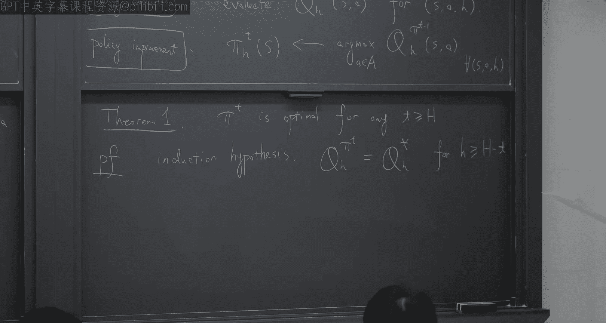
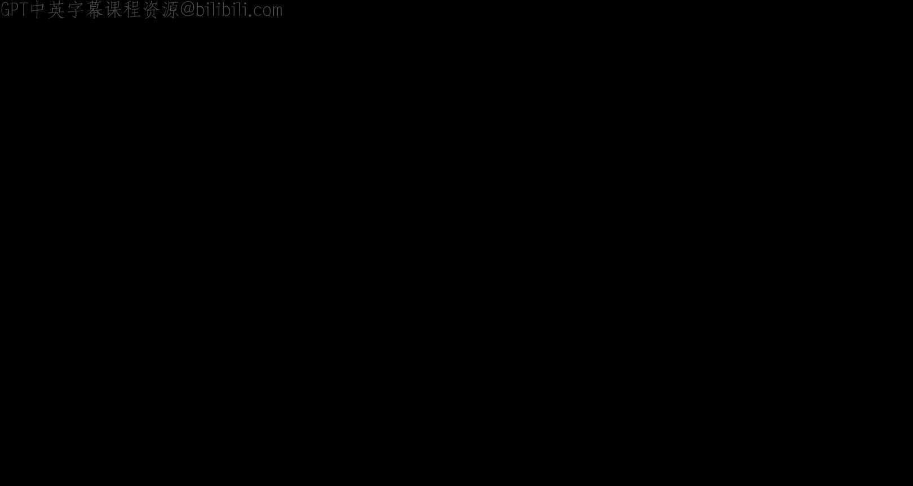

# 普林斯顿大学《强化学习基础｜ECE524 Foundations of Reinforcement Learning Sp24》中英字幕claude-3.7-s p03 Lecture 3_ o Planning.zh_en -BV1vewWeRE5X_p3-

🎼So in the very end of last lecture， we talk about the Belelman Op equation。

 let's just quickly recap what we have been talking about。

So the Bma opt equation is similar to Bma equation。

 but the only modification is like when we take some policy pi instead of taking action that is averaging over policy pi。

 but we take the max action。So it has like two equations。 The first one is V star。 H S is equal to。

Taking max over action A and Q star RHS。SSA。And the other part is the。앞im or Q function。QstarHSA。

Is equal to intermediate reward。Plus。We take expectation over the value in the next step。

And in the last lecture， we can like also says the Bel automatic equation directly gives an a policy。

 optimal policy。K star，8。S， which essentially this new policy。

 we're just taking it greedily respect to Q star。 That is we will with probability one。

 take the action that equal to the action that maximize the Q value， Q star value。A prime。Q4 H。

I say prime。Okay。So in the very end of last lecture。

 we kind of like a reason about like we first initially like start from guessing this Belmon optimal equation and guessing this optimal policy and then we like do the proposition and prove we prove this policy pie chart is actually indeed the optimal policy。

 which achieved the optimal value not only in the very first step。

 but also in all H and R S simultaneously。Okay， so this is what we concluded at the very last part of the lecture。

So today we continue talking about this。They select like optimal policying。

 so the task we're gonna talk about today is called planning。So planning。

 you can think it's something similar to like policy evaluation。

 but instead of like evaluating a fixed policy， now I want to find the optimal policy。

So the planning tasks is defined as follows were given。With environment P。And also reward R。

This is like similar to the setting of policy evaluation。 we kind like we all know the environment。

 This is like environment piano。And our goal is we want to compute the optimal policy。派 star。Okay。

 so similar to policy evaluation， the only difference is now we no longer just evaluate the value of some fixed policy。

 we just directly want to find an optimal policy。So we will basically introduce a couple of algorithms which can solve this problem。

So the first algorithm， we can immediately。Like also take analog to the policy evaluation where from policy evaluation。

 the basic algorithm we do is we use essentially leverage the Belelman equation and do a dynamic programming based on that。

 And we directly do the policy evaluation。 So similarly， in the planning here。

 we can also just directly leverage the Belman optimal equation。

 which gives a recursive form on like how the value gonna propagates。

 and then we use dynamicna programming to compute optimal policy。

 So this gives the first algorithm that is called value equation。

So the first idea is basically leverage。And。Use dynamicyna programming然我就是 short就是DP。

So the algorithm。Again， thiss also very simple， let's call algorithm one of today。

 is called a value tradition。It's called Val information， So we just call it VI。

It turns out this better tradition is also a very important algorithm we will actually see throughout this class。

So the value consists of follows， and the first we initialize。Similar to policy evaluation。

 we can like we also initialized the value at last time。

To be always0 because theres no future reward to collect after H plus one step。Is for NS？

And then we just do dynamic number of programming from the last step to the first step。

So for H from the last step， capital H。H minus-1， da ti 1。We do the following。Essentially。

 we just copied the Belman opt equation。That is a cute star。H trust say。Is equal to R， I say。

And plus。PHVH pass错啊。Star， I say。We compute this for all state action pair at step H。And then。

 we do the。The second bomb equation， that is V starRS。Is equal to。Q star S， a。

 by taking max over action。We do this for any states。Okay。

This is essentially just copied about my optimal equation。 And finally。

 we say well optimal policy is just。It's just the what we wrote here。Indicator。Of we take the。Amax。

Of Q star value。Okay。Is for any HSA。Since we already approved in the last lecture， pi stars。

Optimal policy and why Val works is kind of pretty straightforward。

 This directly gives the optimal policy。 And we can also see this is like dynamicna programming because if you look at the computation flow。

 what we did is again very similar to the last lecture。 We first start with the VH plus one。

Only difference now is's no longer for some particular policies pi， but for the optimal policy。

 that is S dimensional vector。 And then the first step， we compute the。This Kstar capital H。

Which is SA dimensional vector。And then， we compute the。V storage。

Which is estimational vector and go on now。So essentially。

 we only take some linear to edge computation and we can compute the optimal policy。O。

Any questions so far？Yes， is Pi star inside the floor？

The question is is pi start inside the full loop oh sorry it really because we can't like we already like given this value function policy like for any H so it can be outside the loop yeah。

 but you can also put it inside loop， then you don't need to do any h because you can like you already do follow loop。

Both are fine。Okay。Okay。So for some historical reasons， I will also introduce another algorithm。

 also doing the planning， which is the algorithm actually that does not leverage the Belman opt equation。

 but actually only use the Belman equation。So that's the second algorithm。Calllor policy。

 policy tradition。Yeah， in general planning you can have a lot of different planning algorithm。

 but I think those two are。Most commonly described。In the intro textbook。 So policy iteration。

So I think the valuetu， you can think the most important part is we compute this value of v star and we use the bioman automatic equation to compute V star。

 Well， on the other hand， policytu will maintain a policy and we keep improving the policy at every tuition。

So what are we going to do is we will initialize。Let's call it pi0。P 0， basically。

 we already know pi 0 is， is a subject which， which essentially is an h different policy。

 H different policy， which have one policy every step。To be some arbitrary policy。On all states。

So the initialization doesn't really matter that much。

 and typically you can either do some uniformly random policy or you have some prior knowledge and you just use the prior knowledge to initialize your policy。

So， the policy tu。Also， it's a like iterative algorithm， so it has a follow loop。For t equal to1。

2 about到。Do following two steps。So the policy evaluation mainly consists of two parts。

 The first part is so called policy evaluation， basically directly leverage the policy evaluation。

That is， we will evaluate。The value。Of pie T H。呃呃，派 T minusY。Iay。

So we will evaluate the value of previous policy。At all， S H pair。

So essentially leverage the knowledge we learn in the last lecture， we can essentially just run。

Dynamer programming using Bel equation and to compute this value for all the state action at every step。

And the second step is called policy improvement。So because our goal of planning is we want to find optimal policy。

 so it's not very useful if we just evaluate a value， we need to improve based on the current policy。

So what we do is we will update the policy。 So this is a previous policy that is pie T -1。

 So we will update the new policy。Pi T stress。That is equal to。R max。A inA。Q。H T -1。HSA。This is also。

We do this for all SSRA plan。SAH pair。So what we're essentially doing is we use the previous policy learn to evaluate its value。

And then we use this value。 essentially， we take the greedy action， O， greedy action。

 then maximize this value， and we make this as a new policy。

So this is a slightly different approach than vtu which this used Belelma opt equation。

 well this essentially just used original Belelma equation without using a Belelma Op equation。

So the question here is。Okay， we know that value algorithm clearly works。

 clearly will find the like optimal policy。 But like would this algorithm eventually converge to optimal policy。

 like or how many iterations we need to find optimal policy。

So this is answered in the following theorem。我塞。排梯。Is optimal。嗯。For any。T greater equal to H。

Now this after H iteration of this policy evaluation and policy improvement。

 we will guarantee this policy iteration already finds the optimal policy。Maybe in practice。

 you can find optimal policy a bit earlier， but this is like guaranteed in the worst case。

Any question about the algorithm and its statement so far？Okay。

 so we will do the proof for like why this is true。

So I think because a lot of algorithm of reinforcement and MDP is like based on dynamicna programming。

 so a lot of proof is also based on induction， you can think it's like a mathematical version like to prove something related to thena programming。

So we will again do an induction。And we'll use induction hypothesis。

That we will actually prove a stronger result， which says this Q H pi T。 This is the value of pi T。

Is equal to。Kill starch。For any H。Greater than H minus T。

So what is this induction hypothesis talking about？We have like H equal to1， H equal to 2。

 and eventually we have H equal to H。And this is T equal to 0， T equalta 1 and等 T equal to H。

This is a step。So what we are talking about is that in the very first step， that is T t equal to 0。

 only H equal to H。We have the optimal value。 that is in only in the very last step。

 our value equal to the optimal value and everything else is is not equal to optimal value。

 or we don't guarantee it's equal to optimal value。In the second step。

 we are guarantee not only the very last step， our value is equal to optimal value。

 but also the second last step， our value is equal to optimal value。

But we don't guarantee everything else。And so what we are seeing is essentially in every step。

 were guarantee one more step so that our value is equal to the optimal value and eventually in the H step。

 we guarantee all the value is equal to the optimal value。

So this is what this induction hypothesis is talking about。Okay。So let's start the induction。

 We first look at the base case。Basically， we will need to check t equal to 0。 our induction is true。

 And when t equals 0， all we say is the， the value at the very last step is equal to the optimal value。

 So the value at very last step is Q pi 0 H S。And we know。This is the value at the very last step。

 And we know very value at the very last step is basically just the intermediate reward I receive。

 That is RHSA。 And then we no longer have any future reward。 Okay。

 this is basically all the reward I' gonna get in the future。

And we realized because this Q value already specified both data and action。 So this。

 both S and A are fixed， none of them are depends on the policy。

 Okay so although this is like arbitrary policy， but it doesn't really affect the value at the very last step。

So this is also equal2。Q star。I fascinating。So the base cases is correct。O。

So then we say suppose the hypothesis。Suppose the induction hypothesis is true for step T。

All for iteration tea。And let's look at the， let's exam T plus one。So basically。

 by looking at t plus one situation， we need to look at the policy of T plus one situation。Of S。

 I will just use this notation because we already seen the。In this。

 this like a policy evaluation and all the policies like a determin policy。And we know by definition。

 this is equal to agon max。诶。Of Q H。派TS。It's equal to the greedy policy and which look at the value of the previous policy。

This is directly by PR algorithmism。H了 situation algorithm。

And we exam for any H greater equal to H minus T。And we also know because by induction hypothesis。

 we know for Nh that is greater than capital H minus t。

This Q value is actually already equal to Q star， so we know this is equal to agon max。诶。Of。

Qill star essay。This is by induction hypothesis。And finally。

 we remember like the optimal policy is basically just the greedy policy respect to Q star。

 So we know this is just equal to high star。Okay， so this essentially just already implied that for any h greater than H minus T。

 I'm just copy， copy this precondition here。We can like say for any step that is larger than this H minus T。

 We already know the policy we learned up to t minus-1 inition is already optimal。

 Those policy is equal to the optimal policy。And the final argument just used the argument we essentially already said in the last lecture。

 that is we look at the。Q h minus1。Party T plus one。We notice this Q value。And this essay。

Only depends。On our future policy。Like pi H T plus one。派H plus one。2 plus one and到 to pi H。退 plus1。

So the important part is this Q value， although at h minus1 step。

 doesn't really depend on the policy at h minus1 step。The reason is。

 the action at H -1 step is already specified in this a。

 which basically like the policy at H -1 step actually doesn't affect this action A。

 So that's why it doesn't depends on the intermediate policy。 It only depends on the future policy。

And we already know all of them are equal to pi star。

So this just implies that this is also equal to Q star。H minus-1， essay。

The reason is because the policy is optimal policy。 So the value is also optimal value。So。

Now we can just reinex a little bit because now we say for any h greater than capital H minus t。

 we have a value equal to the optimal value up to h minus-1 step。So this is also equivalent to say。

For any H， we just do some reining for any H greater than capital H minus T。-1。We have our value。

Q pi t plus one。H。Equal to the optimal value， Q storage。

And this is what we want to say in the induction hypothesis， and so we finished the proof。Yes。

 it was the rationale for the base case。You you're asking why why did this is true again。 Okay， Yeah。

 So so the question is why basic case is true。 As we already said。

 the basic case look at the value at the very last step。

 And if you expand the value essentially is the cum reward。 that is sum of all the future reward。

 So in the very last step， the reward that we're gonna receive is only at the very last step。

 That is RH。 And we don't have any future reward。 And this R only depends on the state action pair。

 which is already specified here。 So， so the both of them are fixed。 So。

 and they don't depends on the policy。 So that's why those story。So this policy error here。

Virt to the same policy。Yes， a good question。 I think if。I think up to some like tie tie breaking。

 I think they are the equal。Yeah but if they're a typebri game。

 maybe they will come a different action， but that's fine a lot faster。

That's also another good question， I think。Like the questions asking about the speed of policytu versus value。

 So from what we can see here in this episodic setting and。

And if were talking about the computation in the worst case and we will see probably the answer is valueeration is a lot faster。

 And the reason is here we need to do H iteration and in every iteration。

 we we need to do this like a policy evaluation， which are already doing like a Bellman equation and some people will argue for this beman equation because we're evaluating only the。

An optimal policy， only the determin of policy。 So that's why we can do this policy tu a little bit faster than policy evaluation。

 a little bit faster than this Bel opt equation， because this actually look at all the a。 Well。

 this only look at the action that taken by the policy pi T -1， because this is deterministic。

But the problem is this a max is also like look at looking at all a。 So essentially。

 the computation of two step is roughly the same as just doing one pass of this Belel opt equation。

 So you can think like just onetuition is roughly equivalent to like the entire valuetu algorithm。

In this episodic setting。 So I would say the worst case performance， like in theory。

 looks like value is faster。 but I do see， like people in。Online。

 like arguing and saying like this is a。In practice， policy situation can be faster。

 And I think it probably makes more sense in the。In the infinitefinor height and discount setting。

 where they can look at some stationary policy， where this pie doesn't depends on H and。

And so you can do this。 You can， you don't need to do this like for each times。

 You just need to do this for one time。 But this is a little bit beyond this class。

 I don't want to like， talk too much about it。Okay。

So this essentially concludes what I want to talk about for planning algorithm。

 of course there are some other planning algorithm but for the purpose of this course。

 I think we will like to examine like more challenging setting and develop guarantees for those kind of settings instead of talking about like a lot of algorithms achieve a similar objective。

Okay， so before we conclude the planning part， I would like to also mention a little bit about the episodic setting versus the infinitefinor horizon setting。

 Okay， just provide some comment。So things we already talking about like the policy situation and some stationary policy。

 So we'll just comment about the difference between those two。 I think throughout this class。

 we will just use episodic setting。 I think the reason is although we we have additional index of this little h。

 but everything the underlying mechanism is much clear we just do like the number of programming Well in the infinite horizon discounted setting well say like we'll say a little bit I think the key quantity there is is instead of like how many steps you end the per episode they thing like you have infinite number of infinite number of steps。

 but instead you kind of discounted the future reward by some discounting factor gamma this gamma is smaller than one and this is a discount factor。

Okay。So basically it will be much clearer what is this setting if we look at the value function。So。

 essentially， the MP。In the infinite horizon discount setting is very similar to our setting。

 which has a set of states， set of action and reward transition probability。

 and the only difference is now we no longer have a finite horizon， we have a discounting factor。

 gamma。And the value。Of estates。And a policy pie。Now it's computed in the following way。

 Now this is I will take expectation over all the future as a pair。

And we look at the summation of our future reward。Okay， by infinitefin horizon。

 that is we're looking at all the summation of future reward。

 data summation from the very first step， H equal to 0 or H equal to1， it doesn't matter much。

 but we can like with summation over to the infinity Okay what sum because it's infinite horizon。

And of course， for infinite horizoning， we cannot just sum some something constant because that will like blow up。

 so we need to discount the future reward。 That is for any reward happens at each step in the future。

 we will discount it by gamma to the power of H。And then we can like a summation。

 and times the reward we receive at each step。Okay let's say this is is zero equilibriums。

And we know if the reward， for example， is bounded in0 and1。

 So the maximum reward you're gonna to receive is summation gamma to the power of H。

 and we know this is like geometric series where with this factor， gamma is smaller than one。

 So this is clearly this summation is clearly converged to something and it won't blow up so everything is well defined。

And I think the beauty of In horizon setting is we can possibly talking about。

Like a stationary policy that a pi doesn't depend on H。 And also the value doesn't depend on H。 Okay。

 so we can just consider everything like as something stationary。 P is also stationary。

So we will first talk about。How are we going relate this two settings。

 like like why we can talk about the episodic setting without loss of geneity。The reason is。

Essentially， although this is an infinite horizon this setting。

 but we can more or less count the maximum possible cumulative reward after a stepage。

Since we kind of say this reward is always in0 and1 to by normalization。

So we see this maximum possible reward is after step H is basically just。Samation。H prime equal to h。

To infinity。And gamma to the H prime。This is already assuming I always get the maximum reward that is one after step H。

 So this is a maximum possible like discounted cumulative reward we can receive。

Which we can easily compute this summation is equal to。E。伽马 H。One we over one。

I believe something like that。Yes。Okay， so we can clearly see because this gamma is something strictly smaller than 0 strictly smaller than one。

 sorry， So this is， this like cumulative reward after step H is actually geometrically decreasing。

 So it' decreasing extremely fast。So we can essentially come count how many steps。 So， for example。

 if I want all the remaining possible chemistry reward， its smaller than Epsilon。

It turns out you can essentially solve。Solve this as long as H is greater or equal to。

Optim some constants。1 over1 minus schema。Log。Oneand over one on sc out。Time is Eil。

So which up to some logarithmic factor？It's equal to one over1 minus gama。

So this is up to log vector。So what we are saying。After this amount of steps in the infinitefin horizon setting。

 all the reward summ together is very， very small， so epsilon and in a lot of scenario like in the learning scenario we don't really care about this small difference epsilon because we have statistical noise and in that kind of scenario basically we don't care and so what we are seeing is this infinite horizon can be also viewed as some finite horizon setting where this is essentially the effective horizon。

So what we are seeing is up to a small arrow。Infinite horizon discounted setting。

Can be treated as the fine horizon。With effective。Horizon， that is H tilta equal to。

O tilda one over1 minute come。Okay， so this basically set up the connection between this infinitefin horizon and the finite horizon setting that is at least like when we get the result to of the finite horizon setting。

 and up some error we can transfer the result to the infinitefinor horizon setting。

So the second thing is what is the like why we're talking about the finite horizon setting in this course。

 I think it will be clear if we look at the Belman Op equation there。

Bma equation or Belma automatic equation。 we just said。Look at here。

So Obama optimization equation in that kind of case is like Q star SA is equal to RSA。Plus。

 now we need to discount the value at next situation。 So we're adding a gamma here。

 and then were doing a P， and then we have a V star。I say。And then。V Starrus。Is equal to。Max a。

Kill star S S。Okay， so essentially， the Belma China equation is we just dropped the index the X H。

 but we have the discount factor gamma here。So then we can talk about the value tu。

So we just recall in the episodic setting。The value essentially is a ran Belllman automatic equation by dynamic programming。

Which we run this equation from H equal to capital H。Till one。Well， in the Inor horizoniz setting。

There are essentially two possible ways， one is we can do this truncation and we can convert it to episodic setting and where we essentially need to consider a nons stationationary reward and non nonstary policy and value again。

 and then everything go back to the first setting or we can directly use this stationary treatment where instead of doing general programming from capital H to1 because there is no finite horizon。

 what you can do is so called like a fixed point iteration。Okay。

I would just intuitively explain what this is about。

 so essentially this is we run this be equation like we do we have V star， we compute a Q star。

 and we have Q star， we compute V star， can like repeat the process。

And by fixed point means like we're guaranteed after some iteration。

 this process will converge to some value because we use Q star to update V star to update Q star。

 Q star to update V star， we kind like we might go back and forth in the very beginning and then eventually we're going to convertverge to something。

ok。And this is essentially how equivalent of this dynamicna programming in the infinitefin horizon setting。

 I personally feel it's a little bit more complicated to analyze that kind of thing。

 and later we have a more complicated setting like a function approximation or like a multi-agent scenario and by looking at this dna programming。

 it's much clear what everything is happening。And it turns out for fixed point。

 you can basically say up to some。Up to some arrow， atilom。So we will converge。In some。

H2 effect your applies in steps。Okay， so that is if we run this fixed pointtu for H tta steps and eventually we will converge to something up to some smallil。

 small epsilon error， which again， intuitions like similar to the program。Okay。

Any questions about this part so far？I guess I would just quickly。

Go over the difference between similarity and difference between this episodic setting and infinite horizon setting。

And for the later course， we will still focus on episodic setting。Okay，This finish， essentially。

 we want to talk about the planning。let's just recall the setting of planning。Punning is so we know。

Environment that is transition and reward， and we want to compute the pi star optimal policy。

And in this setting， basically everything is already done and we have reasonably good solution。

And however， this is essentially why we call planning。

 Well I would do what the the name of this course is called reinforcement learning。

 So we still need to do the learning component。 And by doing learning。

 I think a lot of people kind of understand learning or define learning as we want to。

Kind like learn optimal policy by interactions through the unknown environment。

 by exploring the unknown environment。 So the very important thing is this is like in practice a lot of time。

 this environment is unknown。Like as a baby we want to learn how to work or how to do some like special skills。

 like we essentially explore this world which is unknown to the baby or to a lot of people。

And in that kind of scenario， we need to do some learning。By learning。

 we essentially means we want to estimate。Both transition and reward， using samples。That is。

 I don't know the transition probability， but by visiting this states multiple times and see what states the transition to what the next states is transition to and we will essentially use some statistical tools to estimate what is the transition probability and reward。

So okay， so when we talk about this learning set， we inevitably need to like introduce some statistical statistical tools to。

 to talk about this。Which。Which essentially will be the next topic that we're going to go over。

So let's first look at what kind of statistical questions will be faced at。Let's consider。

A very simple example。Like。The simple example is like。We can consider we want to estimate。

The transition probability。To new states。So very special cases we could consider， for example。

 this new states， when only have like two possible new states。

And well only look at the probability of starting from one specific SA pair。

 like one fixed essay pair。To two possible new state as prime。

This kind of problem is basically the same as for example， I want to。Look at some coin toast problem。

Because we're starting from some fixed essay pair。 So let's just say we only have like one S A pair。

 And were looking at the transition between two new states。

 and we're essentially similar to the coin tos where every time the new states has two possibilities。

 Let's just talk about the coin tos here。 We have like either head or or tail。And let's say for hat。

 we know in reality like with probability P and with probability for equal to tell is probability with 1 minus P。

 So this is like Bnoli。This is like Bnoi random variable with parameter P。The question is here。

 we don't really know the。The parameter P。We want to estimate it。By looking at a lot of samples。

 that is x1。X 2 and till X， N， we will do an independent draw out of this。

Of this Brui random variable and we want to use x1 to Xn to estimate the parameter P。

 essentially this is a problem of learning the environment where we look at the many independent draw of the next states and we want to estimate what is probability to visit a state one and what is probability to visit a state2。

Okay。And so we know by law of large number。We know the average1 over n sumation I from 1 to n X。

Let's call this hat is is equal to value of one。 This hat is This tail is equal to like a。

Equal value of 0。And we know this summation of X and taking average divided by n is going to converge to this P。

As angle to infinity。And for those of you who have learned a probability class。

 we know this convergence is called almost surely convergence。If if you don't know doesn't matter。

Almost surely convergence， that is with probability1。Okay。

So this somehow says some phenomena like when we have infinite samples， however。

 to a learning community community， this might not be that satisfactory because this essentially only tells you when angles to the infinity。

 you don't really know how large is enough， for example whether a million sample is enough or whether a billion sample is enough。

 like when this convergence is going to happen， that is quite unknown by this like a law of large number。

So for this class， like the learning theory course， we care a lot about sample complexity。

 like because in practice， we never have like this infinite number of samples。

 So we really want to know what like what kind of data sample complexity or how many samples we need so that this estimation can happen and so that we can accurately learn some like transition so that we can accurately learn some optimal policy。

 So this is why we need to introduce a better tool。So a shopper to， okay， we can't see。Essentially。

 we need to not only say this will converge to the to the parameter。

 like almost surely we want to have something。So that we can see the one over n， this average。

Smission from one to an X。Subtract by P。We want to say this difference is upper bounded。

By some function of end。So hopefully we can say this n。

 this dysfunction is something like a scale as 1 over squared of n or1 over n or something basically decrease with n。

So in that case， we're in some good shape because we can see when n goes to infinity like that is in a large sample scenario。

 we are guaranteed this difference will be smaller and smaller。

 And we also not only have like this aytotic guarantee we have also non asymotic guarantee that we can actually say for this less than epsilon。

 we we only need this number of n greater than something depends on epsilon。

 so this is like what we want to develop over this class or maybe a bit of next class and for those who familiar with probability。

You know， this toy is kind of called concentration in quality。

So it will be the essentially the single most important mathematical tool we're going to use when we analyze any learning algorithm。

Okay， so this goes to the second part of the lecture， we'll talk about the concentration inequal。

So there are a lot of different concentration inequalities and we will only introduce a few concentration inequalities that is most relevant to this course and essentially we introduce four of them。

 but three of them are kind of extension， we will only briefly talk about how like what is the statement and how we kind derive them from the original one and we will focus on original one today。

So before we talk about this concentration inequality， we first want to introduce a bit like notion。

 no notation so that we can facilitate our discussion。 So we'll talk about some big O。Big notation。

So I think the introduce of big notation because a lot of times when we if we want to do auto mathematical very rigorous letter talking about。

 we talk very precisely about what is a constant like it's two or4。

 we need a lot of computation and it kind like also hurts a little bit about big picture。

 So a lot of scenario， I think we don't really care about some precise constant。

 whether it's two or four or like a10 or something。

 So we will use some big notation to hide the constant dependence or sometimes even a log dependence。

So we will essentially have a few notation that is like big O， little and， and this H。

 And we also have omega dependence like capital omega， little omega。

And we will also have another set of notation that is O tilda。

 This is only hiding the constant factor。 This is hiding the log factor。

We'll talk about rigorous definition here。So basically， those set off notation like a tu version。

 nontular version。 T is about having a log factor。 This doesn't have a log card。

 Its only had a constant factor。And always like essentially less or equal to Theta is equal to and omega is greater equal to。

 And we will talk about the rigorous definition。The translation。はい。

The question is a transmission probability stable over the time。

 You're talking about whether pH depend on H。Is that the question， So in our episodic formulation。

 it doesn't necessarily need to be stable over time。The are each time safe， we can only do action。

Only one sample。So I think the the way we do the learning is we will play the game for multiple episodes。

 So essentially， we play from the beginning and then do each step。 That is one episode of the game。

Essentially， like you， you， you imagine you learn， you learn to play super Mario by not just playing it once。

 Like you play it like for  a thousand times。 and then you're gonna learn it。悪い？he will。Time。

What if we can only do it for rice。かいしが。Okay， so， so I think what。

 what wes so the question is like essentially， we say P1， we have like P1， P2 and P， H。Right。

 and this this can be all different in the epipostsodic setting。

And the way we're gonna learn this is， for example， we played the first game of Super Mariio。

 and we collect one sample S one trajectory S 1， A 1， S 2 andio S， H， H。

 This is like a first trajectory。 and then we， we go through the second trajectory。

 that is another S1， A1， S 2 A2。io S H， H。 This is like when I played the second game。

So in both trajectoryject or like， and we can have like multiple trajectories at different trajectories。

 those transition probability will be the same。So this will be the same transition probability happening at the very last step of both trajectory。

If we cannot。If we cannot restart a game， then we cannot learn， of course。

 like if you only have one trajectory， then there's no way to estimate the transition。 That's true。

So in order to do statistical estimation， you have to have multiple samples。

I think there's no settings says。You can use one sample to learn。 This is statistically impossible。

And but actually， for example， in financial market， we cannot come back to the old highs， I respect。

Yes， and I think in that kind of scenario， you need to kind of assume there is some correlation between this transition。

 I think we we won't talk about this in the class， but essentially people also study some like adversarial change of the P and in the setting like when you say like if you only visit it once。

 then basically there are a lot of impossibility results。

 you cannot say you cannot say anything reasonable if if P is like changing。

Arbittuly in the worst case， you have to say it like change smoothly or it has some correlation over the time so that you can do the prediction。

 Like， for example， in a financial market， like you know， in a financial market， you can。

 you can like say， oh， this is similar to the past history of some part。

 We essentially you can use some human prior to establishing this transition similar to that kind of transition in the past。

 you cannot see anything strong if you say there can be arbitrly change。 And I only have one sample。

 That's just not possible。That's a good question。O。So regardlessly， we will say。

We define a big old notation。We say。Thatta Gx。Is less or equal to some capital big O of F X。

Where for， we say this x is a vector in RD。So this is not a scar， this is a vector N RD。

We say this JX is a little of Fx if following happens。That is there exists some constantancy。

That is greater equal to 0， and there exists also at a very large number and greater equal to 0。

 so that for any x。Such that。The smallest coordinate of x。Is greater than N。Then。2 x。

It's less or equal to some constant time C X。So informally。

 you can think this capital O is just high some constant factor。 C， basically。

 this is saying when x is large enough， Okay， when any constant， any coordinate of x is large enough。

Then we will have the relation that Gx is less equal to some constant times Cx。

 You can just intuitive think this high sum constant here。And similarly， we were also defining some。

Tda notation。Essentially， we will say if G X is less or equal to big old tuta of F X。If there exists。

Some constant C greater than0。And for n， large enough。And also there exists some polynomial P。So。

 thats for。So that is for NX， again for Nx。So that the minimum of。

Coorronnate is greater or equal to n。 That is large enough。And we have GX。

Less or equal to C times the F x。And times some polynomial times log F x。So again。

 you can just think this O tilda is， is a notation where hides not only the constant。

 but also some logar rhythmithmic factor。 and everything happens when x is large enough。Okay。

 and similarly， we will define the little notation。Little essentially。

 we say Gx is less equal to little of Fx。And the following happens。

 I think the intuitive understanding of little O versus big O is like big O is smaller than some constant。

 but like probably can be similar order。 like they just up to some constant difference。 Well。

 little O essentially Jx is strictly smaller than than Fx when x is are like large enough。

 So how we describe it， essentially we will see for any conancy， no matter how small it is。

There exists some n so that and when n is large enough that for any x such that the minimum。

I of Xi is greater or equal to n。We have。Jax。Smaller than constant times C， X。

So the major difference now is we're not saying there exists some constant。 For example。

 exists some constant can be like two or4， but this is saying for any constant。

 no matter how small it is， it can be like 0。1， It can be 0。001。

 It can be like 10 to the -6 or something。But this is saying no matter how small the constant is。

 as long as I make my X to be large enough， I can always make this G X smaller than some constant times F X。

 Okay， so this is much smaller than the previous big O case。So you can think this is。

 this will directly implies that G X。Over Fx。Gohost to0 for logx。So for x large enough。

 we can say the ratio will eventually go through0。So this is much smaller than the big old notation。

So we have already essentially， you can also say this little O is like also the the log poly log addition has a poly log。

 additional poly log log factor。 So we have introduced the first set of notation。

 So the remaining set essentially we can just define by the capital O or little O。So we say Fx。

It's greater equal to omega g x。This is essentially large up to some constants。

 This is equivalent to。XX。Is smaller than the capital O， big O of F X。

So big O is like less or equal to up to some constant。

 and big big omega is like greater equal to up to some constant。And finally。

We say Fx is equal to theta Gx。If they are basically equal up to some constant factor。

 So this is saying this is equivalent to say Fx。Is not only less than the O of Gx。

But also greater than big omega of Jx。Okay， so after introduce the all notation。

 we will kind of start talk a little bit about the concentration in quality。

So just recall that our objective。we want to have a much sharper bound that basically tells us something about how close it is from a sample average。

And this is sum from one to n to to its expectation。Like we see， the expected value of Xi。

So we want this difference to be less or equal to F N。

So this is what we call concentration in quality。And it turns out whether this equality inequality can happen really depends on like what is the。

Relation between different Xi and whether they have some independency or something。

 So one of the very basic case we can start with concentration inequality is we look at the independent random variable。

The first case is， we say this is independent。And this is a very important assumption because during independentness so we can expect the difference between the random variable to expectations is like some noise and because the noise are independent so they're going to fluctuate it eventually cancel out for a lot of times and this is the whole reason why we can have concentration so we will do the first part。

That is the。Concentration inquiry。For independent random variables。

Or just use the shot like RV is selected random variables。

So we' directly introduce the key result today and we will leave the proof to the next lecture。

Now the key result we're gonna。To this for us， we call the halfing halfing equally。

Let's do a theorem tool。Okay， so the statement of theorem looks like the follows that we say let x1。

 x2 that allow to x n。Be independent random variables。

This is like the key assumption they're independent。And the other structures with probability 1。

We know X is bounded。AI to BI。And this is essentially okay for our setting。

 because a lot of times in reinforcement， we just consider bound random variable。 For example。

 reward is in 01。 And so the value is like in 02 H or something。 So we say the。

 the random variable is always bounded with probability 1。Okay。

 so let's just use the notation that I equal to B I minus AI， which is the range of X I。Then。

For any tea。Geater than0， we see the probability。Of summation， I from one to n。Of X I minus Exi。

Greatter equal to T。It's less or equal to something exponential。To the minus2 T squared。

Over summation i1。Tan。I square。I'll briefly say what does this mean？

Why this is called a concentration in Q， we can think this a whatever the distribution。

 we can look at some distribution of summation X。So we know summation Xi has the M。

 which this is the M， which is the expectation of summation Xi。

And we expect this is as a new random variable that's called V or something like Z。

So this is Z has a mean which is equal to this， and we expect some distribution probably something look like this。

 I don't really know whether it's like this， but I expect something like this。

So what this statement is saying is the probability of this Z random variable exceeding the。

This expectation by amount of T。So this is different cheap。So it says it will exceed。

Expectation by amount of T and， and look at all the probability。That goes beyond T。 Okay。

 this is the probability of this random variable Z is going to be greater than the expectation。

 at least by amount of tea。So what we are saying is that this probability。Its exponentially small。

Regarding to T。In fact， it decrease like something E to the minus t square or something like that。

Okay， so this kind of says essentially exists says the probability of going out is like very small。

 So you can imagine like this is a。Instead of some picture look like this。

 it might be something like her。Super sharp。So the probability is like x very small。

 And so most of the mass will be concentrated around like this region。

 So this is why it called concentration inequality。So this is only one side， one side result。

 You can also directly flip it to the other side， like。

This is less so equal to minus t and you get the same result。So basically， it came。

Most mass in the middle region。And so this is why we call it a concentration。And in the next lecture。

 we will further talk about what this con inquiry talk about。

 and we will also talk about how we're going to derive this con in。

