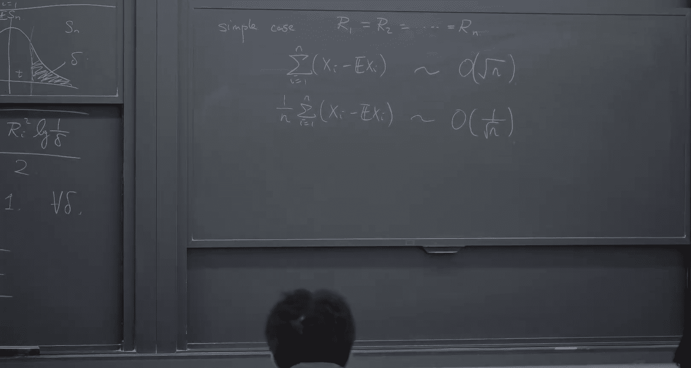
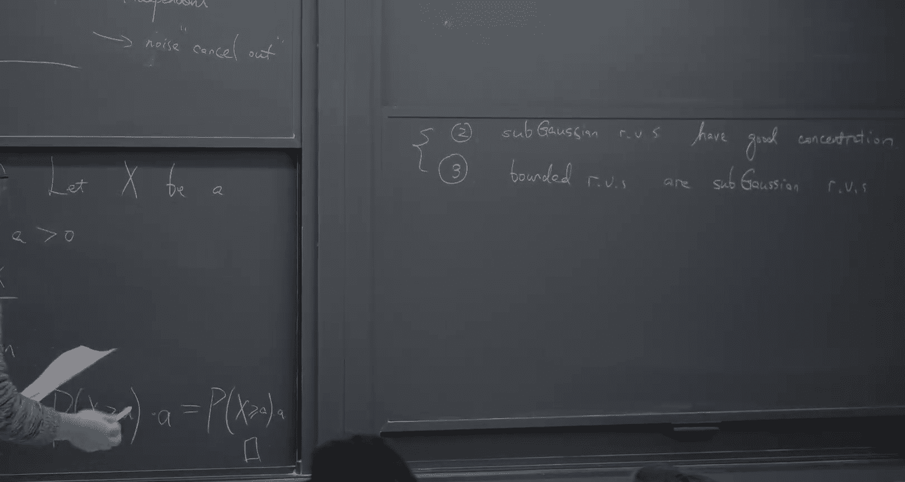

# 普林斯顿大学《强化学习基础｜ECE524 Foundations of Reinforcement Learning Sp24》中英字幕claude-3.7-s p04 Lecture 4_ _ Concentration Inequalities.zh_en -BV1vewWeRE5X_p4-

So the halfing inequality says that X1 to X N。Be independent random variables。

Where was probability 1？I will just use shots so with probability that is w。tp dot。

With probability one that x is bounded， X is sound like a bounded domain， Add AI and BI。And we let。

II donate the length of the。Each interval。And then。We have a。For RT。Gter equal to 0。

And there' a probability。Of summation， X minus Exii。That is the fluctuation of each variable。

 and I sum them together from one to n。We say this fluctuation is greater than T。

 and the probability of this event happen is less than something exponential to the minus2 T square。

Over summation I from 1 to n。I square。And in the last lecture。

 we kind of say this is essentially some tail bound， tail bound， in a sense。

 we're seeing some distribution， which if we look at this summation of X。Ass something like S S N。

 which is I from 1 to n summation。 And this is like the distribution of S N。

And this is an expectation of SN。Where essentially says。The。

 the probability of it goes beyond the expectation plus T。 So this is like offset。

 We're saying the total probability。If the random variable goes beyond the expectation。

 plus a T is like pretty small， is something exped by something exponentially small。

 exponential to the e to the minus T square， something like that。 Okay， so this is like tail bound。

 since this tail probability is very， very small。 So most of the probability mass is like concentrated around the expectation。

 So that's why it's called concentration inequality。So today。

 we will talk about why something like this concentration is actually true。

 So before we're talking about that， I will also just do a slightly transformation of the theorem so that to give some。

Fula， which we will frequently use in the class。So the one very easy thing to do is we can make this probability equal to deta。

 so we just do some change of variable。Let's say we say this datata is defined to be e to the minus2 T square over summation R I squared。

I from one to T。Oh， FR12 n。So essentially， I'm just saying the probability is deta when we when we set the probability equal to deta。

 then we can like we can calculate what is this T like we can express this T in terms of this data。

 So it turns out by doing this， we can easily solve that T is equal to something like。

Square root of summation， I from 1 to n。I square。Log one over deta。Over 2。Okay。

 this is just some change of。Change your variable。So in this case。

 we can immediately get the same result， same hoing bound。

 but written in some slightly different way。So this is a cho。1。We say I'm under the same condition。

As Theorem one。We can see， for any deta。With the probability。At least。1 minus starta。We have。

That summation X I minus Exii， again， this fluctuation。I from  one to n。Is less than。

Square root of summation， iPhone from 1 to N。AI square？Log one over delta。Overto。Okay。

 this is essentially the same thing。So this theorem once is the probability of greater than some threshold is like very。

 very small， so this is essentially with majority probability that is if we get rid of this like low probability events。

 what's with high probability， what happens is this fluctuation will be smaller than something and this thing is basically solved by a change change variable so that make this probability to be deta and then explicitly right out of what this T is。

Yes。What is the meaning with probability want？With probability1 is essentially some some probability statement。

 You can just think with probability1 essentially this this always happened like this this is just like X is always bounded。

 And with probability one minus data is because like this is like probability events like this is a random variable。

 So with some probability， you know， you're gonna end up here。 So this is like tail events。

 So with one minus datata is essentially what we say here。 So like we get rid of this tail events。

 So we say with high probability。 that is So essentially we just make this probability to be deta。

 We're saying once one minus deta probability， we're gonna be smaller than this threshold and this threshold we can't compute this one。

有可。Okay。So I think the benefit of doing this is a lot of times we can just say this data is something like extremely small like 0。

1 or 000。01 or 0。001， something like that and we really want to look at how this sum of fluctuation like scale with n like a scale with the number of samples we have。

 So in this case we can just consider a simple case。

Where we can say if R one equal to R two equal to得 equal to RN。So in these cases like for example。

 all the random variable are identically like like sample from the same distribution in this kind of scenario。

 it will be much easier to see how how those things scales So we can roughly say this summation i from 1 to n X I minus E X I。

 This is the summation of the fluctuation。And we know if this Oi becomes R， its just N R square。

 so that entire skating would be something like squared of。Actually。

 it's like old square random because that's all equal to。And if we consider the average。

This skill is one over a square event。

Okay。So why is this claim like interesting or like a very strong or like it's non trivial。

 So we can think。For example， we can。 we can write out what is this like S N， like how S N。

 how S1 to to S N grows。 So essentially we have， we start from。

So this fluctuation is something like a random work we start from here and then for example。

 I go first here， this is like S1 S1 S1 is like the summation of the first fluctuation。

 and then I go to second like sum of the two fluctuation a summation of three fluctuation。

 so it will be something like that。This is like a random work。

So what we are seeing here is if this is not random， like this this can be correlated or anything。

 then the summation of the fluctuation could be possibly something scale with M。 like for example。

 if everything is one， then the summ is just order n。

But what we are seeing is exactly because this is like random and it's independent。

So this kind of says the fluctuation or the noise can like cancel out each other。

To a very large extent， so that the summation will actually be bounded by some like squared of n curve。

 Like this is squared of n curve。 So the growth of the， the summation of the noise is like。

We're all as a squared of n instead of n。 Okay， So this is like what we claim about the concentration。

 And eventually， we will also say like the mean will converge like this average will converge to mean at one over squared of n rate。

 So that is when n go to infinity， we will actually get infinite close to the。To the expectation。

 which kind of like recovers the law flash number in that sense。Maybe let's write a group in here。

So any questions about this picture so far？Okay， so if not。

 we will start by talking about how we prove the theorem one。So。So essentially。

 this proof of theorem1 will be the most important part of the entire concentration in quality。

 I think the remaining thing we won't go that extensively into the proof。

 And we were just briefly talking about like how to modify this proof。 So this is like the。

AnImportant thing on this probably lasts like。IBelong like we need to do three land landmarks to prove this。

O。So first La is something like pretty straightforward。

 you probably already learn this from the probability class， that is Markov inequality。

It stay that that's X。Be a nonactive random variable。Then。For all。诶。Greateater than zero。

 any scalar a greater than zero。We have probability of x greater than a。Greatter equal to a。

 less or equal to expectation of x divided by a。 I think this is like very elementary。

 you'll probably already learn this。We just do a quick proof。Not much to say。

 this is like also a tail bound， but it's much loose than this one。 Like this is exponentially small。

 but this is just says I'm bounded by some。Some expectation and divided by8。

So the proof is essentially， we say note from the definition of expectation。We have expectation of x。

Is greater or equal to。So essentially we have two parts。One part is great X less than a。

 The other part is x greater than a， greater equal to a。

So what we are saying because the expectation essentially is the integral of the like density of x times time times x itself。

 So what we can do is we can relax all the x in this range。To be0。

 like we lower bound by zero because we know access is an non negative。Now negative random variable。

 Well， in this range， because all x is greater than a。 So I lower bounded by a。 So on both range。

 I'm doing lower bounds。And because we know the first term is like zero， then we kind of go。

Cross it out。 And it basically just we have the second term that is x greater than equal to a and times a。

Which essentially finished this proof。Okay。So although this is also a tail bound。

 but we kind of like know this is like not very sharp， like this is a decrease。

Offsside as t and decrease with e to the minus t squared， but this is offset as a。

 but you're kind of decrease with only one array or something like that。

So well essentially use some techniques to make this inequality like much sharper and eventually were getting something like that。

So the remaining step will be essentially we'll do two things。

So the second step we will essentially say something like well define a newde kind of random variable which call like subgussian random variable。

But like we won't say too much， basically this is defined by some abstract condition。

 we will say this kind of random variable。Have a good concentration。And then the third step。

We will actually say the bounded random variable。Which essentially is the precondition of theorem1。

 which we say all the XR bonded random variables。 So we say bonded random variables are subgsions。

So we will essentially do the remaining proof for splitting into two steps。

So we will first use some abstract condition to say。

 as long as random variable satisfyes some abstract condition called like subgussion。

 and we will have good concentration。 And then then the final step will be say like bond random variable actually is is a class of subgusion random variable。

 It actually satisfied this like abstract condition。

 So that's why like the entire thing goes through。😊，So we will directly go to the Lamma2。

Wehich talk about the second thing。We say that。X1。X， N。To XM be independent random variable。Where。4。

Oreo。蓝的。In R， like any real number。We have the。This is called like a moment generating function。

 The expectation of E to the Lada。X I minus Exi I。Less or equal to。E to the Lada square。

 sigma square， Sigma I square over two。Then。We have the concentration inequality。 That is for R T。

Greatta equal to0。We have the probability。Of summation， I from one to n。Xi minus Exii， again。

 this sum of the fluctuation。Greater equal to T。Is less or equal to。E to the minus T square。Over 2。

Sation I from one to and sigma I squared。So this is essentially corresponding to the first statement。

 And we can see the claim of this Lamma essentially corresponding to what we want in a halfing concentration in Q。

 The only difference like this R is different from sigma I and we have two on the top that have two like at the bottom。

 like in the denominator。 But other than this constant difference is almost the same。 So essentially。

 we will handle this difference in2 and in R and sigma in in the next Lamma。

 But this Lamma essentially says this already have concentration。 And by subgussian。

 we actually means this condition。It's usually the definition of subgausian random variables。

So in this class， because we， we mostly just just need to use like random variables。

 So we won't go that deep in terms of talking about why this is a called sub Gaussian。

 but I will just give intuitive reason why this is like color sub Gaussian。 This is。

 I think the reason is。Its essentially for the tail。 So for this。

 if any random variable satisfy this condition。This is like intuition， we don't do proof here。

If Xi satises subgussian condition。It means like if you look at the distribution of this Xi。

And look at this tail。And it means， essentially means the tail will decay。No slower than e Gaussian。

So it turns out we can formally prove this claim like any variable satisfy this like this inquiry。

We can actually prove the tail will actually decay very fast as I hook。Fass。

 equal or faster than Gaussian。 but we won't go go to that deep like in in this class。

 So this is like just intuition why this is called sub Gaussian。 But essentially。

 you should know like like Gaussian or。Or bonded a random variable。Belongs to subgussion。

The reason is like tail Gaussian tail of Gaussian， definitely like a decayK no slower than Gaussian。

 and the tail of bond variable is very good because bond variable essentially says select。

I I am only in supporting this region。 I have no probability outside this region。 So clearly。

 this tail decays very fast。 So that's why binary variable is also subgussian。 But here。

 like we would just stay abstractly with this condition。 Okay， let's not go deep in terms of like。

 proving everything in that app。Yes。What are the XM Y actions？X and what Y。What are the X and Y Oh。

 yeah， that's very good。 So this is like N and or maybe I， And this is S I。

As I select the summation of the order fluctuation up to step I。

 And this is like a number of step number of random variables you added。

Then is the horizontal line does horizontal line means the expectation of Xon？

No horizontal means summation of X subtracted expectation， so that's why it's means 0。

Yeah so you can think this is like a fluctuation a time step I and this SI is just summation of the fluctuation from the first step to the I step。

 so that's why every step I'm like doing some fluctuation。

 but the fluctuation is independent so they cancel out with each other。Oh so the graph is。

X sign right that as S sign。SI， yeah。As is the sasamation。

So I think like each time this is like if we talk， if we say this difference is K CI。

Then this difference is like Ca C1， and this difference is Ca C 2。 So were kind of sum them together。

 And so that's why it's S。Like this is Ca or something like that。

So the solid bounded bounded lines are S。Bund the lines are like my upper bounds。

This is like I'm saying this will be less than less or equal to a square root n。

 you're saying this one， right， this is like square root square root n line。

Like linear n is like something like that， a square rooting n or something like that。Is this clear？

The steel comes here。Okay， sound good。We'll come back to this again。

 like when we we later talk about another constitution and quote it。Okay， so let's do the proof for。

 for the Lamma。So we start with what we want to prove that is probability of summation i from  one to n。

X I minus exii。G or equal to T。And the first thing we use is this E to the Linuxax。Its monotonic。

For lambda greater than zero。So what we will do is like we just consider whatever Lada is greater equal to 0。

 and we raise everything to the exponential。 So we say this is equal to E to the Lada summation of fluctuation。

Xi minus Uxii。嗯 greater equal to equal to the laity。ラストだ。Okay。

So the good thing about raising to the exponential is now we can actually use the markov in。

 but we're still getting something exponentially decreased。

So this is a next step we use Markov inequality。By Markov in party on the top is the expectation of what we we have。

 That is the E to the。Lda summation， I from 1 to n。X I minus yeah X I。AndIn the denominator。

Is what we have that E to the Lada T。Okay， essentially， we just consider。This whole thing is a new X。

 This whole thing is a new A， and we applied the microality， and we get this bound。

So next step is the most important step here， and you will see the reason why we want to consider this moment generating function。

 And the reason is we can。Essentially， make this equal to。Pi。IPhone 1 to n。

 that is a product of iPhone 1 to n。Expectation。Of E to the land。X I minus E X I。

I think we first need to say like we have expectation outside。And e to the Lada T。

Like the first step is we notice by the exponential we know the summation。

 we can pull summation outside to make it a product。

And the next thing we're going to use is for independent X and Y。We actually notice EXY。

The expectation of x times y is equal to expectation of x times expectation of y。

 This is the most important property of the independence we're going to use。

So that's why we can actually push this expectation inside the product。 Okay。

 just because we use the independent。Independence， so we can push it inside， use independence。

So once we push inside like the entire thing becomes very easy。

 this like just exactly corresponds to our precondition。

 which is expectation of this moment generating function， we say this is upper bounded by this。

So after we push it inside， we use the precondition of the subgussian randomner variable。

 We say this is less equal to e to the。Minus Lada T， which we copy from the denominator and then。

Plus。Lda square。Sation。Sigma I square I from a sigma I squared I from 1，2 N。Over 2。这 is like基图的。

So everything。Everything is on the exponent。This is like pretty straightforward。

 it's just so we plug in the preconognision of subculsion random variable。嗯。Okay。

So we start from what we want， and we already reach here。

 The only thing we need to do is now we still have additional Lada here。

 And but the good thing is that we can， we can make Lada to be anything。

 So that's why the final step is we just optimize over Lada and then。

Then we can get the tightest bound we want。 So to optimize over Lada。

 it's it's relatively straightforward。 I won't go into details because this is like a second order polynomial。

 and we all know how to optimize over second order polynomial。

 So it turns out we can pick optimal Lada。That is equal to。Tea over。

Sation of sigma I square iPhone1 to N， which corresponding to the landda that will minimize this probability。

So that we will have。This。P of。I from one to n。X I minus U Xi。回头 equal equal度T。Its less or equal to。

E to the minus Lada star T。And plus。Learn by star square。

Smission I from one to a sigma I square over 2， and which you plug in and calculate it out and it's exactly equal to e to the。

Minus T square。Over two sum。す个 my。Okay， and this finished the proof。

So now you have more idea of why we want to make some preconditional like that and like call this like subgussian and it's exactly because we want to use independence and one way we very easily use independence is like raise this summation to the exponent so that we can make this summation to become a product and once we have the product structure we can use the independence。

And then everything just follows through。 So that's why it's naturally just to assume something expectation of。

of this x in the exponent， and we just make this sub subcus。Okay。So the final step is the Lama 3。

As we will say， like we kind of assume this abstract condition and then we need to still to verify that Bo random variable actually satisfy this abstract condition。

This is what we will say here。We say if x。Is it random variable？Where。X is in。

A range of a to B with probability 1。And。R equal to B minus a is the range。The lens。

 the lens of the interval。Then。We have a。The expectation of E to the lambda x minus E X。Essentially。

 this is like a moment generating function with say this is less or equal to。e to的兰da。

Square R square。Over 8。For any land in our。This is our third claim that founded random variable actually satisfied the actual condition。

 which we call subgussion。With with precisely this sigma I is equal to like R over2。

 something like that。Any questions so far？Or if you have any questions about any step of derivation。

 you're never clear， I can explain it again。So the final Lama is is would be relatively straightforward。

 It it's about single random variable。 So there's not really much about the like cancellation noise going on。

 It's just。Essentially by brute force computation， because this is just a single random variable and you want to prove some expectation is less than some quantity。

So we will just do the calculation that。So for convenience notation simplicity plastic。

 we define Z is equal to the mean zero version of x。So we define z equal to x minus EX。

So we also define a function， Lada。赛lon特赛lon的。I that。Plus island is equal to。The log。Of expectation。

E to the power of lambda x minus E X。Which is equal to， like， log。E to the land Z。Essentially。

 this is a moment generating function， but we take a log outside。

So it's a log moment generating function。we can use the Taylor theorem。Or like Taylor expansion。

We say this Poai landnda。It's equal to。Ps 0。Plus， pluss prime 0。Lda per prime 0。

 And plus the second order approximation with like Taylor Taylor expansion with second order remainder is Lada square over two times the second order delivery of pers。

 And the only difference is now is not no longer evaluated 0， but evaluated Lada prime。

 So that Lada prime is something like in 0 and Lada。Some intermediate point。

So we note this what we want to bond， essentially， is。Like this poseai is just the log of objective。

 So as long as we can have some upper bound on Poai， we already like finished the Lama。

 So this is what are we gonna do next。Essentially， we want to bound this per， Poai Lada。😊。

So to use this theorem， we need to calculate what is like the gradient and the second order derivative of this peres。

 So I will just do the calculation for you and。We start from precises of this and you take derivative over Lada。

And you can actually do the calculation， which you see the gradient is equal to the expectation of E to the lambda Z。

Times Z。Over to the landda Z。This is the gradient。And this is second audit route。This is equal to。

Expectation。Of E to the landda Z。Divided by expectation of e to the Lada Z。Is a square？Subtracted by。

Expectation of E to the lambda Z。谢。Subtracted by this is like a for front and subtracted by E to the。

Lda Z。Over expectation of E to Lada Z。Z。Does the entire thing square。

So the reason we want to do this Taylor expansion is because first。

 we immediately notice this precise size0。I's just we plugging lambda equal to 0。

 which e to the 0 is like 1。 So log 1 is 0。 So precise 0 is equal to 0。 So the first term is gone。

 And then the second term， precise prime 0。Its also， again。

 we put lambda equal to 0 here and this becomes  one。 this becomes  one。

 Its just equal to expectation of Z。And we note this z is defined to be mean zeros。

 Z is defined to be x minus e to the x。 So this is， again， equal to 0。

So all we need to bond is the third term。 That is the second order derivative of this p。

So in order to bomb the second audit directoral precisees， we need to look at those terms。

 like those seemingly very complicated terms。But let's， for example， look at this term。Okay。

 let's call this term star。So in the sense of， let's say if it's a continuous random variable。

So with say star is actually equal to the integral。Of we have the density function of Z。Times。

E to the landda Z。And divided by， again， the integral of the density Z and E to the landda Z。Di。

And we have additional z here， so with times z。Dy。So one very smart observation is we can actually bundle those things together。

Well make this theme。A new density， like pet z。So we know Pudto is also a density function。

Probability density。Because two things。In order to check his probability。

 we only need to check two things。 One is the P Theta Z is greater than 0。

 greater equal to0 for any z。This is like obviously true because we it's， it's density time。

 something non negative。 So this is always true。 And the second thing， we need this。

Like we need to this do this integral over the density， and that's gonna summation equal to one。

And this is also very straightforward because we can， if we define this as a Ptta。

 and then when we do the integration， we essentially just integrating the numerator part。

 and eventually that's exactly equal to the denominator。 And so that's equal to one。

So this essentially means。This P， this land double prime。

 this technology derivative of perses is actually equal to the expectation。Like。

 you can also do the similar trick for the first term， and it becomes some new expectation of the。

 the square。Divided by expectation of Z。Square。This expectation is taking expectation under new distribution。

P貅的。Okay， and this just becomes the， you know， this is like the variance。 Now。

 this is just equal to Etda。Z minus一qda。Square。Okay， this， I think， is pretty elementary。

 You can expand it out and。Then this is equal to this。

So now the good thing about this is we know this is just expectation of something bounded because Z is bounded。

 expectation of Z is bounded， so this difference is also bounded。

So we know very straightforwardly because Z is in some range that is like at most R。

 So Z minus E Z is at most R。 So the one obvious upper bound is like R squared。But you can actually。

By careful analysis。You can actually do better， You can actually do a tighter bound。

Which we will actually say this is less so equal to。A square over4。

 so we can get a constant improvement。So for most of this class， constant doesn't matter。

 so we'll actually leave this to homework。So where more down。

So just to recap what we have been doing so far， were essentially says we start from the precise Lada and we do ater expansion and first term is 0。

 second term is 0。 and third term we kind of already get the upper bounds。

 So we say this is upper bounded by Lada square divided by divided by  two times r square divided by4。

 which is Lada square R square over 8。Okay。And we note this Poai Lana is exactly the log of what we want to upper bound。

 So if essentially we just take exponential on both side and we finished the proof。Yes。

 any questions？That comes from that term what happened the side plan zero here yeah。

 it's equal to zero yeah。Why is expectation of z equal0 because we define z to be the mean zero version of x。

Yes， so Tilda expectation is。あ。Calculate with。P。PO的PO的也。Yes。Yes。Yes。

 I think this stuff essentially we just change a distribution from P to P to。Yes。

 what's the general intuition or reason why we？Calculating or proving all these dilemmas。

I think the reason is， as I said， I think the third one is like a bit about blue force calculation。

 And we can see from the second Lamma， looking at some moment generating function is like very natural when we handling this summation of independent random variables。

 right， because I think last time I wrote here， like we essentially to use independent property。

 We need to we， we need to look at the product of a random variable instead of a summation of random variable variable。

 summation of independent random variable， right？ So it's very natural to raise it to the exponent。

 So the summation become the product。😊，So that's why I found a second Lamma it's pretty easy to see why we care about some quantity like that。

So third one is essentially the bridge essentially says I want to prove the bunny random variable actually satises something like this so that we finished the hoing quote。

Okay。So all of this is to。Of this is just two proof5。That's good。So eventually， I think the。

I don't need say too much about the proof of hoing in quality。

We're essentially preparing our Lamma to， to prove the half the inequ。

 essentially just the Lamma 2 plus Lamma 3。Like Lamma 2 says subgussian random variable has concentration。

 and Lama 3 says boundary random variable are subgulussion。 So that's clear。

 Bo random also have concentration， and that's finished proof。Greatect。

In case you feel like this proof is like pretty complicated and or。

You cannot very follow it it's okay like you can go back to take a look and on the other hand。

 like when we continue the lecture， we don't really really need dis proof like all we need is we want to use the halfing inquiry So so like the theorem statement and the core is the most important part like we would repeatedly use it when we do the learning scenario and this is just to back up why some constitution inquiry like that is true。

Okay。So， yes， I。The side of Pan is always like a than there。Sorry， could you say again？

The second ama is what？他所谓 I。这 third再来吗？ preciseside precise yeah。Combacks。The function precise conx。

但系但系。It's always better。Second order derivative is always greater equal to 0。 that is true， yes。Yeah。

That's a good comments here。Yeah， thank you。Could you explain again why when you use Taylor's theorem。

 the first two terms are centered at zero and the second or not the thing。Yes。

 I think so the question is why the first two terms are at zero and third terms is at some intermediate point。

 I think this is this is essentially the in the calculus when you do the tailor expansion。

 typically you need to expand to the infinitefinous order right It's not like you trunccate at a second order。

 You need to have third order， fourth order and something like that。 then you can expand as0。

 So what we use here is we don't want to like do the calculation for the third order first order that's like too much。

 So we use a second order remained the version of Taylor is saying like if you trunet at a second order and you don't look at third order。

 then the last term is no longer center as0， but center as some intermediate point of0 and it can be。

Anything。Yeah， yeah。Okay。So if no further question about Hfting inequ quality。

 we will just briefly talk about the second concentration inequality and we finish the random variable part。

Independent random variable part。So the theorem tool。It's so called， for instance， included。

So this is still an independent random variable， but I think in sometimes in the lecture and homework we will use this inequality because this inequality in some scenario is actually tighter than hoings inequality。

So let again， let X I。The independent random variable。And with probability 1。We have， again， sponage。

Let' just say this difference is bounded by R。Does not care about the constants。

And I think the only difference is in a brain inequ quality， we have a one additional condition。

 which can be stronger。 We actually says the variance of each X is bounded by sigma squared。Then。

For R。Great zero。We again have the concentration in quality。That is the。Pability。

Of the summation of the fluctuation。X I minus U Xi。规 to equal to T。Its less or equal to。

E to the minus t square。Two times the summation of iPhone1 to N。Sigma square。Plus2 over3 R T。

So we no longer do the proof for when instance inequality is a little bit involved。

 but I think this kind just only requires you to be able to use this kind of concentration inequality。

So we can think this is like a slightly stronger condition。

 which says it's not only a random variable with bounded radius R。

 but it also has some variance bound sigma I， and potentially the brainstone will be much sharper if the sigma is much smaller than this R。

Okay， in that case， we will have concentration in quality。

 which basically everything is same except that the denominator slightly modified。

So it will be much easier to see what is the modification in the other term。 So we can。

 we can again make this。to be蓝的啊to be deta。So the brain inequ quality is again。

 equivalent with probability， at least。1 minus startta。We will have the following， that is。Smation。

I from one to n。X I。Minus Exii。It's less or equal to some constant C。Times。

Sation sigma I squared I from one to n。Bg1 over third。Plus， r times。logg完 word。Again。

 this is just some change of variables。 you can make this Lada and you can express T in terms of you can this you can express T in terms of data and you will get this bound。

 This is a burn concentration in quality。This is B instance。

And if youll still remember the halfing concentration inequality。Tells you everything is the same。

 but the halfings included on the right hand side is something like this。

 something like summation of。I from1 to n R square。logg one over点 tongue。Yes。

C is just some constant like 10 or something， absolute constant。Yeah。

 I think a lot of times we don't really care about the exact constant。 So we will just look at how。

 how everything scale with and， how everything is。So we can already see the major term of those two things。

 except this like a low order term。 The major term is this term and this term。

 because this term will grow with square root of n。 this is like sumation of one to n。

 So this is like something scale with n。 So when take square root， this square of n。

 and this is also square root n term。 So we will see the brainton square root n term actually only scale with the variance。

 Well， the hing like a square root n term scale with the entire bound。

 So when the variance is much smaller than the bound， the burnton will be sharper。

So we can take a look at one example， quick look at one example。Example is like unfair cointos。

So we just say for each X。Is sampled from Bnoli Pi。That is with probability of P。

 which essentially says that's equal to one with probability P。And。

Equal to 0 with probability 1 minus P。So in this case， we can see the bound on like X is bounded。

 but the range radius is r is equal to1。But we can also compute the expectation and variance。

 So the expectation is only equal to P。And the variance of x。Is equal to something P times 1 minus P。

And is upper bounded by P。We看是谁s的外P。So in this case， in half in。

We can only say something like1 overd of n。1 over n。Average。

The difference between average and its expectation。It's upper bounded。By this term， divided by n。

 because this is like a summation of the fluctuation。

 What we look at there is the average fluctuation。 So everything is divided by n。

And we plug in this r equal to one。So what we get is something like C times。Log one over delta。

Over and。This is what we got front Hing in quality。But if I bring inality。

We can actually plug in the variances equal to P here。And we just divide by everything by n。

 so we actually get something like one of us n。Sation I from one to N X I， subtract by P。

Is less or equal to。屎。😊，Times square root of P times log1 over delta over n。Plus， log1 over delta。

Over and。We know the second term is the lower order term。Well。

 the first term is the leading order term。And if we compare the leading our term of the two concentration in。

 we notice the brain in has additional P there。So this kind of concludes that。

If P much less than one。Then print brain quote is a lot better than。D hoing。Okay。

 any question about the statement of inequality or this comparison？So if not。

 I think finally I want to talk a little bit more about。Another extension。

 like not only being sharpper， but like how are we're going to relax the independent condition。

So this is what we're going to use eventually in a reinforcement setting。 that is。

Concentration inequality。For Martininggo difference or from。Martinale。

So don't be scared by the words and eventually you will feel these concepts like pretty intuitive and the concentrationality we derived for Martin goal will be almost identical to the concentrationequ we get from independence so you can think this is like a generalization of independence。

So I will first talk about the intuition of what kind of thing is like Martin goal and why and something is not like independent but Martin goal。

So I think intuition about Martin goes is， for example， we have like Ca C 1， Ca C 2， Cay da Cay。ca是嗯。

So independent really just says the randomness here and the randomness here is like a completely independent。

 they are not correlated。 Well this kind of concentration is like a lot easier。

 but a lot of times in like sequential decision making and reinforcement learning this is really a luxury I think a lot of times it doesn't holds so that's why like we want something like generalization of independence。

 we want something weaker than independence so that it holds in the sequential decision making。

 but somehow still have good concentration。So intuitively， the Martin goal is。

Is something like if we want to look at again， summation of this Q CI。And the ksia。

 the the independent， the each cas I is no longer independent。 but we have something like。

We have some condition like this。 That is the expectation。Of PCI。Condition on everything in the past。

So this is a little bit abstract， but you can think of one various。

Easy scenario of the past is basically just Ky I -1 kill Ki 1。

So this is everything happened in the past。So we're seeing conditional everything in the past， like。

 for example， this means equal to 1， this equal to minus-1， this is equal to something else。

 like whatever condition on this。And I have this equal to 0。Then we will call Epsili。Then this。

 this epsson I is called like this， this sequence of Epssoni。It's called mar difference sequence。

So we will come to the like a rigorous definition later。 But this is。

 I want to first talk about the intuitive understanding of what is like Martino。

 Martino essentially is。Saying I no longer care about whether HI is independent。

 but I care about when I condition on what happened in the past。My neo randomness。

 Casi is means zero， okay， this is very important to me。

So let's look at an example to see what is difference between independence of this and this like Martino kind of thing。

So， for example， we can look at the。Like a sequence of length2， like n equal to2。

 which is like to showcase what is the difference。So let's say we have a two in the length of two case。

We have like two random variable that is Ca1 and Ca2。So let's see Cas 1 takes two value。

 That is -1 and1。 and Cas C 2 takes three value。 That is -1，0 and1。So the joint probability。

Or maybe not let's not talk about joint probability。 Let's talk about the conditional probability。

Of P可 say two。Condition on Cay1。This is the table for condition and probability。That is。0。5。0， 0。5。

And 0，1，0。So we clearly know this P Cacy 2 conditional cosi1 equal to1。Its not equal to。Pix32。

Conditional co 1 equal to -1。Because one distribution is 0。50，0。5。 The other distribution是5010。So。

 this clearly says。Ca C1 is not independent of Cai 2。O， because condition on different。

Value of Ca C 1， My distribution of Ca C 2 actually can be different。

 so they are not no longer independent。But the good thing about that is we can look at expectation。

Of cur you， too。Conditional could one equal to one。And we can also look at expectation of Cass2。

Conditional co one equal to -1。If you look at both of them。They are equal to0。

This is essentially corresponding to this equation that says if we look at expectation of Ca 2。

 no matter what happens in the past， this is equal to0。

 which corresponding to this exactly is2 equality。So this somehows this a Ca C 1 and Ca C 2。

Is actually。Mart can go different sequence。So in the previous picture of concentration。

 like in the independent variable case。Let's say， for example。

 if we look at the summation of iPhone1 to n K CI， and those are independent。And let's say， the。

The expectation of CassI is equal to 0。 Let's just say this is like mean mean0 random variable and it's independent。

 We already have the picture。That essentially， if we track the summation， it becomes a random work。

 So first up， we're going go up by Ca C1。And the second step we're going to probably go down or go up by Ca2。

And then third step we're going to go up or go down by Ca3， and then four step will go by Ca C 4。

 And but we will see because they are independent。 So a lot of noise is going to cancel out and eventually just become some random work。

And we say the concentration include economic， this random work， if you look at the summation。

 its like bounded by square of n with high probability。

So what are we gonna say in the particle concentration inequality is。

We actually no longer need this independence。 We can replace this independence by Martin goal difference。

To be Martino。The only difference about this independence marking goal is now， for example。

 one trajectoryjectories look like this， and we end up here。 This is like K C T Ca C N。

So for example normal， Ca T and some other trajectory like goes up here。 And then we end up here。

 This is like Ca C T。 This is like second trajectory。

So what we are seeing now they are not independent because this distribution can be different from distribution。

 like in this case this can be like 0。5 equal to 1，0。5 equal to minus1。

 and this can be with probability 1 equal to 0， so the distribution actually depends on the past history。

But the most important thing is the expectation of the new random noise conditional the pass is always equal to0。

And as long as this particle like condition is actually holds。

 we can also get the concentration inequality。Okay， and this is what we will actually。

See in the next lecture。 Yes， question。 wondering when the homework will be posted homework first homework will be posted by next Monday or two Tuesday。

 Yeah， or next week。Okay， and this ends of lecture today。

