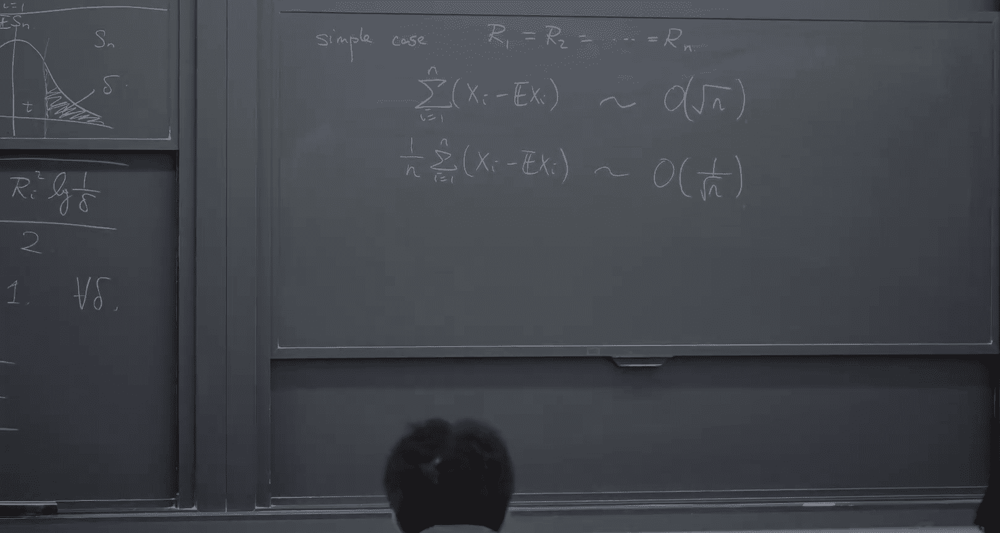
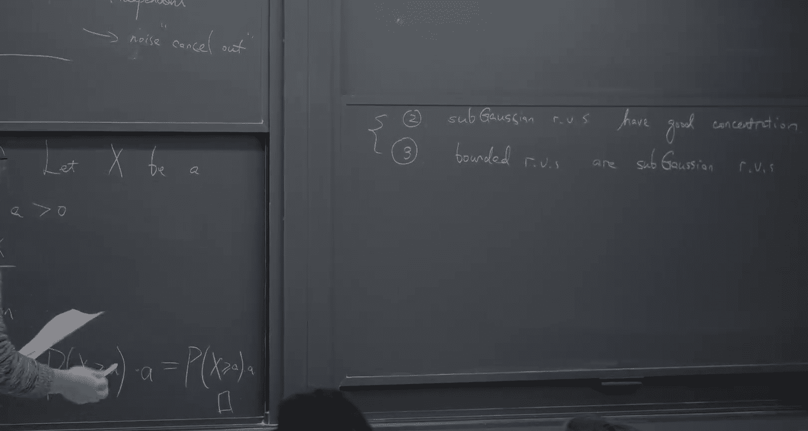

# 强化学习基础：4：集中不等式

在本节课中，我们将要学习集中不等式，特别是霍夫丁不等式和伯恩斯坦不等式。这些不等式描述了独立随机变量之和与其期望值之间的偏差概率，是理解强化学习中样本效率与置信度的重要数学工具。我们将从直观理解开始，逐步深入到证明的核心思想。

## 霍夫丁不等式

上一节我们介绍了集中不等式的概念，本节中我们来看看一个经典且重要的不等式——霍夫丁不等式。

**定理一（霍夫丁不等式）**：设 \( X_1, \dots, X_n \) 是独立的随机变量。以概率1保证，每个 \( X_i \) 被限制在区间 \([a_i, b_i]\) 内。令 \( R_i = b_i - a_i \) 表示每个区间的长度。那么，对于任意 \( t \geq 0 \)，有：

\[
P\left( \sum_{i=1}^{n} (X_i - \mathbb{E}[X_i]) \geq t \right) \leq \exp\left( -\frac{2t^2}{\sum_{i=1}^{n} R_i^2} \right)
\]

这个不等式本质上是一个尾概率界。如果我们把随机变量之和 \( S_n = \sum_{i=1}^{n} X_i \) 看作一个分布，那么它告诉我们，\( S_n \) 的值超过其期望值 \( \mathbb{E}[S_n] \) 加上一个偏移量 \( t \) 的概率非常小，呈指数级衰减。这意味着大部分概率质量都集中在期望值附近，因此被称为“集中”不等式。

我们可以通过变量替换，将这个定理写成另一种更常用的形式。

**推论一**：在定理一的相同条件下，对于任意 \( \delta > 0 \)，以至少 \( 1 - \delta \) 的概率，有：

\[
\sum_{i=1}^{n} (X_i - \mathbb{E}[X_i]) \leq \sqrt{ \frac{\sum_{i=1}^{n} R_i^2 \cdot \log(1/\delta)}{2} }
\]

这种形式的优点是，我们可以直接设定一个很小的失败概率 \( \delta \)（例如 0.01），然后计算出偏差的上界。

为了理解这个结论的强度，我们考虑一个简单情况：假设所有 \( R_i \) 都相等，即 \( R_i = R \)。那么偏差的上界大致为 \( R \sqrt{n \log(1/\delta)} \)。如果我们看平均值：

\[
\frac{1}{n} \sum_{i=1}^{n} (X_i - \mathbb{E}[X_i]) \leq \frac{R \sqrt{\log(1/\delta)}}{\sqrt{n}}
\]

这个结论的有趣之处在于，尽管每个随机变量的波动可能达到 \( R \)，但 \( n \) 个独立波动的总和，其增长速率仅为 \( \sqrt{n} \)，而不是线性的 \( n \)。这是因为随机性和独立性使得波动可以相互抵消。随着 \( n \) 增大，平均值以 \( 1/\sqrt{n} \) 的速率收敛于期望值，这实际上是大数定律的一种体现。

## 定理一的证明思路

接下来，我们探讨霍夫丁不等式为何成立。其证明是理解集中不等式的核心，我们将分三步进行。

### 第一步：马尔可夫不等式

我们从一个更基础的不等式开始。

**引理一（马尔可夫不等式）**：设 \( X \) 是一个非负随机变量。那么对于任意标量 \( a > 0 \)，有：

\[
P(X \geq a) \leq \frac{\mathbb{E}[X]}{a}
\]

这个证明非常直接。根据期望的定义，并利用 \( X \) 的非负性，我们可以将积分区域拆分并分别进行下界估计，最终得到上述不等式。马尔可夫不等式也是一个尾概率界，但它比霍夫丁不等式要宽松得多（衰减速度为 \( 1/a \)，而非指数衰减）。我们将使用一些技巧来加强这个不等式。

### 第二步：次高斯随机变量的性质

证明的核心是引入“次高斯随机变量”的概念。如果一个随机变量满足某种矩母函数条件，我们就称它为次高斯的。

**引理二（次高斯随机变量的集中性）**：设 \( X_1, \dots, X_n \) 是独立的随机变量。如果对于任意实数 \( \lambda \) 和每个 \( i \)，都有：

\[
\mathbb{E}[\exp(\lambda (X_i - \mathbb{E}[X_i]))] \leq \exp\left( \frac{\lambda^2 \sigma_i^2}{2} \right)
\]

那么，对于任意 \( t \geq 0 \)，有：

\[
P\left( \sum_{i=1}^{n} (X_i - \mathbb{E}[X_i]) \geq t \right) \leq \exp\left( -\frac{t^2}{2 \sum_{i=1}^{n} \sigma_i^2} \right)
\]

这个条件（矩母函数有界）通常被用作次高斯随机变量的定义。直观上，满足这个条件的随机变量，其概率分布的尾部衰减速度至少和正态分布一样快。正态分布和有界随机变量都属于次高斯随机变量。

以下是引理二的证明概要：

1.  **利用指数函数的单调性**：对于任意 \( \lambda > 0 \)，有：
    \[
    P(S_n \geq t) = P(\exp(\lambda S_n) \geq \exp(\lambda t))
    \]
    其中 \( S_n = \sum_{i=1}^{n} (X_i - \mathbb{E}[X_i]) \)。

2.  **应用马尔可夫不等式**：
    \[
    P(\exp(\lambda S_n) \geq \exp(\lambda t)) \leq \frac{\mathbb{E}[\exp(\lambda S_n)]}{\exp(\lambda t)}
    \]

3.  **利用独立性和矩母函数条件**：由于 \( X_i \) 独立，指数函数的期望可以分解为乘积：
    \[
    \mathbb{E}[\exp(\lambda S_n)] = \prod_{i=1}^{n} \mathbb{E}[\exp(\lambda (X_i - \mathbb{E}[X_i]))] \leq \prod_{i=1}^{n} \exp\left( \frac{\lambda^2 \sigma_i^2}{2} \right) = \exp\left( \frac{\lambda^2 \sum_{i=1}^{n} \sigma_i^2}{2} \right)
    \]

4.  **优化参数 \( \lambda \)**：将上一步结果代入，得到：
    \[
    P(S_n \geq t) \leq \exp\left( -\lambda t + \frac{\lambda^2 \sum_{i=1}^{n} \sigma_i^2}{2} \right)
    \]
    这是一个关于 \( \lambda \) 的二次函数。选择最优的 \( \lambda^* = t / (\sum_{i=1}^{n} \sigma_i^2) \) 来最小化这个上界，最终得到：
    \[
    P(S_n \geq t) \leq \exp\left( -\frac{t^2}{2 \sum_{i=1}^{n} \sigma_i^2} \right)
    \]

证明的关键在于通过取指数将求和转化为乘积，从而利用独立性。矩母函数的条件正好为此提供了便利的上界。

### 第三步：有界随机变量是次高斯的

最后一步，我们需要证明霍夫丁不等式中的有界随机变量满足次高斯条件。

**引理三**：如果随机变量 \( X \) 以概率1落在区间 \([a, b]\) 内，令 \( R = b - a \)。那么对于任意实数 \( \lambda \)，有：

\[
\mathbb{E}[\exp(\lambda (X - \mathbb{E}[X]))] \leq \exp\left( \frac{\lambda^2 R^2}{8} \right)
\]

这个引理的证明涉及一些计算。核心思想是定义 \( Z = X - \mathbb{E}[X] \) 和函数 \( \psi(\lambda) = \log \mathbb{E}[\exp(\lambda Z)] \)。通过对 \( \psi(\lambda) \) 在 \( \lambda = 0 \) 处进行二阶泰勒展开，并利用 \( Z \) 的有界性来 bound 其二阶导数，最终可以证明上述不等式。常数 \( 1/8 \) 可以通过更精细的分析得到。

结合引理二和引理三，并令 \( \sigma_i^2 = R_i^2 / 4 \)，我们就完成了霍夫丁不等式（定理一）的证明。

## 伯恩斯坦不等式

上一节我们完成了霍夫丁不等式的证明，本节中我们来看看另一个重要的集中不等式——伯恩斯坦不等式。它在某些方差较小的场景下能提供更紧的界。

**定理二（伯恩斯坦不等式）**：设 \( X_1, \dots, X_n \) 是独立的随机变量。以概率1保证，\( |X_i - \mathbb{E}[X_i]| \leq R \)。此外，假设每个 \( X_i \) 的方差有界：\( \text{Var}(X_i) \leq \sigma^2 \)。那么，对于任意 \( t \geq 0 \)，有：

\[
P\left( \sum_{i=1}^{n} (X_i - \mathbb{E}[X_i]) \geq t \right) \leq \exp\left( -\frac{t^2}{2 \sum_{i=1}^{n} \sigma^2 + \frac{2}{3} R t} \right)
\]

同样，我们可以将其转化为高概率形式：以至少 \( 1 - \delta \) 的概率，有：

\[
\sum_{i=1}^{n} (X_i - \mathbb{E}[X_i]) \leq C \cdot \left( \sqrt{ \sum_{i=1}^{n} \sigma^2 \cdot \log(1/\delta) } + R \cdot \log(1/\delta) \right)
\]

其中 \( C \) 是某个绝对常数。

伯恩斯坦不等式与霍夫丁不等式的主要区别在于主导项。霍夫丁不等式的主导项涉及范围 \( R \)，而伯恩斯坦不等式的主导项涉及方差 \( \sigma^2 \)。当方差 \( \sigma^2 \) 远小于范围 \( R^2 \) 时，伯恩斯坦不等式能给出更紧的界。

考虑一个不公平硬币的例子：设每个 \( X_i \) 服从伯努利分布 \( \text{Bernoulli}(p) \)，其中 \( p \) 很小。
*   **范围**：\( R = 1 \)。
*   **方差**：\( \text{Var}(X_i) = p(1-p) \leq p \)。

应用两个不等式到平均值 \( \frac{1}{n}\sum X_i \) 上：
*   **霍夫丁不等式**给出的界约为：\( \sqrt{\log(1/\delta) / n} \)。
*   **伯恩斯坦不等式**给出的主导项约为：\( \sqrt{p \log(1/\delta) / n} \)。

当 \( p \ll 1 \) 时，伯恩斯坦不等式的界明显更优。

## 鞅差序列的集中不等式

到目前为止，我们讨论的集中不等式都要求随机变量相互独立。然而，在序列决策和强化学习中，独立性往往是一个过强的假设。本节中，我们来看看如何将集中性推广到一类称为“鞅差序列”的依赖变量上。

直观上，鞅差序列放松了独立性的要求，但保留了一个关键性质：在给定过去所有信息的条件下，下一个随机增量的期望为零。

**定义（鞅差序列）**：一个随机变量序列 \( \epsilon_1, \epsilon_2, \dots \) 被称为鞅差序列，如果对于所有 \( i \)，都有：
\[
\mathbb{E}[\epsilon_i | \epsilon_1, \dots, \epsilon_{i-1}] = 0
\]

这意味着，尽管 \( \epsilon_i \) 的分布可能依赖于过去的值（即不独立），但它的条件期望总是零。这可以看作是“无偏噪声”的条件版本。

考虑一个长度为2的例子：
*   \( \epsilon_1 \) 以相等概率取 -1 或 1。
*   \( \epsilon_2 \) 的分布依赖于 \( \epsilon_1 \)：
    *   若 \( \epsilon_1 = 1 \)，则 \( \epsilon_2 \) 以 0.5 概率取 -1，0.5 概率取 1。
    *   若 \( \epsilon_1 = -1 \)，则 \( \epsilon_2 \) 以概率 1 取 0。
显然，\( \epsilon_1 \) 和 \( \epsilon_2 \) 不独立。但是，计算条件期望：
\[
\mathbb{E}[\epsilon_2 | \epsilon_1 = 1] = 0, \quad \mathbb{E}[\epsilon_2 | \epsilon_1 = -1] = 0
\]
因此，这个序列满足鞅差序列的条件。

重要的是，对于鞅差序列，我们仍然可以证明类似霍夫丁不等式的集中性。其证明思路与独立情形类似，但需要将期望的条件性质考虑进去。最终得到的界在形式上与独立情形非常相似，这使我们能够在更一般的强化学习设定中使用这些强大的工具。

## 总结

本节课中我们一起学习了集中不等式，这是分析随机算法性能的基石。
1.  **霍夫丁不等式**：为有界独立随机变量之和提供了指数尾概率界，表明波动以 \( \sqrt{n} \) 的速率增长。
2.  **证明核心**：通过马尔可夫不等式、次高斯随机变量的矩母函数条件以及有界变量属于次高斯类这三步完成证明。
3.  **伯恩斯坦不等式**：在已知方差信息时，可以提供比霍夫丁不等式更紧的界，特别是当方差远小于变量范围时。
4.  **鞅差序列**：将集中性推广到一类不独立但条件期望为零的序列，这为分析强化学习中的序列依赖性奠定了基础。

理解这些不等式及其背后的思想，对于后续学习强化学习中的置信区间、探索-利用权衡等概念至关重要。